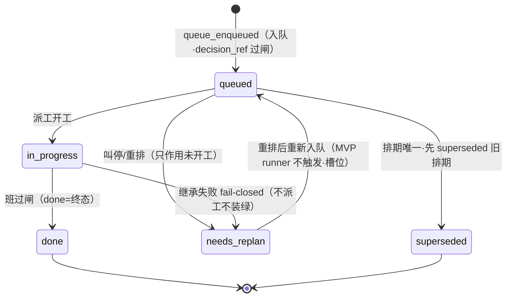

> **口径**：本卡话术/命名遵循《[00-话术统一口径正本](../00-话术统一口径正本.md)》（拍板#312）——双名制首现双写·撞车词带消歧（窗票/工序票·判色/判分）·两层口径 L1 车间（票级）/L2 派工台（窗级）。
> **消歧（本卡·L1·口径正本 §3）**：「票」＝**工序票**（拆单机产物·十一态施工账——非 L2 窗票）；本卡为 L1 波次排期账（五态）。

# 状态机卡 · 夜车波次状态（排期账本五态）

## §0 一句话

**解决什么**：把夜车内「一波（一版）」的排期生命周期画成图——queued/in_progress/done/superseded/needs_replan 五态+合法转移表。**为什么存在**：夜车多波逐版串行，每版的排期推进必须有机器可校验的转移表——「继承失败不装绿」（fail-closed 转 needs_replan）这类纪律全在转移表里（源=queue-ledger.ts 逐格抄录）。**边界**：gate 判定事件不在本五态账（在 queue-events 行车记录仪·拍板#35 读侧正本）；层级口径（会话用语 v1.2 拍板#36）：票→波/批次→里程碑实施→完整夜车。

## §典型事件链

| # | 事件 | 锚 |
|---|---|---|
| 1 | 实物班：queue-40 班 ledger 11 行（enqueued/entry_state 两事件型）——W-041 逐行实勘，五态推进有真账可重放 | `90-过程/执行台账.md:583` |
| 2 | gate 接缝实物：queue-40 班 gate 事件（passed/failed 落 queue-events·EXIT=1 投影在 queue-summary） | `runs/.queue-roots/queue-40/queue-summary.md:3`+`queue-events.jsonl:1` |
| 3 | 转移表源：QUEUE_TRANSITIONS 逐行=`ts/src/queue/queue-ledger.ts:18`——非法转移留痕 rejected 不影响末态（`:24` 语义） | 本卡文字投影表 |

> **源标注（防重复四规）**：本卡五态与转移表的**唯一源=`ts/src/queue/queue-ledger.ts`**——五态枚举（`ts/src/queue/queue-ledger.ts:13`）与合法转移表（`ts/src/queue/queue-ledger.ts:18`）。层级口径（会话用语·v1.2 拍板#36）：票→波/批次→里程碑实施→完整夜车；本卡「波次」=manifest `versions[]` 的一版（一个夜车内的多波逐版串行）。叫停/重排细节如需追设计意图→`07-设计理念专题`（本卡只投影实然）。

## 状态图（mermaid）

**节点详注表**（图中状态逐格·语义/转移边界/标源）：

| 节点（状态） | 详注 |
|---|---|
| queued | 已排期待派：queue_enqueued 入队登记（decision_ref 过闸才进·契约见 ct-20261021-002）；叫停只作用此态（未开工不烧钱）——枚举源=`ts/src/queue/queue-ledger.ts:13`。 |
| in_progress | 派工开工中：runner 派班推进（queue_entry_state 留痕）；此态的两条出路=done（过闸）或 needs_replan（继承失败 fail-closed）。 |
| done | 终态：班过闸收车（queue_gate_passed 后推进）——done 无出边（终态语义·转移表 `:18`），版本史就此定格可回放。 |
| superseded | 终态·排期被替换：排期唯一守卫——旧排期先 superseded 才允许新排期入队（不覆盖历史·留痕完整）。 |
| needs_replan | 唯一可回炉态：继承失败 fail-closed（不派工不装绿·锚 ts/src/queue/queue-runner.ts:16）/叫停重排进入；重排后回 queued——MVP runner 不触发重排槽位（`:4` 注记如实转录）。 |
| [*]（起终点） | 入队凭 queue_enqueued 事件（state:"queued"·重复入队拒）；出账=done/superseded 两终态——五态全貌逐格见文字投影表（源行锚在表后）。 |

## 文字投影（机读·转移边表逐格=QUEUE_TRANSITIONS）

| from | 合法 to | 留痕事件 | 触发者 |
|---|---|---|---|
| queued | in_progress | queue_entry_state | runner 派工 |
| queued | superseded | queue_entry_state | 排期替换（排期唯一守卫） |
| queued | needs_replan | queue_entry_state | 叫停/重排 |
| in_progress | done | queue_entry_state | 班次收车过闸 |
| in_progress | needs_replan | queue_entry_state | 继承失败 fail-closed |
| done | （无·终态） | — | — |
| superseded | （无·终态） | — | — |
| needs_replan | queued | queue_entry_state | 重排（MVP runner 不触发） |

（转移表源行：主线定义=`ts/src/queue/queue-ledger.ts:17` 注记+`ts/src/queue/queue-ledger.ts:18` 逐行；needs_replan 重入队=`ts/src/queue/queue-ledger.ts:24`）

非法转移不抛、留痕 `queue_entry_state_rejected`、末态保持（`ts/src/queue/queue-ledger.ts:24` 语义）。

## gate 语义注记（与事件账的接缝）

1. gate 判定事件（`queue_gate_passed/queue_gate_failed`）在 `queue-events.jsonl`（行车记录仪）——**不在本五态账**；gate 终态读取单一正本=queue-events（拍板#35 实锚）；
2. `queue_gate_failed`→停队列：后续 queued 版不派（不烧下一版的钱）·汇总投影记 EXIT=1（queue-summary 实物=`runs/.queue-roots/queue-40/queue-summary.md:3`）；
3. 继承失败 fail-closed：不派工不装绿——本版转 needs_replan（queue-ledger 既有合法转移）·停队列·退出码 1（`ts/src/queue/queue-runner.ts:16`）；
4. 五态推进与事件流的对账关系见 `ct-20261021-001`（三方对账）；MVP 范围注记：needs_replan 重排槽位=§8.6 动态重排范围外另票（`ts/src/queue/queue-ledger.ts:4` 注记如实转录）。

## 从哪测

`ts/src/queue/` vitest 用例（转移表全覆盖）；实物投影=任一 `runs/.queue-roots/queue-N/queue-ledger.jsonl` 逐行重放对末态；对账跑 `pipeline-lab/scripts/monitor-audit.mjs`。

## 参数与预算

状态机纯内存投影（载入重放）零 LLM 零预算。

## 时效

基准=仓 head 01c1d9a（2026-10-21·W-041 核对·queue-ledger.ts 源码逐格抄录）；失效触发=本卡头 frontmatter「失效触发」键。
