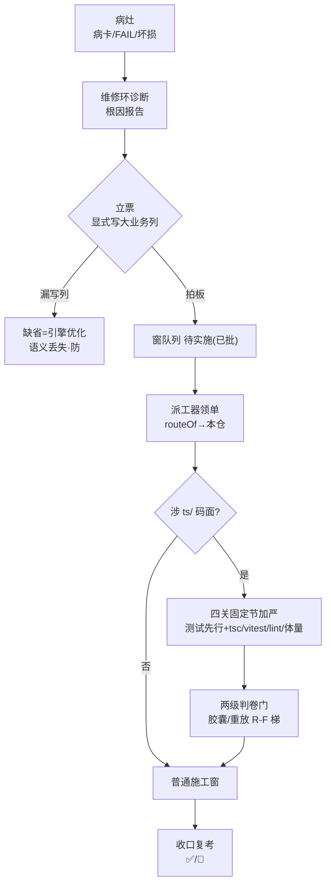

> **口径**：本卡话术/命名遵循《[00-话术统一口径正本](../00-话术统一口径正本.md)》（拍板#312）——双名制首现双写·撞车词带消歧（窗票/工序票·判色/判分）·两层口径 L1 车间（票级）/L2 派工台（窗级）。
> **消歧（本卡·口径正本 §3）**：票（工序票 L1／窗票 L2·随文标注）；复考（交活重考闸·L2）。

# 业务流程卡 · 引擎修复（大业务→本仓作业面）

## §0 一句话

**解决什么**：五类大业务中「治引擎自身坏损」的一类——判卷语义/拉起链/账本/通道等病灶驱动票，路由到**本仓**施工。**为什么存在**：修复与优化必须分流：修复有病灶可循（病卡/维修环/复跑对账）、涉及 `ts/` 码面时加严（四关固定节+两级判卷门）——加严条款不能误伤优化票，分流是加严的前提。**边界**：靠缺省兜不住语义——修复类票必须显式写第 9 列（缺列旧格式缺省=引擎优化）。

## §典型事件链

| # | 事件 | 锚 |
|---|---|---|
| 1 | 实战：W-015（改包道末轮回滚·ts 码件窗白名单首票）——本类加严条款（四关固定节）首次真票演练 | `90-过程/执行台账.md:239` |
| 2 | 实战：W-016（V1 追全绿重放班）与 W-033（隧道B状态误判·cmd 三行段修复）——本类两窗收口 | `90-过程/执行台账.md:239`/`:573` |
| 3 | 病灶入口链：班内 FAIL→维修环 fail-loop（诊断 `pipeline-lab/scripts/diagnose.mjs:1` 起）→病卡→立票——病灶驱动是本类的立票正门 | 本卡定义层/实例层 |

## 定义层（这个类是什么）

- 枚举正本=`BIZ_KINDS`（`91-脚本/pi_runner.mjs:99`·拍板#76①）；本类=`"引擎修复"`。
- 判据：修**引擎自身**的缺陷（判卷语义/拉起链/账本/通道等坏损），非宿主 App、非增量优化（优化走 [bf-20261021-001]）。
- 窗队列实例值在第 9 列（`parseRows` `91-脚本/pi_runner.mjs:92`·缺列旧格式缺省=引擎优化——**修复类票必须显式写列**，靠缺省兜不住语义）。

## 路由层（派工器怎么路由它）

- `routeOf("引擎修复", …)` → `{ok:true, cwd:repoCwd, lane:"本仓"}`（`91-脚本/pi_runner.mjs:103`·拍板#76②）——与引擎优化同岸，**无需宿主固定节**。
- ts 码件窗加严（#71④ 开闸条款·`91-脚本/pi_runner.mjs:87` WHITELIST_NOTE）：任务书必须带四关固定节（测试先行跑红才动码＋tsc/vitest/lint/体量自跑全绿才收口）·判卷=胶囊/重放两级门（R-F 梯=`91-脚本/rf_ladder.mjs`）。
- 机检自证：selftest 案6 断言（`91-脚本/pi_runner.mjs:528`）。

**节点详注表**（图正下方·每节点做什么/边界/锚点）：

| 节点 | 详注 |
|---|---|
| 病灶 | 本类立票的起点：班内 FAIL/病卡/拉起链坏损——与优化类（改进意图）的根本分野=有病灶可循。 |
| 维修环诊断 | 病灶入口链第一站（诊断 `pipeline-lab/scripts/diagnose.mjs:1` 起·拍板#84② 编排）：只读证据出根因报告→病卡——立票有据不瞎修。 |
| 立票显式写列 | 修复类必须显式写第 9 列大业务=引擎修复：缺列旧格式缺省=引擎优化（`91-脚本/pi_runner.mjs:92`）——靠缺省兜不住修复语义（加严条款会漏挂）。 |
| 四关固定节 | ts 码件窗加严条款（#71④·`91-脚本/pi_runner.mjs:87` WHITELIST_NOTE）：测试先行跑红才动码+tsc/vitest/lint/体量自跑全绿才收口——动引擎码面的四道关。 |
| 两级判卷门 | R-F 梯（`91-脚本/rf_ladder.mjs`）胶囊/重放两级——修复不改判卷语义，改完还要同包重放对照（立项说明书 §七）。 |
| 普通施工窗 | 非 ts 面（文档/cmd 段等）修复走常规窗；W-033 隧道B状态误判即 cmd 三行段实战（`90-过程/执行台账.md:573`）。 |
| 收口复考 | 收口自报 ✅ 先过复考闸（考题库机检·exit code 唯一判据）——修复窗的自检更严：任一红打回 🔁。 |

## 实例层（现在队列里长什么样）

- 现行 verified 实例：W-015（改包道末轮回滚·ts 码件窗白名单首票实战）/W-016（V1 追全绿重放班）/W-033（隧道B状态误判·cmd 三行段）——均本仓收口。
- 病灶入口链：班内 FAIL→维修环 fail-loop（诊断 `pipeline-lab/scripts/diagnose.mjs:1` 起·拍板#84② 编排锚 `pipeline-lab/scripts/nightrun-wrap.mjs:704`）→病卡/维修记录→立票（病卡机检=E 系·rrm_lint KINDS 含「病卡/维修记录」）。
- 在跑实例：W-004（判卷快照复验班·▶ 留候业主发班令）——修复类常见「候业主认定」停等形态。

## 防重复指针（应然在别处·本卡只画实然）

- 理念版维修/自愈编排=「07-设计理念专题/五业务场景编排总图-…-20261018.html」（场景轴·原图引用不复制）；专题档案归族=`90-过程/10-专题档案/02-维修与自愈/`。
- 状态定义标源=`90-过程/窗队列.md`；意图回链=`01-蓝图/`。

## 时效

| 键 | 值 |
|---|---|
| 基准 | repo_head 7f51c83（2026-10-21 现勘） |
| 生成式 | 否（as-built 实勘·非生成物） |
| 核对 | 2026-10-21（rrm_lint 整区 PASS+accept 自检） |
| 失效触发 | 见 frontmatter 失效触发键 |
