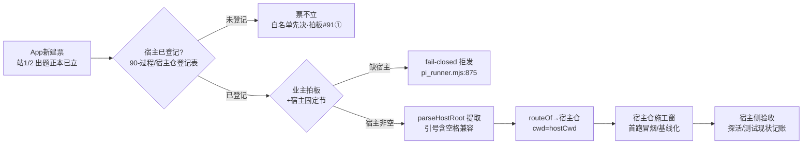

> **口径**：本卡话术/命名遵循《[00-话术统一口径正本](../00-话术统一口径正本.md)》（拍板#312）——双名制首现双写·撞车词带消歧（窗票/工序票·判色/判分）·两层口径 L1 车间（票级）/L2 派工台（窗级）。
> **消歧（本卡·口径正本 §3）**：票（工序票 L1／窗票 L2·随文标注）；三关（收包验货关 L1／立票验单关·贴卡拦病关·领单再验单 L2）。

# 业务流程卡 · App新建（大业务→宿主仓作业面）

## §0 一句话

**解决什么**：五类大业务中「在宿主仓从零建 App」的交付类票——路由到**宿主仓**施工，与引擎两类的硬差异=任务书必须带宿主固定节。**为什么存在**：引擎不能替业主决定「在哪个仓动工」——宿主仓根必须业主以固定节显式给、登记表白名单先决（`90-过程/拍板记录表.md:111` 拍板#91①·未登记=票不立）。**边界**：缺宿主=fail-closed 拒发（`91-脚本/pi_runner.mjs:875`）——宁可拒发不可猜路径。

## §典型事件链

| # | 事件 | 锚 |
|---|---|---|
| 1 | 立规：拍板#91「原地接入+存量白名单」批「准」（宿主仓根允许登记表白名单内任意绝对路径） | `90-过程/拍板记录表.md:111` |
| 2 | 实战首票：W-034「App首跑冒烟」（宿主=039舆情V5·git 基线 96c9c6c+起服探活+测试现状记账·白名单首票）——**App新建已通** | `90-过程/执行台账.md:575` |
| 3 | 挂账如实：正式开闸候交付链两缺口票（W-017 挂账）——存量队列大业务=App新建 行数=0，后续实例随票落 | 本卡实例层 |
| 4 | 引号含空格修正：拍板#91②——工作区根 "pi agent" 带空格致旧正则截断，parseHostRoot 优先匹配引号包裹形式修正 | `90-过程/拍板记录表.md:111`（#91②） |

## 定义层（这个类是什么）

- 枚举正本=`BIZ_KINDS`（`91-脚本/pi_runner.mjs:99`·拍板#76①）；App 类判定=`isAppBiz`（`91-脚本/pi_runner.mjs:100`·三类共上岸）；本类=`"App新建"`。
- 判据：交件链站1/2 出题正本（交件包）已立、宿主仓尚无该 App 或首版从零起步——首跑冒烟/基线化类票亦归此（现状先例 W-034）。

## 路由层（派工器怎么路由它）

- `routeOf("App新建", hostCwd, …)` → 宿主非空 `{ok:true, cwd:hostCwd, lane:"宿主仓"}`；宿主空串 `{ok:false, reason:"缺宿主仓路径…fail-closed 拒发"}`（`91-脚本/pi_runner.mjs:103` 分支体·拍板#76②）。
- 宿主仓根从任务书「宿主固定节」提取（`parseHostRoot` `91-脚本/pi_runner.mjs:112`·拍板#76③·引号包裹路径含空格兼容=#91②）——三关校验同格式双验。
- 领单侧同闸兜底：App 类缺宿主=跳过记因不领（`91-脚本/pi_runner.mjs:875`·fail-closed）。
- 机检自证：selftest 案6 断言 App 类×宿主有无四象限（`91-脚本/pi_runner.mjs:528`）。

**节点详注表**（图正下方·每节点做什么/边界/锚点）：

| 节点 | 详注 |
|---|---|
| App新建票 | 交付类票：站1/2 出题正本（交件包）已立、宿主仓从零起步——首跑冒烟/基线化亦归此（现状先例 W-034·`90-过程/执行台账.md:575`）。 |
| 宿主已登记? | 白名单先决闸（拍板#91①）：宿主仓根必须已在 `90-过程/宿主仓登记表.md:1`（append-only 台账）——「票不立」在登记环节就拦，派工面根本见不到票。 |
| 业主拍板+宿主固定节 | 双保险：业主拍板给票合法性，任务书宿主固定节给作业面坐标——引擎不猜路径、不默认路径。 |
| fail-closed 拒发 | 领单侧同闸兜底（`91-脚本/pi_runner.mjs:875`）：App 类缺宿主=跳过记因不领——不改行状态不弃单，修好任务书可重领。 |
| parseHostRoot | 宿主仓根提取契约（`91-脚本/pi_runner.mjs:112`·拍板#76③+#91②）：优先匹配引号包裹形式（引号内允许空格·剥引号）——"pi agent" 带空格的实证教训。 |
| routeOf→宿主仓 | 宿主非空={ok:true, cwd:hostCwd, lane:"宿主仓"}（`91-脚本/pi_runner.mjs:103`）——与引擎两类的唯一路由分岔点。 |
| 宿主仓施工窗 | 施工面=宿主仓根；引擎判卷语义零涉宿主仓（判卷权冻结在引擎仓红线内）——宿主侧验收以自身测试/探活为准。 |
| 宿主侧验收 | 首跑冒烟的验收形态（W-034 先例）：git 基线+起服探活+测试现状记账——新建类先把「现状」立起来，不硬造绿。 |

## 实例层（现在队列里长什么样）

- 首票实战：W-034「App首跑冒烟」（`90-过程/窗队列.md:61`·宿主=039舆情V5·git 基线 96c9c6c+起服探活+测试现状记账·拍板#91 白名单首票）——**App新建已通**。
- 现网约束如实申报：App新建**正式开闸候交付链两缺口票**（W-017 挂账·丁范围外）——存量队列中大业务=App新建的行=0，后续实例随票落。
- 宿主仓清单正本=`90-过程/宿主仓登记表.md:1`（宿主固定节引用对象）。

## 防重复指针（应然在别处·本卡只画实然）

- 理念版项目产线编排（站1/2↔站3-6 分界=交件包）=「07-设计理念专题/五业务场景编排总图-…-20261018.html」§二（场景轴④⑤⑥·原图引用不复制）。
- 交付链设计意图=`01-蓝图/`；路由契约细节=契约卡 [ct-20261021-004]。

## 时效

| 键 | 值 |
|---|---|
| 基准 | repo_head 7f51c83（2026-10-21 现勘） |
| 生成式 | 否（as-built 实勘·非生成物） |
| 核对 | 2026-10-21（rrm_lint 整区 PASS+accept 自检） |
| 失效触发 | 见 frontmatter 失效触发键 |
