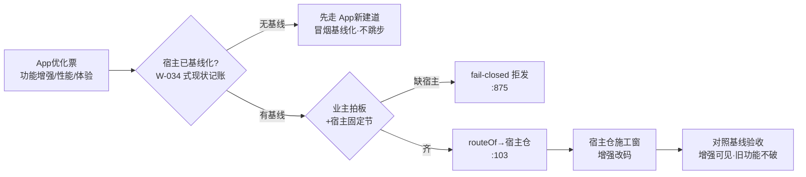

> **口径**：本卡话术/命名遵循《[00-话术统一口径正本](../00-话术统一口径正本.md)》（拍板#312）——双名制首现双写·撞车词带消歧（窗票/工序票·判色/判分）·两层口径 L1 车间（票级）/L2 派工台（窗级）。
> **消歧（本卡·口径正本 §3）**：票（工序票 L1／窗票 L2·随文标注）。

# 业务流程卡 · App优化（大业务→宿主仓作业面）

## §0 一句话

**解决什么**：五类大业务中「对宿主既有 App 做增量改进」的一类——功能增强/性能/体验票，路由到**宿主仓**施工。**为什么存在**：优化与修复、新建三分，才能各配各的验收面（优化=增强前基线在、修复=坏损可对照、新建=从零记账）——App优化卡的机制已备、实例候票（如实申报现网零实例）。**边界**：路由面与 App新建同构——宿主固定节必带、缺宿主 fail-closed（`91-脚本/pi_runner.mjs:875`）。

## §典型事件链

| # | 事件 | 锚 |
|---|---|---|
| 1 | 立规：拍板#76① 五类枚举落地——App优化入 `BIZ_KINDS`（`91-脚本/pi_runner.mjs:99`）·`isAppBiz` 三类共上岸（`:100`） | 本卡定义层 |
| 2 | 机制机检在位：selftest 案6 断言含 App 优化类（routeOf 五类×宿主组合·`91-脚本/pi_runner.mjs:528`）——机制先于实例过硬闸 | 本卡实例层 |
| 3 | 预期入口：宿主 App（如 039舆情V5）经 W-034 式基线化（`90-过程/窗队列.md:61` 实例线）后，功能增强票以本类立票——基线在先、优化在后 | 本卡实例层 |
| 4 | 现网实例=**零**（窗队列大业务=App优化 行数=0·2026-10-21 实勘）——如实申报不硬凑 | 本卡实例层 |

## 定义层（这个类是什么）

- 枚举正本=`BIZ_KINDS`（`91-脚本/pi_runner.mjs:99`·拍板#76①）；App 类判定=`isAppBiz`（`91-脚本/pi_runner.mjs:100`）；本类=`"App优化"`。
- 判据：宿主 App **已存在且已基线化**，改其功能面/质量面——与 App修复（[bf-20261021-005]）的分野：优化=增强，修复=治坏损；与 App新建的分野：仓内已有交付物非从零起步。

## 路由层（派工器怎么路由它）

- `routeOf("App优化", hostCwd, …)` → 宿主非空=`{ok:true, cwd:hostCwd, lane:"宿主仓"}`·空宿主=拒发（`91-脚本/pi_runner.mjs:103`·拍板#76②）。
- 宿主仓根=任务书宿主固定节（`parseHostRoot` `91-脚本/pi_runner.mjs:112`·拍板#76③）；领单侧 App 缺宿主跳过记因（`91-脚本/pi_runner.mjs:875`）。
- 与引擎类的白名单差异：宿主仓作业面的改件清单（第 11 列领地）指向宿主仓路径——交叠反查仍按队列行求交（拍板#92·告警级）。

**节点详注表**（图正下方·每节点做什么/边界/锚点）：

| 节点 | 详注 |
|---|---|
| App优化票 | 入口判据：宿主 App 已存在且已基线化、改的是功能面/质量面——与 App修复分野=增强而非治坏损。 |
| 宿主已基线化? | 优化票的资格前提：基线（W-034 式 git 基线+探活+测试现状记账）在，增强才有对照面——无基线先走新建道，不跳步。 |
| 先走 App新建道 | 流程防跳步：App 类顺序=新建（基线化）→优化/修复——跳过基线直接优化=验收无对照，闸口拦住。 |
| 业主拍板+宿主固定节 | 同三类 App 共同闸：宿主仓根业主显式给（`91-脚本/pi_runner.mjs:112` parseHostRoot·引号含空格兼容），缺=fail-closed 拒发（`:875`）。 |
| routeOf→宿主仓 | `91-脚本/pi_runner.mjs:103` 路由：宿主非空=放行进宿主仓——机制与机检（selftest 案6·`:528`）在位，实例候真票。 |
| 宿主仓施工窗 | 施工面=宿主仓根；领地列指向宿主仓路径，交叠反查按队列行求交（拍板#92·告警级不拦车）。 |
| 对照基线验收 | 验收形态：增强项可见+基线项不破——「优化不许优化掉旧功能」，对照面=基线记账。 |

## 实例层（现在队列里长什么样）

- 现网实例：**零**（窗队列大业务=App优化 行数=0·2026-10-21 实勘）——如实申报不硬凑；路由机制机检在位（`BIZ_KINDS`/`routeOf` selftest `91-脚本/pi_runner.mjs:528` 覆盖三类 App）。
- 预期入口：宿主 App（如 039舆情V5）经 W-034 式基线化后，功能增强票以本类立票；宿主仓清单正本=`90-过程/宿主仓登记表.md:1`。

## 防重复指针（应然在别处·本卡只画实然）

- 理念版=「07-设计理念专题/五业务场景编排总图-…-20261018.html」（场景轴·原图引用不复制）；状态定义标源=`90-过程/窗队列.md`。

## 时效

| 键 | 值 |
|---|---|
| 基准 | repo_head 7f51c83（2026-10-21 现勘） |
| 生成式 | 否（as-built 实勘·非生成物） |
| 核对 | 2026-10-21（rrm_lint 整区 PASS+accept 自检） |
| 失效触发 | 见 frontmatter 失效触发键 |
