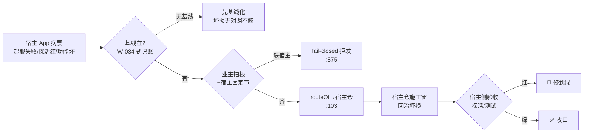

> **口径**：本卡话术/命名遵循《[00-话术统一口径正本](../00-话术统一口径正本.md)》（拍板#312）——双名制首现双写·撞车词带消歧（窗票/工序票·判色/判分）·两层口径 L1 车间（票级）/L2 派工台（窗级）。
> **消歧（本卡·口径正本 §3）**：票（工序票 L1／窗票 L2·随文标注）。

# 业务流程卡 · App修复（大业务→宿主仓作业面）

## §0 一句话

**解决什么**：五类大业务中「治宿主 App 坏损」的一类——起服失败/探活红/功能坏损票，路由到**宿主仓**施工。**为什么存在**：宿主侧病票也要有正门可走，而不是塞进引擎修复混淆验收权——引擎判卷语义**零涉宿主仓**（判卷权冻结在引擎仓红线内），宿主修复以宿主自身测试/探活为准。**边界**：路由面与另两类 App 卡同构（宿主固定节必带·缺宿主 fail-closed `91-脚本/pi_runner.mjs:875`）；现网实例=零（如实申报·防臆造不预填）。

## §典型事件链

| # | 事件 | 锚 |
|---|---|---|
| 1 | 立规：拍板#76① 五类枚举落地——App修复入 `BIZ_KINDS`（`91-脚本/pi_runner.mjs:99`）·`isAppBiz` 判定（`:100`） | 本卡定义层 |
| 2 | 判据锚先行：W-034 冒烟即先记账宿主侧验收面（探活/测试现状）——修复的「坏损对照面」从基线来 | 本卡定义层（W-034 实例线 `90-过程/窗队列.md:61`） |
| 3 | 现网实例=**零**（窗队列大业务=App修复 行数=0·2026-10-21 实勘）——宿主侧病票通道现无专用病卡族，随首票实战再立 | 本卡实例层 |
| 4 | 机制机检在位：selftest 案6 断言含 App 修复类（`91-脚本/pi_runner.mjs:528`·未知类型 fail-closed 拒发） | 本卡实例层 |

## 定义层（这个类是什么）

- 枚举正本=`BIZ_KINDS`（`91-脚本/pi_runner.mjs:99`·拍板#76①）；App 类判定=`isAppBiz`（`91-脚本/pi_runner.mjs:100`）；本类=`"App修复"`。
- 判据：宿主 App **从已基线态坏损回治**——判据锚=宿主侧验收面（探活/测试现状，W-034 冒烟即先记账此面）；与 App优化（[bf-20261021-004]）分野：修复=回治坏损，优化=增量增强。

## 路由层（派工器怎么路由它）

- `routeOf("App修复", hostCwd, …)` → 宿主非空=`{ok:true, cwd:hostCwd, lane:"宿主仓"}`·空宿主=拒发（`91-脚本/pi_runner.mjs:103`·拍板#76②）。
- 宿主仓根=任务书宿主固定节（`parseHostRoot` `91-脚本/pi_runner.mjs:112`·拍板#76③）；领单侧 App 缺宿主跳过记因不领（`91-脚本/pi_runner.mjs:875`·fail-closed）。
- 修复类通用纪律随行：验收面以宿主仓自身测试/探活为准（引擎判卷语义**零涉宿主仓**——判卷权冻结在引擎仓红线内）。

**节点详注表**（图正下方·每节点做什么/边界/锚点）：

| 节点 | 详注 |
|---|---|
| 宿主 App 病票 | 本类入口：宿主 App 的坏损症状（起服失败/探活红/功能坏）——注意病票通道现无专用病卡族，随首票实战再立（防臆造不预填）。 |
| 基线在? | 修复的前提：坏损=与基线的偏差，无基线则「坏」无从谈起——先记账后修复（W-034 先例：冒烟即记 git 基线+探活+测试现状）。 |
| 业主拍板+宿主固定节 | 三类 App 共同闸：宿主仓根业主显式给（`91-脚本/pi_runner.mjs:112`·引号含空格兼容=#91②），缺=fail-closed 拒发（`:875`）。 |
| routeOf→宿主仓 | `91-脚本/pi_runner.mjs:103`：App修复返回宿主仓 cwd——机检在位（selftest 案6·`:528`），实例候真票。 |
| 宿主仓施工窗 | 施工面=宿主仓根；修复票显式写大业务列（缺列缺省=引擎优化兜不住宿主语义·同 bf-002 教训）。 |
| 宿主侧验收 | 修复的红绿权在宿主自身测试/探活——引擎判卷语义零涉宿主仓（判卷权冻结红线）；红则🔁修到绿，绿则✅收口。 |

## 实例层（现在队列里长什么样）

- 现网实例：**零**（窗队列大业务=App修复 行数=0·2026-10-21 实勘）——如实申报；宿主侧病票通道现无专用病卡族，随首票实战再立（防臆造不预填）。
- 宿主仓清单正本=`90-过程/宿主仓登记表.md:1`；机制机检=selftest 案6（`91-脚本/pi_runner.mjs:528`）。

## 防重复指针（应然在别处·本卡只画实然）

- 理念版=「07-设计理念专题/五业务场景编排总图-…-20261018.html」（场景轴·原图引用不复制）；状态定义标源=`90-过程/窗队列.md`。

## 时效

| 键 | 值 |
|---|---|
| 基准 | repo_head 7f51c83（2026-10-21 现勘） |
| 生成式 | 否（as-built 实勘·非生成物） |
| 核对 | 2026-10-21（rrm_lint 整区 PASS+accept 自检） |
| 失效触发 | 见 frontmatter 失效触发键 |
