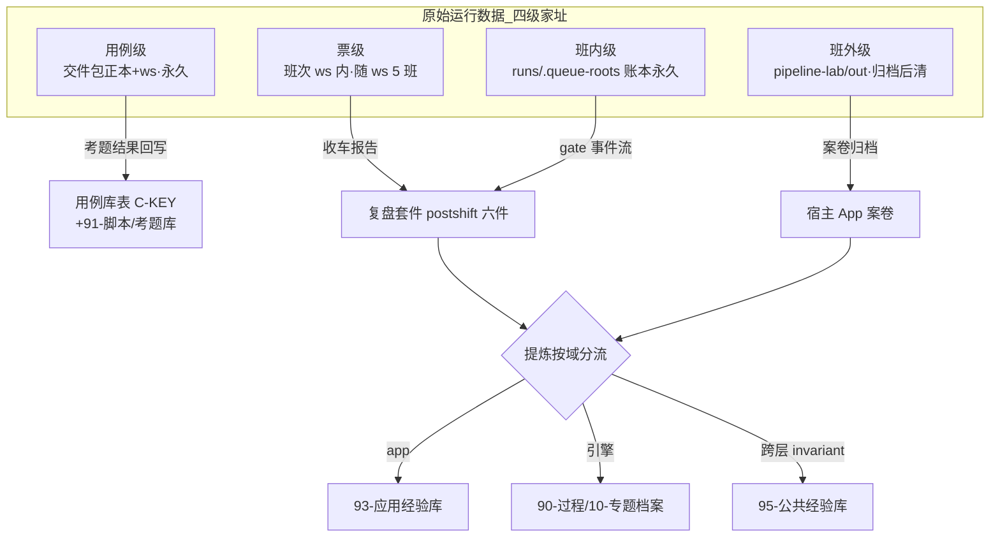

> **口径**：本卡话术/命名遵循《[00-话术统一口径正本](../00-话术统一口径正本.md)》（拍板#312）——双名制首现双写·撞车词带消歧（窗票/工序票·判色/判分）·两层口径 L1 车间（票级）/L2 派工台（窗级）。
> **消歧（本卡·口径正本 §3）**：票（工序票 L1／窗票 L2·随文标注）；复考（交活重考闸·L2）。

# 业务流程卡 · 四级数据记录总表（运行数据落哪里·提炼去哪里）

## §0 一句话

**解决什么**：回答「运行数据落哪里、提炼去哪里」的铁律总表——用例/票/班内/班外四级各有一个唯一家址，90-过程 只收提炼知识。**为什么存在**：拍板#93② 口径2 立「**原始运行数据不进 90-过程**」（`90-过程/拍板记录表.md:114`）——没有唯一家址的运行数据最终都会烂在各处临时目录里、或把编年体账本撑爆。**边界**：本卡=现状体转抄+实物锚，家址裁决**应然正本**=文档落位治理方案 §四（本卡零增删改裁决语义）。

## §典型事件链

| # | 事件 | 锚 |
|---|---|---|
| 1 | 立规：拍板#93② 落表——四级裁决+提炼按域分流（93 引擎域/90 跨层/95 invariant） | `90-过程/拍板记录表.md:114` |
| 2 | 家址正本：文档落位治理方案 §四 应然落位总表（五层 L2/L4/L5 行锚 `:53`-`:70`）——本卡逐行转抄 | `90-过程/10-专题档案/07-流程与治理/文档落位治理方案-五层模型-20261013.md:53` |
| 3 | 实物在册：queue-40 班两账本实物（班内级家址活的例子） | `runs/.queue-roots/queue-40/queue-events.jsonl:1`+`queue-ledger.jsonl:1` |
| 4 | 反模式警示：落位方案 §六 四条（「--root 相对路径」「产出先扔 out/ 不清理」等·`:84`）——家址纪律的反面清单 | `90-过程/10-专题档案/07-流程与治理/文档落位治理方案-五层模型-20261013.md:84` |

## 四级总表（裁决正本·拍板#93 ② `90-过程/拍板记录表.md:114`）

| 级 | 记的是什么 | 家址（唯一·不二迁） | 生命周期 | 提炼去向 |
|---|---|---|---|---|
| **用例**（L5 考题） | 切片 slice-cases.json/探针 `_probes/`/测试文件 | **交件包**（出题正本）＋**ws**（施工产出）——正本只增不改（§四 L5 行·落位方案 `:70`） | 正本永久 | 考题级结果回写用例库表（C-KEY 匹配·`pipeline-lab/scripts/nightrun-wrap.mjs:361`）；考题资产入 `91-脚本/考题库/`（拍板#87 复考闸·增删改=业主拍板） |
| **票**（L4 工单票） | 票代码+票面测试+票产物 | **班次 ws 内**（§四 L4 行·落位方案 `:69`） | 随 ws（保留最近 5 班余移 `runs/_archive/`） | 票级结果进班次收车报告→复盘套件（`pipeline-lab/scripts/postshift.mjs:56` 六件编排）→提炼知识按域分流（下节） |
| **班内**（L2 班次） | queue 账本+班次 ws+log | **`runs/.queue-roots/<根名>/`**（发车令显式绝对路径·账本永久·§四 L2 行·落位方案 `:65`）＋`runs/<班次id>/`（ws） | 账本永久·ws 保留近 5 班 | gate 事件流=班后复盘触发源（`pipeline-lab/scripts/postshift.mjs:8`）；账本双件套契约=契约卡 [ct-20261021-001]；实物=`runs/.queue-roots/queue-40/queue-events.jsonl:1`+`queue-ledger.jsonl:1` |
| **班外**（L2 外产物） | 晨报 HTML/病卡快照/方案件/复盘件 | 生成于 **`pipeline-lab/out/`** → **随案卷归档后即清**（out/ 只留 30 天活件·§四 L2 行·落位方案 `:66`） | 归档后清（拍板#81 归档链） | 归档进宿主 App 案卷（V5 事件归档）+提炼件按域分流（下节）；复盘/诊断成品落 `90-过程/10-专题档案/`（引擎域） |

## 提炼产物按域分流（90 只收提炼知识·拍板#93②）

| 域 | 去向 | 例 |
|---|---|---|
| **app**（宿主 App 专属） | `93-039舆情V5应用经验库RAG-invariant/`（93 族） | 某宿主 App 的踩坑/调参经验 |
| **引擎**（引擎域通用） | `90-过程/`（10-专题档案 九门+深度文档更新） | 派工链 deepread/病卡定位/治理方案 |
| **跨层通用**（invariant） | `95-公共经验库-invariant/` | 跨项目可复用的方法论/约束 |

- 双体分工红线：90=编年体永不回改·02（本区）=现状体向代码对账（拍板#93 口径1·区门牌 `02-全景视图/README.md`）；落位反模式四条=落位方案 §六（`90-过程/10-专题档案/07-流程与治理/文档落位治理方案-五层模型-20261013.md:84`·「--root 相对路径」「产出先扔 out/ 不清理」等）。

## 四级流转图（图示与节点详注）

**节点详注表**（图正下方·每节点做什么/边界/锚点）：

| 节点 | 详注 |
|---|---|
| 用例级 | 家址=交件包正本（只增不改·落位方案 `:70`）+ws 施工产出；考题是业主资产，引擎只执行不自造——考题级结果回写用例库表（C-KEY·`pipeline-lab/scripts/nightrun-wrap.mjs:361`）。 |
| 票级 | 家址=班次 ws 内（`:69`）；生命周期随 ws（保留近 5 班余归档）——票代码不进 90-过程，票的「故事」才以提炼件形态进。 |
| 班内级 | 家址=`runs/.queue-roots/<根名>/`（发车令显式绝对路径·账本永久 `:65`）——queue-40 两账本即活的实物（`runs/.queue-roots/queue-40/queue-events.jsonl:1`）。 |
| 班外级 | 家址=`pipeline-lab/out/`（`:66`）：晨报/病卡快照/方案件生成于此，随案卷归档后即清（只留 30 天活件）——out/ 是走廊不是仓库。 |
| 复盘套件 | 票级+班内级的提炼入口：postshift 六件编排（`pipeline-lab/scripts/postshift.mjs:56`）把运行数据炼成「待拍板」形态的复盘件。 |
| 提炼按域分流 | 拍板#93② 分流铁律的执行口：三分域各有唯一去处（上表）——「90 只收提炼知识」从口号变路径。 |
| 宿主 App 案卷 | 班外归档终点（拍板#81 归档链）：V5 事件归档进宿主 App 案卷——数据跟着 App 走（app 是过客·家址随案卷）。 |

## 防重复指针

- 家址裁决**应然正本**=文档落位治理方案 §四（本卡只转抄裁决+补实物锚·零增删改裁决语义）；拍板正本=`90-过程/拍板记录表.md`（append-only·`:1` 表头锚）。
- 账本字段级契约不在本卡（=契约卡 [ct-20261021-001]/[ct-20261021-002]）；夜车时序=时序卡 [sq-20261021-001]。

## 时效

| 键 | 值 |
|---|---|
| 基准 | repo_head 7f51c83（2026-10-21 现勘） |
| 生成式 | 否（as-built 转抄裁决+实物实勘·非生成物） |
| 核对 | 2026-10-21（rrm_lint 整区 PASS+accept 自检四行齐） |
| 失效触发 | 见 frontmatter 失效触发键 |
