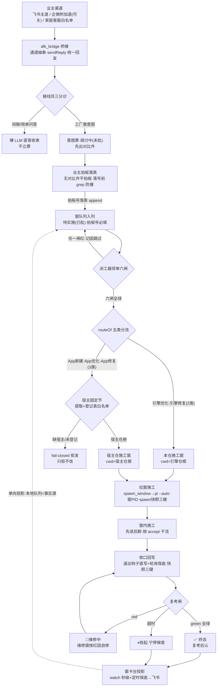

> **口径**：本卡话术/命名遵循《[00-话术统一口径正本](../00-话术统一口径正本.md)》（拍板#312）——双名制首现双写·撞车词带消歧（窗票/工序票·判色/判分）·两层口径 L1 车间（票级）/L2 派工台（窗级）。
> **消歧（本卡·口径正本 §3）**：票（工序票 L1／窗票 L2·随文标注）；三关（收包验货关 L1／立票验单关·贴卡拦病关·领单再验单 L2）；复考（交活重考闸·L2）；挂起（事件对 L1／⏸格 L2·随文标注）。

# 业务流程卡 · 五类业务端到端总装（全景一图：渠道→分诊→拍板→派工→分流→施工→回写→投影→兜底）

## §0 一句话

**解决什么**：`01-业务流程/` 在册 6 卡按五类分画（bf-001~005 分卡＋bf-006 数据总表），缺一张**跨类全景**——本卡一图串读「一条意图从业主手机到收口回写怎么走」：业主渠道→桥接分诊→意图票/对比件→拍板落表→窗队列入列→派工器领单六闸→routeOf 五类分流（引擎 2 类→本仓·App 3 类→宿主仓）→拉窗施工→收口回写/快照三键→复考闸→窗卡台投影→🔁维修环兜底。**为什么存在**：分卡回答「每一类长什么样」，总装图回答「五类共享的那条主干怎么串」——闸门同名不同卡，主干一张图。**边界**：分卡内容指针互链零复制；时序细节（谁先谁后到秒级）归 [sq-20261021-002]；状态定义标源=窗队列（不自立）。

## §典型事件链

| # | 事件 | 锚 |
|---|---|---|
| 1 | 立总装：拍板#98 三包批「准」（包A=本卡·序号接续在册最大 006→007·落号前 grep 表尾在案最高 #97 零撞号——拍板落表环节的 grep 防撞在这行自证） | `90-过程/拍板记录表.md:119` |
| 2 | 实战活例（引擎类全程）：W-044 本窗票——拍板#98 落表→窗队列入列（待实施(已批)·大业务=引擎优化）→派工器领单拉起本施工窗→收口回写→投影，即本图主干的现场重演 | `90-过程/窗队列.md:70` |
| 3 | 实战活例（App 类宿主侧）：W-034 App首跑冒烟——宿主=039舆情V5，routeOf 分流到宿主仓拉窗，五类分流主干的首票实证 | `90-过程/执行台账.md:575` |

## 定义层（这张图怎么读）

- **一条主干两个岔口**：主干=意图→票→拍板→队列→派工→施工→回写→投影；岔口一=接线员分诊（闲聊直答不立票·工厂意图才立票），岔口二=routeOf 五类分流（引擎 2 类进本仓·App 3 类进宿主仓）。
- **五类单卡各管一段**：本卡只画共享主干与分流岔口；每类的判据/实例/防重复见分卡——引擎优化 [bf-20261021-001]·引擎修复 [bf-20261021-002]·App新建 [bf-20261021-003]·App优化 [bf-20261021-004]·App修复 [bf-20261021-005]；四级数据记录 [bf-20261021-006]。
- **闸门可机检**：图上每个闸（拍板号闸/六闸/复考闸/fail-closed）都有码锚与判据，非示意画——契约细节归路由契约卡 [ct-20261021-004]。

## 总装主线（一图串读·五类分流显式标注）

## 节点详注表（图正下方）

| 节点 | 详注 |
|---|---|
| 业主渠道 | 三通道：飞书主道恒在；企微附加道可关（拍板#85 先例·装配=`91-脚本/afk_bridge.mjs:1036`）；家庭客服白名单清单制，清单外忽略。 |
| afk_bridge 桥接 | 通道抽象层收发接口化（W-022·拍板#81①·`91-脚本/afk_bridge.mjs:604`），回发统一走 sendReply（`91-脚本/afk_bridge.mjs:737`·注记 `:20`）；附加通道运行期注册（`:643`）——加通道不改业务。 |
| 接线员三分诊 | 机械前缀优先走既有映射（零 LLM，`91-脚本/afk_bridge.mjs:1139`）；其余过接线员分诊（`91-脚本/afk_receptionist.mjs:243` 三分类·直答 `:55`）；连败达阈值关闸走现行为（`91-脚本/afk_bridge.mjs:1745`）——坏不拦主链。 |
| 意图票 | 工厂类意图立票「探讨中(未批)」，产物锚列=对比件路径（状态不变量表 `90-过程/窗队列.md:8`）；无对比件不拍板（拍板#36）。 |
| 业主拍板落表 | 拍板后 append 拍板表，**落号前 grep 表尾防撞号**（拍板#98 行自证「在案最高 #97 零撞号」`90-过程/拍板记录表.md:119`）。 |
| 窗队列入列 | 立队列行=「待实施(已批)」；eligible=该状态且拍板号非空（`91-脚本/pi_runner.mjs:122`）——「无拍板号不入列队」机检化；大业务=第 9 列（`91-脚本/pi_runner.mjs:92`）。 |
| 派工器领单六闸 | pickDispatch 逐行过闸（`91-脚本/pi_runner.mjs:866`）：拍板号/任务书在册/前置存在/环检测/任务书三关（`91-脚本/pi_runner.mjs:1104`）/App类缺宿主 fail-closed（`91-脚本/pi_runner.mjs:875`）；任一红=记因跳过。 |
| routeOf 五类分流 | 纯函数路由（`91-脚本/pi_runner.mjs:103`·调用点 `:1102`）：引擎两类→本仓，App三类→宿主仓；未知大业务 fail-closed 拒发。契约=[ct-20261021-004]。 |
| 宿主固定节 | App三类经宿主固定节提取仓根（parseHostRoot `91-脚本/pi_runner.mjs:112`·引号剥空格·拍板#91②），宿主须在登记表（白名单先决）；缺宿主/未登记=拒发不改。 |
| 拉窗施工 | spawnSync 调拉窗器（`91-脚本/pi_runner.mjs:1118`·windowsHide 拍板#94），kick 带大业务/作业面/工作目录（`:1117`·拍板#76②），记窗PID（`:1119`）；底座 buildStartCommand（`91-脚本/spawn_window.mjs:68`）弹可见窗跑 pi --auto。 |
| spawn 快照三键 | 拉窗点自产交接快照（拍板#89己）：三键=会话档/产物锚/窗PID（`91-脚本/spawn_window.mjs:88`），构造 buildHandoffSnapshotMd（`:134`），会话档按 cwd 编码探测、缺档如实标（`:106`）。 |
| 收口回写 | 退出钩子直写（拍板#89甲·`91-脚本/pi_runner.mjs:298`）＋轮询保底——▶行才写、终态行原样=幂等；✅/🔁 连快照三键回填（收口侧归 pi_runner 防双写）。 |
| 复考闸 | ✅ 行认账前重跑机检考题（`91-脚本/pi_runner.mjs:213` 仅✅开考·`:923` 执行）；四态（`91-脚本/pi_runner.mjs:236`）green=复考后认/red=打回/skip=缺考题记因/超时=宁停；红打回✅→🔁（`:258`）超时→⏸（`:262`）——永不装绿。 |
| 🔁维修环兜底 | 复考红改「🔁维修中」、下一棒锚前插【复考红】红因+原锚保留（`91-脚本/pi_runner.mjs:258`）；维修窗自修后再报✅同规；分卡=[bf-20261021-002]。 |
| 窗卡台投影 | 本地队列=唯一事实源，飞书=单向投影（`91-脚本/window_card_sync.mjs:5`）；字段映射（`:59`）分批 ≤25 行/批（`:75`）；watch 订阅+防抖 2s 秒级增量（`:103`）＋定时保底，全量对账三道共用（`:220`）。 |

## 实例层（主干上现在跑着什么）

- **引擎类全程活例=本窗 W-044**：拍板#98（`90-过程/拍板记录表.md:119`）→队列行（`90-过程/窗队列.md:70`·待实施(已批)→▶施工中）→派工器领单拉起本窗→本卡即产物→收口回写→投影——主干 12 节点在一票内走全。
- **App 类宿主侧活例=W-034**：首票冒烟走 routeOf→宿主仓拉窗（`90-过程/执行台账.md:575`）；App优化/App修复现网零实例如实申报不硬凑（分卡 [bf-20261021-004]/[bf-20261021-005] 同口径）。
- **批次口径**：拍板#77 并行槽位、拍板#94 拉窗静默化（施工窗仍可见=拍板#70① 设计内）——批量化不改变主干节点顺序，只压缩同批多票的走图速度。

## 防重复指针（应然在别处·本卡只画实然）

- 理念版场景编排=「07-设计理念专题/五业务场景编排总图-厂务线与项目产线-一期现状与二期方向-20261018.html」（**场景轴**①-⑥·与本卡**端到端主干轴**不同分类法·应然原图引用不复制）。
- 五类分卡（判据/实例/防重复）=[bf-20261021-001]~[bf-20261021-005]·四级数据记录=[bf-20261021-006]；路由契约=[ct-20261021-004]；派工回写秒级时序=[sq-20261021-002]；状态定义标源=`90-过程/窗队列.md` 状态不变量表（状态卡 [sm-20261021-001]）。
- 站3→站4→站5 三站施工内部细节=包B 三站施工主线图（bf-008·W-045·候出）；维修环四级阶梯细目=包C 维修环与夜车恢复流程图（bf-009·W-046·候出）。

## 时效

| 键 | 值 |
|---|---|
| 基准 | repo_head 499011b（2026-10-21 现勘·全锚亲验） |
| 生成式 | 否（as-built 实勘·非生成物） |
| 核对 | 2026-10-21（rrm_lint 全区+render_views 渲染+accept 自检） |
| 失效触发 | 见 frontmatter 失效触发键 |
