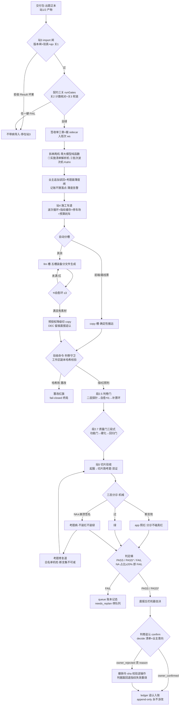

> **口径**：本卡话术/命名遵循《[00-话术统一口径正本](../00-话术统一口径正本.md)》（拍板#312）——双名制首现双写·撞车词带消歧（窗票/工序票·判色/判分）·两层口径 L1 车间（票级）/L2 派工台（窗级）。
> **消歧（本卡·口径正本 §3）**：票（工序票 L1／窗票 L2·随文标注）；三关（收包验货关 L1／立票验单关·贴卡拦病关·领单再验单 L2）；判定梯（交卷判分梯 L1／收班判色梯 L2）；翻案（绿灯吊销 L1／业主撤回 L2）；自愈环（干活自愈环·L1）。

# 业务流程卡 · 三站施工主线（站3 收货拆单→站4 施工与质量门→站5 验收·as-built）

## §0 一句话

**解决什么**：施工窗拉起后、**窗内**那条主线怎么走——一条票从交付包进站3（收货·import 闸）到拆单、进站4（施工链·质量闸）、进站5（验收·判定梯）、再到判卷追认（confirm）与 queue 账本记态，每站闸门/质量门在哪一张图看全。**为什么存在**：模块卡分述每站内部（mk-006~010），缺「三站怎么串、闸门怎么排」的流程视角一图——本卡补主干。**边界**：窗外主干（渠道→派工→拉窗）归总装卡 [bf-20261021-007]；各站内部细节指针互链零复制；时序秒级走线归 [sq-20261021-001]。

## §典型事件链

| # | 事件 | 锚 |
|---|---|---|
| 1 | 立图：拍板#98 三包批「准」（包B=本卡·序号接续 007→008·前置 W-044 已✅自动串行） | `90-过程/拍板记录表.md:119` |
| 2 | 同系前窗：W-044 包A 五类端到端总装图收口（窗外主干 12 节点·本卡接其「拉窗施工」节点向窗内展开） | `90-过程/窗队列.md:70` |
| 3 | 实战活例：W-045 本窗票——队列行▶施工中（大业务=引擎优化·作业面本仓），即主线「拉窗→窗内三站→收口回写」的现场重演 | `90-过程/窗队列.md:71` |

## 定义层（这张图怎么读）

- **编排者不是 queue-runner**：叫号循环只 spawn 子进程跑 run-slice（`ts/src/queue/queue-runner.ts:77`·头注红线「站3 管线零改动」在 `ts/src/queue/queue-runner.ts:5`）；三站串接的真身=垂直切片全链入口 run-slice——导入（:137）→拆单（:150）→施工车道（:213）→判卷门（:238）→质量门三段式（:251）→切片验收（:264）→判定梯（:277），退出码=整体三态。
- **一条主线三级闸**：站3 闸管「包能不能进」（版本/验真/三关），站4 闸管「码做得对不对」（判卷守卫+判卷门+三段式质量门），站5 闸管「App 行不行」（三态分诊+判定梯）——层层拦截，坏货不下游。
- **收尾两件不在 run-slice**：判卷追认（confirm·业主翻案口）与 queue 账本记态（排期五态）在班次/队列侧闭环，图末两节点画出接缝。
- 单站内部细节归模块卡：站3=[mk-20261021-006]·站4=[mk-20261021-007]·站5=[mk-20261021-008]·追认=[mk-20261021-009]·账本=[mk-20261021-010]。

## 三站主线（一图串读·闸门显式）

## 节点详注表·上（站3 收货拆单→站4 施工·图正下方接续）

| 节点 | 详注 |
|---|---|
| 交付包→import 闸 | 主线入口=出题正本交件包；importPackage 收包验真+版本闸+ajv 关1（`ts/src/station3-import/import.ts:34`·Result 坏果即拒），编排调用（`ts/src/run-slice.ts:137`）——不带病导入，细节归 [mk-20261021-006]。 |
| 契约三关 runGates | 关2 计数核对（端点/表/LLM 调用点四组集合比对）+关3 死链检查，任一硬 FAIL 即阻断（`ts/src/station3-import/gates.ts:106`·口径复刻生产者单一正本）——验包面，与派工侧任务书三关不同域。 |
| 签收单三章+sidecar | 过闸即落账：T1 必搬 sidecar、T2 签收单必交——「收没收到」有账可查，终点=班次工作区 ws。 |
| 拆单两机 | ①实施清单解析机 parseImplementationList（`ts/src/station3-import/split.ts:57`·零大模型纯函数）；②批次波次机 planWaves（`ts/src/station3-import/split.ts:168`·Kahn 拓扑排依赖）；splitPackage 汇总出工单+波次（`ts/src/station3-import/split.ts:244`·调用 `ts/src/run-slice.ts:150`）。 |
| 追加读回+薄度闸 | 业主补写只认 TICKETS 指定节、引擎只记账不猜落点（调用 `ts/src/run-slice.ts:164`）；考题面薄度闸（`ts/src/run-slice.ts:184`）拆单后即量——题薄早暴露，不浪费施工预算。 |
| 站4 施工车道 | 波次循环+指纹缓存+停车场+预算刹车（装配点 `ts/src/run-slice.ts:213`）；逐票 buildTicket（定义 `ts/src/station4-build/build.ts:137`·调用 `ts/src/night-shift/build-lane.ts:107`）——车道纪律归 [mk-20261021-007]。 |
| 双槽位与降级链 | 两槽分工：copy 槽照搬产物保底，llm 槽按文件出码（头注 `ts/src/station4-build/build.ts:1`）；llm 连红进⟲自愈环至多 3 轮，环满且有素材时按预授权清单降到 copy 槽并 DEC 留痕候晨报追认——降档路径全在册可考、不临场发明。 |
| 判卷守卫（站4 质量闸） | 验收命令的执行口只有守卫一个（`ts/src/station4-build/build.ts:210`·拍板#82）：开跑先比对判卷素材的工作区副本指纹，动过手脚=一票终局的红旗，既不进自愈环也不进降级链——守卫管防作弊不管红绿，判卷权仍在命令本身。 |

## 节点详注表·下（站5 验收→追认与账本·接续）

| 节点 | 详注 |
|---|---|
| 段2.5 判卷门 | 施工收完先过门（调用点 `ts/src/run-slice.ts:238`）：二层探针→自愈⟲1→补票环（覆盖缺失红→合成工单回站4·轮/量/账三闸限流）→红账本——施工质量红在此收敛，不带病进验收。 |
| 段2.7 质量门三段式 | 功能门→粗分诊→硬化道（调用点 `ts/src/run-slice.ts:251`）；旗标缺省开（`ts/src/run-slice-flags.ts:41`·拍板#50）——切片①先烤功能门，硬化腿再上强度，回归腿兜翻案。 |
| 站5 切片验收 | verifyApp 起服→切片循环跑考题（`ts/src/station5-verify/verify.ts:39`·调用 `ts/src/run-slice.ts:264`·三态语义头注 `ts/src/station5-verify/verify.ts:1`）；页面双证（看得见+接口通）、NA≠PASS——站5 细节归 [mk-20261021-008]。 |
| 三态分诊+考题修复道 | 机械三分：断言败=app 照红（分诊不碰真红）；NA∧崩溃签名=考题病（不装红不装绿）；修复道 LLM 起草+白名单机检——断言集不可减，违者拒收转追认清单，修考题不能变删断言放水。 |
| 判定梯（站5 闸） | judgeOverall 整单三态 PASS/PASS*/FAIL（`ts/src/station5-verify/ladder.ts:32`·调用 `ts/src/run-slice.ts:277`）；NA 占比≥20% 即 FAIL（NA_RATIO_GATE `ts/src/station5-verify/ladder.ts:13`）、PASS* 带星晨报置顶追认——堵「多 NA 少 PASS 机械判 pass」放水口。 |
| 判卷追认 confirm | 晨报五栏机器自决清单×业主意向→追认/推翻事件序列（decide 纯函数 `ts/src/confirm.ts:27`）；推翻须带 reason 缺则拒，--rollback 逐条现场 sha 校验后逆操作（`ts/src/confirm.ts:90`）——撤回只还原文件不还原结论：判据面一变下轮照样重考，翻案不放水。 |
| queue 账本记态 | run-slice 整体三态经退出码回叫号循环（spawn 面 `ts/src/queue/queue-runner.ts:77`·零改动红线注记 `ts/src/queue/queue-runner.ts:5`）；排期账本五态（`ts/src/queue/queue-ledger.ts:13`）写侧白名单三型（`ts/src/queue/queue-ledger.ts:27`）append-only——FAIL 版停队列不派下一版，账全可重放。 |

## 与封印档案差异（骨架参照 vs 本仓 as-built·以码为准）

- 档案 02 卷 2.2「契约三关+纯函数拆单（降级链）」——as-built 降级链不在拆单侧：拆单零大模型纯函数（`ts/src/station3-import/split.ts:57`），降级链长在站4 施工层（预授权降级·`ts/src/station4-build/build.ts:1`）。
- 档案 03 卷 3.4 质量门「三钥匙」——as-built 保留且加码为段2.5 判卷门+段2.7 三段式（功能门→硬化→回归门·`ts/src/run-slice.ts:238`/`:251`），另加档案所无的判卷素材防篡改守卫（拍板#82·`ts/src/station4-build/build.ts:210`）。
- 档案 04 卷 4.1「三段式两道门（C-032）」——as-built 判定梯已是三态 PASS/PASS*/FAIL+NA≥20% 门槛+考题病分诊修复道（`ts/src/station5-verify/ladder.ts:32`·verify 头注），「坏考题不充当罪证」纪律只加严未放松。
- 档案未覆盖的夜车机制（指纹缓存/停车场/预算刹车/补票环三闸）as-built 已长进站4 车道与判卷门（`ts/src/night-shift/build-lane.ts:107`·`ts/src/run-slice.ts:238`）——画环节时以本卡为准。

## 实例层（主线现在跑着什么）

- 在册 as-built 实证：W16 验证班 manifest 丙案双绿终版——判定梯/切片族在多版本逐版过闸中担纲（实物契约=[ct-20261021-002]·站5 实战见 [mk-20261021-008] 事件链）。
- 同系活例：W-044 包A 总装图已收口（`90-过程/窗队列.md:70`·台账 `90-过程/执行台账.md:587`），本卡为其「拉窗施工」节点向窗内的展开；W-045 本窗即主线活票（`90-过程/窗队列.md:71`）。
- 语义边界：本卡只画实然主干——各站「怎么判/怎么修」的机检细节归五张模块卡（mk-006~010），本卡零正文复制。

## 防重复指针（应然在别处·本卡只画实然）

- 单站内部（接口/分诊/修复道/账本机制）=[mk-20261021-006]~[mk-20261021-010] 五卡——本卡只画跨站主线与闸门位置。
- 窗外主干（渠道→派工→拉窗→投影）=[bf-20261021-007]；秒级时序=[sq-20261021-001]；维修环四级阶梯细目=[bf-20261021-002]与包C 图（bf-009·W-046 候出）。
- 理念版骨架参照（封印史料·只取闸门清单）=v1.2 仓「05-TS重构蓝图/深读档案/AFK全流程深度解读/」02/03/04 三卷——应然档案只读引用，差异见上节，正文零复制。

## 时效

| 键 | 值 |
|---|---|
| 基准 | repo_head 0cb1d3d（2026-10-21 现勘·全锚亲验） |
| 生成式 | 否（as-built 实勘·非生成物） |
| 核对 | 2026-10-21（rrm_lint 全区+render_views 渲染+accept 自检） |
| 失效触发 | 见 frontmatter 失效触发键 |
