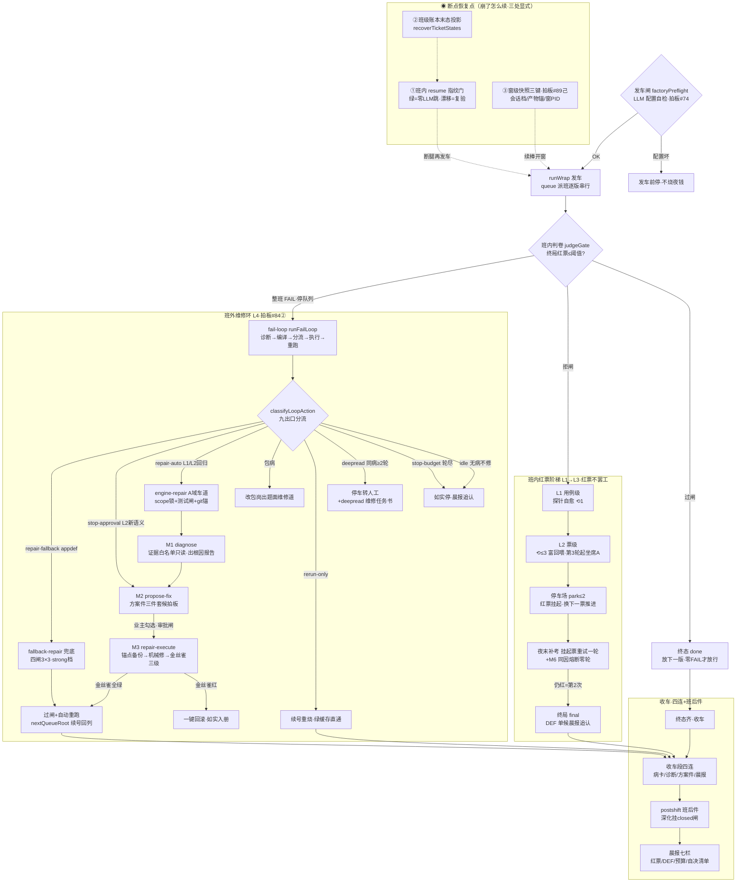

> **口径**：本卡话术/命名遵循《[00-话术统一口径正本](../00-话术统一口径正本.md)》（拍板#312）——双名制首现双写·撞车词带消歧（窗票/工序票·判色/判分）·两层口径 L1 车间（票级）/L2 派工台（窗级）。
> **消歧（本卡·口径正本 §3）**：票（工序票 L1／窗票 L2·随文标注）；补考（挂起补考·L1）；熔断（同因熔断 L1／收班复盘器 L2）；挂起（事件对 L1／⏸格 L2·随文标注）。

# 业务流程卡 · 维修环与夜车恢复（红票/半截窗从发现到治好回列·流程/分支视角·as-built）

## §0 一句话

**解决什么**：夜车「红了怎么办、崩了怎么续」——红票从班内三级阶梯（探针⟲1→票级⟲≤3+坐席A→停车场+夜末补考）一路升到班外维修环（L4·诊断→方案件→执行器），修好回列或如实入停车场；断电/半截窗在哪三处断点恢复（班内 resume 指纹门、班级账本投影、窗级快照三键），一张分支图看全。**为什么存在**：模块卡分述三环（mk-011）与发车收车编排（mk-004/005）、时序卡画秒级走线（sq-001），缺「阶梯怎么升、出口怎么分、断点在哪续」的流程/分支视角一图——本卡补。**边界**：本卡只画流程/分支（决策点+阶梯分流+恢复点），时序先后归 [sq-20261021-001] 零复制；三环接口细节归 [mk-20261021-011]；窗外主干归 [bf-20261021-007]。

## §典型事件链

| # | 事件 | 锚 |
|---|---|---|
| 1 | 立规：拍板#31 修复体系三级重整（班内两级维修工+班外兜底收编）——四级阶梯母件（用例级→票级→班次内→班次外）立轴 | `90-过程/拍板记录表.md:39` |
| 2 | 班外环内化：拍板#35 W16 维修环引擎内化（fail-loop 编排+包病道定版）→拍板#84 授权制改造（L1 自动/L2 回归子类自动/新语义业主勾选·fail-closed 停车点） | `90-过程/拍板记录表.md:47` / `:103` |
| 3 | 断点交接底座：拍板#89己 快照三键（会话档/产物锚/窗PID·W-031 落地）——窗级断点恢复的立规锚 | `90-过程/拍板记录表.md:109` |
| 4 | 本卡：拍板#98 包C（视图补图三包之三·前置 W-045 已✅自动串行）；活例=W-046 本窗 spawn 快照三键在行（缺 2 键 WARN 如实标缺不谎报齐） | `90-过程/拍板记录表.md:119` |

## 定义层（这张图怎么读）

- **四级维修阶梯**（组织轴=机器改错的地方在哪里）：L1 用例级（探针自愈）→L2 票级（⟲环+坐席A）→L3 班次内（停车场/夜末补考/坐席B）→L4 班次外（fail-loop 维修环+兜底道）——每升一层上下文更长、能力更强，低层烧完才升级（母件=`90-过程/10-专题档案/02-维修与自愈/修复体系四级阶梯-用例票班内班外-20261014.md`·只加严不加松铁律）。
- **夜车断点恢复三层**（崩了谁恢复什么）：班内=resume 指纹门（上轮绿免生成不免验收）；班级=账本末态投影 recoverTicketStates（非法转移入账不抛）+绿缓存；窗级=快照三键交接底座（会话档/产物锚/窗PID·缺任一键 WARN 如实标缺）。
- **波次状态语义不自立**：状态定义标源=窗队列不变量表（`90-过程/窗队列.md:8`）·状态卡 [sm-20261021-002]；账本字段契约=[ct-20261021-001]。

## 维修环与夜车恢复主线（mermaid 一幅·阶梯与断点显式）

## 节点详注表·上（发车→判卷→班内阶梯→收车·图正下方接续）

| 节点 | 详注 |
|---|---|
| 发车闸 factoryPreflight | 发车前工厂侧 LLM 配置自检（拍板#74·`pipeline-lab/scripts/nightrun-wrap.mjs:617`）：配置坏=发车前停，不烧夜里的钱——夜车经济学第一闸，钱没配好宁可白夜不白烧。 |
| runWrap 发车 | 夜车总编排入口（`pipeline-lab/scripts/nightrun-wrap.mjs:153`）：queue 派班逐版串行（`:184` 每班收车段四连顺序固定）——上一版过闸才放下一版，单件异常 warnings 收集不挡后续。 |
| 班内判卷 judgeGate | 班内红绿唯一判据（`ts/src/queue/gate.ts:27`·真值表=gate.test.ts 背书）：调用点 `ts/src/queue/queue-runner.ts:240`，过闸记 passed（`:244`）拒闸记 failed 并停队列 EXIT=1（`:247`）——判卷语义零触碰红线在此节点。 |
| L1 用例级·探针自愈 | 阶梯第一级：判卷门顺序=第二层探针→自愈⟲1→补票环→红账本（`ts/src/night-shift/probe-gate.ts:3`），healProbeReds 只对施工质量红定向修（`ts/src/station4-build/probe-selfheal.ts:97`）——修得最准、轮次最少的一级。 |
| L2 票级·⟲≤3+坐席A | 阶梯第二级：回喂轮与首建共享同一 ⟲≤3 预算（`ts/src/station4-build/build.ts:167`·C-027），第 3 轮起坐席A（票级维修工）接手换盒换档（`:177`·独立分账≤2次/票）——第 3 轮是换人不是重抽奖。 |
| 停车场 park≤2 | L3 班次内：红票不直接 FAIL 离场，onRed 裁决——第 1 次挂起换下一票继续推进，第 2 次=终局 final 出 DEF 单（`ts/src/night-shift/park.ts:26`）；轮数跨腿保留宁严不松（`ts/src/night-shift/park.ts:8`）——保吞吐又不无限烧。 |
| 夜末补考+M6 熔断 | 停车场挂起票夜末重试一轮（拍板③·`ts/src/night-shift/lane-drain.ts:31`）；M6 同因熔断=协议病/无正本/连坐复发零轮（`:22` 分类）——比夜末一轮更严的定向收缩，重跑必再红的票不烧。 |
| 终局 final 与收车 | final DEF 票+连坐 final 全部带根因链上晨报（fail-safe 到人工清单）；收车段四连（病卡/诊断/方案件/晨报·`pipeline-lab/scripts/nightrun-wrap.mjs:184`）每班顺序固定——「该静则静」子件自带，wrap 零判断。 |
| postshift 班后件+晨报 | postshift 把「九连的收车半段」独立拉起（`pipeline-lab/scripts/postshift.mjs:5`），三红线=零代码写入/零重跑/零判卷触碰（`:6` 头注），深化只对已关环稳定态开放（closed 闸 fail-closed `:38`）；编排主流程 `:59`；晨报七栏从账本事件面聚合（`ts/src/night-shift/morning-report.ts:2`·红票取末笔 verdict 语义+命中率分列）。 |

## 节点详注表·下（班外维修环 L4→三环→断点恢复·接续）

| 节点 | 详注 |
|---|---|
| 维修环入口 fail-loop | FAIL 班自动接维修环（拍板#84②·接线 `pipeline-lab/scripts/nightrun-wrap.mjs:704`）：编排主流程 runFailLoop（`pipeline-lab/scripts/fail-loop.mjs:233`）=诊断→编译→分流→执行→重跑循环至绿或预算尽·fail-closed。 |
| 九出口分流 classifyLoopAction | 纯判定真值表（`pipeline-lab/scripts/fail-loop.mjs:30`）：idle（无病不修）/stop-budget（轮尽宁停）/deepread（同病≥2轮转人工）/repair-exam（包病）/repair-fallback（appdef）/rerun-only（无档位重烧）/repair-auto L1（机械预授权）/repair-auto L2回归（scope⊆上窗文件+测试闸全量绿）/stop-approval（L2新语义业主勾选不绕行） |
| 如实停出口 | idle/stop-budget/deepread 三出口共点「如实停」：无病不修、宁停不透支、同病≥2轮停车转人工（`pipeline-lab/scripts/fail-loop.mjs:120` 产出 deepread 维修任务书·拍板#52 班内/班外维修员按书接手）——机械修复不盲烧。 |
| rerun-only 重烧回列 | 编译 rejected/无档位：预算内重烧·绿缓存直通一次（`pipeline-lab/scripts/fail-loop.mjs:30`·≥2 轮由 deepread 接住）——重烧不是白烧。 |
| M1 diagnose | 看病的：readEvidence 证据白名单只读（`pipeline-lab/scripts/diagnose.mjs:21`·白名单外不碰），主流程出固定四段根因报告（`:116`·TOP1 回写病卡）——零写代码零重跑·预算缺省 5 次。 |
| M2 propose-fix | 开方子的：parseDiagnosis 空报告不装方案 fail-closed（`pipeline-lab/scripts/propose-fix.mjs:19`），出方案件带安全三件套（`:88`·回退点/金丝雀/预算强制入件）——不修任何东西·勾选才进 M3。 |
| M3 repair-execute | 动刀的（拍板#71/#72·头注 `pipeline-lab/scripts/repair-execute.mjs:1`）：executePlan 审批闸→上溯检查步→锚点备份→机械修→金丝雀三级→回滚/过闸→自动重跑（`:50`）；未勾选不执行·步骤红即回滚·留痕三件套全程。 |
| engine-repair A域车道 | 病根在引擎自身代码时的自动道（头注三红线 `pipeline-lab/scripts/engine-repair.mjs:1`）：L1 diff≤30 行/禁控制流/≤5 文件，L2 未勾选零动工·scope 越界拒绝·测试闸红=回滚转人工 |
| fallback-repair 兜底道 | L4 班外兜底执行器（拍板#31⑤·头注 `ts/src/night-shift/fallback-repair.ts:1`）：四闸只收缩不放宽=根因≤3/班×每根因≤3次+班外独立分账+A域双根白名单，repairTier='strong' 档位只换模型不换判卷。 |
| 断点恢复①班内 resume | 断腿再发车：resume 直通件对上轮已绿票零 LLM 跳过（头注 `ts/src/night-shift/lane-resume.ts:1`·C-012 指纹门），漂移走复验：绿=诚实跳·红=重跑——免生成不免验收。 |
| 断点恢复②班级投影 | 状态重建唯一入口 recoverTicketStates（`ts/src/shared/ticket-state.ts:89`）：账本末态投影出票态/包态，非法转移入账不抛——崩了从账本重放，不靠人脑记进度（账本契约=[ct-20261021-001]）。 |
| 断点恢复③窗级三键 | 半截窗续棒：快照三键底座（`91-脚本/spawn_window.mjs:89`·拍板#89己）=会话档+产物锚+窗PID，缺任一键 WARN 如实标缺不谎报齐；回滚面配套回滚预演器只出文本不出手（`91-脚本/回滚预演.mjs:8`·四段=commit清单/改件stat/领地交叠/建议命令）。 |

## 与封印档案差异（骨架参照 vs 本仓 as-built·以码为准）

- 档案 06 卷 §6.5「层3 对话上下文恢复=我方无会话概念（每票重组装变量盒）」——as-built 已补**窗级**会话档恢复：快照三键交接底座（`91-脚本/spawn_window.mjs:89`·拍板#89己 2026-10-21 落地），档案封印（2026-10-10）早于此件，以码为准。
- 档案 R4-05 §1.1「七出口真值表」——现行 classifyLoopAction（`pipeline-lab/scripts/fail-loop.mjs:30`）=**九出口**：档案之外新增 repair-exam（包病改包岗出题面·拍板#35）与 repair-fallback（appdef 施工终局红兜底道·`ts/src/night-shift/fallback-repair.ts:1`）两道域分流。
- 档案 06 卷 §6.2「红票不罢工三部曲 park→补考→resume」——码面一致在位（`ts/src/night-shift/park.ts:26`/`ts/src/night-shift/lane-drain.ts:31`/`ts/src/night-shift/lane-resume.ts:1`）且轮数跨腿保留（`ts/src/night-shift/park.ts:8`），无差异如实记核对行。
- 档案 06 卷 §6.1 预算三路熔断+续腿签名——归夜车发车/预算面（本卡只画其维修/恢复视角的「预算尽=stop-budget 出口」），三路闸细节不在本卡展开防越界复制。

## 实例层（主线现在跑着什么）

- 在册 as-built 实证班：queue-40 班全链留痕（`runs/.queue-roots/queue-40/queue-events.jsonl:1`·dispatched/gate_passed/gate_failed 事件型实物）——判闸两分支（`:244`/`:247`）落账可回放。
- 实战窗：维修环三环立环拍板链（#28→#35→#71/#72→#84）见 [mk-20261021-011] 事件链；发车/收车编排实战见 [mk-20261021-004]/[mk-20261021-005]；快照三键活例=W-044/W-045/W-046 三窗 spawn 行（W-046 本窗缺 2 键 WARN 如实——三键语义「宁缺不谎报」的现行实证）。
- 语义边界：本卡只画流程/分支——三环接口与预算参数归 [mk-20261021-011]，秒级走线归 [sq-20261021-001]，本卡零正文复制。

## 防重复指针（应然在别处·本卡只画实然）

- 维修环三环内部（接口/预算/测试面）=[mk-20261021-011]；发车编排=[mk-20261021-004]；收车编排=[mk-20261021-005]——本卡只画阶梯分流与断点位置。
- 秒级时序（发车→票流→判卷→收车先后）=[sq-20261021-001]；窗外主干（渠道→派工→拉窗→🔁兜底）=[bf-20261021-007]；三站窗内主线=[bf-20261021-008]；引擎修复分卡=[bf-20261021-002]；波次状态=[sm-20261021-002]；账本契约=[ct-20261021-001]。
- 四级阶梯母件（设计对比件·应然）=`90-过程/10-专题档案/02-维修与自愈/修复体系四级阶梯-用例票班内班外-20261014.md`；理念版骨架参照（封印史料·只取环节清单）=v1.2 仓「05-TS重构蓝图/深读档案/AFK全流程深度解读/」06 卷+R4-02/R4-05/R4-06——差异见上节，正文零复制。

## 时效

| 键 | 值 |
|---|---|
| 基准 | repo_head 843fa51（2026-10-21 现勘·全锚亲验） |
| 生成式 | 否（as-built 实勘·非生成物） |
| 核对 | 2026-10-21（rrm_lint 全区+render_views 渲染+accept 自检） |
| 失效触发 | 见 frontmatter 失效触发键 |
