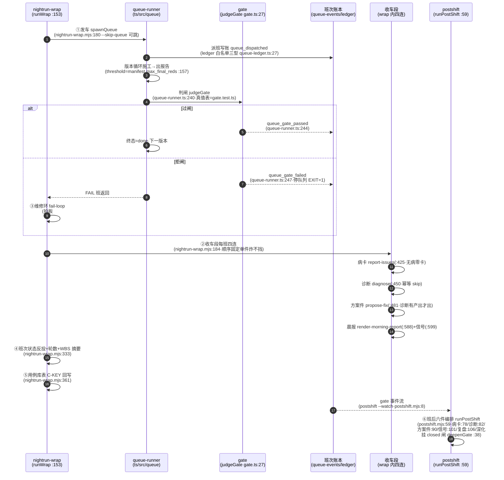

> **口径**：本卡话术/命名遵循《[00-话术统一口径正本](../00-话术统一口径正本.md)》（拍板#312）——双名制首现双写·撞车词带消歧（窗票/工序票·判色/判分）·两层口径 L1 车间（票级）/L2 派工台（窗级）。
> **消歧（本卡·口径正本 §3）**：票（工序票 L1／窗票 L2·随文标注）。

# 时序图 · 一次夜车全链路（发车→票流→判卷→收车段→postshift）

## §0 一句话

**解决什么**：把「一夜之间引擎自己干了什么」画成一条可回放的时间线——发车、派班、判卷、维修、收车四连、班后复盘，每步带实锚。**为什么存在**：夜车是引擎价值兑现的主场景，链路可视化让业主晨读晨报前先能看懂「昨晚的账」从哪来（全链事件留痕=`runs/.queue-roots/queue-40/queue-events.jsonl:1` 实物）。**边界**：本卡=as-built 实然链（向代码对账）；理念版场景编排不在此复制（防重复指针节）。

## §典型事件链

| # | 事件 | 锚 |
|---|---|---|
| 1 | 实物班：queue-40 班全链留痕——queue-events.jsonl 9 行（dispatched/gate_passed/gate_failed 三事件型）·W-041 逐行实勘入卡 | `90-过程/执行台账.md:583` |
| 2 | 真值表锚：judgeGate 真值表以 gate.test.ts 为准（判卷语义零改）——链路图中的判卷节点有测试背书 | `ts/src/queue/gate.ts:27` |
| 3 | 维修环接线：拍板#84② FAIL 接维修环入编排（fail-loop 授权制改造）——链路第 5 步的立规锚 | 本卡文字投影行5 |

## 时序图（mermaid）

**节点详注表**（图中参与者逐个·做什么/边界/锚点）——独节防 E4 超帽：

## 节点详注（参与者逐个）

| 节点（参与者） | 详注 |
|---|---|
| nightrun-wrap（runWrap） | 夜车总编排：一条命令串发车→收车段→反投全链（锚 pipeline-lab/scripts/nightrun-wrap.mjs:153）；零判断逻辑全下放子件，单件异常 warnings 收集不挡后续。 |
| queue-runner | 班内执行者：按 manifest 逐版串行派班施工（threshold=manifest.max_final_reds）；判闸调用在锚 ts/src/queue/queue-runner.ts:240——班内红绿判定全走它。 |
| gate（judgeGate） | 判卷真值表唯一实现（锚 ts/src/queue/gate.ts:27·真值表=gate.test.ts 背书）：终局红票≤阈值才 passed——判卷语义零触碰红线在此节点体现。 |
| 班次账本 | 双件套落账（queue-events 行车记录仪+queue-ledger 排期账·白名单三型锚 ts/src/queue/queue-ledger.ts:27）：链路上每步都有账可回放（契约见 ct-20261021-001）。 |
| 收车段（wrap 四连） | 每班顺序固定四连（锚 pipeline-lab/scripts/nightrun-wrap.mjs:184）：病卡（:425 无病零卡）→诊断（:450 幂等 skip）→方案件（:481 有产出才出）→晨报（:588）——「该静则静」。 |
| postshift（runPostShift） | 班后复盘编排（锚 pipeline-lab/scripts/postshift.mjs:59）：--watch 监听 gate 事件流（`:8` 触发声明）做六件（病卡/诊断/方案件/信号/复盘/深化挂 closed 闸 `:38`）——产出全「待拍板」形态。 |

## 文字投影（机读·步骤×锚点）

| # | 步骤 | 执行者 | 实锚 | 静默条件（该静则静） |
|---|---|---|---|---|
| 1 | 发车（queue 派班） | wrap→queue-runner | `pipeline-lab/scripts/nightrun-wrap.mjs:180` | `--skip-queue` 可跳（重放收车半段） |
| 2 | 派班写账（五态推进） | queue-runner | `ts/src/queue/queue-ledger.ts:27`（白名单三型） | 状态机细节=状态卡 [sm-20261021-002] |
| 3 | 班内判卷 | gate.judgeGate | `ts/src/queue/gate.ts:27`·调用 `ts/src/queue/queue-runner.ts:240` | threshold 缺省 0 红（`:157`） |
| 4 | 过闸/拒闸事件落账 | queue-runner | `ts/src/queue/queue-runner.ts:244`/`:247` | 拒闸=停队列 EXIT=1 |
| 5 | FAIL→维修环 | wrap fail-loop | `pipeline-lab/scripts/nightrun-wrap.mjs:704`（授权制改造·拍板#84②） | 预算尽即停不硬修 |
| 6 | 收车段四连（病卡/诊断/方案件/晨报） | wrap 每班循环 | `pipeline-lab/scripts/nightrun-wrap.mjs:184`（子件 `:425`/`:450`/`:481`/`:588`） | 无病零卡·已有诊断幂等 skip·诊断无产出不出方案件 |
| 7 | 班次状态反投+用例库回写 | wrap | `pipeline-lab/scripts/nightrun-wrap.mjs:333`/`:361` | 缺回写参数=skip |
| 8 | 班后复盘六件 | postshift | `pipeline-lab/scripts/postshift.mjs:59`（触发 `:8` gate 事件监听） | 非FAIL/PASS 静默·深化挂 closed 闸（`:38`） |

## 防重复指针

- 理念版夜车/班次应然=「07-设计理念专题/五业务场景编排总图-…-20261018.html」（场景轴·原图引用不复制）；波次状态机=状态卡 [sm-20261021-002]；账本字段=契约卡 [ct-20261021-001]；数据落点=总表卡 [bf-20261021-006]。

## 时效

| 键 | 值 |
|---|---|
| 基准 | repo_head 7f51c83（2026-10-21 现勘） |
| 生成式 | 否（as-built 实勘·非生成物） |
| 核对 | 2026-10-21（rrm_lint 整区 PASS+accept 自检） |
| 失效触发 | 见 frontmatter 失效触发键 |
