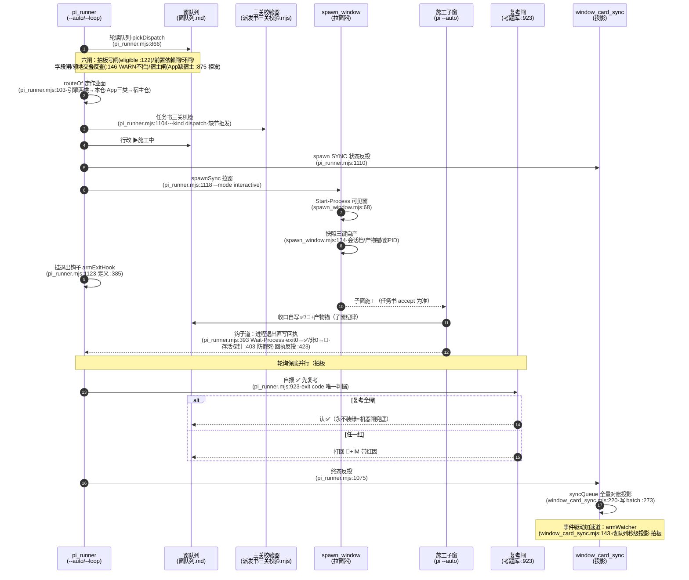

> **口径**：本卡话术/命名遵循《[00-话术统一口径正本](../00-话术统一口径正本.md)》（拍板#312）——双名制首现双写·撞车词带消歧（窗票/工序票·判色/判分）·两层口径 L1 车间（票级）/L2 派工台（窗级）。
> **消歧（本卡·口径正本 §3）**：票（工序票 L1／窗票 L2·随文标注）；三关（收包验货关 L1／立票验单关·贴卡拦病关·领单再验单 L2）；复考（交活重考闸·L2）。

# 时序图 · 派工回写（L2 队列拉起全链：领单→拉窗→施工→回执→投影）

## §0 一句话

**解决什么**：把「白班一张已批票」到「收口回执投影飞书」的全链画成时间线——领单六闸、路由、三关、拉窗、两道回执、复考闸、投影七幕。**为什么存在**：拍板#76 派工制后这条链是引擎的日常主动脉，链路可视化让「窗怎么被拉起、✅ 怎么被认定」每步可查（本窗 W-043 即活例·`90-过程/拍板记录表.md:117`）。**边界**：本卡=as-built 派工链；理念版 L1/L2 双拉起应然不在此复制（防重复指针节）。

## §典型事件链

| # | 事件 | 锚 |
|---|---|---|
| 1 | 实战：W-042 全链收口（领单→拉窗→施工→✅→投影·accept 五条全达） | `90-过程/执行台账.md:584` |
| 2 | 实战（活例）：W-043 本窗由本链拉起——spawn 快照三键缺 1 键 WARN 照录不谎报（拍板#89己 纪律演练） | `90-过程/拍板记录表.md:117`（母账·窗队列 W-043 行快照段） |
| 3 | 复考闸纪律：自报 ✅ 先按窗型重跑考题库机检·exit code 唯一判据·超时宁停 ⏸（拍板#87 永不装绿） | 本卡文字投影行8（锚 91-脚本/pi_runner.mjs:923） |

## 时序图（mermaid）

**节点详注表**（图中参与者逐个·做什么/边界/锚点）：

## 节点详注（参与者逐个）

| 节点（参与者） | 详注 |
|---|---|
| pi_runner（--auto/--loop） | 链条总驱动：pickDispatch 槽位选单（锚 91-脚本/pi_runner.mjs:866）→领单闸族→路由→三关→拉窗→盯收口——全程零 LLM 判卷（模块卡 mk-20261021-001）。 |
| 窗队列 | 唯一事实源：被轮读（只认待实施(已批)行·eligible 锚 91-脚本/pi_runner.mjs:122）、被改 ▶、被回写 ✅/🔁——状态件属性（状态卡 sm-20261021-001）。 |
| 三关校验器 | 任务书闸（锚 91-脚本/pi_runner.mjs:1104·--kind dispatch）：审批规格节缺=拒发（拍板#89丙）——发书侧与领单侧同格式防双头漂移。 |
| spawn_window（拉窗器） | 可见窗制造者（锚 91-脚本/spawn_window.mjs:68·拍板#70① 窗=工作台不静默）+快照三键自产（`:134`·缺键 WARN 不谎报齐·拍板#89己）。 |
| 施工子窗（pi --auto） | 干活的：按任务书 accept 施工收口，自写 ✅/🔁+产物锚回队列——子窗纪律「半截必填下一棒锚」（🔁 态）。 |
| 复考闸（考题库） | 永不装绿的机器闸（锚 91-脚本/pi_runner.mjs:923·拍板#87）：自报 ✅ 先重跑考题库机检，exit code 唯一判据——全绿才认、任一红打回 🔁+IM、超时宁停 ⏸。 |
| window_card_sync（投影） | 单向投影面（锚 91-脚本/window_card_sync.mjs:220 syncQueue·事件道 `:143` 秒级加速·拍板#89乙）：飞书窗卡台只读镜像，本地队列才是真源。 |
| 退出钩子（armExitHook） | 两道回执的钩子道（锚 91-脚本/pi_runner.mjs:385·`:393` Wait-Process/`:403` 存活探针防假死/`:423` 回执反投）：进程退出直写回执·与轮询保底并行幂等（拍板#89甲）。 |

## 文字投影（机读·步骤×锚点）

| # | 步骤 | 实锚 | 红线/语义 |
|---|---|---|---|
| 1 | 领单六闸 | `91-脚本/pi_runner.mjs:866`（pickDispatch）·拍板号闸 `:122` | 探讨中/候拍不可领（无拍板号不入列队） |
| 2 | 路由作业面 | `91-脚本/pi_runner.mjs:103`（routeOf·拍板#76②） | 未知大业务/空宿主 fail-closed 拒发 |
| 3 | 三关机检 | `91-脚本/pi_runner.mjs:1104`（--kind dispatch） | 任务书缺审批规格节=拒发（拍板#89丙） |
| 4 | 行改▶+投影 | `91-脚本/pi_runner.mjs:1110` | 状态机标源=窗队列（[sm-20261021-001]） |
| 5 | 拉窗（可见） | `91-脚本/pi_runner.mjs:1118`→`91-脚本/spawn_window.mjs:68` | 拍板#70① 窗=可见工作台·windowsHide 只治探针闪框（拍板#94③） |
| 6 | spawn 快照三键 | `91-脚本/spawn_window.mjs:134`（buildHandoffSnapshotMd） | 缺键入账 WARN 不谎报齐（拍板#89己·本窗 spawn 快照即实例） |
| 7 | 退出钩子直写回执 | `91-脚本/pi_runner.mjs:385`（armExitHook·`:393`/`:403`/`:423`） | 拍板#89甲·假死零终态误写 |
| 8 | 复考闸 | `91-脚本/pi_runner.mjs:923`（考题 spawnSync·exit code 唯一判据） | 拍板#87 永不装绿：红打回 🔁+IM |
| 9 | 投影飞书 | `91-脚本/window_card_sync.mjs:220`（syncQueue·事件道 `:143`） | 单向投影·回写窗队列才是真源 |

## 防重复指针

- 理念版厂务线编排（L1/L2 双拉起·任务书闸/方向题闸应然）=「07-设计理念专题/五业务场景编排总图-…-20261018.html」§3.1（原图引用不复制）；本卡=as-built 派工回写链。路由契约=契约卡 [ct-20261021-004]；夜车链=时序卡 [sq-20261021-001]。

## 时效

| 键 | 值 |
|---|---|
| 基准 | repo_head 7f51c83（2026-10-21 现勘） |
| 生成式 | 否（as-built 实勘·非生成物） |
| 核对 | 2026-10-21（rrm_lint 整区 PASS+accept 自检） |
| 失效触发 | 见 frontmatter 失效触发键 |
