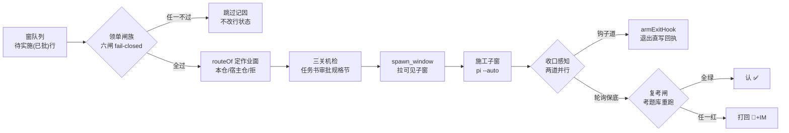

> **口径**：本卡话术/命名遵循《[00-话术统一口径正本](../00-话术统一口径正本.md)》（拍板#312）——双名制首现双写·撞车词带消歧（窗票/工序票·判色/判分）·两层口径 L1 车间（票级）/L2 派工台（窗级）。
> **消歧（本卡·口径正本 §3）**：票（工序票 L1／窗票 L2·随文标注）；三关（收包验货关 L1／立票验单关·贴卡拦病关·领单再验单 L2）；复考（交活重考闸·L2）；挂起（事件对 L1／⏸格 L2·随文标注）。
> **变更注记（v2 增密·W-251·拍板#334·2026-11-03）**：repo_head 67e5b04→e170067 重锚；实现本体已迁 `pi_runner.ts`（3849 行·批D W-179·拍板#254——`pi_runner.mjs`=2 行入口垫片兼库转发·afk_cron/cmd 生产词面保活），全卡行锚随迁 .ts；增量段=判死双证互证＋闸4 升格准备面＋核账零产出双实勘（W-226/W-239/W-243 三批落码·见 §增量段）。

# 模块卡 · 派工器（pi_runner）

## §0 一句话

**解决什么**：让「已批的票」无人值守地自动变成「施工中的窗」——从窗队列领单、过闸、路由作业面、拉起可见子窗、盯收口，全程零 LLM 判卷。**为什么存在**：拍板#76 起「施工一律由定时派工器自动领单开窗执行」（`90-过程/拍板记录表.md:95`·主对话窗只做规划/对比件/拍板落表），派工器就是这条规矩的机器执行者。**边界**：它不判卷不出题（考题=业主资产只执行不自造）、不碰判卷语义与预算三路、方向题永远停等业主。

## §典型事件链

| # | 事件 | 锚 |
|---|---|---|
| 1 | 立规：拍板#76 落表——「主对话窗不直接开工，施工一律定时派工器自动领单开窗」 | `90-过程/拍板记录表.md:95` |
| 2 | 实战：W-041（P4 生成层窗）由 queue-93-w041 拉起——派工器领「待实施(已批)」行→过六闸→拉窗→施工→收口 ✅ | `90-过程/执行台账.md:583` |
| 3 | 实战：W-042（P4b 手工层视图窗）同链拉起收口，accept 五条全达 | `90-过程/执行台账.md:584` |
| 4 | 实战（本卡 v2 增密时的活例）：W-043 本窗即由 pi_runner --auto 从窗队列领单拉起——领单闸族（eligible+拍板号闸）全过后路由本仓施工 | `90-过程/拍板记录表.md:117`（母账拍板#96） |

## 接口

CLI 四路：缺省 dry-run（列 eligible 只读不拉）·`--auto [--loop]` 巡检派工（槽位并行）·`--window <窗ID> --task <任务书> --go` 真拉单·`--selftest`。锚 91-脚本/pi_runner.ts:5（CLI 头注·TS 化迁移注记）。
领单对象=窗队列「待实施(已批)」行；行解析 parseRows 认 11 列（第 11 列=领地·缺列空串不拦）。eligible 判据单源=window-card.ts（W-048 迁移·pi_runner.ts:85 import＋:136 迁移注记·领单判据语义零改）。

## 实现概览

领单闸族 fail-closed（任一不过=不领记因）：状态闸 eligible（单源=91-脚本/window-card.ts:137·pi_runner.ts:85 消费）·前置依赖闸 depsReady（parseDeps/depsReady 单源同迁 window-card·pi_runner.ts:161 注记·前置行不存在=不领·成环 cycleSet 拦截:163-167）·审批规格闸 approvalGate（锚 91-脚本/pi_runner.ts:290·任务书审批规格节拍板号与队列行交叉核对）。
`--loop` 槽位选单 pickDispatch（领至 N 槽满→轮询空槽）。收口感知两道并行：钩子道 armExitHook（CLERK 收据员 detached 发射·锚 91-脚本/pi_runner.ts:98·拍板#155根治单发孤儿化·子窗进程退出直写回执·活探针复核定生死）+轮询保底（✅/🔁 即返回·原样保留）。验收复核闸：施工窗自报 ✅ 先按窗型查考题库重跑机检命令·exit code 唯一判据·超时宁停 ⏸（EXAM_DIR 锚 :101）。

**节点详注表**（图正下方·每节点做什么/边界/锚点）：

| 节点 | 详注 |
|---|---|
| 窗队列 | 领单对象的唯一事实源：只认状态「待实施(已批)」且拍板号非空的行（`90-过程/窗队列.md` 不变量表·eligible 判据单源锚 91-脚本/window-card.ts:137）。探讨中/挂起行不可领——无拍板号不入列队。 |
| 领单闸族 | 六道闸 fail-closed 串联：状态/前置依赖（成环拦截·pi_runner.ts:163-167）/审批规格（任务书拍板号与队列行交叉核对·锚 91-脚本/pi_runner.ts:290）等，任一不过=不领并记因，绝不带病放行。 |
| routeOf | 纯函数路由：引擎两类→本仓，App 三类→宿主仓（需宿主固定节），未知大业务/空宿主 fail-closed 拒发（锚 91-脚本/pi_runner.ts:118；路由契约细节见契约卡 ct-20261021-004）。 |
| 三关机检 | 任务书过派发书三关校验（--kind dispatch·缺审批规格节=拒发（拍板#89丙）——发书侧与领单侧同格式防双头漂移）。 |
| spawn_window | 拉起可见施工子窗（拍板#70① 窗=工作台·print 道位静默壳形态见 mk-002）；快照三键（会话档/产物锚/窗PID）自产入队，缺键 WARN 不谎报齐（拍板#89己）。 |
| 收口感知 | 两道并行幂等：钩子道=子窗进程退出直写回执（活探针防假死误写）；轮询道=轮读队列行状态，✅/🔁 即返回。 |
| 复考闸 | 永不装绿的机器闸：自报 ✅ 先按窗型重跑考题库机检命令，exit code 唯一判据；全绿才认，任一红打回 🔁+IM 带红因，超时宁停 ⏸（拍板#87）。 |

## 增量段（队列写治理三批落码·W-226/W-239/W-243·2026-11-03 补）

派工器巡检收割道（判死族）在 67e5b04 后三批加固——以下三件均已落码在役，判死写走队列写口（宪法对·审计+写前备份）零直写：

| # | 机制 | 内容 | 锚 |
|---|---|---|---|
| 1 | **判死双证互证**（W-226 拍板#311＋W-239 批3） | 闸5 心跳超时后加闸5b 会话档 mtime 新鲜度互证：档新鲜=窗活嫌疑宁停不判死；档陈旧=互证通过；档无据（无快照注记/件缺失/不可读）=宁停（W-239 批3·严于字面）——判死只认「双证同旧」，防 W-223 拉锯病灶复发 | 91-脚本/pi_runner.ts:1232-1264（纯函数）·:1402-1412（执行点） |
| 2 | **闸4 升格准备面**（W-243 拍板#323①） | 🔁归属超时告警升格「派工器翻回重领」：gate4EscalateEnabled（env `AFK_GATE4_ESCALATE` ∈ on/true/1·**缺省 off fail-closed**·未设=告警语义零变）＋gate4EscalateDecision（判据=无活证双证同源：闸5 心跳明确超时∧闸5b 会话档明确停更；任一活证或任一无据=宁停不翻·防 W-182 双窗竞态重蹈）＋gate4EscalateRow（翻回待实施(已批)·dispatcher·宪法对7 走口）——**实翻候业主令**·判据文档=窗产物/W-243-队列写治理批3/闸4升格判据文档 | 91-脚本/pi_runner.ts:1082-1137（:1091/:1098/:1108 三件） |
| 3 | **核账零产出双实勘**（W-226 闸5c＋W-243 批3 四道合成） | 判「零产出」引语落表前双实勘留痕：闸5c git 史+工作树双探（有产物实证=宁停 skip 防重复取证·治 W-220 误判零产出）＋W-243 扩四道合成（核账处置报告.ts 基座＋git status 领地面＋git fsck 丢档候选＋耗时 ms 留痕）——判定序四道合成零踪迹才可判零产出·矛盾=告警不可判 | 91-脚本/pi_runner.ts:1264（闸5c）·:1417-1423（实勘双零入注记）·核账处置报告.ts（W-239 基座） |

前置守卫族另两件（同族背景）：判死快照年龄守卫（W-172 拍板#234·快照过新宁停·锚 :933-963）＋闸2 判死四查翻▶新鲜守卫（W-187 拍板#259①·多源任一新鲜不判死·锚 :967-1040）。

## 调用方与被调用

被调：Windows 计划任务（--loop 常驻）/业主手工 --go。
调用：spawn_window——拉窗子进程（SPAWNER 指 91-脚本/spawn_window.mjs 垫片·锚 91-脚本/pi_runner.ts:96·真身 spawn_window.ts）+快照底座 import 消费（锚 91-脚本/pi_runner.ts:82·单一事实源在 spawn_window·防双头漂移）+队列写口库（writeQueueFlip/touchHeartbeat/heartbeatFresh 等·锚 91-脚本/pi_runner.ts:84·判死写走口零直写）。

## 从哪测

`node 91-脚本/pi_runner.mjs --selftest`（137 案·含领地/审批规格/钩子案＋判死双证案109族＋闸4升格案130-133·W-243/W-245 基线；真身 pi_runner.ts）；缺省 dry-run 对真队列只读零副作用。

## 参数与预算

max_parallel 缺省 4（越界截断+WARN·配置件 91-脚本/afk_dispatch_config.json）；复考超时=宁停 ⏸ 不打 ✅（永不装绿）；判卷零 LLM（考题命令 exit code 唯一判据·考题=业主资产只执行不自造）；预算三路原样不触碰；AFK_GATE4_ESCALATE 缺省 off（实翻候业主令）。

## 时效

基准=仓 head e170067（2026-11-03·W-251 对账批复勘：TS 化迁移随迁+判死双证/闸4升格/核账双实勘三件实锚入卡）；上一基准 67e5b04（2026-10-21 W-040）；失效触发=领单闸族/钩子/复考/判死双证/闸4升格语义改动（看执行台账 91-脚本 新笔+本卡锚行漂移→过期改 draft 走 B1 保鲜闸）。
