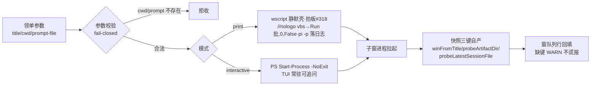

> **口径**：本卡话术/命名遵循《[00-话术统一口径正本](../00-话术统一口径正本.md)》（拍板#312）——双名制首现双写·撞车词带消歧（窗票/工序票·判色/判分）·两层口径 L1 车间（票级）/L2 派工台（窗级）。
> **消歧（本卡·口径正本 §3）**：票（工序票 L1／窗票 L2·随文标注）。
> **变更注记（v2 增密·W-251·拍板#334·2026-11-03）**：repo_head 67e5b04→e170067 重锚；实现本体已迁 `spawn_window.ts`（批C1 W-216·拍板#293——`spawn_window.mjs`=2 行入口垫片兼库转发·pi_runner SPAWNER 词面保活），全卡行锚随迁 .ts；增量段=**print 完全静默壳**（拍板#318·W-236·wscript 隐藏壳拉起形态·见 §增量段）——interactive 道位可见语义零触碰。

# 模块卡 · 拉窗器（spawn_window）

## §0 一句话

**解决什么**：把「一条领单指令」变成「一台真实的可见施工窗」——构造 ASCII 安全命令、拉起 pi 子窗进程、自产交接快照三键。**为什么存在**：拍板#70① 定死「窗=可见工作台不静默」（`90-过程/拍板记录表.md:88`），拉窗器是这条人机边界的技术载体。**边界**：只拉窗不盯窗（收口自检归调用方）、零 LLM 零预算、`--title` 仅 ASCII 且窗题装饰不承载信息。

## §典型事件链

| # | 事件 | 锚 |
|---|---|---|
| 1 | 定形：拍板#70 落表——L2 执行窗形态（窗=可见工作台·spawn 快照三键交底） | `90-过程/拍板记录表.md:88` |
| 2 | 实战：W-034（App 首跑冒烟·宿主仓作业面首票）经 spawn_window 拉起宿主窗 | `90-过程/执行台账.md:575` |
| 3 | 实战：W-042 拉窗 spawn 快照三键照录（会话档/产物锚/窗PID 在窗队列行·缺会话档如实沿录不谎报） | `90-过程/执行台账.md:584` |
| 4 | 实战（活例）：W-043 本窗拉起时快照三键缺 1 键（产物锚目录未建）→WARN 入账不谎报齐——拍板#89己「缺键不装」纪律的真实演练 | `90-过程/执行台账.md:584`（W-042 同款先例） |

## 接口

CLI：`node 91-脚本/spawn_window.mjs --title <窗题> --cwd <子窗目录> --prompt-file <kick路径> [--mode print|interactive] [--dry-run]`（入口=垫片·真身 spawn_window.ts·垫片注记锚 91-脚本/spawn_window.mjs:2）·`--selftest`。
导出纯函数族（供 pi_runner import 消费）：resolveCwd/buildPrintLaunchContent/buildInteractiveLauncherContent/buildStartCommand/buildPsSpawnCommand/buildWindowProbePsCommand（单引号拒收 fail-closed）·print 拉起命令串纯函数（锚 91-脚本/spawn_window.ts:98——`wscript.exe //nologo <vbs> <批处理>`）。

## 实现概览

v4 定案：命令行全 ASCII（中文/空格路径经环境变量传入批处理·CreateProcessW env 块 Unicode 安全）。两种模式：print=跑完自退（**wscript 静默壳**·拍板#318 见 §增量段）；interactive=TUI 常驻（PS Start-Process -NoExit·可追问·可见语义零变）。
交接快照底座单一事实源：winFromTitle 窗题提取·probeArtifactDir 产物目录探针（前缀匹配取 mtime 最新）·probeLatestSessionFile 会话档探针（mtime 降序+afterTs 过滤防拿调用方旧档谎报）——三件随 TS 化迁 spawn_window.ts（pi_runner.ts:82 import 消费）。

**节点详注表**（图正下方·每节点做什么/边界/锚点）：

| 节点 | 详注 |
|---|---|
| 领单参数 | 三要素入参：窗题（仅 ASCII·非 ASCII 自动剔除）、子窗目录、kick 提示词文件路径——全部来自派工器领单行或业主手工命令。 |
| 参数校验 | fail-closed 门：cwd/prompt-file 不存在=拒收；探针命令构造含单引号拒收——宁可拒拉不带病拉窗。 |
| 模式分支 | print=跑完自退（一次性会话·落日志+会话档·**wscript 静默壳拉起**·拍板#318）；interactive=TUI 常驻（施工窗默认·可追问·拍板#100 可见语义零变）。命令行全 ASCII，中文/空格路径走环境变量传入（v4 Unicode 安全定案）。mode 判定锚 91-脚本/spawn_window.ts:486-492。 |
| 子窗进程拉起 | interactive 走 PS Start-Process -NoExit，print 走 wscript 静默壳（拍板#318·见 §增量段）——纯系统进程零 LLM。 |
| 快照三键自产 | 单一事实源三件：winFromTitle 窗题提取/probeArtifactDir 产物目录探针（mtime 最新）/probeLatestSessionFile 会话档探针（afterTs 过滤防拿旧档谎报）——spawn_window.ts 单源；pi_runner import 消费防双头漂移（锚 91-脚本/pi_runner.ts:82）。 |
| 窗队列行回填 | 三键写入窗队列 spawn 快照段；缺键=WARN 照录不谎报齐（拍板#89己）——W-042/W-043 两窗实证。 |

## 增量段（print 完全静默壳·拍板#318·W-236·2026-11-01 落码·2026-11-03 补录）

**语义**：拍板#100「拉窗可见」在 **print 道位**由业主令「C. print 完全静默（真静默）」修订为静默自退（拍板#318·W-236）——interactive 道位可见语义**零触碰**；#265 最小化形态在 print 道位被本票升级取代（设计注记锚 91-脚本/spawn_window.ts:49-55）。

**形态**：print 分支拉起从 `start /min cmd /c` 改为 **wscript 隐藏壳**——`wscript.exe //nologo <vbs副本> <批处理>`·vbs 内 `WScript.Shell.Run <批>, 0, False`（0=隐藏窗·False=异步发射即 0 退出码·与 start 异步发射同契约）：

| 件 | 锚 | 说明 |
|---|---|---|
| vbs 形态单源 | `91-脚本/afk_spawn_hidden.vbs:1`（一行 ASCII） | 批路径走参数；仓内 vbs 含中文路径故运行时落 %TEMP% 副本再发射（spawn_window.ts:347 注记） |
| print 拉起命令串纯函数 | 91-脚本/spawn_window.ts:98-101 | title 不再进命令行（wscript 无窗无题·ascii(title)/winFromTitle 快照归属链在调用方零变） |
| env 继承链 | spawn→wscript→Run 双级 | AFK_* 三键零字节（快照归属改走批内 env 注入·ts:53-55 注记） |
| mode 判定/print 分支 | spawn_window.ts:486/:492 | 缺省 interactive 可见（业主拍板：先不做静默） |

**边界**：静默壳只改 print 道位拉起形态——快照三键/参数校验/退出码契约零变；夜车/无人值守用 print 道即完全静默（桌面零弹窗），围观追问走 interactive。

## 调用方与被调用

被调：pi_runner（import 快照底座四件+子进程拉窗·SPAWNER 指垫片·锚 91-脚本/pi_runner.ts:96）；业主手工拉窗。
调用：wscript.exe/PowerShell/cmd 系统进程（零 LLM）。

## 从哪测

`node 91-脚本/spawn_window.mjs --selftest`（入口垫片·真身 spawn_window.ts·含快照底座与静默壳案）；--dry-run 只出命令不真拉窗。

## 参数与预算

零 LLM 零预算；--title 仅 ASCII（非 ASCII 自动剔除·窗题装饰不承载信息）；cwd/prompt-file 不存在=拒收；临时 cmd/ps/log 留 %TEMP% 清理由业主；只拉窗不盯窗——收口自检归调用方；print 道位=完全静默（拍板#318）·interactive=可见可追问（拍板#100 零变）。

## 时效

基准=仓 head e170067（2026-11-03·W-251 对账批复勘：TS 化迁移随迁+静默壳形态实锚入卡）；上一基准 67e5b04（2026-10-21 W-040）；失效触发=拉窗形态/探针判据/快照底座语义改动（看执行台账 spawn_window 新笔）。
