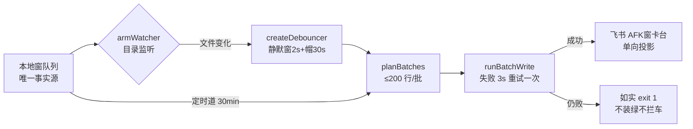

> **口径**：本卡话术/命名遵循《[00-话术统一口径正本](../00-话术统一口径正本.md)》（拍板#312）——双名制首现双写·撞车词带消歧（窗票/工序票·判色/判分）·两层口径 L1 车间（票级）/L2 派工台（窗级）。
> **消歧（本卡·口径正本 §3）**：票（工序票 L1／窗票 L2·随文标注）。
> **变更注记（v2 增密·W-251·拍板#334·2026-11-03）**：repo_head 67e5b04→e170067 重锚；实现本体已迁 `window_card_sync.ts`（1410 行·批C1 W-216·拍板#293——`window_card_sync.mjs`=2 行入口垫片兼库转发·afk_cron/桌面cmd 词面保活），全卡行锚随迁 .ts；增量段=W-241 领地勘误注记＋W-222 旧表退役双表分流＋批大小缺省勘正（≤200→25·见 §增量段）。

# 模块卡 · 窗卡台投影（window_card_sync）

## §0 一句话

**解决什么**：把本地窗队列的状态变化实时投影到飞书「AFK窗卡台」表，让业主在手机上看得到每张窗的 ▶/✅/🔁 与产物锚。**为什么存在**：拍板#69 立队时定死「窗队列=唯一事实源，飞书=单向投影」（`90-过程/拍板记录表.md:90`）——投影让业主免开电脑，本地文件才是真源。**边界**：只覆盖状态/锚点类字段、永不反向写本地、best-effort（失败记因继续·如实报不装绿）。

## §典型事件链

| # | 事件 | 锚 |
|---|---|---|
| 1 | 立队：拍板#69 落表——窗队列立为唯一队列事实源+飞书窗卡台投影 | `90-过程/拍板记录表.md:90` |
| 2 | 实战：W-032 事件订阅道上岗（watch 窗队列→防抖→秒级投影·替代纯定时轮询） | 本卡实现概览事件道三件 |
| 3 | 实战（反面教材·如实申报）：W-042 收口 window_card_sync 两跑均批写失败 42 行——**不装绿如实报**：本地窗队列（真源）✅ 态已落，飞书投影暂缺候恢复，「投影失败不拦车」 | `90-过程/执行台账.md:585`（W-042 收口补记） |

## 接口

CLI 三路：缺省全量对账同步（幂等可重复跑）·`--watch` 常驻状态订阅口（watch 窗队列→防抖→秒级投影）·`--selftest`（入口=垫片·真身 window_card_sync.ts·垫片注记锚 91-脚本/window_card_sync.mjs:2）。
核心导出：parseRows 行解析·cardPayload 行→飞书字段映射（锚 91-脚本/window_card_sync.ts:222）·planBatches 批划分（缺省 size=25·锚 :263）＋planBatchesRouted 双表分流（锚 :172·W-222）·syncQueue 全量对账主流程。

## 实现概览

单向投影：本地窗队列=唯一事实源，飞书「AFK窗卡台」表=投影（只覆盖状态/锚点类字段·永不反向·不改本地任何文件）。**投影件实勘非队列写者**（W-241 领地勘误·grep 零命中写口调用·见 §增量段）。
事件订阅道（W-032）：createDebouncer 防抖合并（锚 91-脚本/window_card_sync.ts:307·静默窗 2s+帽 30s 防连续写饿死）·armWatcher 目录监听（锚 :335·过滤 basename 防编辑器整文件替换断句柄）·startWatchLoop 常驻循环（锚 :346·事件道+进程内定时道 30min 并行·失效 WARN 退定时道·每轮尝试重挂自愈）。
批写 runBatchWrite（失败 3 秒自动重试一次·仍败如实报不装绿）。

**节点详注表**（图正下方·每节点做什么/边界/锚点）：

| 节点 | 详注 |
|---|---|
| 本地窗队列 | 投影的唯一数据源（`90-过程/窗队列.md`）；本件永不回改它——「投影=单向」是全件第一纪律，反向写=设计破坏。 |
| armWatcher 目录监听 | 事件驱动加速道（W-032）：监听队列文件变化秒级触发；过滤 basename 防编辑器「整文件替换」断句柄（锚 91-脚本/window_card_sync.ts:335）。 |
| createDebouncer | 防抖合并连续变化：静默窗 2s+帽 30s（锚 91-脚本/window_card_sync.ts:307）——既不漏更也不被高频写饿死。 |
| planBatches | 批划分缺省 size=25/批（锚 :263·W-222 期勘正·旧文「≤200」系 67e5b04 期参数已漂）；planBatchesRouted 双表分流（锚 :172）。 |
| runBatchWrite | 批写执行+失败 3 秒自动重试一次；重试仍败=如实报，绝不假装同步成功。 |
| 飞书 AFK窗卡台 | 投影终点：业主手机可见的状态面板；字段映射 cardPayload 行→飞书字段——只覆盖状态/锚点类，正文细节仍回本地队列看。 |
| 如实 exit 1 | 失败路径：记因退出（W-042 实证=两跑同败 42 行如实申报·`90-过程/执行台账.md:585`）——本地队列真源不受损，投影恢复后全量对账幂等补齐。 |

## 增量段（投影面治理三笔·W-241/W-222/W-210·2026-11-03 补录）

| # | 改面 | 内容 | 锚 |
|---|---|---|---|
| 1 | **W-241 领地勘误注记**（队列写治理批1·拍板#323①） | window_card_sync 实勘**非队列写者**——grep 零命中写口调用（writeQueueFlip/队列直写零命中）·W-241 立票时窗队列领地列误含本件·收口勘误如实证：投影=只读队列+只写飞书，「单向投影」纪律的领地面实证；本卡锚即 W-241 收口申报 :48 领地差异段 | `90-过程/窗产物/W-241-队列写治理批1/收口申报-W241-队列写治理批1-20261102.md:48` |
| 2 | **W-222 旧表退役**（拍板#302·决策反转链 #255→#287→#302） | 旧表道摘除：TABLE 常量删除（沿垫片先例删+锚注释·ID 字面留史 git 可考）＋planBatchesRouted 三表→双表 T1A+T1B 分流（路由不变：App→T1A/引擎→T1B）＋runBatchWrite 缺省表改 T1B——**删表动作=业主飞书 UI 亲手**（本票只摘码面·旧表=单向投影零事实损失）；W-210 三件语义零触碰硬闸保持 | 91-脚本/window_card_sync.ts:64（设计注记）·:172（planBatchesRouted） |
| 3 | **批大小缺省勘正** | planBatches 缺省 size=25（67e5b04 期卡面「≤200」系旧参已漂·本票实勘勘正） | 91-脚本/window_card_sync.ts:263 |

## 调用方与被调用

被调：各施工窗收口回投（手工跑）/业主整表投影；与 pi_runner 无直接调用（投影面解耦）。
调用：lark-cli 子进程（execSync+windowsHide·--json 走临时文件绕引号）。

## 从哪测

`node 91-脚本/window_card_sync.mjs --selftest`（入口垫片·真身 window_card_sync.ts·含重试/防抖/降级/双表路由案）。

## 参数与预算

零 LLM 零预算；best-effort（批失败记因继续·飞书异常如实 exit 1）；批缺省 25 行/次防炸面。

## 时效

基准=仓 head e170067（2026-11-03·W-251 对账批复勘：TS 化迁移随迁+W-241 领地勘误/W-222 双表分流/批25缺省三笔实锚入卡）；上一基准 67e5b04（2026-10-21 W-040）；失效触发=窗队列列结构/飞书表字段/防抖参数/分流路由改动（看执行台账 window_card_sync 新笔）。
