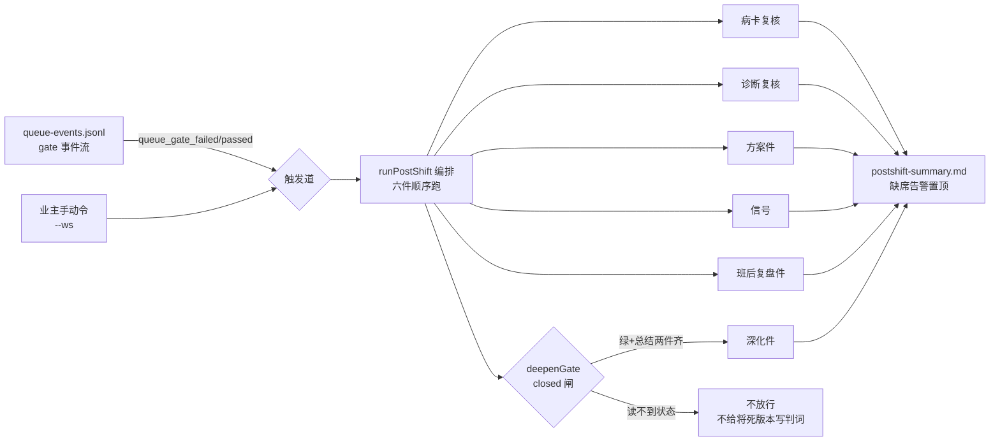

> **口径**：本卡话术/命名遵循《[00-话术统一口径正本](../00-话术统一口径正本.md)》（拍板#312）——双名制首现双写·撞车词带消歧（窗票/工序票·判色/判分）·两层口径 L1 车间（票级）/L2 派工台（窗级）。
> **消歧（本卡·口径正本 §3）**：票（工序票 L1／窗票 L2·随文标注）。

# 模块卡 · 收车编排（postshift）

## §0 一句话

**解决什么**：夜车收车后自动做班后复盘——监听 gate 事件或手动触发，跑复盘/归因/方案件六件，产出全部「待拍板」形态。**为什么存在**：班后归因和深化是高价值但机械的活，postshift 用「零代码写入·零重跑·零判卷触碰」三红线把它自动化，人只拍板（头注红线·锚 pipeline-lab/scripts/postshift.mjs:1）。**边界**：不碰夜车进程、不给将死的版本写判词（closed 闸）、每件失败不挡后续。

## §典型事件链

| # | 事件 | 锚 |
|---|---|---|
| 1 | 编排实勘：W-041 深读确认 postshift 六件编排锚（病卡/诊断/方案件/信号/复盘/深化挂 closed 闸） | `90-过程/执行台账.md:583` |
| 2 | 触发源：queue-40 班 gate 事件流（queue_gate_failed/passed 落 queue-events.jsonl）——--watch 道的行车记录仪 | `runs/.queue-roots/queue-40/queue-events.jsonl:1`（实物在册） |
| 3 | 深化闸纪律：closed 闸 fail-closed——「读不到状态≠放行」，深化只对已关环稳定态工作区开放 | 本卡实现概览·锚 pipeline-lab/scripts/postshift.mjs:38 |

## 接口

CLI 两路：手动复盘 `node pipeline-lab/scripts/postshift.mjs --ws <班次工作区> [--run-id] [--loop-root <维修环根·closed闸>] [--max-calls 5]`·监听 `--watch --manifest <m> --queue-events <q.jsonl> [--poll-sec 30]`。
导出：deepenGate closed 闸纯函数（锚 pipeline-lab/scripts/postshift.mjs:38）·runPostShift 编排主流程（锚 pipeline-lab/scripts/postshift.mjs:59·loopStateReader/shFn 可注入打桩）·watchMode 监听（锚 pipeline-lab/scripts/postshift.mjs:207·gate 事件触发）。

## 实现概览

把 nightrun-wrap 九连的「收车半段」独立拉起：班次结束后做复盘/归因/方案件，不碰夜车进程。红线（头注·锚 pipeline-lab/scripts/postshift.mjs:1）：零代码写入·零重跑·零判卷触碰——产出全部「待拍板」形态，不装绿不改车。
closed 闸 fail-closed：深化只对已关环（绿+总结落盘两件齐）的稳定态工作区开放；读不到状态≠放行——不给将死的版本写判词。韧性：每件失败不挡后续（warnings 收集）·全部子件可独立重跑幂等。

**节点详注表**（图正下方·每节点做什么/边界/锚点）：

| 节点 | 详注 |
|---|---|
| 触发道 | 两路入口并行可用：--watch 监听 gate 事件（锚 pipeline-lab/scripts/postshift.mjs:207·poll-sec 轮询事件流）与业主手动令——同一编排主流程，幂等可重跑。 |
| queue-events.jsonl | 行车记录仪：gate 判定事件的唯一正本（拍板#35 实锚）；postshift 只读它做触发判断，不改写（账本契约见 ct-20261021-001）。 |
| runPostShift 编排 | 六子件顺序拉起（锚 pipeline-lab/scripts/postshift.mjs:59）；loopStateReader/shFn 可注入打桩（测试面）；每件失败 warnings 收集不挡后续。 |
| deepenGate closed 闸 | 深化的资格闸纯函数（锚 pipeline-lab/scripts/postshift.mjs:38）：绿+总结落盘两件齐才放行；fail-closed——读不到状态≠放行。 |
| 深化件 | 班后深化产出（待拍板形态）：只对已关环稳定态工作区开放，不给将死的版本写判词——「宁缺勿滥」的复盘纪律。 |
| postshift-summary.md | 六件汇总落 `<ws>/report/postshift-summary.md`；某件缺席=告警置顶（不藏失败）——业主晨读的单一入口。 |

## 调用方与被调用

被调：nightrun-wrap（收车半段·见卡 mk-20261021-004）/业主手动复盘令。
调用：六子件独立 CLI（复盘/归因/方案件族·编排搬家不重写）；环状态读 repair-loop-state.json。

## 从哪测

pipeline-lab/tests 下 postshift 相关测试件（node --test）；deepenGate 纯函数可直测。

## 参数与预算

独立分账（--max-calls 透传 diagnose·与夜车预算互不挤占）；产出汇总落 `<ws>/report/postshift-summary.md`（缺席告警置顶）。

## 时效

基准=仓 head 67e5b04（2026-10-21·W-040 核对）；失效触发=收车子件面/closed 闸判据改动（看执行台账 pipeline-lab 新笔）。
