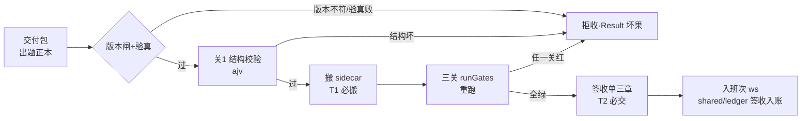

> **口径**：本卡话术/命名遵循《[00-话术统一口径正本](../00-话术统一口径正本.md)》（拍板#312）——双名制首现双写·撞车词带消歧（窗票/工序票·判色/判分）·两层口径 L1 车间（票级）/L2 派工台（窗级）。
> **消歧（本卡·口径正本 §3）**：票（工序票 L1／窗票 L2·随文标注）；三关（收包验货关 L1／立票验单关·贴卡拦病关·领单再验单 L2）。

# 模块卡 · 三站站3收货导入（station3-import）

## §0 一句话

**解决什么**：把交付包（出题正本）安全导入班次工作区——版本闸/验真/签收单/搬 sidecar/三关重跑一条龙。**为什么存在**：三站流水线（站3收货→站4施工→站5验收）的第一道门，导入面坏则后面全坏——契约 v2 八条行为把「收什么、怎么验、入哪账」全部机械化（头注·锚 ts/src/station3-import/import.ts:1）。**边界**：纯机械零 LLM（导入侧不判红绿·判卷语义零触碰）、T1 必搬 sidecar、T2 签收单必交。

## §典型事件链

| # | 事件 | 锚 |
|---|---|---|
| 1 | 实战：W-015（改包道末轮回滚·ts 码件窗白名单首票）——站3 导入面在码件窗白名单条款下被触碰后回滚复验 | `90-过程/执行台账.md:239` |
| 2 | 实测面：import.test.ts/gates.test.ts/backflow.test.ts/coverage.test.ts 测试族全量跑（ts/ 面 1091 案基线） | 本卡从哪测节 |
| 3 | 链位：站3→站4→站5 串联构成切片流水线（queue-runner 派班逐站调用） | 三卡互链（mk-006/007/008 related） |

## 接口

主入口 importPackage(pkgDir, wsDir, ledger, opts)（锚 ts/src/station3-import/import.ts:34·Result 型出参）——把交付包导入工作区。
辅助导出：scanEnvConsumption（锚 ts/src/station3-import/import.ts:208）/collectEnvConsumption/runEnvNameProbe（env 消费面扫描与探针）。

## 实现概览

契约 v2 导入行为八条中的①-⑤（头注·锚 ts/src/station3-import/import.ts:1）：版本闸/验真/签收单三章/搬 sidecar/三关重跑——关1 结构校验走 ajv；三关 runGates（import 自 gates.js·锚 ts/src/station3-import/import.ts:13·调用点锚 ts/src/station3-import/import.ts:155）。T1 必搬 sidecar·T2 签收单必交。

**节点详注表**（图正下方·每节点做什么/边界/锚点）：

| 节点 | 详注 |
|---|---|
| 交付包 | 施工对象=出题正本（交件包·站1/2 产物）；导入只读包不改正本——「正本只增不改」是四级数据记录铁律（见总表卡 bf-20261021-006）。 |
| 版本闸+验真 | 契约 v2 第一二条：包版本与引擎版本对表+包完整性验真；不过=拒收（Result 型坏果出参·锚 ts/src/station3-import/import.ts:34），不带病导入。 |
| 关1 结构校验 | ajv 校验包结构 schema——机械可复核，坏结构在站3 就拦下，不流到站4 浪费施工预算。 |
| 搬 sidecar | T1 类票 sidecar 必搬（头注契约第三条）——依赖资产随包进 ws，防施工时缺料。 |
| 三关 runGates | 导入侧三关重跑（锚 ts/src/station3-import/import.ts:155·gates.js 单一正本）；与派工三关（任务书面）不同域——这里验的是包，不是任务书。 |
| 签收单三章 | T2 签收单必交（契约第五条）：导入完成=签收落 shared/ledger 账本——「收没收到」有账可查，纠纷可回放。 |
| 入班次 ws | 导入终点=班次工作区（票级家址·随 ws 生命周期，保留近 5 班余归档）；env 消费面扫描（锚 ts/src/station3-import/import.ts:208）顺带记账。 |

## 调用方与被调用

被调：queue-runner（切片流水线站3道）/e2e 链。
调用：gates.js（三关）·satisfiability 探针·gherkin 编译机检（出题草稿道·拍板#8 C-025）·shared/ledger（签收入账）。

## 从哪测

同目录测试族：import.test.ts/gates.test.ts/backflow.test.ts/coverage.test.ts 等（`npm test` 全量 node --test·ts/ 面 1091 案基线）。

## 参数与预算

零 LLM（纯机械导入校验）；opts.gherkinGate=warn|block 二档；判卷语义零触碰（导入侧不判红绿）。

## 时效

基准=仓 head 67e5b04（2026-10-21·W-040 核对）；失效触发=契约 v2 版本闸/三关语义改动（看 ts/ 面 git log+契约件）。
