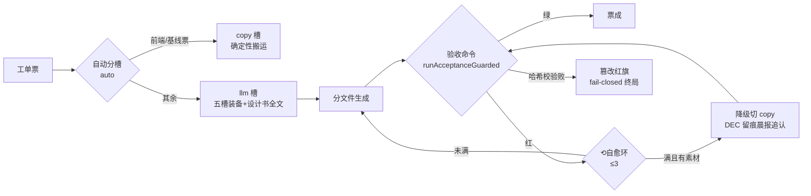

> **口径**：本卡话术/命名遵循《[00-话术统一口径正本](../00-话术统一口径正本.md)》（拍板#312）——双名制首现双写·撞车词带消歧（窗票/工序票·判色/判分）·两层口径 L1 车间（票级）/L2 派工台（窗级）。
> **消歧（本卡·口径正本 §3）**：票（工序票 L1／窗票 L2·随文标注）；自愈环（干活自愈环·L1）。

# 模块卡 · 三站站4施工（station4-build）

## §0 一句话

**解决什么**：流水线的「施工道」——按工单计划把票做成代码：双槽位（copy 确定性搬运/llm 写码工程师）+自动分槽+预授权降级链。**为什么存在**：施工既要 LLM 的产能又要确定性的保底，站4 用「机器不发明新手段、只在预授权清单内降档」两头兼顾（头注·锚 ts/src/station4-build/build.ts:1）。**边界**：判卷素材防篡改（拍板#82 守卫·`90-过程/拍板记录表.md:101`）——守卫只防篡改不判卷，红绿权仍在验收命令。

## §典型事件链

| # | 事件 | 锚 |
|---|---|---|
| 1 | 立规：拍板#82 落表——判卷素材防篡改（验收命令执行全走 runAcceptanceGuarded·篡改=红旗 fail-closed 终局·不进⟲环不进降级链·不可自愈豁免） | `90-过程/拍板记录表.md:101` |
| 2 | 守卫接线：所有验收命令执行走 runAcceptanceGuarded（判卷前校验工作区副本哈希） | 本卡实现概览·锚 ts/src/station4-build/build.ts:210 |
| 3 | 降级链纪律：llm 槽 ⟲≤3 自愈环不绿且有素材→自动切 copy·DEC 留痕晨报追认——机器只在预授权清单内降档 | 本卡实现概览（头注·锚 ts/src/station4-build/build.ts:1） |

## 接口

主入口 buildTicket（锚 ts/src/station4-build/build.ts:137）——按工单计划施工出码；predeployTicketAssets 包内资产预布（锚 ts/src/station4-build/build.ts:129）。
判卷守卫 import 自 shared/judge-guard（runAcceptanceGuarded/lockJudgeSnapshot·锚 ts/src/station4-build/build.ts:24）。

## 实现概览

双槽位+自动分槽+预授权降级链（头注·锚 ts/src/station4-build/build.ts:1）：copy=确定性施工员（基线/前端票保底·搬运 artifacts）；llm=写码工程师（五槽装备+设计书全文→分文件生成→反馈式自愈环 ⟲≤3）；auto=业主拍板默认（前端票走确定性保底·其余走 LLM·⟲3 不绿且有素材→自动切 copy·DEC 留痕晨报追认——机器不发明新手段只在预授权清单内降档）。
判卷素材防篡改（拍板#82）：所有验收命令执行走 runAcceptanceGuarded（调用点锚 ts/src/station4-build/build.ts:210）——判卷前校验工作区副本哈希·篡改=红旗 fail-closed 终局（不进⟲环不进降级链·不可自愈豁免）；红绿权仍归验收命令。

**节点详注表**（图正下方·每节点做什么/边界/锚点）：

| 节点 | 详注 |
|---|---|
| 工单票 | 施工输入：站3 导入后的票（含计划/预算/验收命令）——站4 只按工单施工，不自造票不出题（出题权冻结在开工前）。 |
| 自动分槽 | auto=业主拍板默认档：前端票走确定性保底，其余走 LLM——分槽规则机械可预期，机器不发明新档位。 |
| copy 槽 | 确定性施工员：搬运 artifacts 保底（基线/前端票），零 LLM 零漂移——降级链的落点与确定性路线的本体。 |
| llm 槽 | 写码工程师：五槽装备+设计书全文→分文件生成→反馈式自愈环（⟲≤3）——产能担当，预算走工单 llm-call-budget。 |
| runAcceptanceGuarded | 判卷守卫（拍板#82·锚 ts/src/station4-build/build.ts:210）：判卷前校验工作区副本哈希——防「先改判卷素材再跑命令」的作弊面；红绿权仍归验收命令本身。 |
| 篡改红旗 | fail-closed 终局：不进⟲环不进降级链、不可自愈豁免——守卫是唯一「一票终局」路径，因它防的是对判卷制度本身的攻击。 |
| 降级切 copy | 预授权降档：⟲3 不绿且有素材→自动切 copy+DEC 留痕晨报追认——降级可追认可推翻，不静默吞结果。 |

## 调用方与被调用

被调：queue-runner（切片流水线站4道）。
调用：llm-builder/llm-prompts/llm-session 族（LLM 施工）·judge-guard（判卷守卫）·degrade-chain（降级链）·selfheal-triage（自愈分诊）。

## 从哪测

同目录测试族（phase3/llm 各件 .test.ts）+e2e 链；`npm test` 全量跑。

## 参数与预算

LLM 调用走工单预算（llm-call-budget 件）；⟲≤3 自愈环上限；判卷红绿权/出题权零触碰（#82 守卫只防篡改不判卷）。

## 时效

基准=仓 head 67e5b04（2026-10-21·W-040 核对）；失效触发=槽位/降级链/守卫语义改动（看 ts/ 面 git log+执行台账）。
