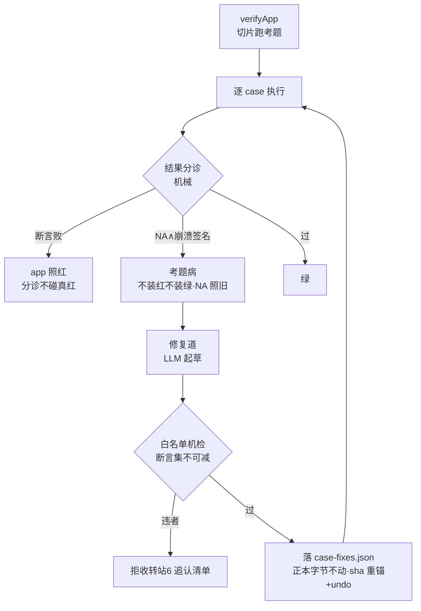

> **口径**：本卡话术/命名遵循《[00-话术统一口径正本](../00-话术统一口径正本.md)》（拍板#312）——双名制首现双写·撞车词带消歧（窗票/工序票·判色/判分）·两层口径 L1 车间（票级）/L2 派工台（窗级）。
> **消歧（本卡·口径正本 §3）**：票（工序票 L1／窗票 L2·随文标注）；判定梯（交卷判分梯 L1／收班判色梯 L2）。

# 模块卡 · 三站站5验收（station5-verify）

## §0 一句话

**解决什么**：流水线的「验收道」——切片跑考题出验收结论，并把「考题自身坏了」与「App 真坏了」分诊开。**为什么存在**：脚本崩≠app 红——把坏考题当罪证会冤枉 App、把真红当考题病会放过 App；站5 用机械分诊守住「坏考题不充当罪证=更严」的判卷纪律（头注·锚 ts/src/station5-verify/verify.ts:1）。**边界**：分诊只识别不改判卷语义；考题修复=LLM 起草+白名单机检双重约束（断言集不可减）。

## §典型事件链

| # | 事件 | 锚 |
|---|---|---|
| 1 | 定形：W6 件⑦ 考题病分诊+修复道上岗——崩溃签名表机械分诊（SyntaxError/Cannot find module/is not defined 等→考题病·不装红不装绿） | 本卡实现概览（头注·锚 ts/src/station5-verify/verify.ts:1） |
| 2 | 实战：W16 验证班（manifest-w16-c-v6 丙案双绿终版）——验收面（判定梯/切片族）在多版本逐版过闸中担纲 | `runs/manifest-w16-c-v6.json:1`（实物在册·契约卡 ct-20261021-002） |
| 3 | 修复道纪律：断言集不可减（orig 全部 expectText 文本必须存活∧expectStatus 不变·违者拒收转站6 追认清单） | 本卡实现概览 |

## 接口

主入口 verifyApp(opts)（锚 ts/src/station5-verify/verify.ts:39）——站5 验收主流程（切片跑考题出验收结论）。
辅助导出 appStartCauseOf（锚 ts/src/station5-verify/verify.ts:253）——启动失败 stderr 尾→BootCause 归因。

## 实现概览

W6·件⑦ 考题病分诊+修复道（头注·锚 ts/src/station5-verify/verify.ts:1）：脚本自身崩≠app 红——分诊（机械）：NA∧崩溃签名（SyntaxError/Cannot find module/is not defined 等）→「考题病」（不装红不装绿·NA≠PASS 照旧——坏考题不充当罪证=更严）；断言败→app 照红（分诊不碰真红）。
修复道（Agent员工起草+机械白名单机检）：修复原语白名单=选择器/url 修正/新增 goto·expectText 步；断言集不可减（orig 全部 expectText 文本必须存活∧expectStatus 不变·违者拒收转站6追认清单）；修复落 ws/_slices/case-fixes.json（正本 pkg 字节不动·按 id 覆盖进运行副本·sha 重锚）+undo 令随件。

**节点详注表**（图正下方·每节点做什么/边界/锚点）：

| 节点 | 详注 |
|---|---|
| verifyApp | 站5 主入口（锚 ts/src/station5-verify/verify.ts:39）：组织切片族（slice-cases/slice-parallel/slice-triage/slice-selfheal）跑考题，汇总出验收结论给判定梯。 |
| 结果分诊 | 机械三分：断言败=app 真红（分诊不碰）；NA∧崩溃签名=考题病；过=绿——判据全是签名表比对，零 LLM 零主观。 |
| app 照红 | 真红路径不动摇：断言败就是断言败，分诊的存在绝不给 App 洗红——「更严」方向的纪律。 |
| 考题病 | 坏考题路径：不装红不装绿、NA≠PASS 照旧——坏考题既不冤枉 App 也不帮 App 蒙混，留待修复道。 |
| 修复道 | Agent员工（LLM）起草修复案+机械白名单机检双重约束：原语只有选择器/url 修正/新增 goto·expectText 步——起草自由、收口严卡。 |
| 白名单机检 | 断言集不可减：orig 全部 expectText 文本必须存活∧expectStatus 不变——修考题永远不能变成「删断言放水」；违者拒收转站6 追认清单。 |
| 落 case-fixes.json | 修复产物落 ws/_slices/（正本 pkg 字节不动·按 id 覆盖运行副本·sha 重锚）+undo 令随件——可回滚可审计，考题正本仍归业主资产。 |
| 启动归因 | appStartCauseOf（锚 ts/src/station5-verify/verify.ts:253）：启动失败 stderr 尾→BootCause 归因——起不来的 App 也能给出「死在哪一步」的机械判词。 |

## 调用方与被调用

被调：queue-runner（切片流水线站5道）/slice-runner。
调用：slice-cases/slice-parallel/slice-triage/slice-selfheal（切片族）·functional-gate/ladder（功能闸/判定梯）·shared/llm（考题修复起草）。

## 从哪测

同目录测试族（slice/ladder/case-defect 等件 .test.ts）+e2e 链；`npm test` 全量跑。

## 参数与预算

考题修复=LLM 起草+白名单机检双重约束（断言集不可减）；判卷红绿权/出题权零触碰（分诊只识别考题病·不改判卷语义）。

## 时效

基准=仓 head 67e5b04（2026-10-21·W-040 核对）；失效触发=分诊签名表/白名单/判定梯语义改动（看 ts/ 面 git log+执行台账）。
