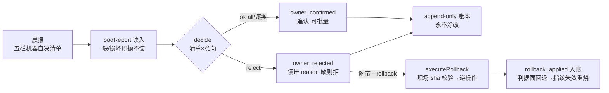

> **口径**：本卡话术/命名遵循《[00-话术统一口径正本](../00-话术统一口径正本.md)》（拍板#312）——双名制首现双写·撞车词带消歧（窗票/工序票·判色/判分）·两层口径 L1 车间（票级）/L2 派工台（窗级）。
> **消歧（本卡·口径正本 §3）**：票（工序票 L1／窗票 L2·随文标注）；翻案（绿灯吊销 L1／业主撤回 L2）。

# 模块卡 · 判卷追认（confirm）

## §0 一句话

**解决什么**：给业主一个「翻案口」——晨报五栏机器自决清单逐条可追认（owner_confirmed）或推翻（owner_rejected·须带 reason），推翻还可执行撤销令（--rollback）。**为什么存在**：机器自决快但非圣旨，Owner 追认环让「机器先走、人可翻案」闭环（头注·锚 ts/src/confirm.ts:1）。**边界**：两者只入账不自动改码；推翻后差量处置走既有补票环与下一轮 resume；只追加账本永不涂改。

## §典型事件链

| # | 事件 | 锚 |
|---|---|---|
| 1 | 定形：晨报五栏机器自决+逐条可推翻的落账端接线（decide 纯函数=清单×意向→事件序列） | 本卡实现概览（锚 ts/src/confirm.ts:27） |
| 2 | 立规：W6 件② 拍板#12——--rollback 推翻并执行撤销令（逐条现场 sha 校验→逆操作→rollback_applied 入账） | 本卡实现概览（executeRollback 调用点锚 ts/src/confirm.ts:90） |
| 3 | 纪律实证：缺 reason 拒绝（可推翻≠可含糊）+文件面撤回不洗绿（判据面回退→下轮指纹失效重烧） | 本卡实现概览 |

## 接口

CLI：`npm run confirm -- --workspace <ws> [--list] [--ok all|<ticketId>]... [--reject <ticketId> --reason "..."] [--rollback]`。
核心导出 decide（锚 ts/src/confirm.ts:27）——晨报决策清单×业主意向→追认/推翻事件序列。

## 实现概览

Owner 追认环接线（头注·锚 ts/src/confirm.ts:1）：晨报五栏机器自决清单逐条可推翻的落账端。语义：owner_confirmed=追认（可批量 all）·owner_rejected=推翻（须带 reason——可推翻≠可含糊·缺 reason 拒绝）；两者只入账不自动改码，推翻后差量处置走既有补票环与下一轮 resume。
输入 loadReport 读晨报（锚 ts/src/confirm.ts:19·缺/损坏即抛不装）；main（锚 ts/src/confirm.ts:50）入账 Ledger；--rollback（W6 件②·拍板#12）：推翻并执行撤销令——逐条现场 sha 校验→逆操作→rollback_applied 入账（executeRollback 调用点锚 ts/src/confirm.ts:90）；文件面撤回不洗绿：判据面回退→下轮指纹失效重烧。纪律：只追加账本（永不涂改）。

**节点详注表**（图正下方·每节点做什么/边界/锚点）：

| 节点 | 详注 |
|---|---|
| 晨报清单 | 追认对象=晨报五栏机器自决清单（每条独立可翻案）——机器先走、人后认，追认不阻塞夜车节奏。 |
| loadReport | 读入晨报（锚 ts/src/confirm.ts:19）：缺/损坏即抛不装——没有清单就不演追认，杜绝「追认了个空」。 |
| decide | 纯函数核心（锚 ts/src/confirm.ts:27）：清单×业主意向→追认/推翻事件序列；可测试可重放（confirm.test.ts 直测）。 |
| owner_rejected | 推翻必须带 reason（可推翻≠可含糊·缺 reason 拒绝）——翻案要留理由，账本上才立得住。 |
| executeRollback | 撤销令执行（W6 件②·拍板#12·锚 ts/src/confirm.ts:90）：逐条现场 sha 校验→逆操作→rollback_applied 入账；--rollback 需与 --reject 并用（回滚只针对推翻项）。 |
| 不洗绿 | 文件面撤回≠判据洗白：判据面回退→下轮指纹失效重烧——推翻后的票下一轮照样重考，翻案不放水。 |
| append-only 账本 | 一切追认/推翻/回滚事件只追加永不涂改（shared/ledger）——追认史=审计史，翻旧账随时可回放。 |

## 调用方与被调用

被调：npm run confirm 脚本（package.json 面）/业主手工追认；decide 的测试在 confirm.test.ts（图谱 trace 产候选 confirm/run-slice·磁盘复核=仅 confirm.ts main 与 confirm.test.ts 两处引用）。
调用：shared/ledger（append-only 账本）·shared/undo-plan（撤销令执行）。

## 从哪测

ts/src/confirm.test.ts（decide 纯函数案·node --test 全量跑）；--list 只读列清单零副作用。

## 参数与预算

零 LLM 零预算（纯机械落账）；--rollback 需与 --reject 并用（回滚只针对推翻项）；红线不变量=判卷语义零触碰（追认不入判卷·晨报对比可见效果）。

## 时效

基准=仓 head 67e5b04（2026-10-21·W-040 核对）；失效触发=晨报 schema/账本事件型/撤销令语义改动（看 ts/ 面 git log+执行台账）。
