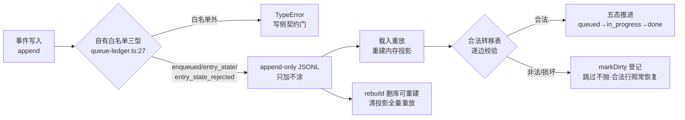

> **口径**：本卡话术/命名遵循《[00-话术统一口径正本](../00-话术统一口径正本.md)》（拍板#312）——双名制首现双写·撞车词带消歧（窗票/工序票·判色/判分）·两层口径 L1 车间（票级）/L2 派工台（窗级）。
> **消歧（本卡·口径正本 §3）**：票（工序票 L1／窗票 L2·随文标注）；「排期」＝L1 夜车票排期（queue-〈班〉/ledger·非 L2 窗队列）。
> **变更注记（v2 增密·W-251·拍板#334·2026-11-03）**：repo_head 67e5b04→e170067 重锚；五态已中文化（W-139 拍板#198：排队中/施工中/完成/被替代/待重排·中文键正本+LEGACY_EN_MAP 读取映射英文旧账一字不动）·行锚随之刷新；**域边界注记**：任务书预置增量段「审计指纹六字段＋写前滚动备份＋注记通道 op:note」实属 L2 窗队列写口域（91-脚本/队列写口.mjs·W-226/W-241/W-242 落码）非本卡 ts/src/queue/queue-ledger.ts 排期账本域——本卡按实域落域界注记不臆造（latitude B 级留痕候追认·见 §域边界注记）。

# 模块卡 · queue账本（queue-ledger）

## §0 一句话

**解决什么**：给夜车排期一本可重放、可重建、脏了能自净的账——每版本一条五态状态线（queued/in_progress/done/superseded/needs_replan）。**为什么存在**：列队=已拍板条目的执行排期口径（蓝图 §8.5·拍板#40），排期推进必须 append-only 可审计（`90-过程/拍板记录表.md:114` 拍板#93 知识基建口径同源）。**边界**：gate 判定事件不在本账（那是 queue-events 行车记录仪·读侧单一正本拍板#35）；冷启空账不建空文件。

## §典型事件链

| # | 事件 | 锚 |
|---|---|---|
| 1 | 立账：C-019/蓝图 §8.5/拍板#40——排期账本三件套（append-only JSONL+游标续读+删库可重建）照 shared/ledger 先例 | 本卡实现概览（头注） |
| 2 | 实物：queue-40 班 ledger 11 行、2 事件型（enqueued/entry_state）——W-041 逐行实勘入卡 | `90-过程/执行台账.md:583` |
| 3 | Q3 自净实战口径：载入损坏行/非法转移→markDirty 登记·不抛·跳过·合法行照常恢复末态（业主 2026-09-28 推荐 A） | 本卡实现概览（锚 ts/src/queue/queue-ledger.ts:94） |

## 接口

class QueueLedger（锚 ts/src/queue/queue-ledger.ts:87）——排期账本（C-019·蓝图 §8.5·拍板#40）。写入面 append 收白名单事件型（锚 ts/src/queue/queue-ledger.ts:68·白名单外 TypeError 写侧契约门）。

## 实现概览

三件套照 shared/ledger 先例（头注）：①append-only JSONL（只许追加永不涂改）②游标续读（since/cursor 同口径）③删库可重建（rebuild 清投影重放·锚 ts/src/queue/queue-ledger.ts:199）。
状态机五态（锚 ts/src/queue/queue-ledger.ts:14·W-139 中文化）：**排队中/施工中/完成/被替代/待重排**（英文旧名 queued/in_progress/done/superseded/needs_replan 经 LEGACY_EN_MAP 读取映射·锚 :33·历史英文账本一字不动重放等价）；合法转移表（锚 :19-24）：主线 排队中→施工中→完成·完成/被替代 终态·叫停/重排只作用未开工或进行中·待重排唯一出边回排队中（列队=已拍板条目的执行排期口径）。
Q3 脏行口径（业主 2026-09-28 推荐 A）：载入损坏行/非法转移事件→markDirty queue_dirty 登记（锚 ts/src/queue/queue-ledger.ts:139·全局账本+内存清单）·不抛·跳过脏行·合法行照常恢复末态（坐标推导永不抛家族）。

**节点详注表**（图正下方·每节点做什么/边界/锚点）：

| 节点 | 详注 |
|---|---|
| 事件写入 | 唯一写入口 append：排期推进全走事件落账——「状态」不是存出来的，是从事件流重放出来的（可审计可回放）。 |
| 自有白名单三型 | 写侧契约门（锚 ts/src/queue/queue-ledger.ts:68）：queue_enqueued/queue_entry_state/queue_entry_state_rejected 三型外直接 TypeError——坏事件在写侧就挡住，不进账。 |
| append-only JSONL | 只许追加永不涂改——账本的绝对底线；五态枚举定义在锚 ts/src/queue/queue-ledger.ts:14、转移表在 :19。 |
| 载入重放 | 冷启从 JSONL 重放内存投影：游标续读（since/cursor 同口径）——账越记越长，读侧永远可以从任意 seq 续。 |
| 合法转移表 | 逐边校验（锚 ts/src/queue/queue-ledger.ts:19）：主线 排队中→施工中→完成，完成/被替代 终态，叫停/重排只作用未开工或进行中——排期纪律的机器化。 |
| Q3 自净 | 脏行不抛不炸：markDirty 登记（锚 ts/src/queue/queue-ledger.ts:139）+跳过+合法行照常恢复末态——半行烂账不至于废整本账（业主推荐 A 定案）。 |
| rebuild | 删库可重建：清内存投影从事件流全量重放——账本文件丢了/坏了，只要有事件流就能一比一重建。 |

## 域边界注记（W-251·拍板#334·2026-11-03·latitude B 级候追认）

任务书预置本卡增量段=「审计指纹六字段＋写前滚动备份＋注记通道 op:note」——实勘该三件属 **L2 窗队列写口域**，落码在 `91-脚本/队列写口.mjs`（W-226 拍板#311 指纹+备份·W-241 批1 暴露面·W-242 拍板#323①批2 注记通道），与本卡 L1 夜车排期账本（ts/src/queue/queue-ledger.ts）**不同域不同件**。按「现状体向代码对账·不臆造」三闸，本卡不把写口功能写入本卡实体——域界分工如下，写口细节候独立卡（沿拍板#294 漏盘申报→清偿窗补卡先例·本票不出新卡）：

| 域 | 件 | 账本职能 | 治理增量（67e5b04 后） |
|---|---|---|---|
| **L1 夜车排期账本（本卡域）** | ts/src/queue/queue-ledger.ts | 工序票排期五态·append-only 事件重放 | W-139 中文化（本卡已随迁）·本体零变 |
| **L2 窗队列写口（邻域·非本卡）** | 91-脚本/队列写口.mjs | 窗队列状态翻格单口 CLI 四道 | 审计指纹六字段（pre/post Md5/Lines/MaxW·队列写口.mjs:83-93·:371）＋写前滚动备份（storage/queue-backups·keep=10·:96-125）＋注记通道 op:note（纯注记不改状态·:422-434·:491-492·W-242） |

**零行为断言**：本注记只添域界说明·本卡实体描述零回改（除行锚中文化随迁）；ts/src/queue/queue-ledger.ts 码面本票零字节。

## 调用方与被调用

被调：queue-runner（磁盘复核=queue-runner.ts import queue-ledger·图谱 trace 产候选后 grep 实证）；nightrun-wrap 读侧经 queue-ledger.jsonl/queue-events.jsonl 重放（readFinalStates·见卡 mk-20261021-004）。
调用：shared/ledger（queue_dirty 全局登记处·opts 注入）。

## 从哪测

ts/src/queue/queue-ledger.test.ts（含脏行/转移/白名单案＋LEGACY 专案：英文旧账重放等价·W-139）；`npm test` 全量跑。

## 参数与预算

零 LLM 零预算；冷启空账不建空文件（首写才落盘）；红线不变量=append-only 永不涂改。

## 时效

基准=仓 head e170067（2026-11-03·W-251 对账批复勘：W-139 中文化行锚随迁+域边界注记落卡）；上一基准 67e5b04（2026-10-21 W-040）；失效触发=状态机/转移表/事件型白名单扩改（看 ts/ 面 git log+§8.5 蓝图权威区）。
