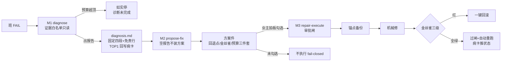

> **口径**：本卡话术/命名遵循《[00-话术统一口径正本](../00-话术统一口径正本.md)》（拍板#312）——双名制首现双写·撞车词带消歧（窗票/工序票·判色/判分）·两层口径 L1 车间（票级）/L2 派工台（窗级）。
> **消歧（本卡·口径正本 §3）**：票（工序票 L1／窗票 L2·随文标注）。

# 模块卡 · 维修环（diagnose / propose-fix / repair-execute）

## §0 一句话

**解决什么**：夜车 FAIL 之后的三环维修链——M1 诊断（只读证据出根因报告）、M2 建议修（出方案件候拍板）、M3 维修执行（审批闸+金丝雀+一键回滚的机械修）。**为什么存在**：坏损要修但更要不闯祸——三环把「看病的」「开方子的」「动刀的」分权，每环独立预算/独立闸门（`90-过程/拍板记录表.md:103` 拍板#84② 编排接线）。**边界**：M1 零写代码零重跑；M2 本件不修任何东西；M3 未勾选不执行 fail-closed。

## §典型事件链

| # | 事件 | 锚 |
|---|---|---|
| 1 | M1 立环：拍板#28（L0 诊断环）——只读证据出根因报告·零写代码零重跑（红线）；预算闸=LLM 调用封顶缺省 5 独立分账 | 本卡实现概览 |
| 2 | M2 立环：L1 建议修（灵感池#5）——诊断→修复方案件（结构化·零 LLM 确定性组织）；安全三件套强制入件（回退点/金丝雀/预算） | 本卡实现概览 |
| 3 | 编排接线：拍板#84②——FAIL 接维修环入 nightrun-wrap 编排（fail-loop 授权制改造） | `90-过程/拍板记录表.md:103` |
| 4 | M3 定案：拍板#71/#72 全链辖区——审批闸→上溯检查步→锚点备份→机械修→金丝雀三级→回滚/过闸→自动重跑 | 本卡实现概览（头注·锚 pipeline-lab/scripts/repair-execute.mjs:1） |

## 接口

三环三 CLI（M1 诊断/M2 方案/M3 执行）：
- M1 `diagnose.mjs`：readEvidence 证据白名单只读（锚 pipeline-lab/scripts/diagnose.mjs:21·app-stderr 尾部+verify-report 摘要+morning 对比——白名单外不碰）·diagnose 主流程（锚 pipeline-lab/scripts/diagnose.mjs:116·出 ws/report/diagnosis.md 固定四段+免责行·TOP1 回写病卡）。
- M2 `propose-fix.mjs`：parseDiagnosis 解析诊断报告（锚 pipeline-lab/scripts/propose-fix.mjs:19·空报告不装方案 fail-closed）·runPropose 出方案件（锚 pipeline-lab/scripts/propose-fix.mjs:88）。
- M3 `repair-execute.mjs`：executePlan 机械修执行（锚 pipeline-lab/scripts/repair-execute.mjs:50）。

## 实现概览

M1 诊断环（拍板#28·L0）：只读证据出根因报告·零写代码零重跑（红线）；预算闸=LLM 调用封顶（缺省 5·独立分账·超顶即停如实「诊断未完成」）·密钥值零入账（ADR-0002 只进请求头）。
M2 建议修（L1·灵感池#5）：诊断→修复方案件（结构化·零 LLM 确定性组织）——方案件=业主拍板输入·拍后才修（本件不修任何东西）；安全三件套强制入件：回退点（git 锚点）/金丝雀（探针冒烟+切片重跑）/预算（调用与时长估计）；渲染/解析/病卡状态枚举收拢 repair-contract.mjs 单一正本（#37 候选A 收拢）。
M3 维修执行器（拍板#71/#72 全链辖区）：审批闸→上溯检查步→锚点备份→机械修→金丝雀三级→回滚/过闸→自动重跑（头注·锚 pipeline-lab/scripts/repair-execute.mjs:1）——未勾选不执行 fail-closed·步骤红即回滚·金丝雀红即回滚·病卡全程推状态·修复记录落盘（留痕三件套）。

**节点详注表**（图正下方·每节点做什么/边界/锚点）：

| 节点 | 详注 |
|---|---|
| M1 diagnose | 看病的：readEvidence 证据白名单只读（锚 pipeline-lab/scripts/diagnose.mjs:21·app-stderr 尾+verify-report 摘要+morning 对比）——白名单外不碰，零写代码零重跑。 |
| 证据白名单外不碰 | 诊断的地盘红线：证据面固定三源，防止「诊断越查越宽」变成变相施工（预算闸缺省 5 次独立分账·超顶如实停）。 |
| diagnosis.md | 根因报告固定四段+免责行（锚 pipeline-lab/scripts/diagnose.mjs:116）；TOP1 回写病卡——诊断结论进病卡族，立票有据。 |
| M2 propose-fix | 开方子的：parseDiagnosis 空报告不装方案（锚 pipeline-lab/scripts/propose-fix.mjs:19）——没诊断出东西就不硬编方案。 |
| 方案件 | 结构化拍板输入（锚 pipeline-lab/scripts/propose-fix.mjs:88）：安全三件套（回退点/金丝雀/预算）强制入件；本件不修任何东西——拍后才修。 |
| M3 repair-execute | 动刀的（拍板#71/#72·锚 pipeline-lab/scripts/repair-execute.mjs:1）：审批闸未勾选不执行 fail-closed；每步红即回滚，留痕三件套全程。 |
| 金丝雀三级 | 三道哨兵（探针冒烟+切片重跑族）：任一红=一键回滚——修好了才算好，修坏了立刻退回锚点。 |
| 病卡推状态 | 维修全程病卡状态机推进+修复记录落盘——病从哪来、怎么修的、修没修好，账面全程可见。 |

## 调用方与被调用

被调：nightrun-wrap 收车四连（M1/M2·见卡 mk-20261021-004）/postshift 深化（closed 闸后）/业主手动。
调用：attribution（collectFindings 归因）·repair-contract（契约单一正本）·agent-cards（loadCard）；M3 调 git（备份/回滚·execSync）+病卡 lark 回写。

## 从哪测

pipeline-lab/tests 下 repair 环测试族（proposal/contract/execute 件）；三环各自可独立重跑幂等。

## 参数与预算

M1 --max-calls 缺省 5 独立分账；M2 零 LLM；M3 未勾选不执行（审批闸前置）·金丝雀三级全绿才过闸·红即一键回滚；密钥零入账零打印（全环）。

## 时效

基准=仓 head 67e5b04（2026-10-21·W-040 核对）；失效触发=三环预算闸/审批闸/回滚语义改动（看执行台账 pipeline-lab 新笔）。
