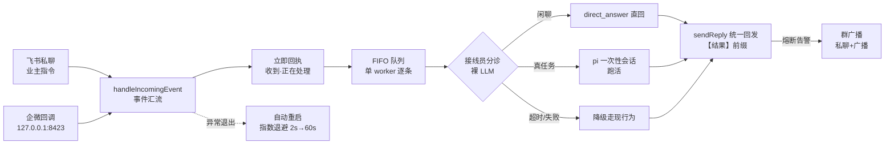

> **口径**：本卡话术/命名遵循《[00-话术统一口径正本](../00-话术统一口径正本.md)》（拍板#312）——双名制首现双写·撞车词带消歧（窗票/工序票·判色/判分）·两层口径 L1 车间（票级）/L2 派工台（窗级）。
> **消歧（本卡·口径正本 §3）**：票（工序票 L1／窗票 L2·随文标注）；复考（交活重考闸·L2）；熔断（同因熔断 L1／收班复盘器 L2）。

# 模块卡 · 飞书桥接（afk_bridge）

## §0 一句话

**解决什么**：让业主在手机飞书上就能使唤引擎——私聊机器人收指令→本机桥接→pi 跑活→结果回发，外加企微/家庭面多通道。**为什么存在**：引擎跑在业主机器上，桥接就是「人不在电脑前也能派活收报」的常驻接口（链路全景头注·锚 91-脚本/afk_bridge.mjs:1）。**边界**：白名单制（仅业主 open_id·清单外忽略记日志）；闲聊/真任务分诊降级 fail-closed 不阻塞桥接；密钥零入账。

## §典型事件链

| # | 事件 | 锚 |
|---|---|---|
| 1 | 分诊定形：拍板#80 落表——接线员分诊（W-021）：闲聊 direct_answer 直回·真任务走 pi 流程·连败达阈值自动关闭+IM 告警 | `90-过程/拍板记录表.md:99` |
| 2 | 收发分离（W-020）：收到立即回执「收到·正在处理」→FIFO 单 worker 逐条跑（排队不丢不并行抢 API）→完成回发【结果】 | 本卡实现概览 |
| 3 | 通道抽象（W-022）：回发统一 sendReply·附加通道（企微）尽力并发失败只 WARN·回调端点只绑 127.0.0.1·密钥未填=通道自动关闭+告警 | 本卡实现概览（锚 91-脚本/afk_bridge.mjs:737） |
| 4 | 事件流纪律：单长跑 `lark-cli event consume` NDJSON 逐行读·进程生命周期=桥接生命周期·异常退出自动重启（指数退避 2s→60s 封顶·稳定 60s 重置） | 本卡实现概览（mainLoop 锚 91-脚本/afk_bridge.mjs:1335） |

## 接口

常驻进程（无 CLI 子命令·`node 91-脚本/afk_bridge.mjs` 拉起·main 锚 91-脚本/afk_bridge.mjs:2048）：业主手机飞书私聊机器人→本机桥接→pi 跑活→回发结果。
导出：sendReply 统一回发口（锚 91-脚本/afk_bridge.mjs:737·W-022 通道抽象·主道飞书熔断记账锚零变化）·handleIncomingEvent 统一入事件口（锚 91-脚本/afk_bridge.mjs:1090·飞书/企微事件汇流）·mainLoop 流式监听主循环（锚 91-脚本/afk_bridge.mjs:1335）。

## 实现概览

链路全景（头注·锚 91-脚本/afk_bridge.mjs:1）：单长跑 `lark-cli event consume im.message.receive_v1 --as bot` NDJSON 逐行读·进程生命周期=桥接生命周期；事件流异常退出→自动重启（指数退避 2s→60s 封顶·稳定 60s 重置）。
收发分离（W-020）：收到立即回执「收到·正在处理」→FIFO 队列单 worker 逐条跑 pi（排队不丢不并行抢 API）→完成回发结果（【结果】前缀）。
接线员分诊（W-021·拍板#80）：worker 处理件先过裸 LLM 接线员——闲聊 direct_answer 直回·真任务走 pi 流程；超时/失败降级走现行为·连败达阈值自动关闭+IM 告警（fail-closed 不阻塞桥接）。
通道抽象（W-022）：回发统一 sendReply·附加通道（企微）尽力并发失败只 WARN；企微接收=回调端点只绑 127.0.0.1·密钥未填=通道自动关闭+IM 告警。
家庭面（W-023/W-026）：群机器人广播（熔断告警=私聊+广播·晨报/收口=仅广播·routeBroadcast 未知类别 fail-closed）+微信客服「家庭管家」（白名单清单制·48h 超限单次尝试即止）+sync_msg 拉取循环兜底。

**节点详注表**（图正下方·每节点做什么/边界/锚点）：

| 节点 | 详注 |
|---|---|
| 飞书私聊 | 主通道：业主手机私聊机器人发指令；白名单制——仅业主 open_id，清单外忽略记日志（防陌生人使唤引擎）。 |
| handleIncomingEvent | 统一入事件口（锚 91-脚本/afk_bridge.mjs:1090）：飞书/企微两源事件汇流成同构入队——下游不关心消息从哪来。 |
| 立即回执 | 收发分离第一半（W-020）：先回「收到·正在处理」——业主秒级有反馈，不干等。 |
| FIFO 队列 | 单 worker 逐条跑：排队不丢、不并行抢 API——任务多了排队能预期，不炸上游配额。 |
| 接线员分诊 | 裸 LLM 分诊（W-021·拍板#80·`90-过程/拍板记录表.md:99`）：闲聊直答省预算、真任务走 pi、连败达阈值自动关闭+告警——fail-closed 不阻塞桥接本体。 |
| sendReply | 统一回发口（锚 91-脚本/afk_bridge.mjs:737·W-022）：主道飞书熔断记账；附加通道（企微）尽力并发失败只 WARN——附加面坏不拖垮主道。 |
| 群广播 | 家庭面（W-023/W-026）：熔断告警=私聊+广播、晨报/收口=仅广播、routeBroadcast 未知类别 fail-closed——告警必达，日常不打扰。 |
| 自动重启 | 事件流=桥接生命周期（mainLoop 锚 91-脚本/afk_bridge.mjs:1335）：异常退出指数退避重启（2s→60s 封顶·稳定 60s 重置）——lark-cli 长连接断了自愈。 |

## 调用方与被调用

被调：常驻在役（开机自启/业主手动拉起）；会话路由默认 pi --print 新会话（cwd=本仓根继承 AGENTS.md）·「继续〈话题〉」映射续 --session-id。
调用：lark-cli（事件流+回发）·afk_receptionist（接线员）·afk_wecom_sender/afk_wecom_callback（企微双件）·afk_family_broadcast/afk_family_kf（家庭面）·pi 子进程。

## 从哪测

IM 通道面测试=91-脚本/考题库/清单-桥接通道窗.json（复考闸机检域）；常驻行为=真班观察（.bridge.log 双时间戳留痕）。

## 参数与预算

白名单制（仅业主 open_id·清单外忽略记日志）；熔断记账；零判卷零出题权触碰；配置=afk_dispatch_config 同族 .env/config 面（密钥零入账）。

## 时效

基准=仓 head 67e5b04（2026-10-21·W-040 核对）；失效触发=事件消费/回发通道/分诊降级语义改动（看执行台账 afk_bridge 新笔）。
