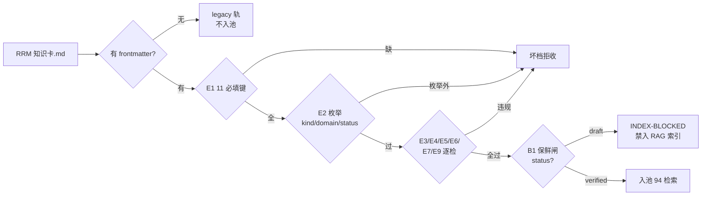

> **口径**：本卡话术/命名遵循《[00-话术统一口径正本](../00-话术统一口径正本.md)》（拍板#312）——双名制首现双写·撞车词带消歧（窗票/工序票·判色/判分）·两层口径 L1 车间（票级）/L2 派工台（窗级）。
> **消歧（本卡·口径正本 §3）**：票（工序票 L1／窗票 L2·随文标注）。

# 模块卡 · 机检族（rrm_lint）

## §0 一句话

**解决什么**：给 RRM（RAG-Ready Markdown）知识卡当门卫——frontmatter 11 键、枚举、锚点格式、原子段长、id 唯一、关联不悬空逐档机检，draft 档禁入 RAG 索引（B1 保鲜闸）。**为什么存在**：「写=断言已验证」（拍板#59②）——知识件的格律不能靠自觉，verified 才入池是现状体保鲜的机器闸。**边界**：纯静态机检零 LLM；W1/W2 只 WARN 不拒收；本卡自身也过这道闸（自指合规）。

## §典型事件链

| # | 事件 | 锚 |
|---|---|---|
| 1 | 枚举扩容：W-036 落台账——E2 KINDS 扩「模块卡」，02-全景视图 RRM 卡从此可过闸入 94 索引 | `90-过程/执行台账.md:578` |
| 2 | 实战：W-040 首批 13 张模块卡（本卡在内）整区批量过闸 verified | `90-过程/执行台账.md:582`（W-040 笔） |
| 3 | 实战（活例）：W-043 本窗 28 张视图卡 v2 增密后整区批量重跑（rrm_lint 目录模式·E5/E6 生效）——母账拍板#96 的机检闸 | `90-过程/拍板记录表.md:117` |

## 接口

CLI 三路：`python 91-脚本/rrm_lint.py <file.md|dir>`（单档/目录批量）·`--selftest`（内置绿例+坏例自测）·`--graph`（triples 符号真连引擎图校验）。单档检查 lint_file（锚 91-脚本/rrm_lint.py:179）·目录批量 lint_dir（锚 91-脚本/rrm_lint.py:273·E5 id 唯一/E6 related 存在此模式生效）·自测 selftest（锚 91-脚本/rrm_lint.py:312）。

## 实现概览

RRM（RAG-Ready Markdown）格式机检（拍板#59 §3.2·机械件）。检查面：E1 frontmatter 11 必填键（锚 91-脚本/rrm_lint.py:38：id/kind/domain/status/created_at/verified_at/repo_head/run_id/anchors/tags/related）·E2 枚举（锚 91-脚本/rrm_lint.py:39：kind∈{病卡,维修记录,建议条目,模块卡}·domain∈{app,engine,exam}·status∈{draft,verified}——模块卡枚举 W-036 扩入）·E3 锚点格式（相对路径:行号）·E4 原子段 ≤2000 字·E7 triples 四列·E9 scope=invariant 领域专名 fail-closed（W-028）。
闸门语义：B1 status=draft→INDEX-BLOCKED（禁入 RAG 索引=现状体保鲜闸·只有 verified 许入）——「写=断言已验证」（#59②）。W1 行内锚对账/W2 SKIP-GRAPH 为 WARN 不拒收。

**节点详注表**（图正下方·每节点做什么/边界/锚点）：

| 节点 | 详注 |
|---|---|
| E0 frontmatter 判 | 无 frontmatter=非 RRM 档走 legacy 轨（如 02 门牌件 README/00 索引卡）——legacy 不报错但也不入 RRM 池。 |
| E1 11 必填键 | 格律底线（锚 91-脚本/rrm_lint.py:38）：id/kind/domain/status/时间对/repo_head/run_id/anchors/tags/related 缺一即拒——键全=卡身世可追溯。 |
| E2 枚举 | kind/domain/status 三枚举（锚 91-脚本/rrm_lint.py:39）：卡种/领域池/生命周期越界即拒；枚举扩容=拍板件（W-036 扩「模块卡」先例·`90-过程/执行台账.md:578`）。 |
| E3-E9 逐检 | 锚点格式（相对路径:行号）/原子段 ≤2000 字/id 目录唯一/related 不悬空/triples 四列/invariant 专名 fail-closed——目录批量模式下 E5/E6 才生效（锚 91-脚本/rrm_lint.py:273）。 |
| B1 保鲜闸 | status=draft→INDEX-BLOCKED：改 status: draft=卡自动失效出池——02 现状体「代码推进→过期改 draft→对账重制→再 verified」的循环靠此闸自动化。 |
| 入池 94 检索 | verified 档的唯一归宿：build_index 收池前提=过 rrm_lint（draft 拒入已在 _load_source 前移）——「写=断言已验证」（#59②）。 |
| W1/W2 WARN 道 | 行内锚对账/SKIP-GRAPH 只警告不拒收：富引卡（时序/拓扑）行内锚多于 anchors[] 属固有 warning，如实申报不拦车。 |

## 调用方与被调用

被调：RRM 写档流水收口闸（93 病卡/02 模块卡等落盘先过机检）·94 build_index 入池前置（draft 拒入已在 _load_source 前移）。调用：codebase-memory CLI（--graph 真连模式·daemon 中性目录拉起）。

## 从哪测

`python 91-脚本/rrm_lint.py --selftest`（17 案·W-036 后基线）；`--selftest-graph` 真连冒烟两锚。

## 参数与预算

零 LLM 零预算（纯机械）；--max-section 可调原子段上限；红线不变量=「status=verified 才入索引」闸门语义（只加严不加松）。

## 时效

基准=仓 head 67e5b04（2026-10-21·W-040 核对·17 案基线）；失效触发=E1-E9/B1 判据或枚举扩改（看执行台账 rrm_lint 新笔·selftest 案数为准）。
