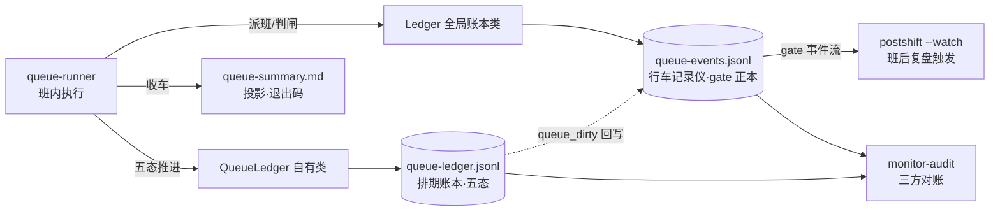

> **口径**：本卡话术/命名遵循《[00-话术统一口径正本](../00-话术统一口径正本.md)》（拍板#312）——双名制首现双写·撞车词带消歧（窗票/工序票·判色/判分）·两层口径 L1 车间（票级）/L2 派工台（窗级）。
> **消歧（本卡·口径正本 §3）**：票（工序票 L1／窗票 L2·随文标注）。
> **变更注记（v2 增密·W-251·拍板#334·2026-11-03）**：repo_head 01c1d9a→e170067 重锚；五态随 W-139 中文化勘正（中文键+LEGACY 映射）；新增**邻域契约节**=队列写口审计行字段表（任务书④预置·实勘属 L2 窗队列审计账域·域界注记见该节）。

# 契约卡 · 班次账本双件套（queue-events + queue-ledger）

## §0 一句话

**解决什么**：定义每班次两本 append-only JSONL 账的字段契约——queue-events（行车记录仪·gate 判定在它）与 queue-ledger（排期账本·五态推进）+queue-summary 投影件。**为什么存在**：账本=夜车可回放的全部根据，字段契约锁定后「读旧账的代码」与「写新账的代码」永不漂移（W-041 字段对照 3/3 自检·`90-过程/执行台账.md:583`）。**边界**：阈值语义/判卷不在本卡（账本只记不判）。

## §典型事件链

| # | 事件 | 锚 |
|---|---|---|
| 1 | 实物定约：queue-40 班两账本实物逐字段抽验（seq/ts/type/payload 顶层键+3 事件型 payload 全在卡面）——W-041 accept 自检 PASS | `90-过程/执行台账.md:583` |
| 2 | 读侧纪律锚：gate 终态读取单一正本=queue-events.jsonl（不在 queue-ledger·拍板#35 实锚） | 本卡接口节 |
| 3 | 三方对账工具：排期账↔事件账↔关环件对账走 monitor-audit | `pipeline-lab/scripts/monitor-audit.mjs:3` |

## 接口（双件分工）

| 件 | 角色 | 写入方类 | 事件型来源 | 锚 |
|---|---|---|---|---|
| `queue-events.jsonl` | 行车记录仪（队列级事件流） | `Ledger`（全局账本类） | 全局 `EVENT_TYPES` 白名单 queue 段 | ts/src/queue/queue-runner.ts:161 |
| `queue-ledger.jsonl` | 排期账本（每版本状态推进） | `QueueLedger`（queue 自有类） | 自有三型白名单 | ts/src/queue/queue-runner.ts:162 |
| `queue-summary.md` | 汇总投影（退出码/阈值/版本终态表） | queue-runner 收车时写 | — | ts/src/queue/queue-runner.ts:268 |

**读侧纪律（实然）**：gate 终态读取单一正本=`queue-events.jsonl`（不在 queue-ledger——拍板#35 实锚）；三方对账=排期账↔事件账↔关环件（`pipeline-lab/scripts/monitor-audit.mjs:3`）。

## 字段表（顶层·两账同构·抽验自 queue-40 实物）

| 字段 | 型 | 语义 | queue-40 实物例 |
|---|---|---|---|
| `seq` | number | 单调递增序号（=账本游标） | `1` |
| `ts` | string | ISO 8601 时间戳 | `2026-10-14T18:06:25.552Z` |
| `type` | string | 事件型（写侧白名单门外 TypeError） | `queue_dispatched` |
| `payload` | object | 事件负载（随 type 变） | `{"version":"V0R","round":1,...}` |

## 事件型与 payload 契约

### queue-events.jsonl（行车记录仪·白名单=ts/src/shared/event-types.ts:90）

| type | payload 字段（实物实证） | 语义 |
|---|---|---|
| `queue_dispatched` | version, round, resume, package, workspace | 派一班 |
| `queue_gate_passed` | version, starred, finalReds, threshold, reason | 过闸（queue-40 seq2 实物） |
| `queue_gate_failed` | version, finalReds, threshold, reason | 拒闸→停队列·EXIT=1 |
| `queue_dirty` | file, detail | 损坏行登记（Q3 自净·由 QueueLedger 回写全局账） |

### queue-ledger.jsonl（排期账本·自有白名单三型=ts/src/queue/queue-ledger.ts:68）

| type | payload 字段 | 语义 |
|---|---|---|
| `queue_enqueued` | version, package, decision_ref, state:"queued" | 入队登记（重复入队拒·排期唯一） |
| `queue_entry_state` | version, from, to | 状态推进（合法转移才记） |
| `queue_entry_state_rejected` | version, from, to | 非法转移留痕（不影响末态） |

## 数据流（图示与节点详注）

**节点详注表**（图正下方·每节点做什么/边界/锚点）：

| 节点 | 详注 |
|---|---|
| queue-runner | 双账本唯一写入方（类落位锚 ts/src/queue/queue-runner.ts:161/`:162`）：派班写 events、推进写 ledger、收车写 summary——三件全由它驱动。 |
| Ledger（全局账本类） | 行车记录仪的写入类：append 收全局 EVENT_TYPES 白名单 queue 段（锚 ts/src/shared/event-types.ts:90）——白名单外 TypeError 写侧契约门。 |
| QueueLedger（自有类） | 排期账本写入类：自有三型白名单（锚 ts/src/queue/queue-ledger.ts:68）；五态转移逐边校验（`:14` 枚举/`:19` 转移表·投影见 sm-20261021-002）。 |
| queue-events.jsonl | gate 判定正本（读侧单一正本·拍板#35）：过闸/拒闸的最终真相在这本账（实物 `runs/.queue-roots/queue-40/queue-events.jsonl:1`）。 |
| queue-ledger.jsonl | 每版本状态线（实物 `runs/.queue-roots/queue-40/queue-ledger.jsonl:1`）：非法转移留痕 rejected 不影响末态——账干净、史完整。 |
| queue-summary.md | 人类可读投影（锚 ts/src/queue/queue-runner.ts:268）：退出码/阈值/版本终态表——晨读入口，真相仍在两 JSONL。 |
| postshift --watch | 账本的第一读者：gate 事件流=班后复盘触发源——账本不只存档，还驱动下游（触发锚 pipeline-lab/scripts/postshift.mjs:8）。 |
| monitor-audit | 三方对账工具（锚 pipeline-lab/scripts/monitor-audit.mjs:3）：排期账↔事件账↔关环件对表——账本间不一致逃不掉。 |
| queue_dirty 回写 | Q3 自净接缝：QueueLedger 载入遇损坏行→回写全局账 queue_dirty 登记——两账联动自净不互相污染。 |

## 追加语义（两账同守）

1. **append-only**：只许追加永不涂改（`appendFileSync` 逐行 JSON）；
2. **游标续读**：`cursor()`=已落盘最大 seq·`since(seq)` 取其后全量；
3. **删库可重建**：`rebuild()` 清内存投影从事件流全量重放；
4. **冷启空账**：不建空文件·首写才落盘；
5. **Q3 自净**：载入遇损坏行/非法转移不抛——登记 `queue_dirty` 跳过·合法行照常恢复末态。

## 波次状态（排期账本维护·细节见状态机卡）

五态 `排队中/施工中/完成/被替代/待重排`（W-139 中文键正本·拍板#198；英文旧名 queued/in_progress/done/superseded/needs_replan 经 LEGACY_EN_MAP 读取映射·历史英文账一字不动重放等价）与合法转移表定义在 ts/src/queue/queue-ledger.ts:14、:19——逐格投影见 `05-状态机/sm-20261021-002`（本卡不重复）。

## 邻域契约 · 队列写口审计行（storage/queue_audit.jsonl·W-251 补·域界注记）

> **域界注记（B 级留痕候追认）**：本节=L2 窗队列写口审计账契约（任务书④预置落卡）——与班次账本双件套（L1 夜车）**不同域不同件**：班次账=夜车排期/gate 判定；审计账=窗队列翻格/注记的道4 审计留痕。落本卡系任务书预置·候独立契约卡（沿拍板#294 漏盘申报→清偿窗补卡先例·本票不出新卡）。

审计账=`storage/queue_audit.jsonl`（append-only·道4 审计·每写一行·W-189 拍板#263 立·W-226 拍板#311 增指纹）。字段契约（91-脚本/队列写口.mjs 实勘·:371 翻格成功行/:434 拒写行/:492 注记行）：

| 字段 | 型 | 语义 | 翻格行 | 拒写行 | 注记行(op:note) |
|---|---|---|---|---|---|
| `ts` | string | ISO 时间戳 | ✔ | ✔ | ✔ |
| `actor` | string | 写权者（dispatcher/window/owner/inspector） | ✔ | ✔ | ✔ |
| `ticket` | string | 窗ID（W-NNN） | ✔ | ✔ | ✔ |
| `from` / `to` | string | 转移前后态（注记行 from=to=现态） | ✔ | from=null·to=null | ✔（=现态） |
| `note` | string | 注记词面 | ✔ | ✔ | ✔ |
| `ok` | bool | 是否真落写（幂等零写=false 亦记·事故可回放） | ✔ | false | ✔ |
| `gate` / `reason` | string | 拒写道号/拒因（≤300字） | — | ✔ | — |
| `via` | string | 固定「队列写口.mjs」 | ✔ | ✔ | ✔ |
| `pid` | number | 写者进程号 | ✔ | ✔ | ✔ |
| `op` | string | 事件标记：翻格行**无此字段**·注记行=`"note"`（消费方按 op 缺省读作翻格=向后兼容） | — | — | `"note"` |
| `preMd5`/`preLines`/`preMaxW` | string/number/number | **写前指纹三字段**（W-226）：队列全文 md5/票据行数（「\| W-xxx \|」起头行计数）/最大W号数值（指纹函数=队列写口.mjs:83-93·拒写行亦携带·fpBox 锁外预读回填） | ✔ | ✔ | ✔ |
| `postMd5`/`postLines`/`postMaxW` | 同上 | **写后指纹三字段**（真落写才记·幂等零写全 null） | ✔ | — | ✔ |

**向后兼容（两级·案18-21 实证=队列写口.mjs selftest）**：①新增指纹字段旧行照读——消费方逐行 JSON.parse 无指纹键不炸（旧格式审计行活证=:806 案20）；②注记行 op:"note" 标记翻格行无此字段——M4 等消费方按 postMd5 读不受影响（:422 注记）。dry-run 零副作用不含审计；auditPath 未传=审计关（module API 沙盒零污染）。

## 从哪测

`ts/src/queue/` 下 vitest 用例；实物对账=读 `runs/.queue-roots/queue-40/` 两 JSONL 逐行 JSON.parse；三方对账跑 `pipeline-lab/scripts/monitor-audit.mjs`。

## 参数与预算

阈值语义：`max_final_reds`（manifest 声明）与 gate payload 的 `threshold`/`finalReds` 对表——终局红票≤阈值才 passed；叫停只作用未开工（queued）——排期口径（纪要 §四-4）；判卷/预算三路不在本卡范围（账本只记不判）。

## 时效

基准=仓 head e170067（2026-11-03·W-251 对账批复勘：行锚随 W-139 中文化刷新+审计行契约节落卡）；上一基准 01c1d9a（2026-10-21 W-041·queue-40 实物逐字段比对）；失效触发=本卡头 frontmatter「失效触发」键。
