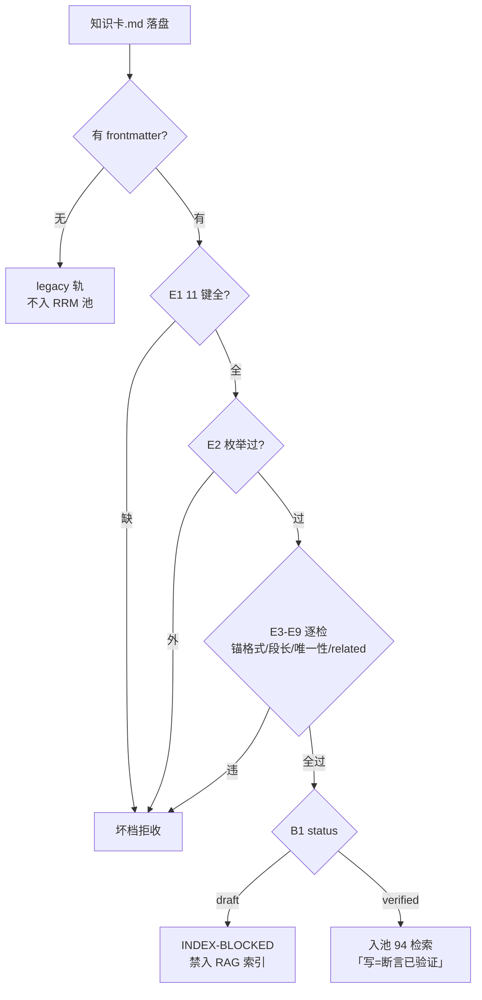

> **口径**：本卡话术/命名遵循《[00-话术统一口径正本](../00-话术统一口径正本.md)》（拍板#312）——双名制首现双写·撞车词带消歧（窗票/工序票·判色/判分）·两层口径 L1 车间（票级）/L2 派工台（窗级）。
> **消歧（本卡·口径正本 §3）**：票（工序票 L1／窗票 L2·随文标注）。

# 契约卡 · RRM frontmatter 11 键与 rrm_lint 闸

## §0 一句话

**解决什么**：定义 RRM（RAG-Ready Markdown）知识卡的 frontmatter 契约——11 必填键+允许附加键+机检检查族（E0-E9/B1）。**为什么存在**：知识件入 RAG 索引的前提是「身世可追溯、格律机械可查」——11 键让每张卡知道自己是谁/谁产的/基于哪个 repo_head，机检闸让「写=断言已验证」（#59②）。**边界**：本卡只投影契约不授权改闸（改闸须业主拍板）。

## §典型事件链

| # | 事件 | 锚 |
|---|---|---|
| 1 | 金标准实物：W-040 首批 13 张模块卡（首卡锚 `02-全景视图/03-模块卡/mk-20261021-001-派工器-pi_runner.md:1`）——本区格律实物样板 | 本卡 TL;DR |
| 2 | 踩坑实证：W-041 施工坑——「有 frontmatter 即按 RRM 检（无才走 legacy 轨）」，视图件只带时效键四要素会炸 E1，故 7 件带全 11 键+四要素附加键 | `90-过程/执行台账.md:583`（W-041 施工坑 a） |
| 3 | 附加键实践：本区各卡「基准/生成式/核对/失效触发」时效键四要素=白名单外附加键（rrm_lint 不检不拒）——契约弹性面 | 本卡附加键节 |

## 接口（11 必填键·`91-脚本/rrm_lint.py:38`）

| # | 键 | 枚举/格式 | 语义 |
|---|---|---|---|
| 1 | `id` | 全局唯一（E5 目录批量查重） | 卡号（惯例 `<前缀>-<日期>-<序号>`） |
| 2 | `kind` | {病卡, 维修记录, 建议条目, 模块卡}（`91-脚本/rrm_lint.py:40`·W-036 扩入模块卡） | 卡种 |
| 3 | `domain` | {app, engine, exam}（`91-脚本/rrm_lint.py:41`） | 领域池（93/94/95 分池依据） |
| 4 | `status` | {draft, verified}（`91-脚本/rrm_lint.py:42`） | 生命周期（B1 闸判据） |
| 5 | `created_at` | 日期 | 建卡日 |
| 6 | `verified_at` | 日期 | 过闸签发日 |
| 7 | `repo_head` | git short hash | 制卡基线 |
| 8 | `run_id` | 自由文本（惯例带窗ID） | 产出批次 |
| 9 | `anchors` | 列表·每项 `相对路径:行号`（E3） | 轨迹锚 |
| 10 | `tags` | 列表（可空） | 检索标签 |
| 11 | `related` | 列表（可空·E6 查悬空） | 关联卡 id |

## 附加键（不检不拒·本区约定）

frontmatter 可带白名单外附加键——02-全景视图 各卡按任务书规约追加**时效键四要素**：`基准`（=repo_head 具体值）/`生成式`（是/否·本区人工对账制卡=否）/`核对`（日期）/`失效触发`（〈拍板#NN/改码〉描述）。rrm_lint 只查 11 必填键缺失（E1），附加键零判定。

## rrm_lint 检查族（抽验面）

| 码 | 判据 | 后果 |
|---|---|---|
| E0 | 无 frontmatter | 非 RRM 档·legacy 轨不适用本检（不入池） |
| E1 | 11 必填键缺失 | 坏档拒收 |
| E2 | kind/domain/status 枚举外 | 坏档拒收 |
| E3 | 锚点非 `相对路径:行号` | 坏档拒收 |
| E4 | 单 H2 节 >2000 字（`91-脚本/rrm_lint.py:37` 可配） | 坏档拒收 |
| E5 | id 目录内重复 | 坏档拒收 |
| E6 | related 悬空 | 坏档拒收 |
| E7 | triples 行非四列 | 坏档拒收 |
| E8 | triples 符号不在引擎图限定名 | 坏档拒收（--graph 注入时） |
| E9 | scope=invariant 档检出未声明领域专名 | 拒收+转库指引 |
| B1 | status=draft | INDEX-BLOCKED（禁入 RAG 索引·绿驱动写入） |

## 检查流水（图示与节点详注）

**节点详注表**（图正下方·每节点做什么/边界/锚点）：

| 节点 | 详注 |
|---|---|
| E0 frontmatter 判 | 分流第一闸：有 frontmatter 即按 RRM 检（W-041 踩坑实证·`90-过程/执行台账.md:583`）——带时效键四要素而不带 11 键=炸 E1，legacy 轨只属于完全无 frontmatter 的门牌件。 |
| E1 11 键全? | 身世底线（锚 91-脚本/rrm_lint.py:38）：id/kind/domain/status/时间对/repo_head/run_id/anchors/tags/related——缺一即拒，格律不靠自觉。 |
| E2 枚举过? | 三枚举（`:40` kind/`:41` domain/`:42` status）：卡种/领域池/生命周期越界即拒——枚举扩容=拍板件（W-036 扩「模块卡」先例）。 |
| E3-E9 逐检 | 格律细检：锚点 `相对路径:行号` 格式（E3）/单 H2 节 ≤2000 字（E4·帽在 `:37` 可配）/id 目录唯一（E5）/related 不悬空（E6）/triples 面（E7/E8）/invariant 专名（E9）——目录批量模式 E5/E6 才生效。 |
| B1 保鲜闸 | 现状体的时效机制核心：status=draft→INDEX-BLOCKED——「改 draft=自动失效出池」，代码推进致卡过期时不需要人肉巡检删卡。 |
| 入池 94 检索 | verified 档唯一归宿：build_index 只收 verified（draft 拒入在 _load_source 前移）——「写=断言已验证」（#59②）让 RAG 池里没有未验证的断言。 |

## B1 保鲜闸（02 现状体的时效机制）

`build_index` 只收 verified 档——代码推进致卡过期时：改 `status: draft`（自动失效出池）→对账重制→过 rrm_lint 再签 verified。02-全景视图（现状体·向代码对账）靠此闸保鲜，不靠人肉巡检。

## 从哪测

单档：`python 91-脚本/rrm_lint.py <卡路径>`（exit 0=过）；目录批量：`python 91-脚本/rrm_lint.py <目录>/`（E5/E6 生效）；自检：`python 91-脚本/rrm_lint.py --selftest`（17 案·W-036 后）。

## 参数与预算

rrm_lint 纯静态机检·零 LLM 零预算；原子段帽 2000 字（--max-section 可调）；「verified 才入索引」闸门语义=拍板#58 系+总方案口径·改闸须业主拍板（本卡只投影不授权）。

## 时效

基准=仓 head 01c1d9a（2026-10-21·W-041 核对·rrm_lint.py 源码实勘）；失效触发=本卡头 frontmatter「失效触发」键。
