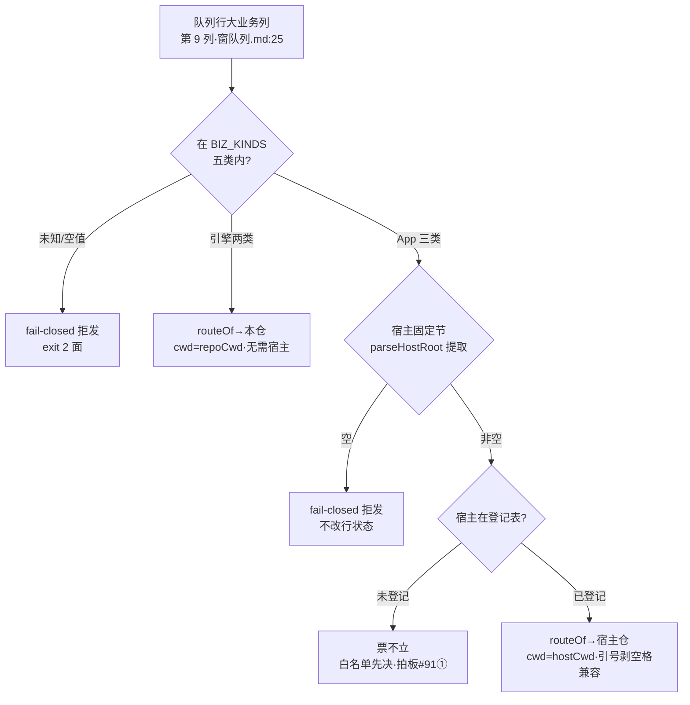

> **口径**：本卡话术/命名遵循《[00-话术统一口径正本](../00-话术统一口径正本.md)》（拍板#312）——双名制首现双写·撞车词带消歧（窗票/工序票·判色/判分）·两层口径 L1 车间（票级）/L2 派工台（窗级）。
> **消歧（本卡·口径正本 §3）**：票（工序票 L1／窗票 L2·随文标注）；三关（收包验货关 L1／立票验单关·贴卡拦病关·领单再验单 L2）。

# 契约卡 · routeOf 五类路由表＋宿主白名单

## §0 一句话

**解决什么**：定义窗队列「大业务」列到作业面（本仓/宿主仓）的路由契约——五类单选、宿主仓根从任务书宿主固定节提取、缺宿主/未知大业务 fail-closed 拒发。**为什么存在**：派工器「把票送到对的地方」全靠这张纯函数表——路由错不产生副作用（只拒不改），这是派工制安全性的第一道契约（拍板#91② 引号含空格修正实证契约演进·`90-过程/拍板记录表.md:111`）。**边界**：宿主白名单正本=登记表（本卡只指针不复制）。

## §典型事件链

| # | 事件 | 锚 |
|---|---|---|
| 1 | 立约：拍板#76② 路由表落地（routeOf `91-脚本/pi_runner.mjs:103`·五类×两作业面） | 本卡接口节 |
| 2 | 契约修正实战：拍板#91②——工作区根 "pi agent" 带空格致旧正则截断，parseHostRoot 优先匹配引号包裹形式修正（`91-脚本/pi_runner.mjs:112`） | `90-过程/拍板记录表.md:111` |
| 3 | 白名单首票实战：W-034 App首跑冒烟（宿主=039舆情V5·登记表在役主宿主行锚 `90-过程/宿主仓登记表.md:8`）——契约从纸面到真票 | 本卡宿主白名单指针节 |

## 接口（路由表·`91-脚本/pi_runner.mjs:103`）

| 大业务（BIZ_KINDS·`91-脚本/pi_runner.mjs:99`） | 作业面 | cwd 来源 | 拒发案 |
|---|---|---|---|
| 引擎优化 | 本仓 | repoCwd（引擎仓根） | — |
| 引擎修复 | 本仓 | repoCwd | — |
| App新建 | 宿主仓 | 任务书「宿主固定节·宿主仓根」 | 宿主空=拒（fail-closed） |
| App优化 | 宿主仓 | 同上 | 宿主空=拒 |
| App修复 | 宿主仓 | 同上 | 宿主空=拒 |
| （其余/空值） | — | — | 未知大业务=拒（fail-closed·`91-脚本/pi_runner.mjs:100` isAppBiz 判定之外） |

## 宿主白名单指针（不在本卡复制·查登记表）

**权威件=`90-过程/宿主仓登记表.md`**（append-only 台账）：列宿主名/宿主仓根（引号包裹·含空格路径）/栈/启动方式/git 基线/状态。现状在役主宿主=039 舆情监测平台 V5（app/·Python 后端+契约件 RuntimeSpec·`90-过程/宿主仓登记表.md:8`）；历史资产行标「不接派工」。**开新 App 类票时宿主仓根必须已在本表**——派工器路由只认任务书文本，本表=业主认可的先决台账，两处对不齐=票不立。

## 宿主仓根提取契约（parseHostRoot·`91-脚本/pi_runner.mjs:112`）

- 优先匹配**引号包裹**形式（引号内允许空格·剥引号）——拍板#91②（工作区根 "pi agent" 本身带空格·旧正则遇空格截断实证后修正）；
- 无引号沿旧截断（兼容既有票）；
- 与三关校验器（派发书三关校验.mjs）同格式——发书侧与领单侧单一语义防双头漂移。

## 路由决策流（图示与节点详注）

**节点详注表**（图正下方·每节点做什么/边界/锚点）：

| 节点 | 详注 |
|---|---|
| 队列行大业务列 | 路由输入：窗队列第 9 列（表头锚 `90-过程/窗队列.md:25`·拍板#76① 五类单选）——缺列旧格式缺省「引擎优化」（存量行零迁移）。 |
| BIZ_KINDS 判定 | 五类白名单（`91-脚本/pi_runner.mjs:99`）外的值一律拒（`:100` isAppBiz 判定之外·fail-closed）——枚举封闭，不猜业务。 |
| 引擎两类→本仓 | 引擎优化/引擎修复返回本仓根——无需宿主固定节，本仓是这两类的默认作业面（`91-脚本/pi_runner.mjs:103`）。 |
| App 三类→宿主固定节 | App新建/优化/修复必须从任务书提取宿主仓根（parseHostRoot `:112`）——业主显式给坐标，引擎不猜路径。 |
| fail-closed 拒发 | 三个拒面（未知业务/空宿主/未登记）方向一致：只拒不改——路由错不产生副作用，修任务书/登记表后重领。 |
| 登记表白名单 | 先决台账（`90-过程/宿主仓登记表.md:8` 在役主宿主行）：未登记=票不立——白名单把「哪些仓可动工」的决定权留在业主手里（拍板#91①·`90-过程/拍板记录表.md:111`）。 |
| 引号剥空格兼容 | 契约演进实证：引号包裹优先匹配（引号内允许空格·剥引号）——"pi agent" 带空格的教训直接写进了提取契约（拍板#91②）。 |

## 调用语义（消费方）

1. `--auto/--loop` 领单：选中行→routeOf 定作业面→ok=false 则拒发记因（不弃单不改行状态）；
2. `--window --go` 手工：同闸·拒发 exit 2；
3. 大业务列本身（窗队列第 9 列·拍板#76①·表头锚 `90-过程/窗队列.md:25`）：缺列旧格式→缺省「引擎优化」（存量行零迁移）。

## 从哪测

`node 91-脚本/pi_runner.mjs --selftest`（routeOf 五类+拒发案在册）；缺省 dry-run 对真队列只读可看每行大业务→作业面映射。

## 参数与预算

路由是纯函数零 IO 零预算；fail-closed 方向=只拒不改——路由错不产生副作用，重发须修任务书/登记表后重领。

## 时效

基准=仓 head 01c1d9a（2026-10-21·W-041 核对·pi_runner.mjs 源码+登记表现行逐行比对）；失效触发=本卡头 frontmatter「失效触发」键。
