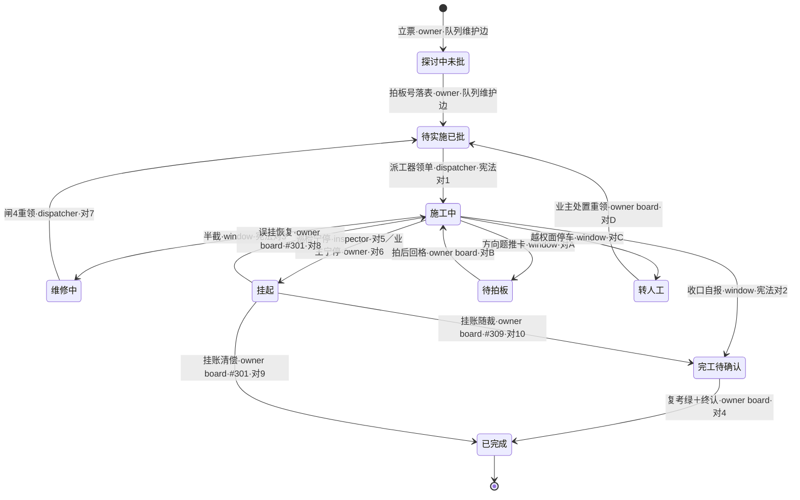

> **史档（正名·W-231·拍板#313④）**：本卡原名「**票生命周期**」——2026-11-01 正名「**窗票生命周期**」。正名依据=《[00-话术统一口径正本](../00-话术统一口径正本.md)》§3 撞车实证：「票」在 L1=**工序票**（拆单机产物·11 态施工账）、L2=**窗票**（窗队列一行·9 态派工账），本卡实画窗队列=窗票 lifecycle，旧名撞 L1 词面故正名（id `sm-20261021-001` 不变·旧名 md 已删·全仓文件名引用点随正名同步；旧名 html=`sm-20261021-001-票生命周期.html` 已加退役注记不物理删·指向本正名件）。
> **变更注记（v3 对账·W-251·拍板#334·2026-11-03）**：v2（b72523e·2026-11-01）系旧锚——其期图注对1–对10 未逐对带拍板号锚（收编对A-D 已在图但拍板号锚只在边注散文）；本版=写口宪法 **14 对逐对实勘重锚**（e170067 期·对边唯一事实源=`91-脚本/队列写口.mjs:54-69` CONSTITUTION·`sed -n '55,70p' | grep -c "actor:"`=14 双验·逐对带 actor 与拍板号锚见 §宪法十四对实勘表）。任务书预置文本「v2 十对系旧锚」与实勘不符：v2 期已十四对（W-235 收编落码在先）——本注记按实勘如实落·任务书预置偏差申报窗产物 latitude-log（B 级）。
> **v2 变化**：v1=七态四主线三异常（2026-10-21 W-041 核对）→ v2=**九态＋写口宪法十四对＋actor 逐边标注＋#301/#309/#317 新出边**。任务书蓝图（W-231 §五）为「宪法十对＋候收编对A-D 虚位」——前置 W-228 收编已落地（W-235 落码·拍板#317 甲案），按蓝图自带「图随宪法定稿」条款，v2 直接落实线十四对。
> **口径**：本卡话术/命名遵循《[00-话术统一口径正本](../00-话术统一口径正本.md)》（拍板#312）——双名制首现双写·撞车词带消歧（窗票/工序票·判色/判分）·两层口径 L1 车间（票级）/L2 派工台（窗级）。
> **消歧（本卡·口径正本 §3）**：「票」＝**窗票**（窗队列一行·L2 派工台——非 L1 工序票）；「复考」＝**交活重考闸**（窗宣称完工重考·非 L1 挂起补考）；「三关」＝**立票验单关**（任务书三关·L2）。

# 状态机卡 · 窗票生命周期（窗队列九态）

## §0 一句话

**解决什么**：把一张**窗票**（窗队列一行）从「灵感」到「关账」的状态旅程画成图——探讨中/待实施/▶施工中/完工待确认/✅已完成 五主线＋🔁维修中/⏸挂起/🔵待拍板/转人工 四异常态，逐边标注写权 actor（**写口宪法十四对**）。**为什么存在**：窗队列=唯一队列事实源（拍板#69 立队），状态语义必须唯一且逐格可查——本卡把窗队列头部不变量表与写口宪法投影成图（源标注：状态不自立定义·改语义去改窗队列/宪法）。**边界**：本卡零运行时零预算；状态定义唯一源=`90-过程/窗队列.md` 头部（`:6` 状态机行/`:7` 复考头注/`:12`-`:15` 不变量表），写权唯一源=`91-脚本/队列写口.mjs:51-69` CONSTITUTION，转移表全集正本=`91-脚本/window-card.ts:41,95-105`。

## §典型事件链

| # | 事件 | 锚 |
|---|---|---|
| 1 | 逐格自检：W-041 把窗队列源不变量表四行×三列与卡面投影表逐格比对=4/4 全对（异常态三态在卡）——「投影≠自立」的机检实证（v1 七态时点） | `90-过程/执行台账.md:583` |
| 2 | 实战（活例）：W-043 本窗行从「待实施(已批)」→派工器领单改「▶施工中」（快照三键入行）→收口走「完工待确认」→复考绿+业主终认翻「✅已完成」——九态主线的完整演练 | `90-过程/拍板记录表.md:117`（母账拍板#96·窗队列 W-043 行） |
| 3 | 领单闸接线：eligible=待实施(已批) 且拍板号非空（**单源=`91-脚本/window-card.ts:137`**·自 pi_runner.mjs:122 迁入·迁移注记=`91-脚本/pi_runner.ts:136`）——状态机与派工器的接缝 | 本卡转移语义注记1 |
| 4 | （v2 新增）收编实战：W-228 方向题推卡🔵/转人工两态本属「宪法外影子态」→拍板#313④①立收编票→拍板#317 甲案 W-235 落码对A-D（宪法十对→**十四对**）→窗队列 `:6` 头注同步「写口宪法十四对」 | `90-过程/执行台账.md`（W-235 收口笔）·`90-过程/窗队列.md:6` |

> **源标注（防重复四规·状态不自立定义）**：本卡状态定义与不变量的**唯一源=`90-过程/窗队列.md` 头部**——状态机行（`:6`）与状态不变量表（`:12`–`:15`）；**写权唯一源=`91-脚本/队列写口.mjs:51-69` CONSTITUTION**（十四对·含 actor/board）；守卫层转移表全集正本=`91-脚本/window-card.ts:95-105` WINDOW_TRANSITIONS（九态枚举 `:41`）。本卡=对源的文字投影+图示，源变则本卡过期（失效触发见 frontmatter）。改状态语义去改窗队列/写口宪法，不改本卡。

## 状态图 v2（mermaid·九态＋宪法十四对·逐边 actor）

**图注（态名缩写防括号）**：探讨中未批=`探讨中(未批)`·待实施已批=`待实施(已批)`·施工中=`▶施工中`·完工待确认=`完工待确认`·已完成=`✅已完成`·维修中=`🔁维修中`·挂起=`⏸挂起`·待拍板=`🔵待拍板`·转人工=`转人工`。

**边注**：
- **对1–对10**＝写口宪法十对（`91-脚本/队列写口.mjs:51-69`·逐对白话口述=详述卡 [sm-20261101-007] §2.5——本卡不复制口述）；**对A–对D**＝W-228 拟对·拍板#317 甲案 W-235 收编落码（🔵/转人工自「宪法外影子态」转正）。
- **对5/对6 实为任意态→⏸**（宪法 `from="*"`·巡检/业主随时可宁停）——图示只画主干入边（施工中→挂起），勿读作「仅施工中可挂」。
- **立票/拍板号落表两边=队列维护边**（非写口宪法对·owner/主窗直录队列行）——图内已标注区分。
- 收编对A-D 按任务书 W-231 蓝图注记「图随宪法定稿」落实线（W-235 收编在案·拍板#317 甲案）；owner(board)=业主道·主窗代录须带拍板号。

### 宪法十四对逐对实勘表（v3·W-251·拍板#334·2026-11-03）

> 唯一事实源=`91-脚本/队列写口.mjs:54-69` CONSTITUTION（对边与 actor 逐对实勘·`sed -n '55,70p' | grep -c "actor:"`=14 双验）；拍板号锚=宪法表备注列＋拍板记录表行实勘。本表替代 v2 期散文边注成为逐对锚载体。

| 对# | from→to | actor | board | 拍板号锚 | 实勘备注（宪法备注列照录） |
|---|---|---|---|---|---|
| 对1 | 待实施(已批)→▶施工中 | dispatcher | — | 拍板#263（W-189 立宪）＋W-187 闸1（拍板#259①） | 派工器领单（闸1 前置沿 W-187） |
| 对2 | ▶施工中→完工待确认 | window | — | 拍板#263 立宪＋拍板#179（第八态语义） | 该票施工窗自翻（收口自报） |
| 对3 | ▶施工中→🔁维修中 | window | — | 拍板#263 立宪＋拍板#87（复考闸打回） | 施工窗自翻（方向题/维修道·复考红走🔁） |
| 对4 | 完工待确认→✅已完成 | owner | ✔ | 拍板#258（W-181 误翻先例后立规） | 业主道·主窗代录须 --board 拍板号 |
| 对5 | *→⏸挂起 | inspector | — | W-187 闸2（拍板#259①）＋拍板#263 立宪 | 巡检宁停（闸2 后置沿 W-187·僵尸/无据宁停） |
| 对6 | *→⏸挂起 | owner | — | 拍板#263 立宪（业主宁停） | 业主宁停 |
| 对7 | 🔁维修中→待实施(已批) | dispatcher | — | W-187 闸4（拍板#259①）＋拍板#263 立宪 | 派工器闸4 超时重领（沿 W-187 闸4 语义） |
| 对8 | ⏸挂起→▶施工中 | owner | ✔ | 拍板#301（首用=W-216） | 勘误恢复·活窗误挂专用·主窗代录须令 |
| 对9 | ⏸挂起→✅已完成 | owner | ✔ | 拍板#301（首用=W-202/W-219） | 挂账清偿·业主令专用 |
| 对10 | ⏸挂起→完工待确认 | owner | ✔ | 拍板#309（首用=W-220） | 挂账清偿随清偿票完工·业主终认后翻✅ |
| 对A | ▶施工中→🔵待拍板 | window | — | 拍板#317 甲案（W-228 拟增·W-235 收编） | 方向题推卡停车（latitude A 卡候业主裁） |
| 对B | 🔵待拍板→▶施工中 | owner | ✔ | 拍板#317 甲案 | 拍后回格续作·主窗代录须 --board 拍板号 |
| 对C | ▶施工中→转人工 | window | — | 拍板#317 甲案 | 越权面停车转人工 |
| 对D | 转人工→待实施(已批) | owner | ✔ | 拍板#317 甲案 | 业主处置重领队列·主窗代录须 --board |

> **逐对实勘结论（W-251）**：图内边集与宪法表 14 对逐一同构（零缺对零多对）；状态清单与窗队列不变量表（`:12`-`:15` 四行×三列）逐格复勘一致（文字投影表零漂移）；不变量表管列必填性·宪法管转移权·两者正交无语义冲突——宁停判据不触发。

## 节点详注（九态逐格·语义/不变量/标源）

| 节点（状态） | 详注 |
|---|---|
| 探讨中(未批) | 管理可见·不可领单：拍板号列空（或"候拍"）、产物锚=对比件路径（出了就有·无对比件不拍板）——灵感池行毕业出对比件才入此态（源=`90-过程/窗队列.md:12`）。 |
| 待实施(已批) | 唯一可领单态：拍板号必填、产物锚可空、不建窗产物目录（惰性创建）——eligible 单源=`91-脚本/window-card.ts:137`（源=`90-过程/窗队列.md:13`）。 |
| ▶施工中 | 派工器领单进入（宪法对1·领单闸族全过+会审门四查后翻格=开始烧钱）：拍板号+产物锚双必填、多产物窗建 `90-过程/窗产物/W-NNN-主题/`（源=`90-过程/窗队列.md:14`）——写权=dispatcher（对1）与 window（对2/对3/对A/对C）。 |
| 完工待确认 | 第八态（拍板#179）：缺考题完工即记此态——坑立释+前置视为就绪+终认走人工道（确认翻✅/发现毛病翻🔁·不代写不打卡·「绿才认✅」零触碰）；挂账随裁亦可入（对10·#309）（源=状态机行 `:6`）。 |
| ✅已完成 | 复考后认+业主终认（对4·owner board）：机检窗型重跑考题库·exit code 唯一判据·全绿才认（`90-过程/窗队列.md:7` 头注）——关账不搬家，产物锚含 handoff（源=`:15`）；**唯一终态**（勘误走拍板表 append-only）。 |
| 🔁维修中 | 异常态：半截·**下一棒锚必填**——复考红打回/收口半截进入，闸4 超时重领回 待实施(已批)（对7·dispatcher）——「半截必填下一棒锚」让接力不断档（源=状态机行 `:6`）。 |
| ⏸挂起 | 异常态：候授权/等外部·**原因必填**——巡检/业主宁停（对5/6·from=*·宁停不装绿）；三出边全 owner board：误挂恢复▶（对8·#301）/挂账清偿✅（对9·#301）/挂账随裁（对10·#309）——⏸ 不再是死态。 |
| 🔵待拍板 | 第九态（拍板#317 甲案 W-235 收编）：方向题推卡候批——window 推卡进入（对A·`pi_runner --latitude-card`）·owner 拍后回▶续作（对B·board）——方向题不硬撑不代答（拍板#170 系授权面）。 |
| 转人工 | 异常态：越权面停车——window 推入（对C）·owner 处置重领回 待实施(已批)（对D·board）——收编后不再是无出边孤岛（终态唯✅·拍板#317 甲案）。 |

## 文字投影（机读·主线四态×不变量表逐格）

| 状态 | 拍板号列 | 产物锚 | 窗产物目录 |
|---|---|---|---|
| 探讨中(未批) | 空（或"候拍"） | 对比件路径（出了就有·无对比件不拍板） | 不建（惰性创建） |
| 待实施(已批) | 必填 | 可空 | 不建 |
| ▶施工中 | 必填 | 必填 | 多产物窗建 `90-过程/窗产物/W-NNN-主题/` |
| ✅已完成 | 必填 | 必填（含 handoff） | 关账不搬家 |

（源行锚逐格：探讨中=`90-过程/窗队列.md:12`·待实施=`:13`·▶施工中=`:14`·✅已完成=`:15`——2026-11-01 W-231 逐格复勘一致）

## 文字投影（机读·支线五态·照状态机行定义）

| 状态 | 不变量 | 进入缘由 | 写权（宪法对） |
|---|---|---|---|
| 完工待确认 | 缺考题完工/随裁入·终认人工道 | 收口自报（对2）/挂账随裁（对10） | window／owner(board) |
| 🔁维修中 | 半截·**下一棒锚必填** | 复考红打回/收口半截 | window（对3） |
| ⏸挂起 | 候授权/等外部·**原因必填** | 巡检宁停/业主宁停（不装绿） | inspector（对5）/owner（对6）·from=* |
| 🔵待拍板 | 方向题推卡候批·候拍板号 | 方向题/越面推卡（--latitude-card） | window（对A） |
| 转人工 | 越权面停车候业主处置 | 越权面/机械判不了 | window（对C） |

## 转移语义注记（照源·不自立规则）

1. **探讨中行=管理可见·不可领单**（无拍板号不入列队红线·v1.2#39）；**领单仅从 待实施(已批)**（`90-过程/窗队列.md:17`·eligible 单源=`91-脚本/window-card.ts:137`·迁移注记=`91-脚本/pi_runner.ts:136`）；
2. **✅=复考后认**（`90-过程/窗队列.md:7` 头注：机检窗型·派工器按窗型重跑考题库机检命令·exit code 唯一判据·全绿才认·任一红打回 🔁+IM·缺考题窗型跳过记因不拦·复考超时=宁停改 ⏸）＋**终认走对4**（owner board·W-181 误翻先例后立规）；
3. **写权=写口宪法十四对**（`91-脚本/队列写口.mjs:51-69`）：每对 {from→to·actor·board}·非法对拒写 fail-closed＋审计留痕（storage/queue_audit.jsonl）＋乐观锁＋写前滚动备份（W-226·拍板#311）；owner(board)=业主道·主窗代录须带拍板号；对1–对10 逐对白话口述=[sm-20261101-007] §2.5（本卡零复制）；
4. **图示边集=宪法十四对（写口写权面）**；守卫层转移表全集（`91-脚本/window-card.ts:95-105`）另含 ✅→🔁 复考打回（拍板#87 唯一出边）/完工待确认→🔁/🔁→⏸/⏸→待实施/待实施→探讨中 退回等边——守卫不进宪法、由调用方持判据决定走哪条边；▶→✅ 直翻边守卫层仍在但**宪法无此对=经写口不可直翻**（标准完工道=对2→对4）；
5. **立票/拍板号落表=队列维护边**（图内已标·非写口对·owner/主窗直录）；状态件=窗队列（状态列可机械/人工回改）·与拍板记录表/执行台账（append-only）分职；
6. 灵感池行毕业出对比件→入队列为探讨中行（灵感池行回写 待拍板(→队列W-NNN)·`90-过程/窗队列.md:17`）。

## 从哪测

- 读 `90-过程/窗队列.md` 头部三段（状态机 `:6`/✅注记 `:7`/不变量表 `:12`-`:15`）逐格对照本卡两表；
- 机检三件：`node 91-脚本/window-card.ts --selftest`（13 案·案9 九态/转移表全覆盖·W-235）·`node 91-脚本/队列写口.mjs --selftest`（23 案·宪法十四对+越权拒写五案+全链 judge 三连·W-235）·`node 91-脚本/fsm-audit.mjs`（三台四查·可达性/孤岛/出边健康/自环出口·W-230）；
- 领单闸实测=`node 91-脚本/pi_runner.ts --selftest`（eligible/状态闸案）。

## 参数与预算

本卡零运行时零预算；状态推进写权全在写口宪法十四对逐对 actor——dispatcher：对1/对7·window：对2/对3/对A/对C·owner(board)：对4/对8/对9/对10/对B/对D·inspector：对5·owner：对6——投影通道=window_card_sync（单向飞书投影·观测面不写正本）。

## 时效

基准=仓 head e170067（2026-11-03·W-251 对账批复勘：窗队列头部三段逐格复抄＋写口宪法 14 对逐对实勘表落卡＋逐对拍板号锚补齐＋守卫转移表行号复验）；上一基准 b72523e（2026-11-01 W-231）；失效触发=本卡头 frontmatter「失效触发」键。
