# FSM Runtime 业内参照 · 两层状态机总卡（Mealy 型 Core＋Runtime 七层对照·含原 006 全部核心内容）

> **怎么读这张卡（读者路径）**：5 分钟＝第一章总表＋1.7 走查＋第二章六台图册；30 分钟＝§14 双矩阵＋各章 N.0；深读＝§12 治理结论＋§13 写口宪法＋§3.3 断言；想挑战＝§16；想落地＝§15。行话随手查＝附录A。
> **图例（实然/应然）**：✔实然＝码内事实带 file:line 锚 · △应然＝候拍设计（事件名/L1 actor 字段）· ◐部分或设计差异——冲突以正本码为准。
> **目录**：第一章 总论述（1.7 图1·走查）｜第二章 Core（2.0 矩阵·2.4 六台图册·2.5 台账宪法口述）｜第三章 拦截链（3.0·3.2.6 领单流转表·3.3 断言五品种）｜第四章 事件网关｜第五章 实例仓库｜第六章 调度器｜第七章 弹性组件（7.2.6 值守流转表）｜第八章 Saga（8.2.5 挂账流转表）｜第九章 治理底座｜第十章 静态工具｜第十一章 覆盖度｜第十二章 治理结论（四问）｜第十三章 写口宪法｜第十四章 全量矩阵（L2 35＋L1 31）｜第十五章 候票 8 件｜第十六章 开放问题 7 条｜附录A 术语｜附录B 锚清单｜§17 证据尾巴
> **两层口径**：L1＝车间流水线（票级·机器为主·ts/src）；L2＝派工台（窗级·91-脚本·管到业主终认）。

## 第一章 · 总论述（Mealy 型 Core＋Runtime 七层架构）

### 1.1 系统定位与 Mealy 型选择

本系统为「AI 软件工厂」：自然人业主拍板 → **L1 车间流水线**（机器为主·把立项包变成验收过的代码）＋ **L2 派工台**（窗级·把拍板变成施工窗、管到业主终认）。选 **Mealy 型**：翻格输出由【当前状态＋输入事件】共同决定——同是「▶施工中」，收口自报翻「完工待确认」、宁停翻「⏸挂起」，输出纯看事件与守卫，正是 Mealy 语义。每个唯一 TaskID（L1=工序票/run 批·L2=窗票）对应独立状态机实例。

### 1.2 业内层 × 本厂落点 总表

| 业内层 | 本厂落点（机制/事件名） | 本卡章节 |
|---|---|---|
| FSM Core 内核 | 宪法十对·转移表·词面白名单断言 | 第二章 |
| 3.2.1 迁移拦截链 | 领单验格闸/体检门/收口申报器/assertStateFace | 第三章 |
| 3.2.2 事件管理层 | 单到即派（queue_watcher）/单飞锁/事件账本白名单 | 第四章 |
| 3.2.3 持久化层 | 写锁/快照三键/账本末态+游标恢复 | 第五章 |
| 3.2.4 资源调度层 | 翻格开窗（槽位）/优先级列/心跳租约 | 第六章 |
| 3.2.5 弹性层 Resilience | 干活自愈环族/挂起补考/同因熔断/预算刹车 | 第七章 |
| 3.2.6 补偿事务层 | 挂账清偿/挂账随裁/绿灯吊销/业主翻案 | 第八章 |
| 3.2.7 可观测层 | 收班报/收班判色/收班复盘器/效率账 | 第九章 |
| 3.3 静态工具链 | keys 对账断言/LEGACY 映射/钉版闸 | 第十章 |

### 1.3 模块 · 归属 · 一句话别名（词表）

| 模块 | 归属 | 一句话别名 |
|---|---|---|
| State / Event / Transition / Guard / Action | FSM Core 内核 | 有限状态机数学模型 |
| 拦截器、前置后置校验、不变式断言 | Runtime - 迁移拦截链 | 切面 / Hook |
| 事件去重、乱序缓冲、死信 | Runtime - 事件管理层 | 事件网关 |
| 快照、乐观锁、实例存储 | Runtime - 持久化层 | 实例仓库 |
| 定时器、并发槽 / 信号量、排队队列 | Runtime - 资源调度层 | 调度器 |
| 重试、熔断、舱壁、超时 | Runtime - 弹性层 Resilience | 弹性组件 |
| Saga 补偿动作 | Runtime - 补偿事务层 | 业务补偿 |
| 审计、指标、Trace、告警 | Runtime - 可观测层 | 治理底座 |
| 可达性检查、版本灰度 | 开发配套工具链 | 静态校验工具 |

### 1.4 边界约定四条（与业内模板逐条同构）

1. **Guard 属内核，Pre-Check/Invariant/Post-Check 属拦截链**——本厂同构：闸（守卫）焊在迁移边，词面白名单断言（assertStateFace·pi_runner.ts:563）在写口拦截；
2. **并发槽/熔断/重试不是迁移规则**——槽位主循环（#26）/自愈环（#15）/补考（#23）全部在状态机外包装；
3. **两种重试范式**——短同步=回喂自愈环⟲≤3（#15）；长周期=停车场显式态＋夜末补考定时自环（#23）——双范式原生落地；
4. **定时器只投事件，状态机不 sleep**——afk_cron 挂链/queue_watcher 只发事件，pi_runner 轮询循环即事件驱动。

### 1.5 六台状态机与图索引

六台图册＝本章 §2.4（图2 窗队列九态·图3 批次运行十态·图4 票级十一态·图5 波次五态·图6 病卡七态·图7 包级账十值）。

### 1.6 阅读路线

专业人员：第一章总表 → 感兴趣的层进对应章；厂内窗口：直接按层查本厂机制锚；评审挑战：各章「缺口」行＋§16。

### 1.7 系统上下文、一张票的一生与 W-220 走查（自 006 并入）

**系统一句话**：这是一间「AI 软件工厂」——自然人业主（审核者）以拍板驱动，两层 harness 协作把拍板变成验收过的代码：**L1＝车间流水线**（机器为主·ts/src·把立项包变成验收过的代码），**L2＝楼上派工台**（窗级管理面·91-脚本·把拍板变成施工窗、把窗管到业主终认）。

### 图1 · 两层系统上下文

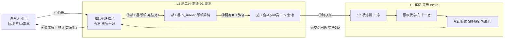

### 一张票的一生（L2 视角·八步）

①业主看对比件拍板（拍板表记行）→ ②主窗立票（窗队列一行＋任务书过三关＋贴飞书卡）→ ③派工器领单（验格→查撞单→再验单→**体检门**→定档→翻▶＋弹窗）→ ④施工窗跑 L1 夜车（收包→拆单→发车→施工→自愈→双证验收→判分→收车）→ ⑤窗交活（五件套＋收口自报→完工待确认）→ ⑥交活重考闸（考题重跑·绿才送终认）→ ⑦业主终认翻✅（缺考题走人工道；红打回返工环）→ ⑧收班：收班报/判色/复盘器。

### 端到端实例走查（真实案例·W-220·2026-10-31/11-01）

| 步 | 发生了什么 | 卡上坐标 |
|---|---|---|
| 1 | 拍板#296③ 立票：窗队列回卷元凶勘定（只读取证窗·零写面红线） | §14 L2 行1-3（拍板落账/立票验单关/立票贴卡） |
| 2 | spawn 后窗死：巡检僵尸认定（窗死＋申报不完整）→⏸挂起 | 宪法对5·§14 L2 行「宁停判死」 |
| 3 | 挂账登记：注记「清偿=W-223 收口」候清偿票 | 宪法对6（owner 宁停·原因必填） |
| 4 | 清偿票 W-223 交勘定报告＋收口申报完整（accept 全绿零未绿） | §14 L2 行「交活五件套/交活重考闸」 |
| 5 | 拍板#309：挂账行随裁→完工待确认（不锁死⏸不跳级✅·业主令首用） | 宪法对10·§14 L2 行「挂账随裁」 |
| 6 | 现态=完工待确认，候业主终认翻✅ | 宪法对4 |

---

## 第二章 · FSM Core 内核（有限状态机数学模型）

> 业内定义：状态机的数学模型，只定义「任务可以怎么变」，不含调度/容错/存储。模块＝State/Event/Transition/Guard/Action 五要素。

### 2.0 本层图与机制矩阵

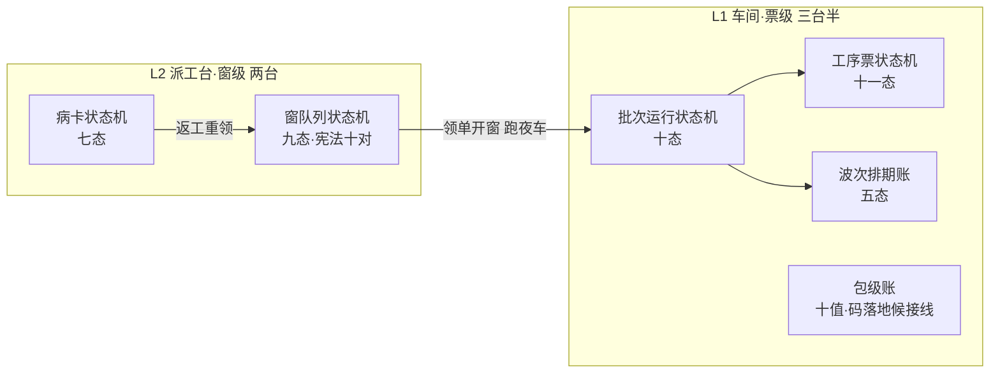

**Core 五要素 × 两层矩阵**：

| 要素 | L1 车间落点 | L2 派工台落点 |
|---|---|---|
| State | 批次运行十态·工序票十一态·波次五态 | 窗队列九态·病卡七态 |
| Event | 账本事件族（119 型白名单） | 队列变更/定时到点/收口自报/拍板推卡 |
| Transition | RUN/TICKET 转移表·rejected 入账 | 写口宪法十对（S+actor+Guard→S'） |
| Guard | 包导入三关/扣绿闸/硬化双闸/三钥匙 | 领单闸链/体检门/定档闸 |
| Action | 拆单/装备/写码分段/双证切片 | 翻格开窗/收口申报/行手术族 |

### 2.1 harness 第一层（L1·车间）

#### 2.1.1 State · 批次运行状态机（十态）
`ts/src/shared/run-state.ts:19-43` ✔——启动→导入中→拆单中→装备中→施工中→探针中→(自愈中→)验收中→汇报中→收车＋跳过边各态→汇报中；收车无出边。

#### 2.1.2 State · 工序票状态机（十一态）
`ts/src/shared/ticket-state.ts:21-46` ✔——待建/缓存问询/缓存直通·绿/施工中/降级产物/审查·扣绿闸/硬化出关/绿灯·可吊销/红·严重偏题/停车场/终局；23 条合法边（图4）。

#### 2.1.3 State · 波次排期账（五态）
`ts/src/queue/queue-ledger.ts:13,18` ✔——queued/in_progress/done/superseded/needs_replan；done/superseded 终态，needs_replan 唯一可回炉。

#### 2.1.4 Event · 账本事件族
`ts/src/shared/event-types.ts:11-12,54` ✔——state_transition/state_transition_rejected/ticket_state_transition/gate_suspend/gate_resume 等白名单事件（详见第四章·119 型）。

#### 2.1.5 Transition · 转移表
RUN_TRANSITIONS（run-state.ts:32）＋TICKET_TRANSITIONS（ticket-state.ts:47）✔——非法转移＝`state_transition_rejected`/`ticket_state_rejected` 入账不抛（ticket-state.ts:119-127）——断言思想的账本版。

#### 2.1.6 Guard · 闸族
包导入三关（#2·import.ts:34·gates.ts:107,280）→审查·扣绿闸（#19·reviewer.ts:42）→硬化双闸（#20·mutation-gate.ts:227）→三钥匙出关（#21·build-lane.ts:126,150）✔——质量闸链焊在票级边上。

#### 2.1.7 Action · 施工与验收动作
拆单（#3·split.ts:57）/装备（#5·equipment.ts:29）/写码分段（#14·llm-builder.ts:35）/双证切片（#31·run-slice.ts:251）✔——动作无内置重试，由弹性层（第七章）包装。

#### 2.1.8 本章口述
一张工序票的一生全在十一态里走：出生先问库房（缓存问询），没存货就进沙箱施工；干完测试绿也不发灯——押给审查员对题；对上题进硬化车间「对坏」；三把钥匙凑齐才发绿灯，而且这灯可吊销。跑偏了判红进停车场，夜末给一次补考机会，同因再犯直接熔断。整个过程每一步都写进行车记录仪（events.jsonl），断了灯也能按账本游标接着跑。

#### 2.1.9 缺口（勘误 2026-11-01·拍板#314③）
包级账（第六台）**码已落地**——拍板#199·W-137：package-state.ts 十值＋11 边转移表＋拍板号守卫（:12-66）＋package-ledger.ts 五件套账本（192 行）✔。**零调用方闲置**：主流程无写点·候接线方式决策（§12 候办①修订·W-232 讨论件联动）。

### 2.2 harness 第二层（L2·派工台）

#### 2.2.1 State · 窗队列状态机（九态）
正本=`90-过程/窗队列.md:6`＋写口宪法 ✔——探讨中(未批)/待实施(已批)/▶施工中/完工待确认/✅已完成/🔁维修中/⏸挂起＋宪法外词面 🔵待拍板、转人工（候收编·§12）。

#### 2.2.2 State · 病卡状态机（七态）
`repair-contract.mjs:23,40` ✔——待分诊→诊断→A域→方案件→修复→金丝雀→关（业内名 Incident Management Lifecycle·#47）。

#### 2.2.3 Event · 四类驱动事件
外部事件＝queue_watcher 队列变更（#28）；定时事件＝afk_cron 挂链（30 分机械＋每小时值守·#305）；人工干预事件＝拍板/终认/推卡；窗自报＝收口申报。

#### 2.2.4 Transition · 写口宪法十对
`91-脚本/队列写口.mjs:47-60` ✔——每对 {from→to, actor, board}，四员 actor＝dispatcher/window/owner/inspector；十对全表与逐对口述见 §2.5。

#### 2.2.5 Guard · 领单闸链
验格五闸（#7·pi_runner.ts:2093,2388）→撞单反查（#92 告警）→派发三关（#6）→**会审门四查**（#37·:490-515）→定档闸（#62b）——准入闸链挂在 待实施(已批)→▶施工中 边上。

#### 2.2.6 Action · 翻格开窗与行手术
markRunning＋spawn（#26/#28）✔；收口申报器（W-130·:1317-1328）；红/⏸行手术（:543-565·fail-closed 词面校验）。

#### 2.2.7 本章口述
一张窗票的一生在九格里走：业主拍板后立票排队（待实施已批）；派单员巡检领单，过五道资格闸＋开工体检门才翻「施工中」——这一翻开始烧钱；员工干完自己报「完工待确认」，机器按考卷重考，绿了还得业主点头才翻✅；干砸了进返工环；机器巡逻看见不对劲就⏸宁停。⏸今晚起有三条出边——误挂能翻回、挂账能清偿、能随裁，死态变工作态。

#### 2.2.8 缺口
🔵/转人工游离宪法外（影子态·候收编）；窗队列.md 头注未同步 #301/#309 三出边（§12 候办）。

### 2.3 状态流转表范式（三件套·关键流转统一记法）

> **记法总纲**：同一份流转事实三种视图——①**状态流转表**（六列·机读正本·唯一事实源）②mermaid 状态图（人看）③口述（外行）——表改，图与口述跟改。守卫失败＝留在现态记因，不产生迁移；熔断/预算等「修正案层」不进转移表，悬在所有边之上。

**范式一 · 六列转移表**（`S + Event + Guard → S'` 逐行展开）——以通用重试状态机为例：

| # | From 现态 | Event 触发事件 | Guard 守卫 | Action 动作 | To 次态 | 出口说明 |
|---|---|---|---|---|---|---|
| 1 | S 执行中 | 下游调用失败 | 重试额度>0 ∧ 熔断未开 | 注册重试定时器 | `S_RETRYING` | 进入显式重试态（不 sleep） |
| 2 | `S_RETRYING` | 重试触发事件（定时器到点） | 熔断未开 | 执行一次下游调用 | `S'` / `S_RETRYING` | 成功→迁移；失败→额度−1（**自环**） |
| 3 | `S_RETRYING` | 重试触发事件 | 额度耗尽 | 记死信＋告警 | `S_RETRY_FAILED` | 终局·不再自动重试 |
| 4 | `S_RETRYING` | 重试触发事件 | **熔断打开** | **不发起调用**·直接判本次失败 | `S_RETRYING` / `S_MANUAL` | 熔断是 Action 的保护，不是迁移规则 |
| 5 | `S_RETRY_FAILED` | 人工修复事件 | 人工核账确认 | 修复动作 | `S` / `S_MANUAL` | 人工介入道·永不装绿 |

**范式二 · 状态登记表**（每态一行）：

| 状态 | 类别 | 进态凭据 | 出边 | 白话 |
|---|---|---|---|---|
| `S` 执行中 | 正常态 | — | 2 | 干活的格 |
| `S_RETRYING` | 重试中 | 失败＋有额度 | 自环×N | 挂闹钟的分身格 |
| `S_RETRY_FAILED` | 异常态 | 额度耗尽 | 1（人工） | 认输格·候人工 |
| `S_MANUAL` | 人工修复态 | 人工介入 | 1 | 业主/人工的格 |
| `S'` | 终态（成功） | 调用成功 | 0 | 干完了 |

**范式三 · mermaid 状态图**（同一份表的画）：

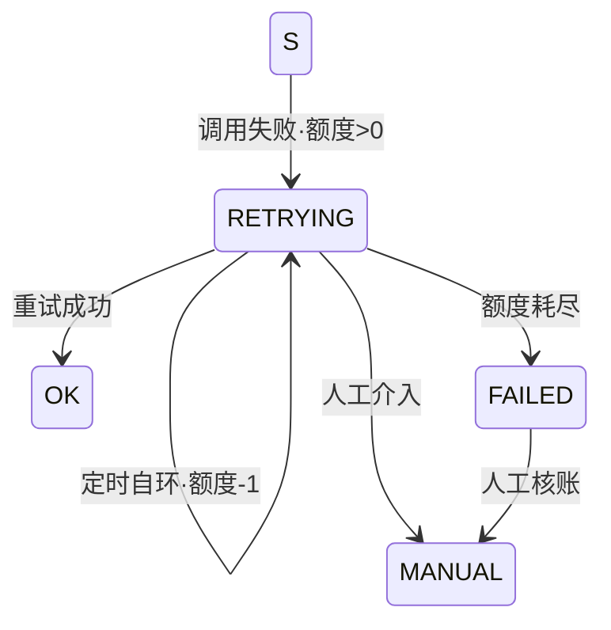

**本厂原生实证 · L1 挂起补考＝教科书长周期重试**：

| # | From 现态 | Event 触发事件 | Guard 守卫 | Action 动作 | To 次态 |
|---|---|---|---|---|---|
| 1 | 施工中/审查红 | 红票裁决 park#1 | 预算内修不动 | 押停车场·留 FAIL 断点 | 停车场 |
| 2 | 停车场 | 夜末补考定时事件 | **同因未复发** | 带 FAIL 摘录重试一轮 | 施工中 |
| 3 | 停车场 | 夜末补考 | **同因复发** | 同因熔断·不再给额度 | 终局 |

### 图2 · L2 窗队列九态与宪法十对边

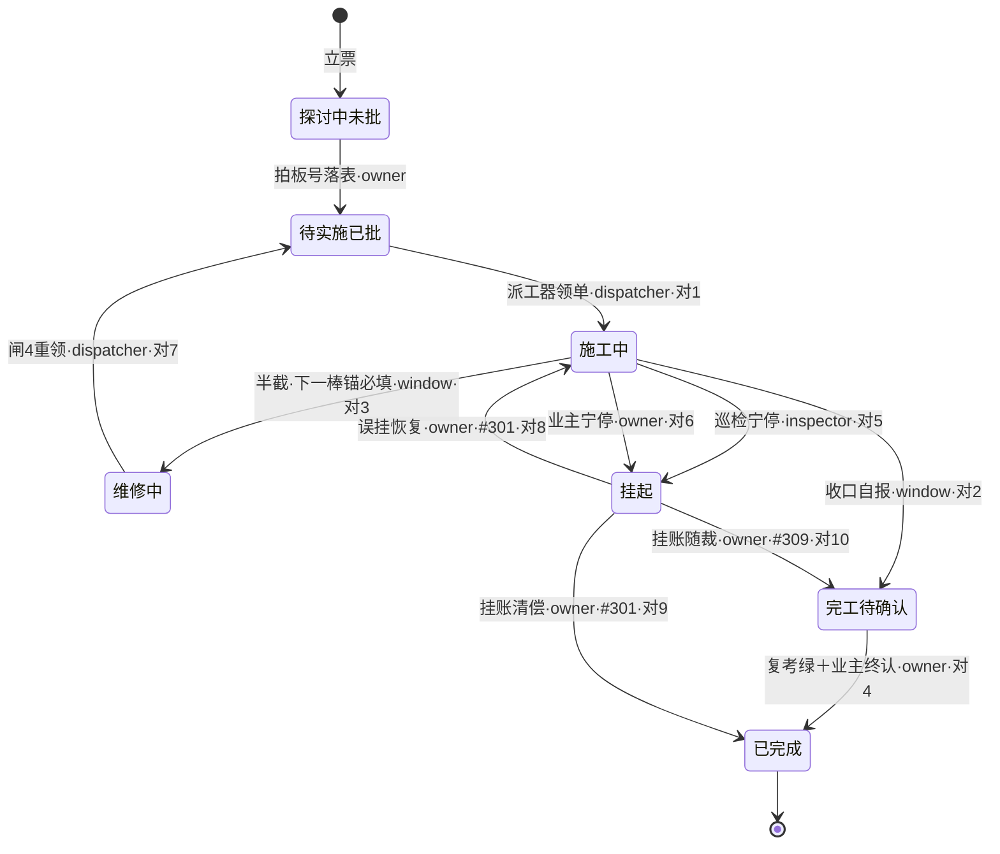

> 注：图内态名缩写（探讨中未批=`探讨中(未批)`·待实施已批=`待实施(已批)`·施工中=`▶施工中`·已完成=`✅已完成`·维修中=`🔁维修中`·挂起=`⏸挂起`）。🔵待拍板、转人工两词面**不在宪法内**（影子态·§12 候收编）。✅已完成=终态无出边，勘误走拍板表 append-only。

### 图3 · L1 run 十态主线（票级十一态详表见 §13 表B）

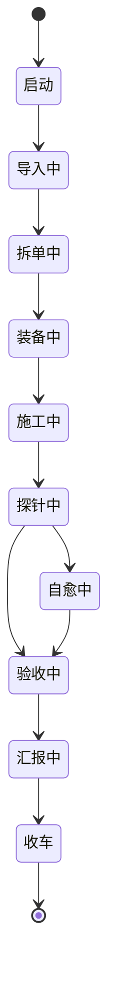

> 注：各态→汇报中均有跳过边（如 station3-only 装备中→汇报中）；**挂起不占态**——gate_suspend/gate_resume 成对审计事件＋账本末态＋since 游标判断点（L1 哲学：事件对无死锁）。

### 图4 · L1 票级十一态（施工账·正本=ticket-state.ts:21,47）

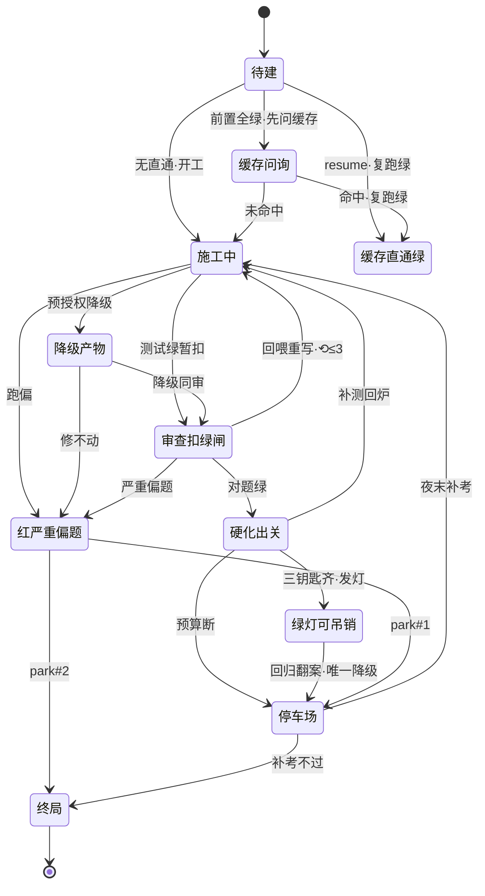

> 注：图内态名缩写（缓存直通绿=`缓存直通·绿`·审查扣绿闸=`审查·扣绿闸`·红严重偏题=`红·严重偏题`·绿灯可吊销=`绿灯·可吊销`）。缓存直通绿=无出边绿终态。**红线：红永不变绿·绿灯可吊销=唯一降级出边·⟲≤3/park≤2/预算三路守卫不进转移表。**三钥匙=测试绿∧对题绿∧硬化绿。

### 图5 · L1 波次五态（排期账·正本=queue-ledger.ts:13,18）

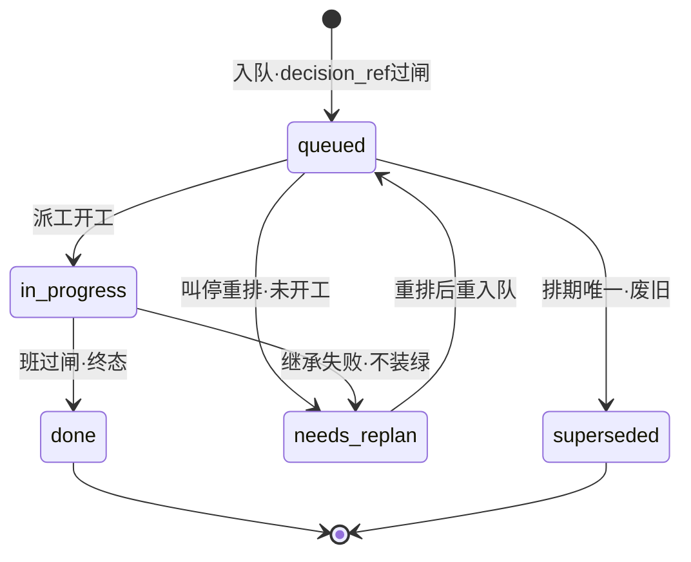

> 注：done/superseded=终态无出边；needs_replan=唯一可回炉态（继承失败 fail-closed 不派工不装绿·重排后回 queued）。

### 图6 · L2 病卡七态（维修账·正本=repair-contract.mjs:23,40）

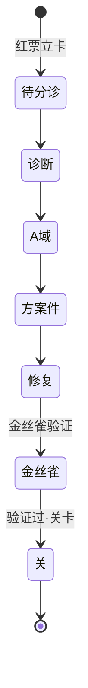

> 注：七态链=待分诊→诊断→A域→方案件→修复→金丝雀→关（业内名 Incident Management Lifecycle·ITIL 同构·#47·转移表 fail-closed）；修复段回窗队列走🔁重领闭环（§14 L2 返工环行）。

### 图7 · L1 包级账十值（施工规划账·正本=package-state.ts:12-66·拍板#199）

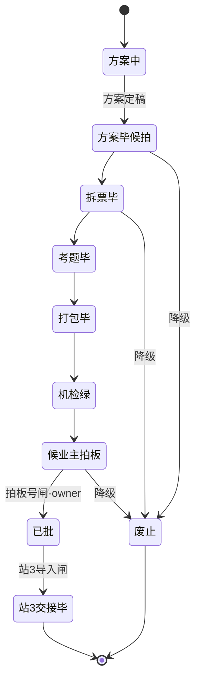

> 注：图内「方案毕候拍」=`方案毕(候拍)`。十值九主线＋侧终态废止（唯一降级方向·三入边）；站3交接毕/废止=终态无出边；拍板号守卫（候业主拍板→已批 边·非空非候拍才放行）在账本写侧调用方——守卫不进转移表（ticket-state 同款纪律）。**码已落地**（拍板#199·W-137）·零调用方闲置·候接线方式决策（§12 候办①·W-232 联动）。

### 2.5 台账与宪法十对口述（自 006 并入）

#### 台账·L1（ts/src）

| 台 | 态数 | 正本 | 用途 |
|---|---|---|---|
| run 级状态机 | 10 态 | `ts/src/shared/run-state.ts:19-43` | 每次批次运行生命周期：启动→导入中→拆单中→装备中→施工中→探针中→(自愈中→)验收中→汇报中→收车＋跳过边各态→汇报中 |
| 票级状态机 | 11 态 | `ts/src/shared/ticket-state.ts:21-46` | 每张工序票质量生命周期：待建→缓存问询→(缓存直通·绿｜施工中→审查·扣绿闸→硬化出关→绿灯·可吊销｜降级产物｜红·严重偏题→停车场/终局) |
| 波次排期账 | 5 态 | `ts/src/queue/queue-ledger.ts:13,18` | queued/in_progress/done/superseded/needs_replan |
| 包级状态 | 10 值 | package-state.ts:12-66＋package-ledger.ts（拍板#199·W-137） | 站1/2 段·**码已落地零调用方**·候接线（W-232 联动） |

**L1 挂起语义**：无独立态——`gate_suspend/gate_resume` 成对审计事件＋账本末态＋since(seq) 游标投影判"跑到哪、断在哪"（run-state.ts:11-13 头注·V4 夜车硬门）。

### L2（91-脚本·窗队列九态＋病卡七态）

**窗队列态**（正本=`90-过程/窗队列.md` 状态机行＋写口宪法）：

```
探讨中(未批) → 待实施(已批) → ▶施工中 → 完工待确认 → ✅已完成
▶施工中 → 🔁维修中（半截·候重领）
任意态 → ⏸挂起（宪法入边 2 条：inspector 宁停 / owner 宁停）
⏸挂起 → ▶施工中 / ✅已完成（#301）· 完工待确认（#309）——三出边业主道 --board
特殊词面：🔵待拍板（方向题候裁）· 转人工 —— ⚠ 两态不在宪法十对内（见 §12）
```

**写口宪法十对**（`91-脚本/队列写口.mjs:47-60`·责任部件四员：dispatcher/window/owner/inspector·owner(board)=业主道·主窗代录须带拍板号）：

| # | from → to | 责任部件（actor） | 语义 | 详细口述解释 |
|---|---|---|---|---|
| 1 | 待实施(已批)→▶施工中 | dispatcher | 派工器领单 | 单子躺在窗队列里等（业主已拍板批过）。派单员巡检一圈：资格闸全过（状态对/拍板号在/前置干完/任务书在/路由对），再过开工体检门四查——全绿才翻「▶施工中」弹窗开工。这是全链最重的一格：翻格=开始烧钱，所以闸最多。 |
| 2 | ▶施工中→完工待确认 | window | 收口自报 | 员工干完活自己交卷：accept 全绿、交活五件套齐、申报落盘——窗自己翻「完工待确认」。注意这只是「自称干完了」，绿不绿要过下一格机器重考（复考闸）＋业主终认才算数。 |
| 3 | ▶施工中→🔁维修中 | window | 方向题/维修道 | 干到半截干不动了（方向题拿不准推🔵、或收口半截）——窗自己翻「🔁维修中」，下一棒锚必填：接力的人知道从哪接着干，不从头瞎摸。 |
| 4 | 完工待确认→✅已完成 | owner(board) | 业主终认 | 唯一终认格：机器复考绿了、业主亲自点头（或业主令主窗代录带拍板号）才翻✅。这条对是 W-181 误翻✅之后立的规矩：✅只认业主道，机器和员工都翻不了。 |
| 5 | *→⏸挂起 | inspector | 巡检宁停（僵尸/停更/预算无据） | 巡检员任何时候看见不对劲——窗死申报不完整（僵尸）、会话档停更像死循环、预算刹车没据可算——一律翻⏸候人工。宁停勿装绿：拿不准就停，绝不替窗说「干完了」。 |
| 6 | *→⏸挂起 | owner | 业主宁停 | 业主自己叫停（撞号让位/挂账登记/候外部条件）——同样翻⏸，原因必填。与巡检道分开记 actor：谁停的一查便知，翻案权各归各。 |
| 7 | 🔁维修中→待实施(已批) | dispatcher | 闸4 超时重领 | 维修票排好了，派工器按闸4超时语义重新领单——翻回「待实施(已批)」把领单闸链（含开工体检门）重新走一遍，修好的当新活派。 |
| 8 | ⏸挂起→▶施工中 | owner(board) | 勘误恢复·活窗误挂（#301） | 勘误恢复专用：巡检判死判错了（活窗被误挂——心跳孤儿、盯错探针档），业主核过实锚（会话档还新鲜在写）翻回▶续干。#301 新开·首用 W-216。这条边治「⏸无出边死锁」的活窗半边。 |
| 9 | ⏸挂起→✅已完成 | owner(board) | 挂账清偿·业主令（#301） | 挂账清偿专用：这行⏸是挂账（注记写着「清偿=W-X 收口」），W-X 真收口了——业主令下挂账行直接翻✅清账，不用再走一遍终认仪式。#301 新开·首用 W-202/W-219。 |
| 10 | ⏸挂起→完工待确认 | owner(board) | 挂账随清偿票完工随裁（#309） | 挂账随裁专用：清偿票 W-X 干到「完工待确认」了，挂账行跟着翻同款态候业主终认——不再死锁⏸也不跳级翻✅。#309 新开·首用 W-220（W-223 勘定报告交了，W-220 随裁）。 |

**⏸挂起全部触发情形**（今晚六案归类·业主已核）：

| 触发者 | 情形 | 今晚实例 |
|---|---|---|
| inspector 巡检 | ①僵尸认定（窗死＋申报不完整）②停更分诊（死循环嫌疑·W-148 签名）③窗预算刹车无法核算（#211） | W-220/W-223 三次·W-223（盯错探针档误判）·W-216 |
| owner/主窗代录 | ④挂账让位（撞号/收敛裁定）⑤挂账登记（清偿=W-X 收口）⑥候外部（候企微重启令等） | W-219(#298)·W-202/W-217/W-220·W-199(#284①) |

**完工待确认三触发**：①施工窗自报（▶→·window 合法边）②缺考题窗型完工（#179·不代写✅）③挂账随裁（#309）。

### 两层设计哲学差异（今晚事故的机制注脚）

| | L1（引擎） | L2（harness） |
|---|---|---|
| 挂起表达 | 无独立态——gate_suspend/resume 事件对 | ⏸ 独立状态格（写口宪法管） |
| 崩溃恢复 | 账本末态＋游标投影 | 状态格＋写口翻格 |
| 今晚教训 | 事件对无死锁 | ⏸ 无出边曾死锁五行——#301/#309 补出边后解除 |

---

## 第三章 · 迁移拦截链（切面 / Hook · 3.2.1）

> 业内定义：紧贴跃迁链路切面注入，不改迁移规则。模块：前置校验、不变式断言、后置校验、异常拦截。

### 3.0 本层图与机制矩阵


**拦截模块 × 两层矩阵**：

| 模块 | L1 车间 | L2 派工台 |
|---|---|---|
| 前置校验 | 包导入三关（#2·gates.ts:107）＋钉版闸（#65） | 验格五闸（#7）＋审批规格节＋派发三关（#6） |
| 不变式断言 | 判卷守卫对拍 sha（#18·build.ts:73）＋keys 对账 | assertStateFace（:563）＋window_assert（W-088） |
| 后置校验 | 对题审查员扣绿（#19）＋硬化对坏 FAIL（#20） | 收口申报四查（:1317）＋钩子回执注记（#89甲） |
| 异常拦截 | 红票裁决七源同出口（#22·red-ruling.ts:35） | 打回分诊三分类（#49）→返工环（#47） |

### 3.1 harness 第一层（L1·车间）

#### 3.1.1 前置校验（Pre-Check）
包导入三关（#2·版本闸 ajv/计数闸/死链）＋版本钉版（#65·run-slice.ts:139·R02 拍板#215）✔——校验失败直接拒绝本次事件。**口述**：夜车收包先验三道——版本对吗、数量齐吗、链接死吗；这班用哪一版还要先钉铭牌，指纹不符拒启。

#### 3.1.2 不变式断言（Invariant）
判卷守卫防篡改（#18·build.ts:73,210·对拍冻结 sha）＋keys 对账断言（STATE_LABELS 失步即 throw·ticket-state.ts:100-103）✔——断言失败=系统逻辑异常。**口述**：考卷开工前封存画押，交卷时对指纹——有人偷改考卷，整场作废。

#### 3.1.3 后置校验（Post-Check）
对题审查员扣绿闸（#19·reviewer.ts:69,109）＋硬化双闸对坏 FAIL（#20）✔——迁移落地后业务一致性校验。**口述**：测试绿只是入场券——审查员逐条对题防跑偏，硬化车间专挑「只会做对题的绣花枕头」。

#### 3.1.4 异常拦截（Exception）
红票裁决七源同出口（#22·red-ruling.ts:35,48,57,71）——Action 异常统一路由到停车场/终局分支。**口述**：七种死法一个裁决口——park#1 还有救换票重做，park#2 记账收摊；同一个口出，账好查。

#### 3.1.5 缺口
可达性/孤岛状态静态检查＝无（§10·§16#6）。

### 3.2 harness 第二层（L2·派工台）

#### 3.2.1 前置校验（Pre-Check）
领单验格五闸＋审批规格节＋派发三关（#6/#7·pi_runner.ts:3261-3270）✔——校验失败跳过记因不弃单。**口述**：派单员取单前查五样——状态对吗、拍板号有吗、前置干完吗、任务书在吗、路由对吗；哪道不过记一笔跳过，不扔单。

#### 3.2.2 不变式断言（Invariant）
assertStateFace 词面白名单（:563·写口闸3·拍板#259①）＋window_assert 不变量＋产物锚（W-088·拍板#135①）✔——拒写非法翻格。**口述**：往队列格子里写字前先断言「这个字在白名单里吗」——W-181 误翻✅之后立的规矩，机器也翻不了业主的格。

#### 3.2.3 后置校验（Post-Check）
收口申报器四查（申报完整/三键/申报落盘·:1317-1328）＋钩子回执注记（#89甲·:643,774）✔。**口述**：窗进程一退回执直写；交活先查五件套齐不齐——不齐不收。

#### 3.2.4 异常拦截（Exception）
打回分诊三分类（#49·Bounce Triage）→返工环（#47/#48·repair-contract.mjs）✔。**口述**：考砸先分诊——机械毛病、规矩病、规格病各走各的口，不一股脑打回了事。

#### 3.2.5 缺口
前置校验的「批什么漂移」检测＝回禀候令（拍板#307⑥·四方向）。

### 3.2.6 关键流转表：领单闸链（六列范式·事件=巡检 tick·现态=待实施(已批) 驻留）

| # | From 现态 | Event 触发事件 | Guard 守卫 | Action 动作 | To 次态/出口 |
|---|---|---|---|---|---|
| 1 | 待实施(已批) | 巡检 tick | 状态=待实施(已批)∧拍板号非空 | 取单入候选 | 入候选 |
| 2 | 候选 | 闸1 前置检查 | 前置✅/完工待确认∧无环 | —— | 不过=跳过记因·留驻 |
| 3 | 候选 | 闸2 任务书存在 | 文件在 | —— | 拒=记因 |
| 4 | 候选 | 闸3 路由 | 大业务→作业面存在 | routeOf | 拒=记因（fail-closed） |
| 5 | 候选 | 闸4 审批规格节 | 拍板号交叉核对一致 | —— | 不一致=拒发 exit2 |
| 6 | 候选 | 派发三关 | CHECKER EXIT0 | —— | 红=拒发 |
| 7 | 候选 | 领单体检门四查 | dryrun:只记／enforce:全绿 | reviewGateLogAppend | 红→探讨中(未批)·超时→⏸ |
| 8 | 候选 | 定档闸 | 词表扫改动面定档 | 高档(enforce)→⏸ | 停车候拍 |
| 9 | 候选 | 翻格 Action（宪法对1） | 全闸过 | markRunning＋spawn | **▶施工中** |

### 3.3 断言五品种（自 006 §9 并入）

**结论**：断言≠泛泛的「代码校验」——校验是大类（可软可硬），断言是其中最硬的子类：一条二值的机器主张（「X 此时必须为真」），假了当场红、exit code 说话，绝不告警了事。在本厂地图里，**断言是闸的牙齿**：§14 矩阵里每个「闸」，判过/不过的判据最终都是一组断言。

| | 校验/检查（大类） | 断言（硬核子类） |
|---|---|---|
| 输出 | 可软：WARN 告警不拦车（撞单反查、锚点漂移 13 行=告警级） | 必硬：假了当场红，exit code 唯一判据，红=打回/拒写/不装绿 |

### 断言五品种对照（怎么对应上）

| 品种 | 是什么 | 实例（锚） | 挂在本卡矩阵哪一格 |
|---|---|---|---|
| ①行为断言 | 断「函数/闸在给定输入下必出给定结果」——selftest 全是这类 | runReviewGate 案92-129（pi_runner.ts:2335-2766） | 每个闸的自证：会审门/复考闸/写口手术全带 selftest |
| ②同步断言 | 断「码与文档/字典不失同步」——漂了当场 throw | ticket-state.ts:100-103（STATE_LABELS 失步即 throw）·sm-003 keys 对账断言 | 状态机↔状态字典↔机制目录对账（本卡 §12/§12 所说投影件漂移即靠它兜底） |
| ③不变量断言 | 断「写之前/收口之前世界仍合规」——fail-closed 拒写 | assertStateFace 词面白名单（pi_runner.ts:563·写口闸3·拍板#259①）·window_assert 不变量＋产物锚（W-088·拍板#135①） | 写口宪法（§2/§13）的牙齿：每对翻格前先过词面断言；交活重考闸挂载件 |
| ④锚点断言 | 断「文档里 file:line 锚在现行码里还成立」 | 锚点断言 --check（meta-lint 族·漂移=告警级） | 机制目录卡36 锚漂移（:377-394→现行）即它查出 |
| ⑤防假绿断言 | 断「断言自己活着」——反着调必须变红才证没坏 | W-162 防假绿断言调反隔离（瘫化词面→转绿=真活→还原复红逐字节一致） | 纪律层：绿才认的前提是断言不会永久绿 |

**L1 特殊形态**：转移表把断言思想做成账本版——非法转移不抛异常，记 `state_transition_rejected` 入账（ticket-state.ts:119-127）；合法性一寸不让，红的方式是「入账留痕」而非「中断」。

**对应到本卡地图**：闸（guard）＝断言的集合＋出口映射（会审门四查=4 组断言实跑；复考闸=考题重跑断言＋window_assert）；宪法＝断言的权限版（actor＋词面断言）；绿才认纪律＝断言的结果解释权（认 exit code 不认感觉：NA≠PASS·skip≠green·断言调反必须红）。

---

## 第四章 · 事件网关（事件管理层 · 3.2.2）

> 业内定义：统一管理进入状态机实例的事件——路由、去重、乱序、死信。模块：事件去重、乱序缓冲、死信。

### 4.0 本层图与机制矩阵

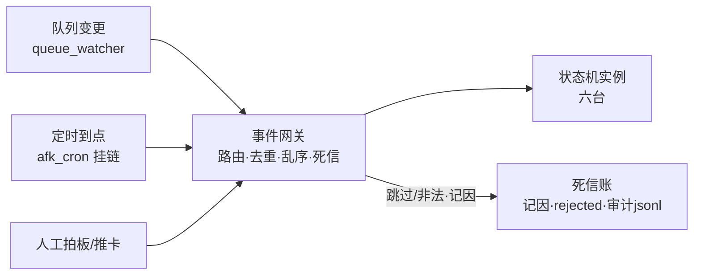

**事件模块 × 两层矩阵**：

| 模块 | L1 车间 | L2 派工台 |
|---|---|---|
| 事件路由/溯源 | events.jsonl 119 型白名单（#54·原生事件溯源） | queue_watcher 防抖 30s 发射（#28·TaskID=窗ID） |
| 去重/幂等 | 账本 seq 严格递增（C-021） | 单飞锁＋queue_mutex 乐观锁（重试上限 3） |
| 乱序缓冲 | ——（单写者无乱序） | 后到秒退（丢弃策略） |
| 死信 | state_transition_rejected 入账 | 跳过记因落盘＋审计 jsonl＋review-gate.jsonl |

### 4.1 harness 第一层（L1·车间）

#### 4.1.1 事件白名单与溯源
事件账本白名单（#54·EVENT_TYPE_LIST 119 型＋EVENT_LABELS 正本字典·event-types.ts）＋events.jsonl append-only＝**原生 Event Sourcing** ✔。**口述**：119 种事件个个有名有姓，加一种要拍板——账本上不存在「无名事件」。

#### 4.1.2 死信（非法/无法消费事件）
`state_transition_rejected`/`ticket_state_rejected` 入账（ticket-state.ts:119-127）＋gate_suspend 无配对挂账（efficiency-risks.ts:26）✔——回放排查有账可查。**口述**：非法事件不当没发生——记「被拒」账，回放时看得见当时想干什么、为什么被拒。

#### 4.1.3 缺口
死信无独立队列形态（记账式）·事件优先级 L1 无——按需增强（§11 覆盖小结）。

### 4.2 harness 第二层（L2·派工台）

#### 4.2.1 事件路由与乱序（去重）
queue_watcher 防抖 30s→发射、后到秒退（#28·单飞互斥）＝乱序丢弃策略；单飞锁＝EventID 去重同构 ✔。**口述**：队列一动等 30 秒再发车（攒一批变更），两个派工器同时抢活——后到的秒退，绝不双开。

#### 4.2.2 幂等控制
queue_mutex 写口乐观锁（#53·W-092·OPTIMISTIC_RETRY=3·队列写口.mjs:63）✔——防同窗并发事件撕裂。

#### 4.2.3 死信管理
跳过记因落盘（appendSkipReason·:2555 区）＋审计 jsonl＋review-gate.jsonl ✔——**口述**：领单跳过不是悄悄跳过——哪张票、哪道闸、为什么，逐条落盘可回放；今晚回卷事故能勘定元凶，靠的就是这类账。

#### 4.2.4 缺口
宪法外两词面（🔵/转人工）的事件无白名单型——收编后补型（§16#1）。

## 第五章 · 实例仓库（持久化层 · 3.2.3）

> 业内定义：保障单实例宕机不丢状态。模块：快照、乐观锁、实例存储。

### 5.0 本层图与机制矩阵

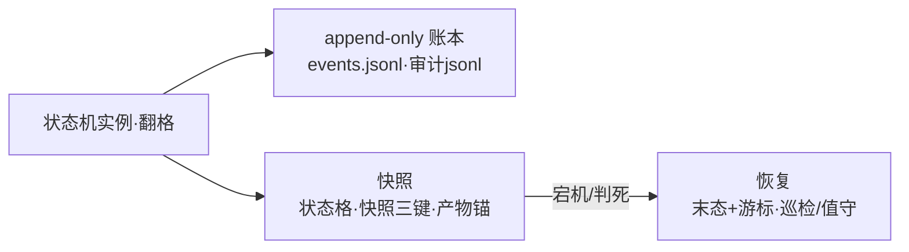

**持久化模块 × 两层矩阵**：

| 模块 | L1 车间 | L2 派工台 |
|---|---|---|
| 实例存储 | events.jsonl 单点入账（C-021·ledger.ts:12） | 窗队列 md 状态格＋产物锚目录 |
| 快照 | 账本即流水（无独立快照·重放即重建） | spawn 快照三键（会话档/窗PID/时间） |
| 乐观锁 | 单写者事件循环（无锁需要） | queue_mutex 四写点包锁（#53·W-092） |
| 恢复 | 账本末态＋since 游标（V4 硬门） | 巡检判死→核账报告（#64）→值守恢复（#305/#301） |

### 5.1 harness 第一层（L1·车间）

#### 5.1.1 实例存储（append-only 账本）
events.jsonl 同步单点入账（C-021·拍板#42①·ledger.ts:12）✔——并发 worker 事件逐条完好、seq 严格递增。

#### 5.1.2 快照与恢复
崩溃后按账本末态＋since(seq) 游标判「跑到哪、断在哪」（run-state.ts:11-13·V4 夜车硬门）＋recoverTicketStates 同票取末笔（ticket-state.ts:136-146）✔。**口述**：L1 不留「挂起格」——停车是一对「挂起/恢复」事件；车再发时读账本末态加游标，断在哪格从哪格接着跑，一步不丢。

#### 5.1.3 缺口
transition 事件无 actor 字段（崩溃归因只能到态不能到部件）——候票（§15#8）。

### 5.2 harness 第二层（L2·派工台）

#### 5.2.1 实例存储与快照
窗队列 md 状态格＋spawn 快照三键（会话档/窗PID/时间·:1317 区）＋产物锚目录（窗产物/W-NNN/）✔。

#### 5.2.2 乐观锁与并发保护
queue_mutex 四写点包锁（#53·领单/钩子/复考/快照·锁内重读→比对→改→写）＋写前词面断言 ✔。**口述**：四个会写账的地方全走同一扇门（写口），门上两道锁——乐观锁防抢、词面断言防写错字；今晚的回卷事故正是「没走这扇门的直写」造成，事故反过来证明了锁的价值。

#### 5.2.3 恢复能力
巡检判死→僵尸核账报告（#64·只取证不代写）→值守恢复 ⏸→▶（#305·#301 对）✔。

#### 5.2.4 缺口
心跳孤儿（领单实例退出无人续租）＝W-189 设计盲区——值守道止损·根治候 W-220 续跑（今晚实证）。

## 第六章 · 调度器（资源调度层 · 3.2.4）

> 业内定义：跨多实例协调——并发槽/信号量、排队队列、定时器。不属于单个任务状态机。

### 6.0 本层图与机制矩阵

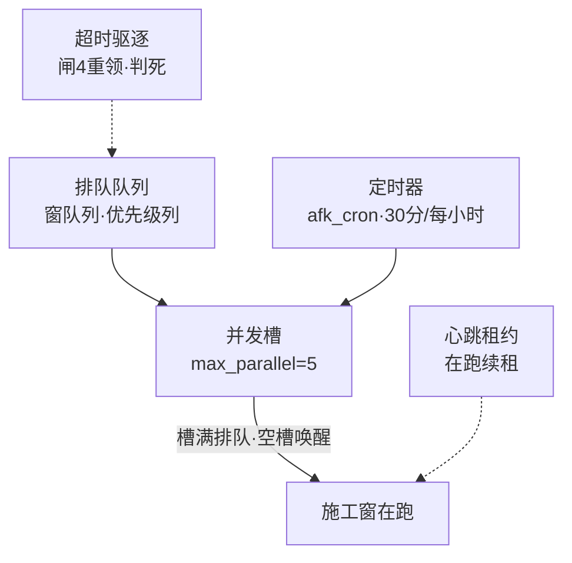

**调度模块 × 两层矩阵**：

| 模块 | L1 车间 | L2 派工台 |
|---|---|---|
| 并发槽/信号量 | 波内受控并发（#25·barrier-loop） | 槽位化主循环（#26·领至槽满） |
| 排队队列 | 就绪制波次（E3·前置✅即解锁） | 窗队列＋优先级列（#179·不抢占） |
| 定时器 | 班闸/波次事件（gate passed/failed） | afk_cron 挂链＋queue_watcher 事件触发 |
| 超时驱逐/心跳 | 预算 hard 收车（#24） | 闸4 超时重领＋心跳租约（W-189）＋判死（W-172） |

### 6.1 harness 第一层（L1·车间）

#### 6.1.1 排队队列与就绪调度
E3 就绪制/波次调度（#25·ready-queue.ts·barrier-loop.ts·前置✅即解锁·波内受控并发）✔。**口述**：票不排死队——前置干完就就绪，波内几票同时跑但受控，全靠账本说了算。

#### 6.1.2 定时器与资源终止
夜车预算三路（#24·night-budget.ts·软降档/hard 收车留断点）✔——资源耗尽由调度层收车，状态机只收事件。

#### 6.1.3 缺口
L1 波次无优先级（就绪即发）——与 L2 优先级列不对齐（§11 平台增强◐）。

### 6.2 harness 第二层（L2·派工台）

#### 6.2.1 并发槽 / 信号量
槽位化主循环（#26·max_parallel=5·领至槽满→轮询空槽→再领·pi_runner.ts:2373）✔——**口述**：五条车道，车多排队；每跑完一辆空一条槽，排队的立刻顶上。

#### 6.2.2 排队队列与优先级
窗队列即排队队列＋优先级列（#179·高/普/低·插队不闯闸·不做抢占）✔——**口述**：急单能插到队首，但该过的闸一道不少；在跑的车绝不拦停。

#### 6.2.3 定时器
afk_cron 挂链（pi_runner 随链＋wip_scan 30 分＋值守每小时·#305）＋queue_watcher 事件触发（#28·防抖 30s）✔。

#### 6.2.4 排队超时驱逐与心跳
闸4 超时重领（W-187）＋心跳租约（W-189·leaseTouch）＋巡检判死（W-172 快照年龄守卫）✔——**口述**：在跑的窗由派单员代报平安（心跳）；心跳断了先别判死——值守道核会话档活证（#305·今晚 W-216 心跳孤儿拉锯的教训），真死了才判，判死还有核账报告兜底。

#### 6.2.5 缺口
不做抢占（在飞▶不打断不杀·候业主另拍）；心跳孤儿根治候 W-220 续跑（§5.2.4）。

## 第七章 · 弹性组件（Resilience · 3.2.5）

> 业内定义：包装 Action 外部调用，防雪崩。模块：重试、熔断、舱壁、超时。

### 7.0 本层图与机制矩阵

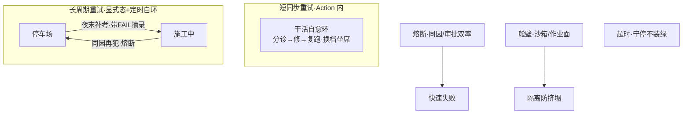

**弹性模块 × 两层矩阵**：

| 模块 | L1 车间 | L2 派工台 |
|---|---|---|
| 重试（短同步） | 回喂自愈环⟲≤3（#15·build.ts:184） | ——（L2 无 Action 内重试） |
| 重试（长周期） | 停车场＋夜末挂起补考（#23·lane-drain.ts:31） | 闸4 超时重领（W-187）＋值守恢复（#305） |
| 熔断 | 同因熔断（#23·复发零轮） | 审批熔断（#62a·双率越阈·影子缺省） |
| 舱壁 | 票级沙箱（#11）＋载体三级（#68） | 大业务作业面路由（#76②·fail-closed） |
| 超时 | 预算 hard 收车（#24） | 体检门四查宁停＋taskTimeoutMs |

### 7.1 harness 第一层（L1·车间）

#### 7.1.1 重试（双范式）
短同步＝回喂自愈环⟲≤3（#15·build.ts:184-255·预共享预算·15a 机械分诊/15c 坐席A 换档）；长周期＝停车场显式态＋夜末挂起补考（#23·lane-drain.ts:31,50·带 FAIL 摘录）✔。**口述**：小毛病当场改当场再试，最多三回合；改不好的押进停车场，收班前带着「错题摘录」最后试一次——同一种错犯两回，直接不给机会（同因熔断）。

#### 7.1.2 熔断
同因熔断（#23·同因复发零轮）✔——快速失败保护下游。

#### 7.1.3 舱壁
票级沙箱（#11·每票一箱·票毕回搬·补考开新箱＝干净房）＋沙箱三级载体分级（#68·宿主/影树/容器·provider-types.ts:13,22,44）✔——**口述**：一票一屋，谁也别污染谁；屋子分三档，权限跟着档走。

#### 7.1.4 超时与背压
预算三路（#24·night-budget.ts·软降档→hard 收车留断点）✔。

#### 7.1.5 缺口
下游级熔断（如 LLM 供应商级）以换档降级（#15c Model Fallback）替代——粒度不同如实标注。

### 7.2 harness 第二层（L2·派工台）

#### 7.2.1 重试
闸4 超时重领（W-187·🔁→待实施）＋值守活窗误挂恢复（#301·⏸→▶）＋活窗心跳孤儿续租（#305）✔。

#### 7.2.2 熔断
审批熔断（#62a·审批熔断.ts:48,85,173·回退率+事故率双率越阈出收紧建议·影子缺省）✔——**口述**：数这个班代拍出错的比例，超线就建议收权——但只建议，动手前必等业主令。

#### 7.2.3 舱壁
大业务→作业面路由（#76②·routeOf fail-closed）——不同业务隔离不同工作目录 ✔。

#### 7.2.4 超时
会审门四查超时宁停（REVIEW_GATE_TIMEOUTS·baseline 600s/tsc 300s/reverify 180s/anchor 30s）＋taskTimeoutMs 窗任务超时 ✔——**口述**：体检超时不硬等——宁停⏸候人工，绝不卡死车道。

#### 7.2.5 缺口
渐进开闸（#52）下 enforce 面仍部分影子（会审门/分级闸翻转候业主令·渐进推进中）。

### 7.2.6 关键流转表：值守恢复与重领（六列范式·L2）

| # | From 现态 | Event 触发事件 | Guard 守卫 | Action 动作 | To 次态 |
|---|---|---|---|---|---|
| 1 | ⏸挂起 | 值守每小时六查 | 会话档新鲜（活证）＋心跳孤儿实锚 | 写口 owner --board（#301 对8） | ▶施工中 |
| 2 | ⏸挂起（清偿=W-X） | 值守定时清偿链 | W-X 已✅ | 写口 owner --board（#301 对9） | ✅已完成 |
| 3 | ⏸挂起（清偿=W-X） | 值守定时随裁 | W-X=完工待确认 | 写口 owner --board（#309 对10） | 完工待确认 |
| 4 | 🔁维修中 | 闸4 超时重领 | 前置就绪 | 重领（闸链含体检门重走） | 待实施(已批) |
| 5 | ▶施工中 | 收口自报 | 交活五件套齐＋申报落盘 | 窗自翻（#89甲钩子/申报器） | 完工待确认 |
| 6 | 完工待确认 | 复考＋业主终认 | 考题重考 exit0＋owner board | 写口翻✅（宪法对4） | ✅已完成 |

## 第八章 · 业务补偿（Saga · 3.2.6）

> 业内定义：正向动作绑定补偿动作，失败按序反向撤销。**本厂设计差异：补偿＝「账本 append＋业主令」人工主导，非自动反向执行**（自动化边界候讨论·§16#7）。

### 8.0 本层图与机制矩阵

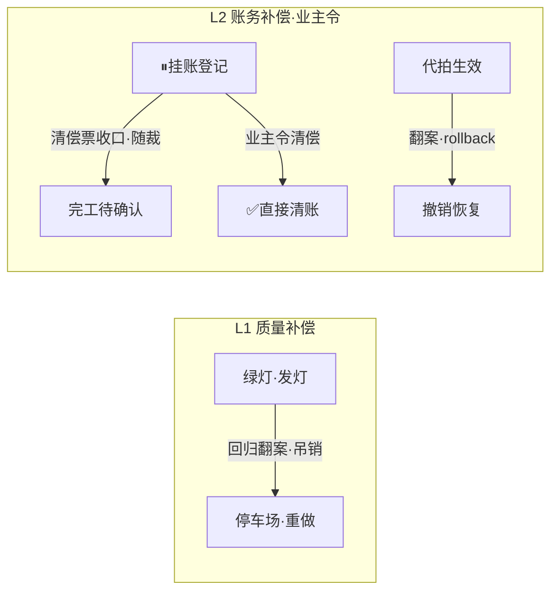

**补偿模块 × 两层矩阵**：

| 模块 | L1 车间 | L2 派工台 |
|---|---|---|
| 质量补偿 | 绿灯吊销（#35·regression-leg·唯一降级出边） | 考砸打回→返工环（#47 闭环） |
| 换票补偿 | park#1 挂起换票（#22） | 挂账让位（撞号/收敛·owner 宁停） |
| 挂账-清偿补偿对 | —— | ⏸挂账↔随裁（#309）↔清偿翻✅（#301） |
| 翻案 | —— | 业主追认/一键撤回（#40/#45·rollback） |
| 设计差异 | 人工主导补偿 | 同左 |

### 8.1 harness 第一层（L1·车间）

#### 8.1.1 质量补偿
绿灯吊销（#35·regression-leg·回归翻案——新片红吊销旧绿灯重走三钥匙）✔——唯一降级出边。**口述**：后面工序的回归考卷红了，一查锚定到前面已发绿灯的票——回头把灯拔了押回停车场重做；发过的灯也敢收回。

#### 8.1.2 换票补偿
红票裁决 park#1 挂起换票（#22）——撤销当前执行，换票重做 ✔。

### 8.2 harness 第二层（L2·派工台）

#### 8.2.1 挂账-清偿补偿对
⏸挂账登记（清偿=W-X 收口）↔ 清偿随裁（#309·⏸→完工待确认·首用 W-220）＋清偿翻✅（#301·W-202/W-219）✔——**口述**：一时干不了的活先挂账压⏸，账上写明「谁收口我清账」；等那位真交了活，挂账行自动跟着翻格——不锁死也不跳级。

#### 8.2.2 翻案（Compensation 执行）
业主追认/一键撤回（#40·confirm --rollback·event-types.ts:82 owner_confirmed/rejected）＋代拍追认制（#45）✔——**口述**：代理拍板错了不怕——业主一键撤回，账本记一笔翻案，世界恢复原状。

#### 8.2.3 流程补偿
🔁返工环（#47 病卡七态→修复→金丝雀→关→重走交活）✔。

#### 8.2.4 缺口
哪些补偿可自动化、哪些必须业主令——边界未成文（§16#7 候讨论）。

### 8.2.5 关键流转表：挂账-清偿-随裁（Saga 三步·补偿对）

| 步 | 动作 | 账本痕迹（宪法对/事件） | 补偿触发 |
|---|---|---|---|
| 1 挂账 | ⏸＋注记「清偿=W-X 收口」 | owner 宁停（对6） | 若 W-X 红→挂账行留⏸候再指（不自动撤） |
| 2 清偿票交活 | W-X→完工待确认 | window 自翻（对2）＋重考闸 | 触发随裁条件 |
| 3 随裁 | 挂账行 ⏸→完工待确认（#309 对10·owner board） | 写口手术 | 业主终认→✅（对4）；翻案→rollback（#40） |

## 第九章 · 治理底座（可观测层 · 3.2.7）

> 业内定义：审计、指标、Trace、告警、人工干预。

### 9.0 本层图与机制矩阵

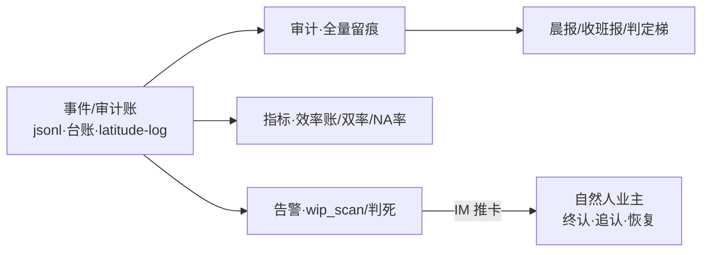

**观测模块 × 两层矩阵**：

| 模块 | L1 车间 | L2 派工台 |
|---|---|---|
| 审计 | events.jsonl（全量事件流水） | 审计 jsonl＋latitude-log＋执行台账 |
| 指标 | R13 判定梯（#36·NA 率/片红率） | 效率账（#60）＋熔断双率（#62a） |
| Trace | run 批号＋票 ID 贯穿账本 | 会话档＋产物锚＋快照三键 |
| 告警 | 探针红/预算线（站内 IM） | wip_scan WARN（#50）＋判死通报＋值守六查 |
| 汇报 | 晨报纯投影（#39） | 收班报三节（#46）＋判定梯判色（#61） |
| 人工干预 | 业主追认（#40） | 终认/勘误恢复/推卡（#44·监工道）＋值守（#305） |

### 9.1 harness 第一层（L1·车间）

#### 9.1.1 审计
events.jsonl 全量事件流水（append-only·不可篡改）✔——每一次迁移旧态/新态/事件/结果全记。

#### 9.1.2 指标与判定
R13 判定梯（#36·ladder.ts:13,32·票红/切片红/NA≥20%/无考题=FAIL·UNKNOWN≠HEALTHY）✔。

#### 9.1.3 汇报
晨报纯投影（#39·morning-report.ts:56,70,284·events.jsonl 全量投影·无独立数据源）✔——**口述**：晨报没有自己的一本账——全部从事件流水现算现投影，账本唯一，报就不会谎。

### 9.2 harness 第二层（L2·派工台）

#### 9.2.1 审计
审计 jsonl＋latitude-log（代拍留痕）＋执行台账（append-only）＋review-gate.jsonl ✔。

#### 9.2.2 指标
班产效率账（#60·效率账解析.ts:35,61,81,85·三源聚合只投影）＋熔断双率 ✔。

#### 9.2.3 汇报与判定
班次汇报聚合器（#46·三节：代拍清单/候拍池/追认台账·:271）＋班次判定梯（#61·:147,163·班绿=全✅∧零红∧预算全可判·词面锚 :135-140）✔——**口述**：收班机器判色——绿黄红三态，判黄的每一条都有词面锚可回查，不猜不装。

#### 9.2.4 告警
wip_scan 落差机检（#50·:150,174·僵尸嫌疑/反向落差·WARN 不拦车）＋IM 通知 ✔。

#### 9.2.5 Trace
会话档＋产物锚＋spawn 快照三键（跨窗追踪三件套）✔。

#### 9.2.6 人工干预（带审批流）
业主终认（#258 道）＋勘误恢复/挂账清偿（owner board·#301/#309）＋候批推卡（监工道·#306 飞书 IM）＋值守道六查推进（#305·越权只推卡不代答）✔。

#### 9.2.7 缺口
效率账缺数宁停降黄（缺数不装绿）——数据面扩宽候票（§15 相关）。

## 第十章 · 静态校验工具（开发配套工具链 · 3.3）

> 业内定义：开发发布期使用，线上不运行——可达性检查、版本灰度。

### 10.0 本层图与机制矩阵

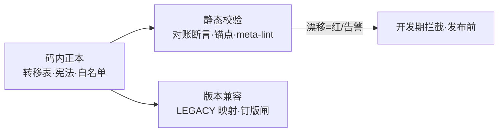

**静态工具 × 两层矩阵**：

| 模块 | L1 车间 | L2 派工台 |
|---|---|---|
| 非法跃迁校验 | 转移表机器可读＋keys 对账断言 | 写口宪法 selftest＋词面白名单 |
| 版本兼容/灰度 | LEGACY_EN_MAP 读取映射（#195） | 投影唯一性（#88）＋状态字典草案（候拍） |
| 锚点校验 | 锚点断言 --check（漂移告警级） | 同一套（机制卡 file:line 全覆盖） |
| 可达性/孤岛检查 | **无**（✘·候票·§16#6） | **无**（同左） |

### 10.1 harness 第一层（L1·车间）

#### 10.1.1 非法跃迁校验与对账
转移表机器可读（TICKET/RUN_TRANSITIONS）＋keys 对账断言（正本枚举==字典行·sm-003）✔。

#### 10.1.2 版本兼容与回滚
LEGACY_EN_MAP 读取映射（拍板#195/#198·历史账本一字不动·语义等价）✔。

#### 10.1.3 缺口
可达性/孤岛/死循环闭环检查器＝无（候票·§16#6）。

### 10.2 harness 第二层（L2·派工台）

#### 10.2.1 词面与锚点静态校验
队列行三关（#58·队列行三关.ts:112）＋meta-lint＋锚点断言 --check（漂移=告警级）＋写口宪法 selftest ✔。

#### 10.2.2 版本灰度
窗卡台投影唯一性（#88·Idempotent Upsert）＋状态字典草案六列（sm-003·候拍）◐。

#### 10.2.3 缺口
可达性/孤岛状态检查器＝**无**（候票·§16#6）✘。

## 第十一章 · 覆盖度与取舍（模板 §5 对照）

| 档 | 项 | 本厂 |
|---|---|---|
| ✅必选（生产底线） | 拦截校验/不变式/幂等/持久化+锁/审计/异常态/基础重试 | **全✔**（§3-§5/§7） |
| ✅强烈推荐 | 并发槽/熔断舱壁/驻留告警/Saga 补偿 | 槽✔·熔断舱壁✔·驻留告警✔·Saga◐（人工主导） |
| 🟡平台增强 | 事件优先级/事件溯源/人工审批流/静态检查 | 优先级◐（L2 有列·L1 无）·溯源✔（L1 原生）·审批流✔·静态检查◐（缺可达性） |

**一句话总结**：本厂两层 harness 对 FSM Runtime 参照架构为**高覆盖原生实现**——唯二设计差异（Saga 人工主导·挂起双形态）均为有意取舍，缺口（可达性检查器·L1 actor 字段·🔵收编）已全部入候票（§15/§16）。

## 第十二章 · 状态机治理结论（四问·自 006 并入）

> 本章回答原 006 四问：状态机是否新增（12.2 候办）/术语病根（12.3 双名制）/矩阵（§14 全量）/命名（12.4 事件名落册）。

#### 12.1 四问结论表

| 问 | L1（车间） | L2（派工台） |
|---|---|---|
| ①状态机新增？ | **台数不新增**（run10态+票11态+波次5态够用）；唯一挂账=包级10值码已落地（拍板#199·零调用方）——候业主追认十值＋接线方式决策；挂起保持事件对表达不升态 | **台数不新增**；但**两态收编**候拍：🔵待拍板、转人工现游离于写口宪法外（无 actor 无合法边=影子态）；窗队列.md 头注状态机行待同步 #301/#309 新三出边 |
| ②术语病根 | 双名制：短名不动＋事件名（时点·干什么）做理解面 | 同左＋撞车词强制消歧（窗票 vs 工序票·判色 vs 判分） |
| ③机制对应 | 见 §14 L1 矩阵（31 行·闸/驱/驻三类坐标） | 见 §14 L2 矩阵（35 行·宪法十对条条有主） |
| ④机制命名变更？ | 机检短名不改；机制目录卡面加「事件名」栏 | 同左；新机制（值守道/监工道）立卡时事件名随卡诞生 |

**本卡三条新发现（实勘所得）**：
1. 🔵待拍板、转人工两词面**不在写口宪法十对内**——谁有权翻、翻去哪，无机器可校验的答案（影子态·今晚回卷事故的同族风险）；
2. `wip_scan.py:48` 常量名 `SEVEN_STATES` 实装 **8** 个态（第八态加入后扩了列表没正名）；
3. 机制总索引卡（2026-10-28 盘点 57 条）已落后 tonight 三台新机器：值守道（#305·双层 LLM 巡检推进）、监工道推卡改飞书（#306）、队列写口宪法本体（W-189）——索引卡失效触发条款「新增机制→补行」已触发。

---

#### 12.2 问一：状态机是否需要新增？

### L1 现状 → 判定：**台数不新增，一件转正候拍**

- 现状：run10态/票11态/波次5态三台在役且正本清晰；包级10值码已落地（拍板#199·零调用方闲置·候接线决策）（对比件 v1.3 §3.6·账本已由 W-137 落码·候接线）；挂起用事件对表达不设态。
- 判定依据：L1 的机制（§14 矩阵）已全部能挂到三台现有状态机的边或驻留态上，无"无家可归"的机制；挂起事件对是**设计优点**（无死锁·游标可重放），不应升格成态。
- 候办①：包级10值落拍板转正（第六台）——站1/2 段从此也有机器可校验的排期/状态账。
- 候办②：sm-003 六台全景卡把「gate_suspend/resume 事件对不算态」写成显式备注，防后人误"补态"。
- **预期效果**：状态机台数稳定；站1/2→站6 全链每段都有机器账；无人再问"L1 挂起在哪"。

### L2 现状 → 判定：**台数不新增，两态收编＋两处同步候拍**

- 现状：窗队列态已从 7 态（拍板#69 立队时）长到 9 态词面（+完工待确认#179、+⏸三出边#301/#309），但：
  - **🔵待拍板、转人工不在宪法十对内**——无 actor、无合法边、不走写口（推卡道/主窗直改）。它们是游离于机器账之外的"影子态"：翻得对不对全凭人盯，恰是今晚队列回卷事故的同族风险面（无审计直写）。
  - `90-过程/窗队列.md` 头注状态机行（:6）仍是旧 7+1 表述，未同步 #301/#309 新三出边（新语义目前只活在队列写口.mjs 宪法表里）。
  - `wip_scan.py:48` `SEVEN_STATES` 名旧实八（第八态扩列未正名）。
- 候办①：宪法增对收编——🔵待拍板：`▶施工中→🔵待拍板 actor=window`（方向题推卡）＋`🔵待拍板→▶施工中 actor=owner(board)`（拍后回格）；转人工：`▶施工中→转人工 actor=window` ＋ `转人工→* actor=owner`。增删=拍板级（宪法表头注明文）。
- 候办②：窗队列.md 头注状态机行补 #301/#309 三出边＋🔵/转人工两词面（或明写"🔵/转人工=宪法外词面候收编"）。
- 候办③：SEVEN_STATES 正名（随下一张在飞 pi_runner/wip_scan 票顺带·零行为变化）。
- **预期效果**：九态条条有宪法对、次次翻格有审计——影子态清零；头注/卡面/码三方一致，新会话不再读到三个版本的窗队列状态机。

---

#### 12.3 问二：术语病根怎么解决最好（双名制方案）？

### 现状（L1/L2 同病三症）

1. **比喻名不含时点**：会审门/拆单机/扣绿闸/停车场/收割器——说了"像什么"没说"何时触发"（会审门立项原名「图纸会审门」·W-123）；
2. **缩写外文名**：wip_scan/pickDispatch/gate_suspend/run-slice——机器友好人不友好；
3. **两层撞车词**：票（窗队列票 vs 工序票）、三关（全厂四个：包导入/任务书/队列行/派发复跑）、判定梯（判票 vs 判班）、补考复考（挂起补考 vs 交活重考）、翻案（绿灯吊销 vs 业主撤回）、环（自愈环 vs 返工环）、授权面（票单 vs 窗单）——sm-001 卡自己都撞过名（叫「票生命周期」画的实是窗队列 8 态）。

**约束（为什么不能直接改名）**：机检词面锚焊死——班次聚合器判班黄靠「会审门红」词面（班次汇报聚合器.ts:135-140）、写口宪法靠态名中文字面、meta_lint/队列行三关靠态词面。改名=打断机检+历史账本语义漂移。

### 方案（L1/L2 同方）：双名制，只加不改

- **短名不动**（机检锚·代码符号名·文档锚全部保留）；
- **加事件名理解面**：公式＝**【时点·干什么】**。L1 时点词：收包时/发车时/施工时/出事时/验收时/判分时；L2 时点词：立票时/领单时/干活时/交活时/收班时/巡逻时。尾字定类型：门/闸=不过不放行·环=返工循环·钩=时点挂钩·报/账=产出留痕·器=周期机器；
- **撞车词强制消歧对**：窗票 vs 工序票·收包验货关 vs 立票验单关·交卷判分梯 vs 收班判色梯·挂起补考 vs 交活重考·绿灯吊销 vs 业主撤回·干活自愈环 vs 返工环·票单授权面 vs 窗单授权面；
- **使用规则**：首现双写「领单体检门（会审门）」；机检/代码继续短名；跨层引用必带时点词。

### 预期效果

口述可懂（名字即业务故事）、机检零扰（短名原样）、跨层不歧义（撞车词各有其名）、新会话按名定位（事件名=状态机坐标的记忆化）。

---

#### 12.4 问四：机制命名变更（事件名落册）？

### L1 现状与判定

- 现状：机制目录 35 条 L1 条目名＝比喻名/业内名混排（拆单机/扣绿闸/三钥匙出关/停车场）；码符号名英文（pickDispatch 类比物·run-slice 等）。
- 判定：**码与文档短名一律不改**；机制目录卡面加「事件名」栏（本卡 §14 L1 矩阵"事件名"列即草案：收包验货关/拆单排产/考卷封存/发装备/就绪发车/干活自愈环族/三钥匙发灯/绿灯吊销/红票裁决/双证验活族/交卷判分梯/晨报…）。
- 预期效果：目录从"考据名册"变"坐标地图"——看到事件名即知在 run/票级状态机哪条边上。

### L2 现状与判定

- 现状：16+ 条 L2 条目名同病；且今晚新上三台机器尚无卡：值守道（#305·建议事件名**每小时值守巡检**）、监工道推卡道（#306·建议事件名**候批推卡道**）、队列写口宪法（W-189·建议事件名**翻格宪法**——它本身不是机制卡但是矩阵的"边法权"正本，候补一张纪律卡）。
- 判定：短名不改；卡面双名化（机制名＋事件名两栏）；**新机制立卡时事件名随卡诞生**（立法于源头，不再事后补名）；会审门卡 36 锚漂移候卡窗（pi_runner.ts:377-394→现行 :391-421 区＋W-214 再漂·W-208 时效注记已挂账）。
- 预期效果：机制目录"补行"后与今晚实况对齐；每个机制的卡面自带状态机坐标，回答"这是做什么状态机对应的事件"不再需要深读。

---

## 第十三章 · 两层写口宪法（自 006 §8 并入）：L1 能照写，语义差半边

### 与 L2 宪法的三点本质差异（实勘）

1. **写者结构**：L2=多方（4 actor）写一个 md 文件——宪法管准入防误翻防回卷；L1=单进程单写者 append-only（C-021·拍板#42①·appendFileSync 单点入账 ledger.ts:12）——不存在「谁有权写」，只存在「谁在写」→ L1 宪法 actor 列=**责任部件归属**，非权限。
2. **合法性半边已在码**：L1 from→to 合法性已由 RUN/TICKET_TRANSITIONS 机器校验（非法→`state_transition_rejected` 入账不抛·ticket-state.ts:119-127）——即「合法性半部宪法」已有，缺「actor 归属半部」：transition 事件 payload 现仅 `{ticketId, from, to}` 无 actor。
3. **无 board 列**：L1 账本无业主直写面（业主输入在包/档），不设 L2 式 --board。

### 表 A · run 级十态写口

写者唯一=run-slice 主控（stage 边界过 sm 推进）·主线九边＋跳过边各态→汇报中（station3-only 短路）；挂起不占态=gate_suspend/gate_resume 事件对（ledger.ts:189,197·run-slice.ts:265 浏览器取证段首用）。

### 表 B · 票级十一态逐边宪法（草案·候拍·与 §14 L1 矩阵同批边——本表=宪法视图（归属＋口述），§14=机制视图（五列））

> **实然/应然分界（必读）**：合法性正本=ticket-state.ts:47 转移表（✔实然·码内逐边机器校验·非法=state_transition_rejected 入账）；「责任部件（actor）」列与口述列=本卡分析推断（△应然——码内 transition 事件尚无 actor 字段·落码候票 §15#8）；事件名全卡均为候拍。若本表与转移表冲突，以转移表为准。

| # | from → to | 责任部件（actor） | 语义 | 详细口述解释 |
|---|---|---|---|---|
| 1 | 待建→缓存问询 | build-lane（指纹问询 #9） | 前置全绿先问缓存 | 这张票排到窗口了，先别急着叫师傅干活——先问一嘴库房：「这活上回是不是干过？」前置票全绿了才有资格问这一嘴；问完拿着答覆走下一格。 |
| 2 | 待建→缓存直通·绿 | build-lane（resume 直通） | 上轮已绿·复跑绿才直通 | 库房说「干过，上回还是验过绿的」。但口说无凭——重跑一遍考卷，还绿才放行直通。免生成不免验收：活可以少干一遍，试一场不能少考。 |
| 3 | 待建→施工中 | build-lane（派工开工） | 无直通·正常开工 | 库房说没干过（或者复跑不绿），那就正常开工——把票装进专属干净沙箱，师傅领着装备信封进箱干活，别家碎事听不见。 |
| 4 | 施工中→审查·扣绿闸 | build 道（对题审查员 #19） | 测试绿暂扣不发灯 | 师傅说干完了，测试也绿了——但车间规矩：测试绿不发灯。先押着，等对题审查员逐条对题：干的是不是题面上要的？防「跑得快但跑偏了」。 |
| 5 | 降级产物→审查·扣绿闸 | build 道（预授权降级链 #12） | 降级产物同审 | 这张票没走标准路子（保底法子降级干出来的），出身降级不豁免验收——一样押去对题审查，审得过才算数。 |
| 6 | 审查·扣绿闸→施工中 | build 道（回喂自愈环 #15·⟲≤3） | review_findings 回喂重写 | 审查员挑出毛病，写着意见打回炉——师傅照单子改，改完再送审。最多来回三轮，防无限打磨；三轮还不过就走别的出口，不跟一张票耗到天亮。 |
| 7 | 审查·扣绿闸→红·严重偏题 | red-ruling（#22） | 严重偏题且预算内修不动 | 审查员认定这不是小毛病，是方向性跑偏，预算内修不回来了——判红票送裁决，不再回炉耗预算。红就是红，红永不变绿。 |
| 8 | 审查·扣绿闸→硬化出关 | hardening-lane（接力） | 对题绿·进硬化 | 对题也绿了，放行下一道——硬化车间。这里专门「对坏」：好考卷要 PASS，坏考卷必须 FAIL，两样都过才算真结实，防「只会做对题的绣花枕头」。 |
| 9 | 硬化出关→绿灯·可吊销 | hardening-lane（硬化双闸 #20） | 对绿 PASS∧对坏 FAIL=发灯 | 硬化验收过，三把钥匙（测试绿∧对题绿∧硬化绿）凑齐，正式发绿灯——但这灯叫「可吊销」：后面切片回归要是红了，这灯会被回头拔掉，发过的灯也敢收。 |
| 10 | 硬化出关→施工中 | hardening-lane | 不合格回写补测 | 硬化车间挑出毛病（比如考题是摆设、变异杀不死），打回施工段补测重做——回炉不算出关，三把钥匙差一把都别想亮灯。 |
| 11 | 硬化出关→停车场 | 预算刹车（#24） | 夜车预算断 | 夜车预算烧到线了——软的先降档省着烧，烧到 hard 线就硬收车：票押进停车场留个断点，账本记清楚断在哪，明晚接着来，不硬撑不装完。 |
| 12 | 红·严重偏题→停车场/终局 | red-ruling（#22 七源同出口） | park#1 挂起换票 / park#2 终局 | 红票的死法有七种，但裁决口只有一个：park#1=押进停车场换张票重做（还有救）；park#2=终局（没救了，记账收摊）。同一个口出，账好查。 |
| 13 | 停车场→施工中 | lane-drain（挂起补考 #23） | 夜末补考一轮·同因熔断 | 夜快收班了，给停车场里押着的票最后一次机会——带着上次 FAIL 的摘录重考一轮，让它「知道错在哪」再试；同一原因第二次犯，直接不再给机会（同因熔断）。 |
| 14 | 停车场→终局 | red-ruling | 终局 | 补考也没过（或者没资格补考）——终局，账本记死。不装绿、不复活、不留尾巴，明早晨报里如实报。 |
| 15 | 绿灯·可吊销→停车场 | regression-leg（回归翻案 #35） | 新片红吊销旧绿灯·唯一降级出边 | 后面切片的回归考卷红了，一查锚定到这张已发绿灯的票——回头把它的绿灯拔了，押回停车场走翻案腿重做。这是全状态机唯一的降级出边：绿灯可吊销，发过的灯也敢收回。 |

### 表 C · 波次五态写口

写者=queue-runner（#25）·QUEUE_TRANSITIONS（queue-ledger.ts:18）·gate passed/failed 落 queue-events 行车记录仪（sm-002）。

### 修正案层（不进转移表的守卫）

红永不变绿 · ⟲≤3 · park≤2 · 预算三路——守卫红线悬于转移表之上，非法边即使有部件身份也过不了合法性半部宪法。

### 候票（已入 §15 第 8 项）

账本 transition 事件 payload 增 actor 字段——预期效果：崩溃恢复归因到部件（断在哪一棒）、复盘 G3「哪一层本该拦住」按 actor 直查账、机制矩阵 actor 列有码级正本；历史账本缺 actor=legacy 只读不猜（兼容 LEGACY_EN_MAP 先例）。

---

## 第十四章 · 全量机制矩阵（迁移边视图·自 006 §6 并入）

### 方法论：机制在状态机上的坐标只有三种

- **闸（guard）**：挂在迁移边上，过才放行——坐标=（边·出口映射）；
- **驱（driver）**：合法边的执行者/写态者——坐标=（边·actor）；
- **驻（resident）**：驻留在某态期间跑的服务——坐标=（态·周期·出口只告警不翻格）。

### L2 矩阵（窗队列九态 × 机制·35 行·末列=类型＋口述）

| 迁移边/驻留态 | actor | 机制（现行名·业内名） | 事件名（候拍） | 类型/详细口述解释 |
|---|---|---|---|---|
| 探讨中(未批)→待实施(已批) | owner | 拍板落票（拍板表·无对比件不拍板） | 拍板落账 | 驱——业主看完对比件点头，拍板行记进账本灵感才毕业成票；无对比件不拍板。 |
| →待实施(已批) 驻留 | 主窗 | 任务书三关＋审批规格节（#6·Dispatch Contract Gate） | 立票验单关 | 闸——派工单写好先机检三道：批什么拍板号/预算帽/授权动作面，单子不合格不发。 |
| 立票后 | 主窗 | 队列行三关＋窗卡台投影（#58/#88·Intake Format Gate/Projection Uniqueness） | 立票贴卡 | 闸＋驱——窗队列贴飞书公告栏前再拦一遍病行，病行当场打回立票人，不让病进门。 |
| 候批驻留 | 主窗＋机械设备 | 审批卡异步道（#44·Async Approval Workflow·approval_poll） | 候批回执道 | 驻——走审批的票挂审批卡，轮询回执落表＋交叉核对后才可领；批没下来单子不动。 |
| 待实施→▶施工中（资格·前置） | dispatcher | 前置闸＋完工待确认让坑（#27·Dependency Gate with Slot Release） | 前置就绪·让坑 | 闸——前置✅或完工待确认=就绪；成环全不领；完工待确认让坑（第八态·前置票可先开工·终认走人工道）。 |
| 待实施→▶施工中 | dispatcher | pickDispatch 五闸（#7·Claim Gate Chain·状态/前置/任务书/路由/拍板号核对） | 领单验格闸 | 闸——领单先验资格：状态/拍板号/前置/任务书/路由五道，哪道不过跳过记因不弃单。 |
| 同上（链内软闸） | dispatcher | 领地交叠反查（#92·Overlap Check·告警不拦） | 领单查撞单 | 闸(软)——两窗要改同一文件=撞单，喊一嗓子提醒影响面不拦车，收口时注意回归。 |
| 同上 | dispatcher | 任务书派发三关复跑（#6·Dispatch Contract Gate） | 领单再验单 | 闸——发车前派工单机检再跑一遍，防立票之后单子被改坏。 |
| 同上 | dispatcher | **会审门**（#37·Pre-spawn Review Gate·四查·dryrun/enforce·红→探讨中·超时→⏸） | **领单体检门** | 闸——开工前四查：基线绿吗/类型过吗/锚点在吗/假设验吗；红=退回探讨中·超时=⏸，现影子只记不拦。 |
| 同上 | dispatcher | 风险分级/分级闸（#62b·Risk-based Approval Tiering·AFK_TIER_GATE） | 领单定档闸 | 闸——这单危险吗？词表扫改动面定高中低档=定谁有权批；高档(enforce)停车候业主。 |
| 同上（执行体） | dispatcher | markRunning＋spawn（#26/#28·Worker Pool/Change-triggered Dispatcher·槽位主循环/事件触发） | 翻格开窗 | 驱——全闸过完才翻▶弹施工窗；翻格=开始烧钱，所以排在所有闸后面。 |
| ▶驻留 | dispatcher | 心跳租约（W-189·Heartbeat Lease·leaseTouch） | 干活力续租 | 驻——派单员代在跑窗报平安（touch 心跳）；心跳断了会被巡逻当僵尸，故须续租。 |
| ▶驻留 | window | 方向题闸（#43·Direction-question Interlock·🔵推卡停） | 拿不准停车请示闸 | 闸——方案级分歧不猜不硬干：推卡🔵候拍→停，永不装绿，拍板回来接着干。 |
| ▶驻留 | window | 任务书授权面（#42·Pre-authorized Autonomy Scope·L2 侧） | 单内自决·越面推卡 | 驻——单上写了能自己定的才自己定（留痕候追认）；越面推卡候批，不自作主张。 |
| ▶驻留 | inspector | wip_scan 落差机检（#50·Stale-row Scanner·反向落差/僵尸嫌疑） | 半小时巡逻 | 驻——每半小时查在途窗健康：两本账对不上/窗该动没动，WARN 告警不拦车。 |
| ▶驻留 | supervisor | 监工道推卡（#275/#283·Notifier·#306 改飞书 IM） | 候批推卡道 | 驻——候批卡直推业主飞书手机：只发现+催办不代答；恢复清偿归值守道，分界面不重活。 |
| ▶→完工待确认 | window | 收口五件套＋收口申报器（#57·Closing Checklist Protocol·W-130） | 交活五件套 | 驱——交活交五件：台账/总览/专题表/深读时效/借鉴台账；五件不全=没交完，申报器不收。 |
| ▶驻留（收口兑底） | dispatcher | 收据员＋收割器（#29·Watchdog/Reaper·含 29a 判死快照年龄守卫） | 回执兑底收割 | 驻——detached 回执＋▶行三查收割：产物驱动收口不依赖窗退出；判死前先验快照新鲜度（新窗 skip 不误杀）。 |
| 完工待确认→✅已完成 | owner | **复考闸**（#38·Post-completion Exam Gate·考题库重跑·绿才认 #87）＋window_assert（W-088） | **交活重考闸** | 闸——自称干完不算，机器按考题库重考+终态断言，exit code 唯一判据；考绿才送业主终认。 |
| （缺考题分支·#179） | window | 考题库匹配缺题→记完工待确认不代写✅ | 没考卷不装绿 | 闸——这窗型没配考卷：不代写考题不代写✅，记完工待确认让坑（前置可开工），终审走业主。 |
| ▶→🔁维修中 | window | 打回分诊三分类（#49·Bounce Triage） | 考砸分诊 | 驱——考砸先分诊三岔：机械毛病/规矩病/规格病各有去处，不一股脑打回了事。 |
| 🔁→待实施(已批) | dispatcher | 闸4 超时重领（W-187） | 返工重领 | 驱——维修票候重领：超时派单员重领，闸链（含体检门）重走一遍。 |
| 🔁驻留 | window | 病卡维修环七态＋fail-loop 八岔（#47/#48·Incident Lifecycle/Repair Loop Classifier） | 返工环 | 驻——返工不是糊涂账：立病卡七态走流程，fail-loop 八岔分类，修完重走交活。 |
| *→⏸挂起 | inspector | 僵尸认定/停更签名分诊（#63·Stall Signature Triage·W-148）/预算刹车无据（#211） | 宁停判死 | 闸——窗死申报不完整/停更像死循环/预算没据——翻⏸宁停候人工，绝不代写✅。 |
| ⏸→▶ / ⏸→✅ / ⏸→完工待确认 | owner | 宪法三出边（#301/#309） | 误挂恢复/挂账清偿/挂账随裁 | 驱——⏸不再是死态：判错挂了翻回▶；挂账清了翻✅；清偿票到完工待确认就随裁。 |
| ⏸驻留 | duty+LLM | 值守道双层（#305·Watchdog＋LLM Patrol·duty_monitor 30分机械＋LLM 值守窗每小时六查推进） | 值守巡检推进 | 驻——机械兜底30分零判断动作＋LLM值守窗每小时六查：合法边推进、越权只推卡候批。 |
| ⏸驻留（核账） | 值守/人工 | 核账处置报告（#64·Audit Disposition Report·只读取证报告器） | 僵尸核账报告 | 驻——⏸僵尸行只取证实盘＋复算命令清单·四节报告；零状态改写翻态人工，绝不代写✅。 |
| 完工待确认驻留 | owner | 业主终认（#258 道） | 终认 | 驱——终认是业主的格：机器只呈绿考卷，翻不翻✅业主说了算。 |
| 收班（跨态） | dispatcher | 班末 drain（W-147）/班次汇报（#46·Shift Report Aggregator）/班次判定梯（#61·Three-state Verdict Ladder）/审批熔断（#62a·Circuit Breaker）/效率账（#60·Usage Accounting） | 收班放行/收班报/收班判色/收班复盘器/收班工时账 | 驻＋报——收班四件事：挂起的放行一轮/出三节日报/判绿黄红/数代拍双率出收权建议（只建议不动手）。 |
| 跨态 | owner＋代拍窗 | 代拍与追认制（#45·Delegated Decision with Ratification） | 代拍·批量追认·翻案 | 制度——禁区六项停车候拍；授权面内细节代拍＋批量追认；翻案=confirm --rollback 推翻。 |
| 新闸上线 | 制度 | 渐进开闸生命周期（#52·Shadow-mode Rollout Protocol） | 渐进开闸 | 制度——新闸缺省 dryrun 只记不拦→观察一班→业主令才 enforce；误拦回退也入账（会审门=首例）。 |
| 翻格全程 | 写口 | 领地断言＋队列写锁（#53·Territory Assertion + Single-writer Mutex） | 写锁·断言 | 底座——sha256 禁改清单＋withQueueLock 四写点包锁（领单/钩子/复考/快照）；写前词面断言拒非法翻格。 |
| 发车前（L1 入口） | dispatcher | 版本钉版（#65·Build Pinning·R02 拍板#215） | 钉版闸 | 闸(底座)——开工前把「这班用哪一版」钉成五栏指纹铭牌；缺钉版/指纹不符=拒启。 |
| 考务（日常/收班） | 考务 | 班外评测与留出核账（#66·Holdout Eval＋Locked Final Exam·考题分家） | 班外评测·留出终考 | 驻——考卷三本分家：班外题库日跑涨留跌撤（撤回零自动执行）＋留出清单锁柜终考；题库/清单业主逐笔点定。 |
| （游离） | owner/window | 🔵待拍板、转人工——**宪法外** | —— | ⚠候收编——两态没进宪法：谁有权翻、翻去哪无机器答案（影子态），候票收编。 |

**矩阵验证结论**：宪法十对条条有主（每条合法边恰一个有权 actor）；机制无一挂空（每个 L2 机制都能落到某条边或驻留态）；唯一的坐标空洞就是 🔵/转人工。

> **对账补行（2026-11-01）**：#27/#29/#44/#45/#52/#53/#63/#64/#65/#66 十条补入（#63 并入宁停判死行）——机制目录 L2 侧全量覆盖；值守道/监工道/心跳租约/写口宪法为目录外新机制（候补卡·§15#4）。

### L1 矩阵（run 十态 × 票级十一态 × 波次五态·与 L2 五列同款·31 行·末列=类型＋口述）

> actor 列=**责任部件**（码内单写者·差异见 §13：L1 无越权问题只有归属问题）。迁移边列前缀：`run:`=run 级·`票:`=票级·`波:`=波次。

| 迁移边/驻留态 | actor | 机制（现行名·业内名） | 事件名（候拍） | 类型/详细口述解释 |
|---|---|---|---|---|
| run:启动→导入中 | 导入闸（station3-import） | 包导入三关（#2·Input Validation Pipeline·版本/计数/死链） | 收包验货关 | 闸——夜车收立项包先验三道：版本对吗/数量齐吗/链接死吗，hardFails 拒收。 |
| run:导入中驻留（红时） | 导入闸 | 包级三关修复环⟲≤3（#59·Post-rejection Triage） | 拒收修复环 | 驻——验货不过三岔分诊：机械毛病当场补/规矩病打回两岗/规格病只转不修，最多三轮。 |
| run:导入中→拆单中 | 拆单机（split） | 拆单机（#3·DAG Batching·Kahn 波次） | 拆单排产 | 驱——一大包拆成工序票，拓扑排序分波，波内受控并发。 |
| run:拆单中/验收中驻留 | 两岗编制（岗卡 P1/P2） | 拆票打包师/考题起草师（#51·Producer Agent Roles·出题权冻结） | 拆票打包岗·考题起草岗 | 驻——拆票打包师把包拆成票打装备；考题起草师起草考卷；出题权冻结在开工前，业主只拍横比件。 |
| run:拆单中驻留 | 判卷冻结（judge-guard） | 判卷素材冻结＋施工前锁定（#4·Integrity Anchoring·#13 素材预投 Pre-provisioning 折叠于此） | 考卷封存 | 驱——施工前把判卷素材 sha256 存照画押：防考卷被偷改，验收时对拍；非落点素材先预投，LLM 写不出的不让它写。 |
| run:装备中 | 装备（equipment） | 五槽装备信封（#5·Work-Order Contract） | 发装备 | 驱——每票一个全套装备信封：代码/规范/上下文配给装好再发车。 |
| 波:queued→in_progress | queue-runner | E3 就绪制/波次调度（#25·DAG Scheduling·queue-ledger 五态） | 就绪发车 | 驱——前置✅即解锁发车不分红绿；排期账五态有转移表，非法入账不抛。 |
| 票:待建→缓存问询/缓存直通·绿 | build-lane（指纹问询） | 指纹问询/缓存直通（#9·Memoization with Revalidation） | 干活前查缓存 | 闸——上轮干绿过的活先问缓存，复跑还绿才直通；免生成不免验收。 |
| run:施工中驻留 | build-lane＋dep-guard | 票级沙箱（#11·Bulkhead+Sandbox）＋依赖连坐（#10·Cascading-failure Guard） | 每票一箱·连坐 | 驻——每票专属沙箱干净房；前置挂起则自己不开工（零 LLM 连坐）。 |
| run:施工中驻留 | 沙箱（发车令选档） | 沙箱三级载体分级（#68·Strategy + Fail-closed Resolution） | 干活载体选档 | 驻——宿主/影树/容器三档载体发车令选档，权限随档定；未知拒启，容器缺位如实降级。 |
| 票:待建→施工中 | build-lane | 派工开工 | 开工 | 驱——无缓存直通正常开工，师傅进箱干活。 |
| run:施工中驻留（LLM 边界） | build 道 | 变量盒协议（#1·Command/Contract·variable-box.ts:12,31,60） | 分段交接盒 | 驻——跨 LLM 边界结构化交接：盒内皆数据、字段序=缓存卫生；工人与 LLM 之间递的全是盒子不是散话。 |
| 票:施工中→审查·扣绿闸 | build 道（reviewer） | 对题审查员（#19·Quality Gate）＋判卷守卫防篡改（#18·Tamper-proof Judge） | 对题审查·防偷改 | 闸——测试绿扣着不发灯：对题审查员逐条对题；验收前对拍冻结指纹防篡改考卷。 |
| 票:施工中驻留 | build 道 | 分段 JSON（#14·Structured Output）＋回喂自愈环⟲≤3（#15·Bounded Retry）＋偏移采样弹（#16·Drift Detector）＋零提交预闸（#17·Fail-fast No-op） | 干活自愈环族 | 驻——红→机械分诊→修→复跑最多三轮；跑偏早停、零提交直接红，都不劳 LLM 猜。 |
| 票:降级产物→审查·扣绿闸 | build 道 | 预授权降级链（#12·Graceful Degradation） | 降级同审 | 驱——保底法子降级干出来的，出身降级不豁免验收，一样送审。 |
| 票:审查·扣绿闸→施工中 | build 道 | 回喂重写（#15·Bounded Retry） | 回炉重写 | 驱——审查意见打回重写改完再送审，来回最多三轮防无限打磨。 |
| 票:审查·扣绿闸→红·严重偏题 | red-ruling | 红票裁决（#22·Unified Failure Adjudication） | 严重偏题裁定 | 驱——方向性跑偏预算内修不动，判红送裁决不回炉耗预算。 |
| 票:审查·扣绿闸→硬化出关 | hardening-lane | 硬化接力 | 进硬化 | 驱——对题绿放行硬化车间，专门「对坏」：坏考卷必须 FAIL。 |
| 票:硬化出关→绿灯·可吊销 | hardening-lane（mutation-gate） | 硬化双闸（#20·Mutation-calibrated Quality Bar）＋三钥匙出关（#21·Multi-signal Sign-off） | 三钥匙发灯 | 闸——测试绿∧对题绿∧硬化绿三钥匙齐才发灯；对绿 PASS 还要对坏 FAIL。 |
| 票:硬化出关→施工中 | hardening-lane | 不合格回写补测 | 补测回炉 | 驱——硬化挑出毛病打回施工段补测，回炉不算出关。 |
| 票:硬化出关→停车场 | 预算刹车（night-budget） | R03 预算三路（#24·Budget Brake） | 预算刹车 | 闸——软的先降档省着烧，hard 线硬收车押停车场留断点明晚续。 |
| 票:停车场→施工中 | lane-drain | 挂起补考＋同因熔断（#23·Retry-once + Circuit Breaker） | 挂起补考 | 驱——夜末带 FAIL 摘录重考一轮；同因第二次犯直接不给机会（同因熔断）。 |
| 票:停车场→终局 | red-ruling | 终局（park#2） | 终局 | 终态——没救了记账收摊，不装绿不复活不留尾巴。 |
| 票:绿灯·可吊销→停车场 | regression-leg | 切片②回归翻案（#35·Regression Overturn·唯一降级出边） | 绿灯吊销 | 驱——后面切片回归红了，回头拔已发绿灯押回停车场走翻案腿；唯一降级出边。 |
| run:探针中/验收中 | verify（station5） | 起服守卫（#30·Environment Guard）＋双证切片（#31·Two-witness Verification）＋探针门（#32·Contract Probe Gate）＋功能门（#33·Locate→Heal→Rerun）＋切片出题员（#34·Exam Draft & Repair） | 双证验活族 | 闸——起服守卫先过（环境病=NA），页面证+接口证两证齐，探针打真实端点，红片定位修复重跑。 |
| run:验收中→汇报中 | 判定梯（ladder） | R13 判定梯（#36·Aggregate Health Verdict·UNKNOWN≠HEALTHY） | 交卷判分梯 | 闸——票红/切片红/NA≥20%/无考题=FAIL；UNKNOWN≠HEALTHY 不猜健康。 |
| run:汇报中驻留 | 晨报/追认 | 晨报纯投影（#39·Event-sourcing Projection）＋业主追认（#40·HITL+Saga）＋丙级规格修正（#41·Spec Amendment Channel）＋票单授权面（#42·Pre-authorized Autonomy Scope） | 晨报·业主追认 | 驻＋驱——晨报纯投影无独立数据源；confirmed/rejected 业主说了算，可一键撤回。 |
| run:→收车 | run-slice 主控 | 收车（无出边·L1 终态） | 收车 | 终态——run 生命周期终点；断点恢复靠账本末态+游标，不靠状态格。 |
| 票:全生命周期 | 状态机本体 | 票级状态机 11 态（#8·Lifecycle FSM·ticket-state.ts:21,47） | 工序票施工账 | 底座——合法转移表·非法入账不抛·账本恢复=唯一事实源（本表全部票：边的承载台）。 |
| run:全程 | ledger | 事件账本白名单（#54·Event Sourcing with Fixed Schema·119 型白名单） | 行车记录仪 | 底座——append-only 事件型白名单，加型须拍板；历史英文码 LEGACY 读取映射。 |
| run:全程（横切） | 全部件 | 红先绿后（#55·Red-before-Green）＋fail-closed（#56·Fail-safe）＋同构快照/改前快照断言（#80·Snapshot Diff Assertion） | 红线守卫 | 底座——沙盒跑屏先红证病再绿证修；未知≠通过宁停不装绿；改共享面先拍改前快照、diff 断言零漂移。 |

**矩阵验证结论**：L1 机制全部能挂到 run 边或票级边上；L1 的"闸"密度集中在 施工→审查→硬化→绿灯 一段（质量闸链），对应 L2 的闸密度集中在 领单→体检→定档 一段（准入闸链）——**两层同构：前门体检＋后门重考**（卡36 已考据）。

> **对账补行（2026-11-01）**：#1/#8/#13/#51/#54/#55/#56/#68/#80 九条补入（#13 折叠于考卷封存行）——机制目录 L1 侧（含折叠子机制）全量覆盖；#29a 判死快照年龄守卫在 L2 侧宁停判死行。

### 两层同构对照（镜像记忆表）

| 语义 | L1（车间·票级） | L2（派工台·窗级） |
|---|---|---|
| 前门体检 | 收包验货关（包导入三关） | 领单体检门（会审门） |
| 后门重考 | 交卷判分梯（R13） | 交活重考闸（复考闸） |
| 出事分诊 | 拒收修复环/红票裁决 | 考砸分诊/返工环 |
| 熔断 | 同因熔断（#23） | 收班复盘器（审批熔断 #62a） |
| 授权 | 票单授权面（latitude） | 窗单授权面（任务书） |
| 挂起 | 事件对 gate_suspend/resume（无态） | ⏸ 独立态（宪法管） |

---

## 第十五章 · 候票清单（自 006 §11 并入·全部候拍板号）

| # | 候票 | 层 | 量级 | 依据 |
|---|---|---|---|---|
| 1 | 宪法收编 🔵待拍板/转人工（增对＋actor 定档＋selftest） | L2 | 小票（码+拍板） | §12·影子态风险 |
| 2 | 窗队列.md 头注状态机行同步 #301/#309 三出边＋🔵/转人工注记 | L2 | 勘误件 | §12·头注滞后 |
| 3 | sm-001 卡正名「窗票生命周期」＋重绘 v2（九态＋宪法边＋actor 标注） | L2 | 卡窗 | §12 撞车实证 |
| 4 | 机制总索引卡补行：值守道/监工道推卡道/队列写口宪法＋会审门卡 36 锚更新（失效触发条款已触发） | 两层 | 卡窗补行 | §12·#305/#306/W-189 |
| 5 | 机制目录双名化：全卡面加「事件名」栏（草案=本卡 §14 两矩阵事件名列）＋话术规范补两层对照节 | 两层 | 文档小票 | §12/§12 |
| 6 | sm-003 备注补「gate_suspend/resume 事件对不算态」＋包级 10 值落拍板转正 | L1 | 备注行＋拍板 | §12 |
| 7 | wip_scan.py SEVEN_STATES 正名（随在飞票顺带·零行为） | L2 | 顺带件 | §12 发现 2 |
| 8 | 账本 transition 事件 payload 增 actor 字段（makeTicketStateMachine/run sm 注入 stage 名·历史账本缺 actor=legacy 只读不猜沿 LEGACY_EN_MAP 先例） | L1 | 小票（码+拍板） | §13·归因可查 |

---

## 第十六章 · 开放问题（自 006 §12 并入·给专业评审的挑战入口）

| # | 问题 | 张力 | 现状 |
|---|---|---|---|
| 1 | 🔵待拍板/转人工怎么收编宪法 | 影子态（无 actor 无边）vs 收编要新增对＋定 actor（拍板级） | 候票 §15#1 |
| 2 | L1 transition 事件要不要补 actor 字段 | 崩溃归因可查 vs 改事件 payload 兼容历史账本 | 候票 §15#8·历史账本 legacy 只读不猜 |
| 3 | 双名制（事件名）会不会卡机检 | 人读可懂 vs 机检词面锚焊死（判班黄靠「会审门红」四字） | 方案=短名不动只加层·候票 §15#5 |
| 4 | 包级 10 值何时转正第六台状态机 | 账本已落码（拍板#199）·站1/2 段零调用方 vs 接线设计成本 | 候票 §15#6 |
| 5 | ⏸ 触发情形还会长吗（今晚已六案） | 宁停道越用越多 vs 出边只有三条 | 观察·值守道数据积累候裁 |
| 6 | FSM 静态可达性/孤岛状态检查器（L1 转移表＋L2 宪法的外部静态分析） | 业内模板 3.3 缺口 vs 收益（状态机小·手检尚可） | §10 新发现·候票 |
| 7 | Saga 自动补偿边界（哪些补偿可机器自动反向·哪些保持业主令） | 自动化效率 vs 人工主导安全（#301/#309 现行全业主令） | §10 设计差异·候讨论 |

---

## 附录A · 术语对照（白话＋业内名·合并版）

| 术语 | 白话一句话 | 业内名 |
|---|---|---|
| 拍板 | 业主看完对比件点头，决策入 append-only 账本 | Human-in-the-loop Decision |
| 对比件 | 给业主做决策的现状 vs 改后对照报告 | Decision Brief |
| 立票 | 把拍板登记成窗队列一行（待实施(已批)） | Work Item Creation |
| 任务书 | 派工单：批什么/预算帽/授权面/假设清单 | Work-Order Contract |
| 三关 | 派工单的机检验三道 | Input Validation Pipeline |
| 会审门 | 开工前体检四查（领单后弹窗前） | Pre-spawn Review Gate（Shadow Mode） |
| dryrun/enforce | 影子（只记不拦）→实拦（真拦） | Shadow Mode → Enforce（渐进开闸/Progressive Rollout） |
| 分级闸 | 扫改动面定风险档＝定谁有权批 | Risk-based Approval Tiering |
| 复考闸 | 自称干完不算，机器按考卷重考 | Post-completion Exam Gate |
| 绿才认 | 只认机器 exit code，不认自称与感觉 | Green-only Acceptance（NA≠PASS） |
| 宁停 | 拿不准就停车候人工，绝不装绿 | Fail-safe Stop |
| 窗票/工序票 | 窗票=窗队列一行（L2）；工序票=拆单产物（L1）——同厂两个「票」 | Work Order vs Process Ticket |
| 写口宪法 | 谁有权把状态翻成什么（唯一写入口＋转移对） | State Transition Constitution / Write Port |
| 病卡/返工环 | 红票维修流程（七态） | Rework Loop / Incident Lifecycle |
| 值守道/监工道 | 值守=定时巡检推进（机械＋LLM 双层）；监工=候批推卡催办 | Watchdog ＋ Notifier |
| 代拍/追认 | 授权面内代理决定，事后批量追认、可一键撤回 | Delegated Decision ＋ Ratification（Saga Compensation） |
| 锚点 | 文档里指向码位置的 file:line 证据 | Source Anchor |
| 断言 | 二值机器主张，假了当场红（五品种见第三章 3.3） | Assertion（fail-loud check） |
| 候拍 | 等业主拍板号才动工的候选事项 | Pending Approval |
| 守卫 | 同事件下的分支路由判断，只选分支不拒事件 | Guard（FSM Core） |
| 拦截器 | 跃迁前后切面逻辑，不改迁移规则 | Interceptor/Hook（Runtime） |
| 事件溯源 | 账本记全量事件，状态可重放重建 | Event Sourcing（L1 events.jsonl 原生） |
| 舱壁 | 不同下游/任务的资源隔离，防一处挤塌全局 | Bulkhead（票级沙箱同构） |
| 死信 | 无法消费的事件单独落账，支持回放排查 | Dead Letter（本厂=记因账/rejected 账） |


## 附录B · 正本锚清单（本卡全部 file:line 汇总）

L1：run-state.ts:19-43 · ticket-state.ts:21-46,47-61,100-103,119-127,136-146 · queue-ledger.ts:13,18 · queue-runner.ts:16 · ledger.ts:12,139,189,197 · event-types.ts:11-12,54 · variable-box.ts:12,31,60 · import.ts:34 · gates.ts:107,112,280 · split.ts:57,255,264 · judge-guard.ts:76 · equipment.ts:29,132 · build.ts:73,129,137,165,184-255,205,274 · build-lane.ts:63,80,89-91,126,150 · selfheal-triage.ts:57,94 · reviewer.ts:42,69,109,127,147,205 · hardening-lane.ts:209 · mutation-gate.ts:227 · red-ruling.ts:35,48,57,71 · lane-drain.ts:31,50 · night-budget.ts · ladder.ts:13,32,38 · morning-report.ts:56,70,284 · run-slice.ts:139,265,266 · provider-types.ts:13,22,44 · spec-amendment.ts · types.ts:185-207 · efficiency-risks.ts:26 · 班外评测跑.mjs:105,126 · 留出核账跑.mjs:88。
L2：队列写口.mjs:47-63 · pi_runner.ts:490-515,517-541,543-565,563,643,774,1317-1328,2093,2388,2555,3240-3361 · hook_receipt_clerk.mjs:110 · queue_watcher.mjs · window_card_sync.mjs:654 · 队列行三关.ts:112 · wip_scan.py:48,150,174 · repair-contract.mjs:23,40 · 审批熔断.ts:48,85,173 · 风险分级.ts:33,79,116 · 效率账解析.ts:35,61,81,85 · 班次汇报聚合器.ts:135-140,147,163,271 · approval_poll.mjs · 核账处置报告.mjs:44,57,103,130 · supervisor.mjs · duty_monitor.mjs · 派发书三关校验.mjs · 窗队列.md:6 · 00-机制总索引卡.md §2。

## §17 · 证据尾巴

- 参照框架＝业主提供 FSM Runtime 模板（对话在案 2026-11-01）；
- 全部落锚实勘于 repo_head 6732949（各章 H4 内联）；
- 合并源＝sm-20261101-006（四问分析·双矩阵 35/31 行·两层宪法·断言五品种·六台图册·转史档）；
- 本卡 draft 候核候拍——正本冲突以码与窗队列.md 为准；mermaid 图渲染目检候浏览器恢复（结构自检已 PASS）。
