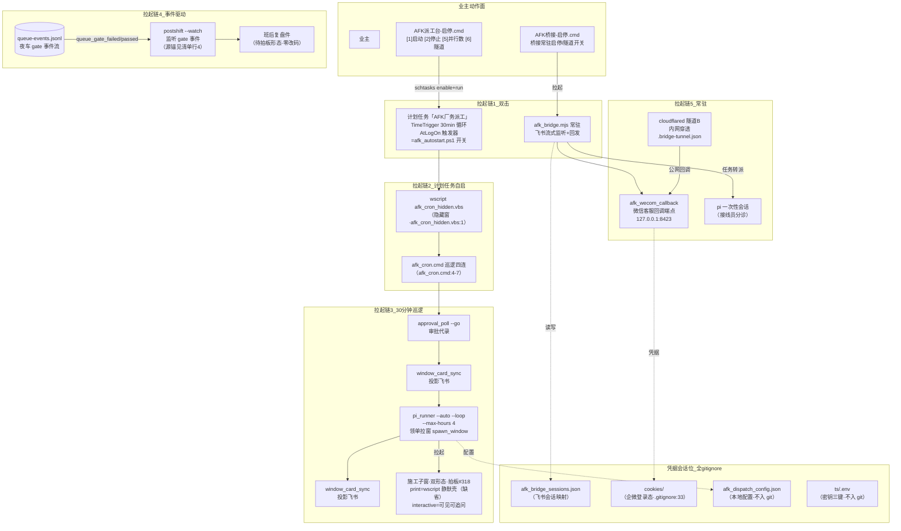

> **口径**：本卡话术/命名遵循《[00-话术统一口径正本](../00-话术统一口径正本.md)》（拍板#312）——双名制首现双写·撞车词带消歧（窗票/工序票·判色/判分）·两层口径 L1 车间（票级）/L2 派工台（窗级）。
> **消歧（本卡·口径正本 §3）**：票（工序票 L1／窗票 L2·随文标注）；复考（交活重考闸·L2）。
> **变更注记（v2 增密·W-251·拍板#334·2026-11-03）**：repo_head 01c1d9a→e170067 重锚；增量段=**print 静默壳拉起形态**（拍板#318·W-236·施工子窗节点补双形态）＋**定时链现役道清单**（afk_cron.cmd 23 行实勘·15 道挂链——「巡逻四连」旧貌刷新·见 §增量段）。

# 部署图 · 运行拓扑首图（五类拉起链＋凭据会话位）

## §0 一句话

**解决什么**：画全引擎在业主机器上的常驻/触发面——双击、计划任务自启、30 分钟巡逻、事件驱动、常驻桥接五类拉起链+凭据会话位清单。**为什么存在**：引擎是「跑在业主真机上的多进程系统」，哪个进程谁拉起、凭据放哪，必须一张图可查（W-041 计划任务动作经 Get-ScheduledTask 实勘入图·`90-过程/执行台账.md:583`）。**边界**：本图只画进程拓扑不复制模块语义（pi_runner 收口细节归 mk-001）；五链启停动作=业主亲自（安全红线）。

## §典型事件链

| # | 事件 | 锚 |
|---|---|---|
| 1 | 实勘入图：W-041 计划任务动作实勘=Get-ScheduledTask 现查 wscript.exe afk_cron_hidden.vbs（`:1` 调 afk_cron.cmd 隐藏窗）+TimeTrigger 30min——图上「拉起链2」节点全部实锚 | `90-过程/执行台账.md:583` |
| 2 | 巡逻四连实勘：afk_cron.cmd 巡逻链=approval_poll --go→window_card_sync→pi_runner --auto --loop --max-hours 4→window_card_sync | `91-脚本/afk_cron.cmd:4` |
| 3 | 本窗活例：W-043 施工窗即「拉起链3」的产物（30 分钟巡逻→pi_runner 领单→可见施工窗）——拓扑图上的链路每天都在跑 | 本卡部署图（拉起链3） |

> **TL;DR**：引擎在业主机器上的常驻/触发面全景——**双击、计划任务自启、30 分钟巡逻、事件驱动、常驻桥接**五类拉起链，外加凭据会话位清单（全 gitignore）。全部节点=实然在役件（as-built·2026-10-21 实勘：计划任务动作经 wscript 调 afk_cron_hidden.vbs→afk_cron.cmd）。

## 部署图（mermaid）

**节点详注表**（主干节点逐个·做什么/边界/锚点）：

## 节点详注（主干节点逐个）

| 节点 | 详注 |
|---|---|
| AFK派工台-启停.cmd | 业主双击面 [1]启动 [2]停止 [5]并行数 [6]隧道：启停与自启开关由业主亲自执行（安全红线·代理出件不代跑·拍板#76⑥）；母本=仓内桌面版 cmd。 |
| 计划任务「AFK厂务派工」 | 系统级触发器：TimeTrigger 30min 循环+AtLogOn 触发器（afk_autostart.ps1 开关四态·taskName 定义锚 91-脚本/afk_autostart.ps1:5）——引擎无人值守的时间心脏。 |
| afk_cron_hidden.vbs | 隐藏窗包装：wscript 调它再拉 afk_cron.cmd（锚 91-脚本/afk_cron_hidden.vbs:1·实勘 Get-ScheduledTask）——巡逻窗不闪屏但窗关=巡逻停。 |
| afk_cron.cmd 定时链 | 30 分钟巡逻体（锚 91-脚本/afk_cron.cmd 全文 23 行·现役 15 道清单见 §增量段）：审批代录→投影→监工→催办→对拍→值守→哨兵→清场→看门狗→派工→投影→对账→经验落盘，顺序固定；日志 .dispatch-cron.log。 |
| pi_runner --auto --loop | 巡逻链的干活核心：--max-hours 4 预算帽（单轮夜车窗）·--spawn-mode 拉起形态开关（缺省 print=.spawn-mode.txt 读面·#158/W-108）领单拉窗（领单闸/路由/复考语义归 mk-001·本图只画位置）。 |
| 施工子窗（print=静默壳/interactive=可见） | 拉起链3 的终点产物：pi --auto·**双形态**（拍板#318）：print 道位=wscript 静默壳完全静默（夜车/无人值守）；interactive 道位=可见工作台（拍板#70① 零变）——拓扑上它独立成窗，收口回执走钩子道/轮询道（时序见 sq-20261021-002）。 |
| queue-events.jsonl（事件源） | 拉起链4 的触发源：夜车 gate 事件流（queue_gate_failed/passed）——事件驱动链让「班后复盘」不依赖人想起复盘。 |
| postshift --watch | 事件消费者（锚 pipeline-lab/scripts/postshift.mjs:8 触发声明·`:231` 判定）：监听 gate 事件→班后复盘件（待拍板形态·零改码零重跑零判卷触碰）。 |
| afk_bridge.mjs 常驻 | 拉起链5 的主体：飞书流式监听+接线员分诊+回发（收发分离/通道抽象语义归 mk-012）——进程生命周期=桥接生命周期，断线自动重启。 |
| cloudflared 隧道B | 公网回调入口：企微回调需要公网可达，cloudflared 内网穿透+状态文件 .bridge-tunnel.json——隧道开关在业主桥接启停 cmd。 |
| 凭据会话位（C1-C4） | 四位全 gitignore（拍板#90/#93 P0·cookies/ 在 `.gitignore:33`）：飞书会话映射/企微登录态/派工配置/ts 密钥三键——真实凭据不进 git/飞书/文档正文。 |

## 五类拉起链清单（文字投影·机读）

| # | 链 | 触发者 | 链路 | 实锚 |
|---|---|---|---|---|
| 1 | **双击** | 业主 | AFK派工台-启停.cmd（[1] 启动=启用计划任务+立即触发一轮+飞书投影·[2] 停止·[5] 并行数·[6] 隧道）/ AFK桥接-启停.cmd（桥接常驻启停） | 两 cmd 桌面 GBK 份+仓内母本 |
| 2 | **计划任务自启** | Windows 任务计划 | 「AFK厂务派工」TimeTrigger 30min 循环；AtLogOn 触发器由 `91-脚本/afk_autostart.ps1`（开关四态 on/off/toggle/status·taskName 定义 afk_autostart.ps1:5·拍板#76⑥）增删 | 计划任务动作=wscript.exe afk_cron_hidden.vbs（实勘 Get-ScheduledTask） |
| 3 | **30 分钟巡逻** | afk_cron.cmd | 现役 15 道挂链（全文 23 行实勘·见 §增量段清单）：approval_poll → queue_watcher(detached) → window_card_sync → supervisor → wip_scan → 对拍机检 → duty_monitor → 队列哨兵 → 清场巡检 → watchdog_llm → pi_runner --auto --loop --max-hours 4 --spawn-mode → window_card_sync → 窗卡台对账 → 经验落盘（日志 .dispatch-cron.log·关窗=停巡逻） | afk_cron.cmd 全文 23 行（2026-11-03 实勘） |
| 4 | **事件驱动** | queue-events gate 事件 | postshift --watch 监听 `queue_gate_failed/queue_gate_passed`（`pipeline-lab/scripts/postshift.mjs:8` 触发声明·`pipeline-lab/scripts/postshift.mjs:231` 判定）→班后复盘件（零代码写入零重跑零判卷触碰） | pipeline-lab/scripts/postshift.mjs |
| 5 | **常驻** | afk_bridge.mjs | 飞书流式监听→接线员分诊（闲聊直答/任务转派 pi 一次性会话）→回发手机；企微族（wecom_callback 绑 127.0.0.1:8423+family 客服拉取循环）；cloudflared 隧道B 内网穿透（公网回调入口） | AFK桥接-启停桌面版.cmd 状态文件清单（.bridge-*.json 族） |

## 增量段（拉起形态与定时链实勘·W-251·拍板#334·2026-11-03）

### 1. print 静默壳拉起形态（拍板#318·W-236·2026-11-01 落码）

施工子窗拉起双形态（spawn_window --spawn-mode·afk_cron.cmd:17-19 开关段）：

| 形态 | 道位 | 拉起链 | 语义 |
|---|---|---|---|
| **print（缺省·完全静默）** | 夜车/无人值守 | pi_runner → spawn_window print 分支 → `wscript.exe //nologo <vbs副本> <批>` → `WScript.Shell.Run <批>, 0, False`（0=隐藏窗·False=异步发射即 0） | 真静默：桌面零弹窗零窗钮（拍板#100「拉窗可见」在 print 道位由业主令修订·interactive 零触碰）·跑完自退落日志+会话档 |
| **interactive（可见）** | 围观/追问 | pi_runner → spawn_window interactive 分支 → PS Start-Process -NoExit | 可见工作台可追问（拍板#70①/#100 语义零变） |

形态单源三件：vbs 本体=`91-脚本/afk_spawn_hidden.vbs:1`（一行 ASCII·运行时落 %TEMP% 副本防中文路径）·print 拉起命令串纯函数=`91-脚本/spawn_window.ts:98-101`·形态开关 afk_cron.cmd:16-19（`.spawn-mode.txt` 读面·缺/空/非 interactive 回落 print·#158/W-108）。详设=mk-002 增量段。

### 2. 定时链现役道清单（afk_cron.cmd 全文 23 行实勘·2026-11-03·15 道挂链）

| 行 | 道 | 命令词面（GBK 解码） | 备注 |
|---|---|---|---|
| :4 | 审批代录道 | `approval_poll.mjs --go` | |
| :6 | 队列观察道 | `start "" /b node queue_watcher.mjs`（detached） | W-116/拍板#168 治首启轮卡死 |
| :7 | 投影道（前） | `window_card_sync.mjs` | |
| :8 | 监工道 | `supervisor.mjs --go` | |
| :9 | 超时催办道 | `python -X utf8 wip_scan.py --check-feishu` | |
| :11 | 班前对拍道 | `对拍机检.mjs --selftest` | W-176/拍板#247·告警级不拦车 |
| :12 | 值守道 | `duty_monitor.mjs --go` | 拍板#304·巡检推进挂链 |
| :13 | 队列哨兵道 | `队列哨兵.mjs --go` | |
| :14 | 清场巡检道 | `清场巡检.mjs --go` | W-242/W-238 批2/3 落码 |
| :15 | LLM 看门狗 | `call watchdog_llm.cmd` | |
| :17-19 | 形态开关段 | `AFK_SPAWN_MODE` 读 `.spawn-mode.txt` | 缺省 print·#158/W-108 |
| :20 | **派工主道** | `pi_runner.mjs --auto --loop --max-hours 4 --spawn-mode %AFK_SPAWN_MODE%` | 领单拉窗核心 |
| :21 | 投影道（后） | `window_card_sync.mjs` | |
| :22 | 窗卡台对账道 | `窗卡台对账.mjs` | |
| :23 | 经验落盘道 | `经验落盘.mjs --cron-scan --since 2026-10-31` | W-188/拍板#261 |

> 实勘口径：`wc -l`=23 行（:5/:10/:16 为 rem 注释行·不含独立道）；道数=15（含开关段非道不计）——「巡逻四连」（67e5b04 期旧貌·:4-7）系 v1 期快照已扩容，本节即现役全量清单。

## 凭据会话位（真实凭据不进 git·拍板#90/#93 P0）

| 位 | 内容 | 防线 |
|---|---|---|
| `91-脚本/afk_bridge_sessions.json` | 飞书会话映射 | 桥接私有件（不入投影不入文档正文） |
| `cookies/` | 企微登录态（扫码落盘） | .gitignore:33 |
| `im-*` | 企微设备码/登录流中间件 | .gitignore:34 |
| `91-脚本/afk_dispatch_config.json` | 派工本地配置（含通道段） | .gitignore 专行 |
| `ts/.env`（*.env 全族） | 密钥三键（Token/Secret/AESKey） | .gitignore 首段 |
| `96-运行态/` | 常驻运行态残件 | .gitignore:35 |

## 边界注记（实然口径）

- 施工子窗=**双形态**（拍板#318）：print 道位=wscript 静默壳完全静默（夜车缺省）·interactive 道位=可见工作台（拍板#70①·不治不藏）；pi_runner 轮询保底与退出钩子两道并行为收口感知（观察期·拍板#89③）——收口机制细节归 pi_runner 模块卡（03-模块卡/mk-20261021-001）·本图只画进程拓扑不复制其语义；
- 图中「拉起链2→3」串联实然：计划任务只负责把 afk_cron.cmd 拉起，巡逻四连在其窗内顺序执行，窗关=巡逻停（afk_cron.cmd title 声明）。

## 从哪测

静态：读 afk_cron.cmd/afk_autostart.ps1/两启停 cmd 对照本图节点；动态（业主面·非代理）：`Get-ScheduledTask -TaskName "AFK厂务派工"` 看 Actions/Triggers；桥接在役看 `.bridge.log` 尾部。

## 参数与预算

本图纯文档零运行时零预算；巡逻链预算帽=pi_runner --max-hours 4（单轮夜车窗·afk_cron.cmd:20 实锚）；五链启停动作=业主亲自（安全红线：危险命令只出文本）。

## 时效

基准=仓 head e170067（2026-11-03·W-251 对账批复勘：afk_cron.cmd 23 行全文实勘+静默壳形态入图+双形态边界注记）；上一基准 01c1d9a（2026-10-21 W-041·计划任务实勘+链路成员逐件对照）；失效触发=本卡头 frontmatter「失效触发」键。
