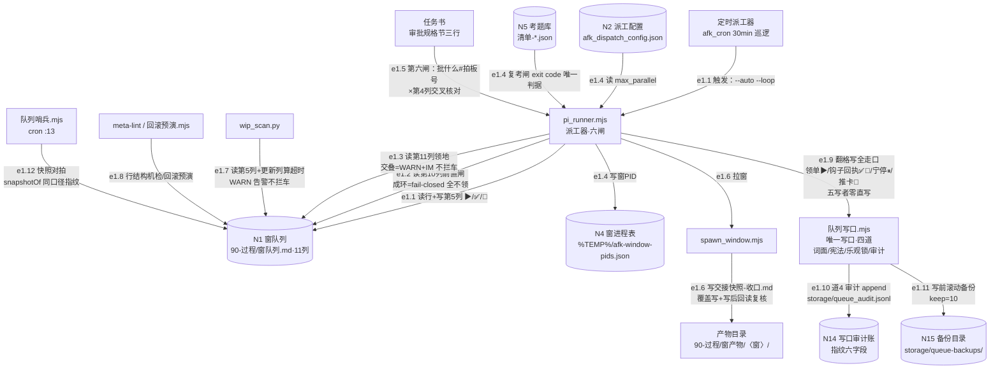

> **口径**：本卡话术/命名遵循《[00-话术统一口径正本](../00-话术统一口径正本.md)》（拍板#312）——双名制首现双写·撞车词带消歧（窗票/工序票·判色/判分）·两层口径 L1 车间（票级）/L2 派工台（窗级）。
> **消歧（本卡·口径正本 §3）**：票（工序票 L1／窗票 L2·随文标注）；三关（收包验货关 L1／立票验单关·贴卡拦病关·领单再验单 L2）；复考（交活重考闸·L2）。
> **变更注记（v2 增密·W-251·拍板#334·2026-11-03）**：repo_head 0cb1d3d→e170067 重锚（行锚随 TS 化迁移刷新·pi_runner/spawn_window/window_card_sync 真身均在 .ts·.mjs=垫片）；增量段=**队列写路收敛**节点边（e1.9-e1.12·唯一写口+审计+备份+哨兵·W-189 拍板#263/W-226 拍板#311/W-227 拍板#324·见边明细）。

# 数据流卡 · df-001 派工链数据流（N1 窗队列为中心）

## §0 一句话

**解决什么**：回答「一张票从窗队列到施工窗拉起，数据在哪个表哪个列哪个文件之间怎么流」——节点=N1 窗队列（唯一事实源）为中心，边=e1.1~e1.8（登记表编号零漂移）。**边界**：本卡只画**本地**派工链数据流（队列读写/配置/考题/窗PID/快照/机检），飞书投影边归 [df-20261021-002]，夜车账本归 [df-20261021-003]。

## §典型事件链

| # | 事件 | 锚 |
|---|---|---|
| 1 | W-047 本票即活例：拍板#99 落拍板表（`90-过程/拍板记录表.md:120`）→窗队列入列「待实施(已批)」（第 5 列）→定时派工器 30min 巡逻 pi_runner --auto 领单→本窗拉起 | `90-过程/拍板记录表.md:120` |
| 2 | 领单六闸逐格过：eligible 状态+拍板号闸（`91-脚本/pi_runner.mjs:122`）→审批规格节拍板号交叉核对（`91-脚本/pi_runner.mjs:268`）→routeOf 本仓→三关校验→拉窗 | `91-脚本/pi_runner.mjs:122` |
| 3 | 收口回写：子窗自写 ✅ 第 5-8 列→window_card_sync 读 N4 窗进程表算窗PID 活体投影（数据流见 df-002 e2.1）→wip_scan 3 天超时催办兜底 | `91-脚本/wip_scan.py:58` |

## §节点与边总览（编号正本=00 登记表·零漂移）

- **节点**：N1 窗队列（`90-过程/窗队列.md`·11 列表头=`90-过程/窗队列.md:25`）、N2 派工配置（`91-脚本/afk_dispatch_config.json`）、N4 窗进程表（`%TEMP%/afk-window-pids.json`）、N5 考题库（`91-脚本/考题库/`）＋两处登记表行内数据落点：任务书「审批规格节」（e1.5 读面）与产物目录（e1.6 写面）。
- **边**：e1.1~e1.8 共 8 条，全部程序↔本地文件，**零飞书边**（飞书投影=e2.x 归 df-002）。

## §数据流主线（mermaid）

## §节点详注（图正下方·每节点做什么/边界/锚点）

| 节点 | 详注 |
|---|---|
| 定时派工器 | 计划任务每 30min 拉起 pi_runner --auto --loop 的触发源（afk_cron 巡逻链一环）；只触发不读数据——数据读写全在 pi_runner。 |
| N1 窗队列 | 全引擎唯一队列事实源：11 列表格（`90-过程/窗队列.md:25` 表头），第 5 列状态/第 4 列拍板号/第 10 列前置/第 11 列领地为派工链四大数据面；行解析=`parseRows`（`91-脚本/pi_runner.mjs:92`·缺列旧格式缺省兼容）。 |
| pi_runner.mjs | 派工器本体：六闸顺序=eligible（`91-脚本/pi_runner.mjs:122`）→前置闸→领地反查→并行帽→复考闸→审批规格核对（`91-脚本/pi_runner.mjs:268` 纯函数族）；选单=`pickDispatch`（`91-脚本/pi_runner.mjs:866`）；放行=三关校验（`91-脚本/pi_runner.mjs:1104`）+拉窗（`91-脚本/pi_runner.mjs:1118`）。 |
| N2 派工配置 | max_parallel=4 等四键 JSON；pi_runner 读它定并行帽——改并发只动此文件零改码。 |
| N5 考题库 | 复考闸判卷面资产（清单 JSON×2+夹具×4+inject_driver）；增删改须业主拍板——数据流上只被读（exit code 唯一判据），不被派工链写。 |
| N4 窗进程表 | pi_runner 拉窗后写窗PID（`%TEMP%/afk-window-pids.json`·`91-脚本/window_card_sync.mjs:29` PIDFILE 同源消费）；窗卡台投影用它算「pid·存活｜已退」活体格。 |
| 任务书审批规格节 | 拍板#89 三行固定节（批什么/预算帽/允许动作面）；第六闸提取「批什么」拍板号与队列第 4 列交叉核对，不一致/提取失败=不领（fail-closed）。 |
| spawn_window.mjs | 拉窗器：buildStartCommand 组命令（`91-脚本/spawn_window.mjs:68`）+buildHandoffSnapshotMd 交接快照（`91-脚本/spawn_window.mjs:134`）覆盖写产物目录+写后回读复核（拍板#89己）。 |
| wip_scan.py | 超时催办：读第 5 列状态+更新列算超时天数（`91-脚本/wip_scan.py:58` WARN 行·缺省阈值 3 天）——**告警级不拦车**，只出清单不改队列。 |
| meta-lint/回滚预演 | 手工机检边：队列行结构机检与回滚预演（`91-脚本/回滚预演.mjs`）——只读校验面。 |
| 队列写口.mjs（e1.9-e1.11 新增） | 窗队列唯一写口（W-189 拍板#263·五写者收编）：翻格写全走口四道=道1 词面校验/道2 宪法表（十四对·`91-脚本/队列写口.mjs:54-69`）/道3 乐观锁（mtime+行指纹·重试≤3）/道4 审计留痕——治 W-181 误翻/W-182 覆盖双病灶；pi_runner 翻格写（领单▶/钩子回执✅🔁/宁停⏸/闸4升格重领）全走口零直写（`91-脚本/pi_runner.ts:84` import 消费）。 |
| N14 写口审计账（新增） | `storage/queue_audit.jsonl`（append-only·道4）：每写一行 ts/actor/ticket/from/to/note/ok/via/pid＋写前写后指纹六字段（pre/post Md5/Lines/MaxW·`队列写口.mjs:83-93,371`·契约详表=ct-001 邻域节）；拒写行亦记（ok:false+gate+reason 事故可回放）；幂等零写亦记。 |
| N15 写前备份目录（新增） | `storage/queue-backups/窗队列-<ts毫秒>.md`（W-226 拍板#311·`队列写口.mjs:96-125`）：写口每次落写前拷贝全文·同 md5 已备跳过·滚动保留 keep=10 份删最老（env AFK_QUEUE_BACKUP_KEEP 可配）——备份失败不挡写（兜底不是闸）。 |
| 队列哨兵.mjs（e1.12 新增） | 队列状态机检面（afk_cron :13）：snapshotOf 同口径指纹对拍（`91-脚本/队列哨兵.mjs:49,128`·票据行数/最大W号/maxW 数值序）——只读不改，异常告警不直写。 |

## §边明细（e1.1~e1.8·对照登记表 §一 零漂移）

| 边 | 程序 | 读← | 写→ | 字段/列级 | 触发 |
|---|---|---|---|---|---|
| e1.1 | pi_runner.mjs | N1 | N1 | 领单第 5 列→▶施工中；钩子回执 exit0→✅/非0→🔁（见 df-006 e6.1d 双写）；快照注记并行同列 | 定时派工器 --auto --loop |
| e1.2 | pi_runner.mjs | N1 第 10 列前置 | — | 值以✅开头=就绪；成环=fail-closed 全不领 | 同上 |
| e1.3 | pi_runner.mjs | N1 第 11 列领地 | — | 拟派×已✅/▶ 求交，命中 WARN+IM（告警不拦车） | 同上 |
| e1.4 | pi_runner.mjs | N2/N5 | N4 | 读 max_parallel；复考 exit code 唯一判据；写窗 PID | 同上 |
| e1.5 | pi_runner.mjs | 任务书审批规格节 | — | 批什么#拍板号 × 第 4 列交叉核对 | 同上 |
| e1.6 | spawn_window.mjs | N1（注记） | 产物目录 | 交接快照-收口.md 覆盖写+写后回读复核 | 被拉窗时 |
| e1.7 | wip_scan.py | N1 全表行 | console | 第 5 列+更新列算超时（告警不拦车） | 手工/催办 |
| e1.8 | meta-lint/回滚预演.mjs | N1 | — | 行结构机检/回滚预演 | 手工 |
| e1.9 | pi_runner.ts（及施工窗/主窗/巡检·五写者） | N1 | N1 | **翻格写全走队列写口**（W-189 拍板#263·锚 `90-过程/拍板记录表.md:298`）：写口四道=词面/宪法十四对（`队列写口.mjs:54-69`）/乐观锁/审计——五写者零直写 | 全部翻格场景 |
| e1.10 | 队列写口.mjs | — | N14 | 道4 审计 append（含指纹六字段·拒写行/幂等零写亦记） | 每次走口写 |
| e1.11 | 队列写口.mjs | — | N15 | 写前滚动备份（keep=10·同 md5 跳过·失败不挡写） | 每次真落写前 |
| e1.12 | 队列哨兵.mjs | N1 | console | 快照指纹对拍（snapshotOf 同口径·异常告警不直写） | afk_cron :30min 巡逻 |

## §纪律线（本块归属）

- 登记表 §七 编号纪律线 1-6 中**本块无直接归属边**（e1.x 全本地零飞书）——双色/单向投影/业主专属写等线落 df-002/df-004 各归其卡。登记表引言称「七条」、§七 正文实列 6 条编号纪律线：本窗照 §七 正文 6 条全落图（归属见各卡），差异如实申报于此，不自造第 7 条编号。
- 本块自身闸纪律（登记表行内既有·显式标注）：**前置闸 fail-closed**（e1.2 成环全不领·宁停不派）；**领地告警不拦车**（e1.3 WARN 级）；**复考 exit code 唯一判据**（e1.4 不看文本只看码）；**审批规格拍板号交叉核对 fail-closed**（e1.5 拍板#89）。
- **写路收敛纪律（e1.9-e1.11 新增·W-251 补录）**：N1 翻格写唯一通道=队列写口（五写者零直写·越权拒写 fail-closed＋审计留痕＋写前备份）——窗口施工注记走 `--note`（op:note 注记通道·W-242）禁 bash 直写队列；哨兵/机检面只读（e1.12·e1.7/e1.8）不翻格。

## §防重复指针

- 派工链时序视角（谁先谁后）=[sq-20261021-002]；状态谁改怎么改=[sm-20261021-001]（标源=窗队列不变量表·本卡不自立状态定义）；模块接口细节=[mk-20261021-001]/[mk-20261021-002]/[mk-20261021-003]。飞书投影数据流=[df-20261021-002]。
- agent 输入输出契约正本=登记表 §〇-A 段（A1-A21·拍板#343 W-259），本卡不重复（派工链零 LLM 调用岗·详见总图卡 gw-20261103-001 §10）。
- 本卡与 sq-002 分类轴不同：本卡=**数据面**（哪个表哪个列被谁读写），sq-002=**时间面**（步骤先后）——零正文复制。

## §时效

| 键 | 值 |
|---|---|
| 基准 | repo_head e170067（2026-11-03 W-251 对账批现勘·行锚随 TS 化迁移刷新+写路收敛节点边落卡） |
| 生成式 | 否（as-built 实勘·非生成物） |
| 核对 | 2026-11-03（登记表编号对照·e1.9-e1.12/N14/N15 已同步 append 登记表） |
| 失效触发 | 见 frontmatter 失效触发键 |
