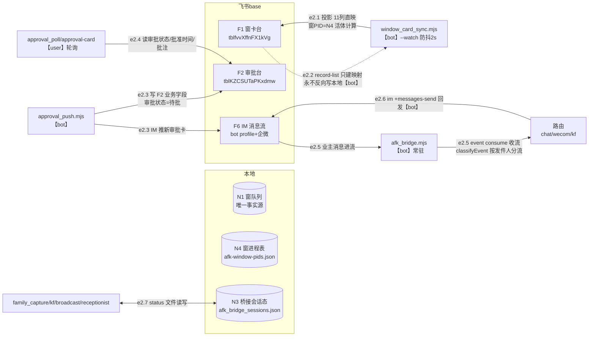

> **口径**：本卡话术/命名遵循《[00-话术统一口径正本](../00-话术统一口径正本.md)》（拍板#312）——双名制首现双写·撞车词带消歧（窗票/工序票·判色/判分）·两层口径 L1 车间（票级）/L2 派工台（窗级）。
> **消歧（本卡·口径正本 §3）**：票（工序票 L1／窗票 L2·随文标注）。

# 数据流卡 · df-002 飞书通道数据流（F1-F6 五表一流）

## §0 一句话

**解决什么**：回答「引擎与飞书五表一 IM 流之间，谁以什么身份读写了哪个表哪个字段」——边=e2.1~e2.7（登记表编号零漂移），**bot/user 双色身份**贯穿全图。**边界**：本卡只画通道面（投影/推审/回读/桥接/分流）；审批流转的业务语义归拍板流程，病卡三表回写细节归 [df-20261021-004]。

## §典型事件链

| # | 事件 | 锚 |
|---|---|---|
| 1 | W-042 实败例：window_card_sync 批写失败 42 行两跑同败（批写重试后仍失败·错误信息空）——**投影=单向投影·本地队列才是真源**，失败不拦车如实报 | `91-脚本/window_card_sync.mjs:6` |
| 2 | W-026 重试机制在案：批写失败→3 秒自动重试一次→仍失败如实报 exit 1（不装绿） | `91-脚本/window_card_sync.mjs:19` |
| 3 | 审批卡全链活例：postshift 显式 --base-token 推 F2（df-004 e4.2）→approval_push IM 通知→业主 F2 批「准」→approval_poll 回读放行 | `91-脚本/approval_push.mjs:119` |

## §节点与边总览（编号正本=00 登记表·零漂移）

- **节点**：N1 窗队列（事实源）、N3 桥接会话态、N4 窗进程表、F1 窗卡台（`tblfvvXffnFX1kVg`）、F2 审批台（`tblKZCSUTaPKxdmw`·`ts/.env:134` APPROVAL_TABLE_ID）、F3 病卡表/F4 班次表/F5 用例库（同库·回写边归 df-004）、F6 IM 消息流（bot profile+企微）。
- **边**：e2.1~e2.7 共 7 条。**base 同库标识**：`91-脚本/window_card_sync.mjs:30` BASE 硬编码 ≡ `ts/.env:133` APPROVAL_BASE_TOKEN 同值（值掩码·拍板#90 只列键名）。
- **死键注记**：`ts/.env:105` FEISHU_CHAT_ID=空值=死键（IM 实际走 bot profile+运行时 open_id·`91-脚本/approval_push.mjs:119` recv）——删除候选候业主拍板（登记表 §八 在案）。

## §数据流主线（mermaid·实线=程序边·双色标注身份）

## §节点详注（图正下方·每节点做什么/边界/锚点）

| 节点 | 详注 |
|---|---|
| N1 窗队列 | 投影侧唯一事实源：11 列直映 F1 前 8 列+第 9 列→「大业务」五类单选（字段 `fldy4T6NiY`）；七态外状态=跳投 fail-open——本地永远先落，飞书只是投影。 |
| N4 窗进程表 | 窗PID 活体数据面：`91-脚本/window_card_sync.mjs:29` PIDFILE 读 pi_runner 落盘记录+存活判定，合成 F1「窗PID」格（`pid·存活｜已退`·无记录=—）。 |
| N3 桥接会话态 | 常驻桥进程状态族：`.bridge.pid/.bridge-stream.json/afk_bridge_sessions.json` 等八文件常量（`91-脚本/afk_bridge.mjs:127`）；e2.7 各 family 脚本读写各自 status 文件（写法=`91-脚本/afk_receptionist.mjs:329` 读旧+patch 合并+覆盖写）。 |
| F1 窗卡台 | 表 id=`91-脚本/window_card_sync.mjs:31`；状态列为七态单选白名单——队列里白名单外状态跳投不炸（fail-open）；watch 常驻防抖 2s+30min 定时保底双道。 |
| F2 审批台 | 审批流转表：approval_push 写全部业务字段+审批状态=待批（env 检查=`91-脚本/approval_push.mjs:105` hasEnv·缺 APPROVAL_BASE_TOKEN/APPROVAL_TABLE_ID 即降级）；**审批状态列业主专属写·引擎只读**（纪律线3）。 |
| F6 IM 消息流 | bot profile 收发+企微分流；`91-脚本/approval_push.mjs:119` 推「新审批卡」用 --as bot --chat-id recv（运行时 open_id·FEISHU_CHAT_ID 死键不参与）。 |
| 路由 classifyEvent | afk_bridge 收流后按发件人身份分流 chat/wecom/kf 三车道——身份判定是 e2.5→e2.6 的分岔点。 |

## §边明细（e2.1~e2.7·对照登记表 §二 零漂移）

| 边 | 程序 | 方向 | 表·字段 | 身份·触发 |
|---|---|---|---|---|
| e2.1 | window_card_sync.mjs | N1→F1 | 11 列直映+大业务 select+窗PID 活体；七态外跳投 fail-open | bot·--watch 防抖 2s |
| e2.2 | window_card_sync.mjs | F1→(映射) | record-list 建 窗ID→record_id；**永不反向写本地** | bot |
| e2.3 | approval_push.mjs | 引擎→F2+F6 | 写 F2 业务字段+待批；IM 推新审批卡通知 | bot·审批卡产生时 |
| e2.4 | approval_poll/approval-card.mjs | F2→引擎 | 读审批状态+批准时间+批注（`pipeline-lab/scripts/approval-card.mjs:29` parseApprovalRecord·准+批准时间才放行） | user·轮询 |
| e2.5 | afk_bridge.mjs | F6→路由 | event consume 常驻收流→classifyEvent 分流 | bot·常驻 |
| e2.6 | afk_bridge.mjs | 路由→F6 | im +messages-send 回发（`91-脚本/afk_bridge.mjs:621`） | bot·事件驱动 |
| e2.7 | family_capture/kf/broadcast/receptionist | F6(企微/kf)↔N3 | 各自 status 文件读写 | 常驻 |

## §纪律线（登记表 §七 落图·本块归属 3 条）

- **线1 事实源→投影单向**：N1→F1 永不反向（`91-脚本/window_card_sync.mjs:6` 定位句+`91-脚本/window_card_sync.mjs:19` 纪律句·e2.2 只读映射）——上图 e2.2 用虚线负向表达「查而永不写」。
- **线2 两套身份**：91-脚本系=bot（e2.1/e2.2/e2.3/e2.5/e2.6 标 bot）、pipeline-lab 系=user（e2.4 标 user）——上图全边带身份标注。
- **线3 审批状态列业主专属**：F2 审批状态引擎只读（`pipeline-lab/scripts/approval-card.mjs:29` 红线头注·e2.4 只读面）。
- 本块另注：FEISHU_CHAT_ID 死键（`ts/.env:105` 空值·全仓零消费方）——删除候选候业主另拍，本卡只注记不处理。

## §防重复指针

- 窗卡台投影模块接口=[mk-20261021-003]；票状态七态定义=[sm-20261021-001]（标源=窗队列）；派工链本地数据面=[df-20261021-001]；病卡/班次/用例三表回写字段级细节=[df-20261021-004]。
- 本卡与 mk-003 分类轴不同：本卡=通道数据面（谁写哪个表哪个字段），mk-003=模块接口面——零正文复制。

## §时效

| 键 | 值 |
|---|---|
| 基准 | repo_head 0cb1d3d（2026-10-21 现勘·锚点 14 处 sed 亲验·env 只列键名值掩码） |
| 生成式 | 否（as-built 实勘·非生成物） |
| 核对 | 2026-10-21（表 id 与登记表逐字对照·BASE 行号漂移 :27→:30 已按现行码修正） |
| 失效触发 | 见 frontmatter 失效触发键 |
