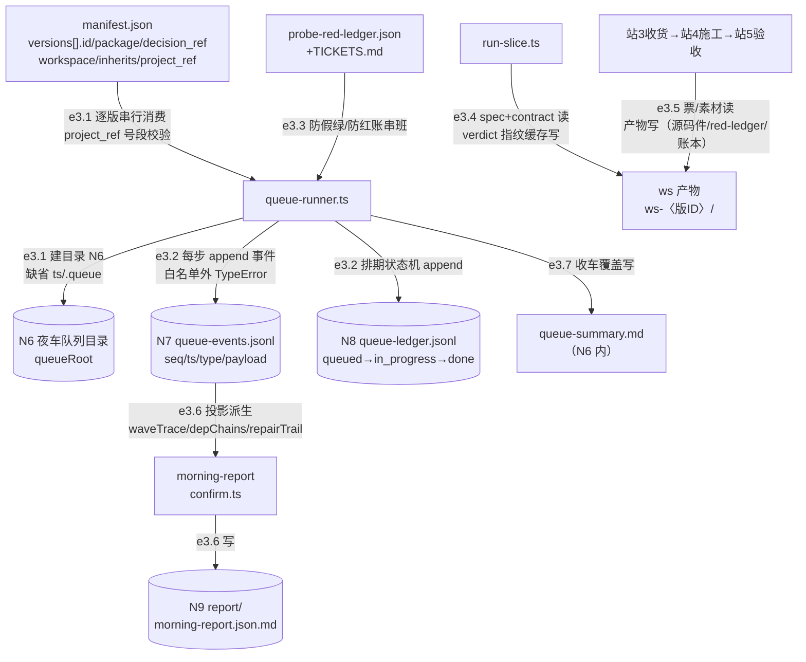

> **口径**：本卡话术/命名遵循《[00-话术统一口径正本](../00-话术统一口径正本.md)》（拍板#312）——双名制首现双写·撞车词带消歧（窗票/工序票·判色/判分）·两层口径 L1 车间（票级）/L2 派工台（窗级）。
> **消歧（本卡·口径正本 §3）**：票（工序票 L1／窗票 L2·随文标注）。

# 数据流卡 · df-003 引擎夜车数据流（N6-N9）

## §0 一句话

**解决什么**：回答「一夜车跑起来，manifest 怎么变队列、每步事件怎么落账本、晨报从哪来」——节点=N6 夜车队列目录/N7 事件账本/N8 排期账本/N9 晨报，边=e3.1~e3.7（登记表编号零漂移）。**边界**：本卡只画账本数据面；夜车时序（步骤先后与闸门）=[sq-20261021-001]，波次状态机=[sm-20261021-002]。

## §典型事件链

| # | 事件 | 锚 |
|---|---|---|
| 1 | queue-52/queue-40 实跑：manifest versions 逐版串行→queueRoot 下双账本逐行 append（queue-events.jsonl 9 行 3 事件型/queue-ledger.jsonl 11 行 2 事件型实物在案） | `ts/src/queue/queue-runner.ts:161` |
| 2 | 防假绿/防串班：发车即读 probe-red-ledger.json+TICKETS.md 比对——非源码非配置，专防陈旧报告假绿与 V0 红账串班 | `ts/src/queue/queue-runner.ts:12` |
| 3 | 收车：queue-summary.md 覆盖写（`ts/src/queue/queue-runner.ts:268`）+confirm 出 morning-report.json（`ts/src/confirm.ts:20`）→postshift 六件链接手（df-004） | `ts/src/queue/queue-runner.ts:268` |

## §节点与边总览（编号正本=00 登记表·零漂移）

- **节点**：manifest.json（e3.1 读面）、N6 夜车队列目录（queueRoot：`queue-events.jsonl`/`queue-ledger.jsonl`/`queue-summary.md`/`ws-〈版ID〉/`）、N7 事件账本行（type 白名单 114+ 型）、N8 排期账本（五态+3 事件型白名单）、N9 班次工作区报告（morning-report.json/.md）；e3.4/e3.5 涉 ws 产物与站3/4/5 写面（模块细节=mk-006~010）。
- **边**：e3.1~e3.7 共 7 条，**全部本地零飞书**——夜车身份面不涉 bot/user 双色（双色线落 df-002/df-004）。

## §数据流主线（mermaid）

## §节点详注（图正下方·每节点做什么/边界/锚点）

| 节点 | 详注 |
|---|---|
| manifest.json | 夜车发车输入：versions[] 每版 id/package/decision_ref/workspace/inherits（+project_ref 运行时必填·号段校验=`ts/src/queue/queue-runner.ts:46` 接口定义+`ts/src/queue/queue-runner.ts:132` validateManifestRoot 发车拦）；逐版串行消费。 |
| N6 夜车队列目录 | queueRoot 缺省 `ts/.queue`（`ts/src/queue/queue-runner.ts:287`）；实跑如 pipeline-lab/queue-52/——夜车全部落盘物的家目录。 |
| N7 事件账本行 | 行车记录仪：每行 {seq,ts,type,payload}；type 白名单=EVENT_TYPE_LIST（`ts/src/shared/event-types.ts:8`·114+ 型）——**白名单外 TypeError**（写侧契约门）；双账本落位=`ts/src/queue/queue-runner.ts:161`。 |
| N8 排期账本 | 波次状态机账本：五态 queued/in_progress/done/superseded/needs_replan（`ts/src/queue/queue-ledger.ts:13`）+自有白名单 3 事件型（`ts/src/queue/queue-ledger.ts:27` 区）——与 N7 双账本分工=行车记录 vs 排期状态。 |
| ws 产物 | 班次工作区：run-slice 读 spec.md+contract.json 写产物+`.cache` verdict 指纹缓存（`ts/src/run-slice.ts:149` 读+`ts/src/run-slice.ts:179` 缓存建）；站3/4/5 全链读写同一 ws（e3.5）。 |
| N9 班次报告 | confirm 出 report/morning-report.json+md（`ts/src/confirm.ts:20`）；waveTrace/depChains/repairTrail 皆 N7 账本投影派生——**晨报无独立数据源，全是账本投影**。 |
| queue-summary.md | 收车覆盖写（`ts/src/queue/queue-runner.ts:268`）——班次级摘要，与 N9 晨报分工=队列摘要 vs 报告。 |

## §边明细（e3.1~e3.7·对照登记表 §三 零漂移）

| 边 | 程序 | 读← | 写→ | 明细 |
|---|---|---|---|---|
| e3.1 | queue-runner.ts | manifest.json | N6 建 | versions 逐版串行；project_ref 号段校验；queueRoot 缺省 ts/.queue |
| e3.2 | queue-runner.ts | — | N7/N8 | 每步 append 事件；白名单外 TypeError |
| e3.3 | queue-runner.ts | probe-red-ledger.json/TICKETS.md | — | 防假绿/防红账串班 |
| e3.4 | run-slice.ts | spec.md+contract.json | ws 产物 | `.cache` verdict 指纹缓存（四铁律 ADR-0003） |
| e3.5 | 站3/4/5 全链 | 票/素材 | ws | tickets-md、red-ledger、llm-fs 写源码件、value/verdict-cache |
| e3.6 | morning-report | N7 投影 | N9 | report/morning-report.json+md（全派生无独立源） |
| e3.7 | queue-runner.ts 收车 | — | N6 | queue-summary.md 覆盖写 |

## §纪律线（登记表 §七 落图·本块归属声明+块内契约纪律）

- §七 编号纪律线 1-6 中本块**无直接归属边**（零飞书·线2 双色不适用）——归属卡=df-002（线1/2/3）与 df-004（线2/4/5/6），全 6 条落图见各卡；登记表引言「七条」vs §七 正文实列 6 条差异已在 df-001 如实申报。
- 本块自身契约纪律（显式标注）：**事件型写侧白名单**（N7 白名单外 TypeError·N8 仅 3 事件型）——夜车任何程序不得发明新事件型；**防假绿/防串班**（e3.3 发车即比对·`ts/src/queue/queue-runner.ts:12`）；**排期状态机合法转移**（N8 转移表=QUEUE_TRANSITIONS·细目=[sm-20261021-002] 标源）。

## §防重复指针

- 夜车时序（步骤先后/闸门）=[sq-20261021-001]；波次五态转移=[sm-20261021-002]；双件套字段契约=[ct-20261021-001]、manifest 家族契约=[ct-20261021-002]——本卡=数据面（谁写哪个文件哪类行），契约卡=schema 面（字段长什么样），零正文复制。
- 派工链（票怎么来）=[df-20261021-001]；班后维修环（账本数据接着去哪）=[df-20261021-004]。
- agent 输入输出契约正本=登记表 §〇-A 段（A1-A21·拍板#343 W-259），本卡不重复——夜车链判断岗=A1写码/A2审查/A3采样/A4判据追加/A7补锚/A8解环（详见总图卡 gw-20261103-001 §3~§6）。

## §时效

| 键 | 值 |
|---|---|
| 基准 | repo_head 0cb1d3d（2026-10-21 现勘·锚点 13 处 sed 亲验） |
| 生成式 | 否（as-built 实勘·非生成物） |
| 核对 | 2026-10-21（登记表 N6-N9/e3.1-e3.7 逐条对照；run-slice/confirm 全路径修正=ts/src/ 根） |
| 失效触发 | 见 frontmatter 失效触发键 |
