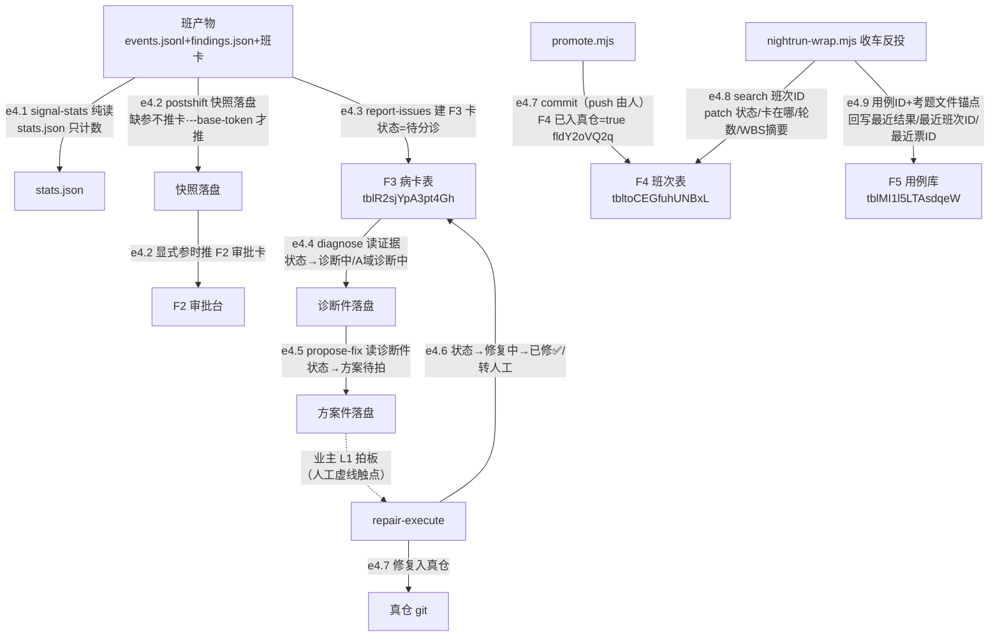
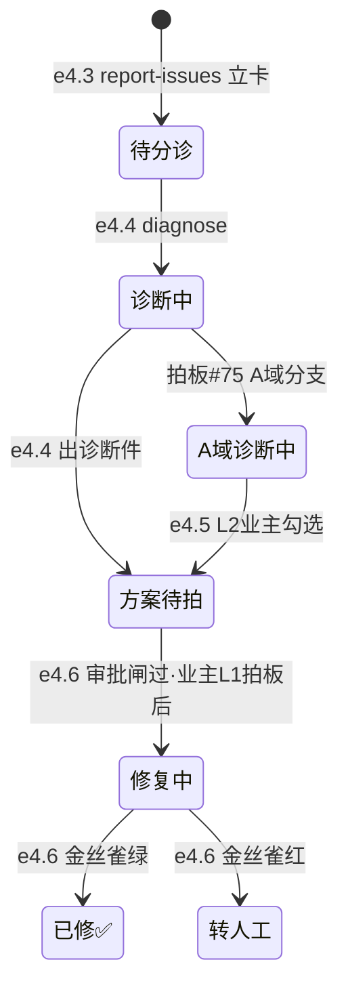

> **口径**：本卡话术/命名遵循《[00-话术统一口径正本](../00-话术统一口径正本.md)》（拍板#312）——双名制首现双写·撞车词带消歧（窗票/工序票·判色/判分）·两层口径 L1 车间（票级）/L2 派工台（窗级）。
> **消歧（本卡·口径正本 §3）**：票（工序票 L1／窗票 L2·随文标注）。

# 数据流卡 · df-004 班外维修环数据流（e4.1~e4.9）

## §0 一句话

**解决什么**：回答「一夜车跑完后，病灶数据怎么一步步变成病卡、诊断、方案、修复、入真仓的」——边=e4.1~e4.9（登记表编号零漂移），F3 病卡表七态转移+开工已入真仓字段级回写。**边界**：本卡只画数据面（谁写哪个表哪个字段）；F2 审批台通道细节=[df-20261021-002]。

## §典型事件链

| # | 事件 | 锚 |
|---|---|---|
| 1 | 信号统计纯读例：signal-stats 班后只计数不归因，零 lark 零写表——统计 JSON 只喂晨报环境建议栏 | `pipeline-lab/scripts/signal-stats.mjs:1` |
| 2 | 缺参降级实规：postshift 缺 lark 参数=只快照落盘不推卡（`pushed:false` 如实报），显式 --base-token 才推 F2/F3 | `pipeline-lab/scripts/postshift.mjs:76` |
| 3 | 病卡走全环例：report-issues 立卡「待分诊」→diagnose 推「诊断中」→propose-fix 推「方案待拍」（业主 L1 触点）→repair-execute「修复中→已修✅/转人工」→promote 回写 F4 已入真仓 | `pipeline-lab/scripts/repair-execute.mjs:195` |

## §节点与边总览（编号正本=00 登记表·零漂移）

- **节点**：班产物（events.jsonl/findings.json/班卡导出/stats.json/诊断件/方案件）＋F3 病卡表（`tblR2sjYpA3pt4Gh`）、F4 班次表（`tbltoCEGfuhUNBxL`）、F5 用例库表（`tblMI1l5LTAsdqeW`）、F2 审批台（e4.2 推审面）；真仓 git（e4.7 commit 面·push 由人）。
- **边**：e4.1~e4.9 共 9 条。**身份面=全 user**（pipeline-lab 系·纪律线2 双色的另一色）。

## §数据流主线（mermaid·全边身份=user·虚线=人工触点）

## §节点详注（图正下方·每节点做什么/边界/锚点）

| 节点 | 详注 |
|---|---|
| signal-stats（e4.1） | 班后统计起点：纯读零 lark 零写表（`pipeline-lab/scripts/signal-stats.mjs:1` 头注红线）；事件型=EVENT_TYPES 白名单子集，白名单外不猜不计数；病卡状态枚举从 repair-contract import 不复制。 |
| postshift（e4.2） | 六件链编排：快照恒落盘；推卡面=缺参不推（fail-open 但 `pushed:false` 如实报·`pipeline-lab/scripts/postshift.mjs:76`），显式 --base-token 才建 F2 审批记录（`pipeline-lab/scripts/postshift.mjs:184` createApprovalLark+buildApprovalRecord）。 |
| report-issues（e4.3） | F3 建卡：病ID/项目名称/域/来源班次/标题=`病:〈tag〉·〈head〉`/状态=待分诊（`pipeline-lab/scripts/report-issues.mjs:84` schema 区）。 |
| F3 病卡表 | 七态 select 单一正本=`pipeline-lab/scripts/repair-contract.mjs:23` SICK_STATUS；转移表=`:39` SICK_TRANSITIONS——状态机见下图二。 |
| diagnose（e4.4） | 证据→诊断件落盘+F3 状态→诊断中（`pipeline-lab/scripts/diagnose.mjs:202` 写 DIAGNOSED）；A 域分支=拍板#75 上溯车道。 |
| propose-fix（e4.5） | 诊断件→方案件落盘+F3 patch 状态→方案待拍+方案链接（`pipeline-lab/scripts/propose-fix.mjs:120`）——**业主 L1 拍板输入·唯一人工拍板触点**。 |
| repair-execute（e4.6） | 审批闸→修复中（`pipeline-lab/scripts/repair-execute.mjs:152`）→A 域分支（`pipeline-lab/scripts/repair-execute.mjs:162`）→红=转人工（`pipeline-lab/scripts/repair-execute.mjs:171`）/绿=已修✅（`pipeline-lab/scripts/repair-execute.mjs:195`）——七态转移全部经 larkStatus 写 F3。 |
| promote（e4.7） | 晋升闭环：--apply 代执行 commit（**push 永远由人**）；commit 落真仓后回写 F4「已入真仓」=true（字段 ID `fldY2oVQ2q`·`pipeline-lab/scripts/promote.mjs:17`）；--mark-only=业主手动 commit 后补账模式（`pipeline-lab/scripts/promote.mjs:186`）。 |
| nightrun-wrap（e4.8/e4.9） | 收车自动反投：F4 按「班次ID」search 后 patch 状态/卡在哪/轮数/WBS摘要（`pipeline-lab/scripts/nightrun-wrap.mjs:509` 区·卡在哪=夜车收车自动反投+时间戳）；F5 按用例ID+考题文件锚点回写最近结果/最近班次ID/最近票ID（`pipeline-lab/scripts/nightrun-wrap.mjs:128` 区·**只回写本班跑到的考题·未跑不动不装 NA**）。 |

## §F3 病卡七态转移图（图二·正本=`pipeline-lab/scripts/repair-contract.mjs:39` SICK_TRANSITIONS·逐格照抄）

## §边明细（e4.1~e4.9·对照登记表 §四 零漂移）

| 边 | 程序 | 读← | 写→ | 明细 |
|---|---|---|---|---|
| e4.1 | signal-stats.mjs | 班次 events+findings+班卡导出 | stats.json | 纯读零 lark 零写表；事件型白名单子集 |
| e4.2 | postshift.mjs | 班产物 | 快照落盘 | 缺参不推卡；显式 --base-token 才推 F2/F3 |
| e4.3 | report-issues.mjs | findings | F3 建卡 | 病ID/标题/状态=待分诊/域全称/来源班次/诊断链接 |
| e4.4 | diagnose.mjs | 证据 | 诊断件+F3 | 状态→诊断中（或 A域诊断中） |
| e4.5 | propose-fix.mjs | 诊断件 | 方案件+F3 | 状态→方案待拍（业主 L1 触点） |
| e4.6 | repair-execute.mjs | 方案件 | 执行+F3 | 状态→修复中→已修✅/转人工（转移表 repair-contract:39-45） |
| e4.7 | promote.mjs | F4 | F4+真仓 | 已入真仓=true（fldY2oVQ2q·键=工单ID列）+代执行 commit；--mark-only 补账 |
| e4.8 | nightrun-wrap.mjs | F4(search 班次ID) | F4 patch | 状态/卡在哪/轮数/WBS摘要（收车自动反投） |
| e4.9 | nightrun-wrap.mjs | F5(用例ID/考题文件锚点) | F5 三列 | 最近结果/最近班次ID/最近票ID（只回写本班跑到的） |

## §纪律线（登记表 §七 落图·本块归属 4 条）

- **线2 两套身份**：pipeline-lab 系=**user**（本卡 9 边全 user 色·与 df-002 bot 色对偶）。
- **线4 病卡状态机单一正本**：F3 七态枚举+转移表=`pipeline-lab/scripts/repair-contract.mjs:23`/`pipeline-lab/scripts/repair-contract.mjs:39`（图二逐格照抄）——与引擎票级 11 态（ticket-state.ts）**无关不混用**（repair-contract 红线头注）。
- **线5 缺参 no-op 降级**：postshift（e4.2）缺 lark 参数=只落盘零推卡（fail-open 但 `pushed:false` 如实报）。
- **线6 push 由人**：promote（e4.7）只 commit，`git push` 业主亲自（仓红线4）。

## §防重复指针

- 发车编排模块=[mk-20261021-004]、收车编排=[mk-20261021-005]；夜车账本上游=[df-20261021-003]；F2 审批通道=[df-20261021-002]。病卡状态机契约细节（字段/schema 面）=repair-contract.mjs 本体（单一正本·本卡只画转移不加字段表）。
- 本卡与 mk-004/005 分类轴不同：本卡=表字段回写数据面，mk 卡=模块接口面——零正文复制。
- agent 输入输出契约正本=登记表 §〇-A 段（A1-A21·拍板#343 W-259），本卡不重复——维修环判断岗=A9诊断/A10深化/A11翻译/A13兑底/A15改包（详见总图卡 gw-20261103-001 §8~§9）。

## §时效

| 键 | 值 |
|---|---|
| 基准 | repo_head 0cb1d3d（2026-10-21 现勘·锚点 14 处 sed 亲验） |
| 生成式 | 否（as-built 实勘·非生成物） |
| 核对 | 2026-10-21（F3 七态转移逐格对照 SICK_TRANSITIONS·F4/F5 回写字段逐字对照登记表） |
| 失效触发 | 见 frontmatter 失效触发键 |
