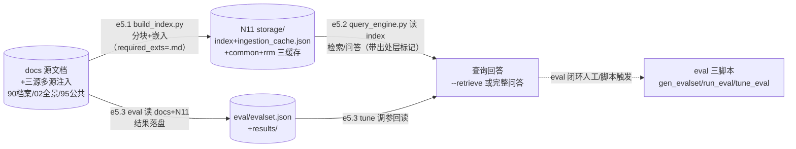

> **⚠️ 时效注记（2026-11-03·拍板#333/#346）**：本件已被 v2 supersede——以 `df-20261103-001-知识库RAG数据流v2.md` 为准（H2 代产·拍板#333）；本件保留作 v1 历史正本不回改。
> **口径**：本卡话术/命名遵循《[00-话术统一口径正本](../00-话术统一口径正本.md)》（拍板#312）——双名制首现双写·撞车词带消歧（窗票/工序票·判色/判分）·两层口径 L1 车间（票级）/L2 派工台（窗级）。
> **消歧（本卡·口径正本 §3）**：票（工序票 L1／窗票 L2·随文标注）。

# 数据流卡 · df-005 知识库 RAG 数据流（e5.1~e5.3）

## §0 一句话

**解决什么**：回答「经验文档怎么变成可检索的向量索引、查询怎么取、评测怎么闭环节」——节点=docs 源文档/N11 RAG 索引库/eval 结果，边=e5.1~e5.3（登记表编号零漂移）。**边界**：本卡只画数据面；RAG 检索质量问题与方案归 92 痛点区。

## §典型事件链

| # | 事件 | 锚 |
|---|---|---|
| 1 | W-043 渲染窗 RAG 不受扰冒烟：build_index 增量真跑——HTML 零入池（required_exts=[".md"] 滤图形件）+索引节点数 912（+179=28 卡 v2 增密块数增量） | `94-班外经验库RAG/settings.py:1` |
| 2 | 增量策略实战：ingestion_cache.json 同文本 hash 未变→命中缓存跳过嵌入（「未变块走缓存·禁全量重嵌」拍板#58④） | `94-班外经验库RAG/build_index.py:4` |
| 3 | 查询三用法在案：--rebuild 增量建/更新索引（多源 research+95）、--retrieve 只检索不烧 LLM、完整问答带出处 | `94-班外经验库RAG/query_engine.py:1` |

## §节点与边总览（编号正本=00 登记表·零漂移）

- **节点**：docs 源文档（`94-班外经验库RAG/docs/`+多源：90-过程/10-专题档案·02-全景视图·95-公共经验库-invariant）、N11 RAG 索引库（`storage/index/`+`ingestion_cache.json`+`ingestion_cache_common.json`+`embed_cache_rrm.json`）、eval 结果落盘（`eval/evalset.json`+`eval/results/`）。
- **边**：e5.1~e5.3 共 3 条，**全部本地零飞书**。

## §数据流主线（mermaid）

## §节点详注（图正下方·每节点做什么/边界/锚点）

| 节点 | 详注 |
|---|---|
| docs 源文档 | 知识源面：目录内 docs/+全局三源注入（`94-班外经验库RAG/settings.py:1` 头注：90-过程/10-专题档案 层=engine＋02-全景视图 层=engine·required_exts=[".md"] 天然滤图形件＋95-公共经验库 层=common）——W-028 拍板#88② 多源不混池。 |
| N11 RAG 索引库 | 落盘四件：storage/index/（向量索引·persist=`94-班外经验库RAG/build_index.py:162`）+ingestion_cache.json（hash 缓存·`94-班外经验库RAG/build_index.py:133` persist 行）+ingestion_cache_common.json+embed_cache_rrm.json——增量策略=未变文件命中缓存跳过嵌入（`94-班外经验库RAG/build_index.py:4` 头注）。 |
| query_engine.py | 检索与问答入口（`94-班外经验库RAG/query_engine.py:1` 头注三用法）：--rebuild 增量建/更新、--retrieve 只检索不烧 LLM（≤1500 字候选块·出处带层标记）、完整问答带出处——RAG-0 闭环的消费面。 |
| eval 三脚本 | gen_evalset.py 生成评测集（`94-班外经验库RAG/eval/gen_evalset.py:1`）/run_eval.py 跑评（`94-班外经验库RAG/eval/run_eval.py:1`）/tune_eval.py 调参（`94-班外经验库RAG/eval/tune_eval.py:1`）——读 docs+N11、结果落 evalset.json+results/，构成 e5.3 闭环节。 |

## §边明细（e5.1~e5.3·对照登记表 §五 零漂移）

| 边 | 程序 | 读← | 写→ | 明细 |
|---|---|---|---|---|
| e5.1 | build_index.py | docs/ 经验文档（+三源） | N11：storage/index/（persist:162）+ingestion_cache.json（hash 未变跳过:4-6,133） | 增量建/更新索引 |
| e5.2 | query_engine.py | N11 index | 查询回答 | --retrieve/完整问答·RAG-0 闭环·出处带层标记 |
| e5.3 | eval/gen_evalset·run_eval·tune_eval.py | docs+N11 | eval 结果落盘 | 评测-调参闭环节 |

## §纪律线（登记表 §七 落图·本块归属声明）

- §七 编号纪律线 1-6 中本块**无直接归属边**（零飞书表·线1-6 全不适用）——全 6 条落图见 df-002（线1/2/3）与 df-004（线2/4/5/6）；登记表引言「七条」vs §七 正文实列 6 条差异已在 df-001 如实申报。
- 本块自身纪律（显式标注）：**.md 单一入池扩展名**（HTML/生成品不入索引·W-043 冒烟实证 HTML 零入池）——02-全景视图 HTML 渲染品永不污染向量库；**多源不混池**（三源层标记 engine/common 先滤后取·拍板#88②）；**draft 禁入索引**（RRM 卡 B1 保鲜闸·过期卡自动失效出池）。

## §防重复指针

- 渲染层与索引的关系=[df-20261021-006]（e6.2 渲染品=索引的 .md 上游产物）；夜车账本知识化路径=[df-20261021-003]→90-过程→e5.1 三源注入。
- 本卡与 92 痛点区分类轴不同：本卡=数据面（哪个文件流向哪个文件），痛点区=问题与方案面——零正文复制。
- agent 输入输出契约正本=登记表 §〇-A 段（A1-A21·拍板#343 W-259），本卡不重复（RAG 链零 LLM 判断岗·检索栈=机械设备；总图卡=gw-20261103-001）。

## §时效

| 键 | 值 |
|---|---|
| 基准 | repo_head 0cb1d3d（2026-10-21 现勘·锚点 8 处 sed 亲验） |
| 生成式 | 否（as-built 实勘·非生成物） |
| 核对 | 2026-10-21（e5.1-e5.3 逐条对照登记表 §五·persist/cache 行号亲验一致零漂移） |
| 失效触发 | 见 frontmatter 失效触发键 |
