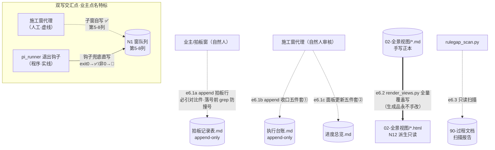

> **口径**：本卡话术/命名遵循《[00-话术统一口径正本](../00-话术统一口径正本.md)》（拍板#312）——双名制首现双写·撞车词带消歧（窗票/工序票·判色/判分）·两层口径 L1 车间（票级）/L2 派工台（窗级）。
> **消歧（本卡·口径正本 §3）**：票（工序票 L1／窗票 L2·随文标注）。

# 数据流卡 · df-006 文档台账与渲染层（e6.1a-d＋e6.2/e6.3·含人工流）

## §0 一句话

**解决什么**：回答「拍板/台账/面板这些**人工写**的账，和渲染品这种**程序写**的派生件，数据从哪流向哪、谁和谁在同一字段上双写」——边=e6.1a~e6.1d（人工·虚线）＋e6.2/e6.3（登记表编号零漂移）；**e6.1d 双写交汇点=全图唯一人工/程序双写同一字段处，双箭头汇合特标（业主 2026-10-21 拍板画进）**。**边界**：本卡只画数据面。

## §典型事件链

| # | 事件 | 锚 |
|---|---|---|
| 1 | e6.1a 实例：拍板#99 落表尾（落号前 grep 表尾在案最高 #98 零撞号·必引对比件=登记表 00 号件） | `90-过程/拍板记录表.md:120` |
| 2 | e6.1b/c 实例：W-041 收口五件套——执行台账 append 本笔+进度总览窗口表加行（`90-过程/执行台账.md:583` W-041 行在案） | `90-过程/执行台账.md:583` |
| 3 | e6.2 防手改实证（W-043）：手改 html 加 HUMAN-EDIT→重跑渲染器→被覆盖还原；touch md 拨新→--check-only 报 stale | `91-脚本/render_views.py:251` |

## §节点与边总览（编号正本=00 登记表·零漂移）

- **节点**：`90-过程/拍板记录表.md`（e6.1a 写面）、`90-过程/执行台账.md`（e6.1b）、`90-过程/进度总览.md`（e6.1c）、N1 窗队列第 5-8 列（**e6.1d 双写交汇点**）、`02-全景视图/*.md`→同名 `.html`（N12 派生只读·e6.2）、扫描报告（e6.3）。
- **边**：e6.1a~e6.1d 人工虚线边 4 条＋e6.2/e6.3 程序边 2 条，共 6 条。

## §数据流主线（mermaid·虚线=人工流·e6.1d 双箭头汇合特标）

**双写交汇点特标说明（e6.1d·业主 2026-10-21 拍板画进）**：上图双写交汇点子图中，人工虚线（子窗代理自写 ✅）与程序实线（pi_runner 钩子兜底）**双箭头汇入同一数据面 N1 第 5-8 列**——全图唯一人工/程序双写同一字段处。**幂等规则**：子窗已写（行已 ✅/🔁/⏸/🔵）则钩子原样返回逐字不变，不覆盖不降级不重复记（拍板#89甲·`91-脚本/pi_runner.mjs:353`「非 ▶ 态一律原样」幂等行；钩子三案头注=`91-脚本/pi_runner.mjs:344`；exit0→✅=`91-脚本/pi_runner.mjs:361`；非0→🔁=`91-脚本/pi_runner.mjs:365`）。

## §节点详注（图正下方·每节点做什么/边界/锚点）

| 节点 | 详注 |
|---|---|
| 拍板记录表 | 业主拍板唯一权威（append-only 只追加不回改）：每拍板行必引对比件路径，落号前 grep 表尾防撞号——e6.1a 人工边，程序零写面。 |
| 执行台账 | 窗收口编年账（append-only）：每窗收口本笔=收口五件套①——e6.1b 人工边；`90-过程/执行台账.md:583` 即 W-041 收口笔实物。 |
| 进度总览 | 窗口/专题面板（收口五件套②）：e6.1c 人工边更新窗口表行与专题线加注（抬头=`90-过程/进度总览.md:1`）。 |
| N1 第 5-8 列 | **双写交汇数据面**：状态/下一棒锚/产物锚/更新四列——子窗代理收口自写 ✅（人工），pi_runner 退出钩子对未写行（▶ 态）兜底直写（程序）；幂等=子窗已写钩子不覆盖（拍板#89甲）。 |
| 02-全景视图/*.md | 手写正本（RRM 卡·agent/RAG 索引源）：e6.2 的读面；本卡族 df-001~006 即其一部分。 |
| *.html（N12） | 派生只读渲染品：render_views 覆盖写（`91-脚本/render_views.py:216` html.write_text）——**手改会被下次渲染冲掉**（`:251` 自测断言「手改痕迹不在渲染后 html」）；双层制=拍板#96（md 正本×HTML 生成品）。 |
| 扫描报告 | rulegap_scan 只读产物（`91-脚本/rulegap_scan.py:2` 头注：扫专题档缺「规则缺口」行→WARN 清单不拒收）——e6.3 零写文档面。 |

## §边明细（e6.1a-d＋e6.2/e6.3·对照登记表 §六 零漂移）

| 边 | 谁 | 读← | 写→ | 说明 |
|---|---|---|---|---|
| e6.1a | 业主/拍板窗（人工·虚线） | — | 拍板记录表表尾 | append-only 拍板行（必引对比件；落号前 grep 防撞号） |
| e6.1b | 施工窗代理（人工·虚线） | — | 执行台账表尾 | append-only 收口五件套① |
| e6.1c | 施工窗代理（人工·虚线） | — | 进度总览 | 收口五件套②面板更新 |
| e6.1d | 施工窗代理＋pi_runner 钩子（**双写交汇点**） | — | N1 第 5-8 列 | 子窗自写 ✅；钩子对未写行兜底直写；幂等=子窗已写钩子原样不覆盖（拍板#89甲） |
| e6.2 | render_views.py | 02-全景视图/*.md | 同名 .html 覆盖写（:216） | 手改会被冲掉（:251-257 自测佐证） |
| e6.3 | rulegap_scan.py | 90-过程文档 | 扫描报告 | 只读 |

## §纪律线（登记表 §七 落图·本块归属声明+块内纪律）

- §七 编号纪律线 1-6 中本块无编号线直接归属（线1 投影单向属 e2.x 面=df-002）——全 6 条落图见 df-002/df-004；登记表引言「七条」vs §七 正文实列 6 条差异已在 df-001 如实申报。
- 本块自身纪律（显式标注）：**e6.1d 双写幂等**（拍板#89甲·子窗已写钩子不覆盖·见特标说明）；**append-only 两表**（拍板记录表/执行台账只追加不回改）；**HTML 生成品永不手改**（拍板#96 双层制·e6.2 全量覆盖=设计内）；**渲染品不入 RAG 索引**（required_exts=.md·与 df-005 交接纪律）。

## §防重复指针

- 票状态七态定义=[sm-20261021-001]（标源=窗队列不变量表·本卡只画第 5-8 列数据面不自立状态定义）；RRM frontmatter 契约=[ct-20261021-003]；派工链队列读写=[df-20261021-001]；飞书投影=[df-20261021-002]；索引入池=[df-20261021-005]。
- 本卡与 sm-001 分类轴不同：本卡=谁写哪个列的数据面，sm-001=状态语义面——零正文复制。

## §时效

| 键 | 值 |
|---|---|
| 基准 | repo_head 0cb1d3d（2026-10-21 现勘·锚点 10 处 sed 亲验·e6.1d 幂等行 :353 逐字核对） |
| 生成式 | 否（as-built 实勘·非生成物；本卡亦为 e6.2 渲染链产出物之一） |
| 核对 | 2026-10-21（e6.1a-d/e6.2/e6.3 逐条对照登记表 §六·双写交汇点经业主拍板画进在案） |
| 失效触发 | 见 frontmatter 失效触发键 |
