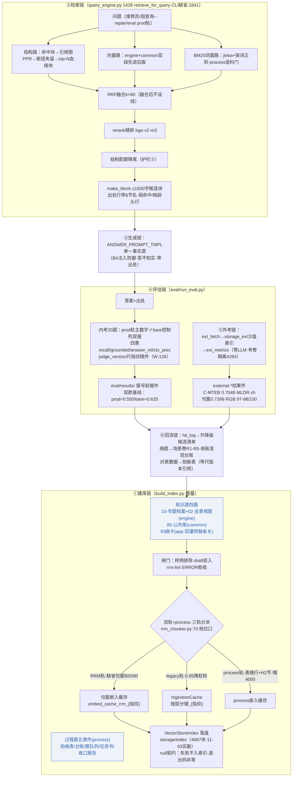

> **口径**：本卡话术/命名遵循《[00-话术统一口径正本](../00-话术统一口径正本.md)》（拍板#312）——双名制首现双写·撞车词带消歧（窗票/工序票·判色/判分）·两层口径 L1 车间（票级）/L2 派工台（窗级）。
> **v2 缘起（拍板#333·2026-11-03·主窗代产）**：df-005（2026-10-21·repo_head 0cb1d3d）停在「裸向量+双轨分派」时代——其后四条新流未画：①检索四通道缺省编排（#141/#118）②外考链（W-190~215·#264）③93→94 回灌桥（W-125·#170 C1）④process 轨（W-091·#140）；另 eval 主尺已翻 prod 双报（W-240·#321③）。本件=重画全链·v1 保留作历史正本。

# 数据流 v2 · 知识库RAG（建库→检索→生成→评估→外考→回流 六链·2026-11-03）

> **本卡管什么**：94-班外经验库RAG 子系统的知识流动全链——谁把知识喂进索引（建库链）、问题怎么变成候选块（检索链）、候选块怎么变成答案（生成链）、分数怎么出炉（评估链·内考+外考）、账怎么回流（回流链）。
> **业内定位**：RAG Reference Architecture 的数据面视图（Ingestion→Retrieval→Generation→Evaluation pipeline + feedback loop）。

## 总图 · 六链全景（v2）

## 与 df-005（v1）的四条差分

| # | v1（10-21）缺失/过时 | v2 现款 | 依据 |
|---|---|---|---|
| 1 | 建库=双轨（RRM 节切+legacy） | **三轨**：RRM 句窗缺省（800/80·section 逃生口）+legacy+process（帽 4000）·93 回灌桥第四源缺省关 | W-227·#321②·W-125·W-091 |
| 2 | 检索=裸向量直取 | **四通道缺省编排**（结构∥词面∥向量→RRF→rerank→配额）+优化四档全缺省关+语料门 | #141/#118·#165/#131/#138 |
| 3 | eval 单轨裸奔 | **prod/bare 双轨双报**+judge_version 指纹+饱和度机检+**外考四基准独立链**（storage_ext 沙盒·零 LLM） | W-184/240·#256①/#321③·W-190~215·#264 |
| 4 | 无 GPU/显存面 | 外考嵌入工厂显存帽自动生效（cap=14GB·W-215）+产线 build 同源消费 | W-196/215 |

## 节点与边登记（增量·对账 00-节点与边总登记表）

| 节点 | 类型 | 说明 | 锚 |
|---|---|---|---|
| 93-班内兜底知识库 | 数据源（app 层·缺省关） | 回灌桥开闸才入池 | wardcard_bridge.py:50-55 |
| process 五类件 | 数据源（process 层） | 文件级白名单·仅显式口可达 | settings.py:175-195 |
| RRM 句窗档 | 分块产物 | window_part+section 三键（W-253 回捞定位面） | rrm_chunker.py:262-275 |
| storage_ext/ | 沙盒索引 | 外考专用·不入 kb_sources（#264 永久语义） | eval/ext_index.py |
| judge_version | 元数据键 | 尺版本指纹随 results 落盘 | calibration_gate.py |

**失效触发回看**：W-253 回捞档落地收口→②检索链/③生成链追笔；翻缺省候拍落拍→总图缺省标注更新。

**tags**：专题化·知识库RAG·数据流卡·四通道编排·外考链（拍板#119·首位=阶段词组⑤）
