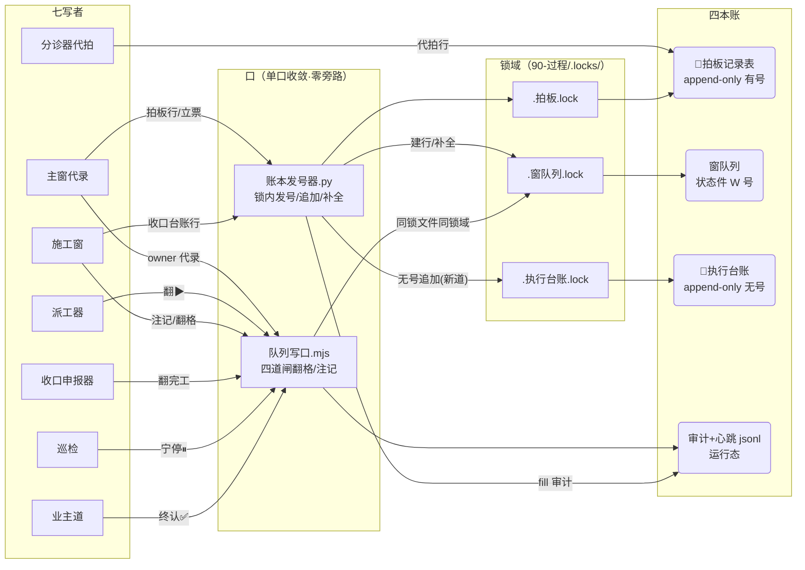

<!-- meta: window=W-271 type=全景件 status=verified tags=数据流卡,全景视图,专题化 -->

---
id: df-20261103-002
kind: 模块卡
domain: engine
status: verified
version: v1
created_at: 2026-11-03
verified_at: 2026-11-03
repo_head: b944d35
run_id: queue-w271-20261103
anchors: ["91-脚本/账本发号器.py:33", "91-脚本/账本发号器.py:62", "91-脚本/账本发号器.py:112", "91-脚本/账本发号器.py:142", "91-脚本/队列写口.mjs:7", "91-脚本/队列写口.mjs:54", "91-脚本/队列写口.mjs:160", "91-脚本/队列写口.mjs:174", "91-脚本/队列写口.mjs:199", "91-脚本/队列写口.mjs:203", "91-脚本/queue_mutex.ts:114", "91-脚本/meta-lint.ts:249", "91-脚本/打回分诊.ts:247", "91-脚本/pi_runner.ts:257", "90-过程/规则-发号即落行与账本单口纪律.md:1", "90-过程/规则-队列写口纪律.md:29", "02-全景视图/07-数据流/df-20261030-001-业务链触发CRUD矩阵.md:94", "02-全景视图/07-数据流/df-20261030-001-业务链触发CRUD矩阵.md:111"]
tags: ["数据流卡", "全景视图", "专题化"]
related: ["df-20261030-001", "sm-20261030-005", "df-20261021-001"]
基准: repo_head b944d35（开工实测=任务书repo_head开工时实勘·拍板#357②④扩面笔已在本笔工作树·锚以本笔收口态为准）
生成式: 否
核对: 2026-11-03
升版缘由: 首版（拍板#357④·对比件 §3-④「写路全景补卡」·任务书 W-271 accept4）
失效触发: 发号器 LEDGERS/append_row/fill_row 行号漂移·队列写口四道闸改码（道增删）·第四本账入锁域·宪法表增删对（拍板级）→本卡过期改 draft 走 B1 保鲜闸
---

> **口径**：本卡话术遵循《[00-话术统一口径正本](../00-话术统一口径正本.md)》（拍板#312）——白话三词（机械设备/Agent员工/自然人审核）；发号=领号，落行=把行写进账本，临界区=锁内别人插不进来的那一小段时间。
> **母账**：拍板#357（并发写撞号三缝收口·业主令「准」2026-11-03）·对比件=`90-过程/handoffs/对比流程-并发写撞号三缝收口-现状vs改后-20261103.html`（§3-④=本卡蓝本）。

# 数据流卡 · df-20261103-002 写路全景（写者 × 底表 × 口 × 锁域）

> **本卡是什么**：全仓「append 类写」的**单口可查可审总图**（拍板#357④）——七写者（谁在写）× 四本账（写到哪）× 口与锁域（经哪道口、进哪把锁）×审计心跳（写了留什么痕）。姊妹件=df-20261030-001（业务链触发 CRUD 矩阵·36 行×15 列）——本卡是它行29/30/31 三行的**写路治理视角放大件**，行30/31 旧现状行已随本卡同笔回改（勘误依据=拍板#357·B1 保鲜道）。

## §1 七写者（谁在写）

| # | 写者 | 属列 | 写面（写哪本账·干什么） | 实勘锚 |
|---|---|---|---|---|
| 1 | 主窗代录（含手机出令·主窗代行） | L2 | 拍板行 append（发号器锁内落行）·立票建行（窗队列 W 行·发号器）·owner 转换代录（须 --board 拍板号） | `规则-发号即落行 §一1·队列写口.mjs:63` |
| 2 | 分诊器（代拍道） | L2 | 拍板表代拍行 append（appendProxyRow·断窗重排/班末 drain 两道） | `打回分诊.ts:247` |
| 3 | 派工器（dispatcher） | L2 | 窗队列领单翻▶（队列写口 actor=dispatcher·宪法对①） | `队列写口.mjs:55` |
| 4 | 施工窗（window） | L2 | 窗队列注记/翻🔁/推🔵/转人工（宪法对②③⑪⑬）·执行台账收口 append（**新道=发号器 --append-row-file --ledger 执行台账**·拍板#357②） | `队列写口.mjs:56-58,66-68`·`账本发号器.py:112` |
| 5 | 收口申报器 | L2 | 窗队列翻完工待确认（▶非本态拒收 fail-closed） | `pi_runner.ts:257,1276` |
| 6 | 巡检（inspector） | L2 | 窗队列宁停推⏸（僵尸/无据宁停·宪法对⑤） | `队列写口.mjs:59` |
| 7 | 业主道（owner） | L2 | 终认翻✅/勘误恢复/挂账清偿/业主宁停（宪法对④⑥⑦⑧⑨⑩⑫⑭·主窗代录须 --board） | `队列写口.mjs:60-69` |

> **七写者口径注**：治本架构件（20261030）立「五写者」（主窗/施工窗/派工器/巡检/收口申报器）——本卡实勘加严为七：+分诊器代拍道（打回分诊.ts:247）+业主道独立 actor（owner·宪法表四 actor 词汇之一·`队列写口.mjs:52`）。只加严不加松（仓规）。

## §2 四本账（写到哪）

| 账 | 语义 | 写道（唯一写口） | 占用/编号语义 | 锁 |
|---|---|---|---|---|
| 🔴拍板记录表 | append-only（母账·一字不改删） | 发号器 `--append-row-file --ledger 拍板`（锁内发号→{N}替换→追加→同号唯一验证→释锁·验证不过回滚重试≤3） | **有号账**（#N 递增·禁占位行禁 fill-row——append-only 一次写全·写不全=宁晚落行） | `.locks/.拍板.lock` |
| 窗队列 | 状态件（状态列许回改·宪法十四对管流转） | 翻格/注记=队列写口四道闸；**建行/占位补全=发号器**（立票 `--ledger 窗队列` W 行模板·补全 `--fill-row W-N --row-file <新行>` 仅窗队列开放） | **有号账**（W-N 递增·占位短行许钉号后同锁补全） | `.locks/.窗队列.lock` |
| 🔴执行台账 | append-only（收口五件套①·无号） | **新道=发号器 `--append-row-file --ledger 执行台账`**（纯锁内追加·行原样落账零改写·不发号不验号）；生效前直写照旧已翻篇 | **无号账**（越界引入编号语义=A 类越面推卡停车·对比件 §6 边界；`--next` 对它=用法错 exit 2） | `.locks/.执行台账.lock` |
| 审计与运行态 | append-only jsonl（运行态不进 git） | 写口审计=`storage/queue_audit.jsonl`（成功与拒都记·道4）；发号器 fill 审计=`storage/tmp/发号器审计.jsonl`（op:fill·ts/pid/行号/前后指纹）；心跳=`storage/heartbeat/` | 无号 | —（审计零锁·追加道自带幂等） |

> 四本账口径注：拍板#357 语境「三本账」=拍板表/窗队列/执行台账（三缝收口对象）——本卡实勘加审计/运行态 jsonl 为第四本（写口审计+发号器 fill 审计+心跳租约=可审面），与 sm-005 append-only 六对象（events/queue-events/分诊事件/latitude-log 等 L1 车间账）分层不混：L1 车间账见 df-001 行22-23/32-33，本卡只管 L2 派工台账。

## §3 口与锁域（怎么写·单口收敛全景）

- **发号器四道牙**（自身硬闸·`账本发号器.py`）：锁内重查最大号（防 TOCTOU）→ `{N}` 占位守卫拒发（无占位行不落账）→ 追加后同号唯一验证（不过自动回滚重试≤3）→ 全败如实 exit 1 账本零污染（宁停不装绿）。锚：`append_row:112`·`next_number:100`·`validate_unique:106`。
- **fill_row 补全道**（拍板#357④·仅窗队列）：同锁域读→按行号定位唯一目标行（不存在/同号多行=fail-closed 拒写 exit 1）→整行替换→同号唯一验证→写盘→审计（`fill_row:142`）。拍板表/执行台账传 `--fill-row`=用法错 exit 2（append-only 禁回改）。
- **写口四道闸**（翻格/注记·`队列写口.mjs:7-12`）：道1 词面（WINDOW_STATES 白名单·:160）→道2 转换权宪法（十四对查表·:174·表本体 :54-69）→道3 乐观锁（mtime+行指纹复核·重读重试上限3·:199）→道4 审计（成功与拒都记·:203,283）。
- **锁协议同构三件**：发号器 `acquire_lock:62`（O_EXCL 原子占位+PID 存活判+死锁接管+只摘己锁+W-271 坏锁文短等加严+抖动重试）↔ `queue_mutex.ts:114 withQueueLock`（同锁文件同协议·TS 侧）↔ 写口道3 乐观锁（同一窗队列锁域）。**同一账本的一切写（发号建行/写口翻格）互斥在同一把锁上**。

## §4 写路全景矩阵（写者 × 账本 × 口 × 锁域）

| 写者 ↓ 账 → | 拍板记录表 | 窗队列 | 执行台账 | 审计/心跳 |
|---|---|---|---|---|
| 主窗代录 | **C**·发号器锁内落行（禁 grep+edit 直落·禁 --next 取号后落笔）·`发号即落行 §一` | **C**·立票建行走发号器 W 行模板（§二1）·owner 翻格走写口 --board | — | — |
| 分诊器代拍 | **C**·appendProxyRow·`打回分诊.ts:247` | **U**·drain 翻回（走口）·`打回分诊.ts:349,360` | — | — |
| 派工器 | NA | **U**·领单翻▶（走口·闸1 前置沿 W-187）·`队列写口.mjs:55` | — | **C**·审计行·`queue_audit.jsonl` |
| 施工窗 | NA | **U**·注记/翻🔁/推🔵/转人工（走口）·`队列写口.mjs:56-68`·占位补全走 `--fill-row`（W-271 新道） | **C**·收口五件套① append 走发号器新道（拍板#357②·W-271 起一律） | **C**·fill 审计（补全时） |
| 收口申报器 | NA | **U**·翻完工待确认（走口·fail-closed）·`pi_runner.ts:257,1276` | — | — |
| 巡检 | NA | **U**·宁停推⏸（走口 inspector）·`队列写口.mjs:59` | — | — |
| 业主道 | 拍板令=母账（主窗代录落行） | **U**·终认✅/勘误恢复/挂账清偿（走口 owner·--board）·`队列写口.mjs:60-69` | — | — |

**机检伴生双道**（meta-lint 撞号·告警级不拦车·`meta-lint.ts:249,364,367`·W-265 在役）+写口 duplicateRow 四锚拒收 fail-closed（W-265 案H）+发号器同号唯一验证四道牙=**撞号三道防线**。绕行扫描器候后续票（拍板#357 §五·本票只申报）。

## §5 append-only 红线占用语义（本卡视角）

- 🔴拍板记录表：**U/D 全禁**——禁占位行禁 fill-row（拍板#357 立规=宪法句·发号器码面 `fill_row:142` 仅窗队列开放=物理化）；号面勘误走业主令专用道（#279/#329 先例）。
- 🔴执行台账：append-only·无号——禁编号线（A 类越面）·禁回改；`--next` 拒发 exit 2（`main:307`）。
- 窗队列：行本体禁 bash/edit 直改（队列写口纪律 §三禁令清单·`规则-队列写口纪律.md:29`）——建行/补全（发号器）与翻格/注记（写口）之外**零旁路**。
- 审计 jsonl：append-only·拒写也记（事故可回放）。

## §6 与 df-001 行30/31 回改联动（B1 保鲜）

df-20261030-001 行30（拍板表「表尾 grep 防撞号」旧道）与行31（执行台账「无脚本写口」）已随本卡同笔回改为新道（勘误依据=拍板#357·`账本发号器.py:33` LEDGERS 三账+`fill_row:142`）——df-001「失效触发」节所列锚漂移情形（发号器/写口改码）自此含本卡 §3 四道牙与 fill_row 锚；本卡自身失效触发节同口径。

## §7 来源锚点

- 拍板#357 全文·对比件 §3-②④·规约件 `90-过程/规则-发号即落行与账本单口纪律.md`（§一/§二/§三=本卡语义源）
- 姊妹纪律 `90-过程/规则-队列写口纪律.md`（§三禁令·写侧）
- 正本码 `91-脚本/账本发号器.py`（W-271 扩面笔：LEDGERS:33/NO_NUMBER_LEDGERS:38/append_row:112/fill_row:142/acquire_lock:62/_audit_fill:172）·`91-脚本/队列写口.mjs`（四道闸:7-12·宪法表:54-69·审计:203）·`91-脚本/queue_mutex.ts:114`·`91-脚本/meta-lint.ts:249`
- 治本架构 `07-设计理念专题/窗队列并发写治理-五写者单口收敛与状态机宪法-根因分析与治本架构-候拍-20261030.md`（五写者→本卡实勘加严为七）
- 姊妹卡 `df-20261030-001`（行29/30/31=本卡放大对象·行30/31 已回改）
