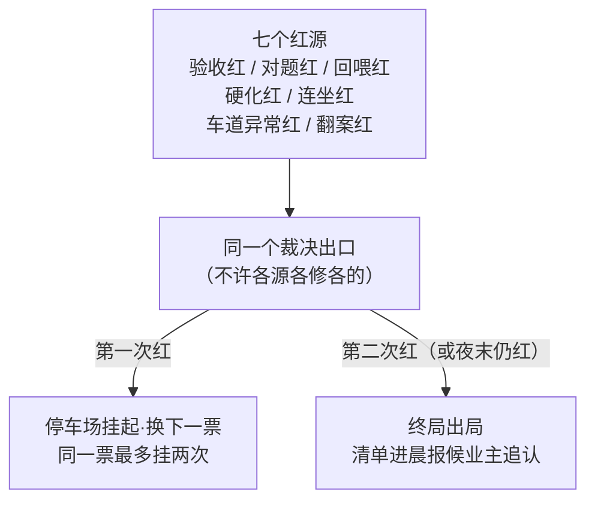
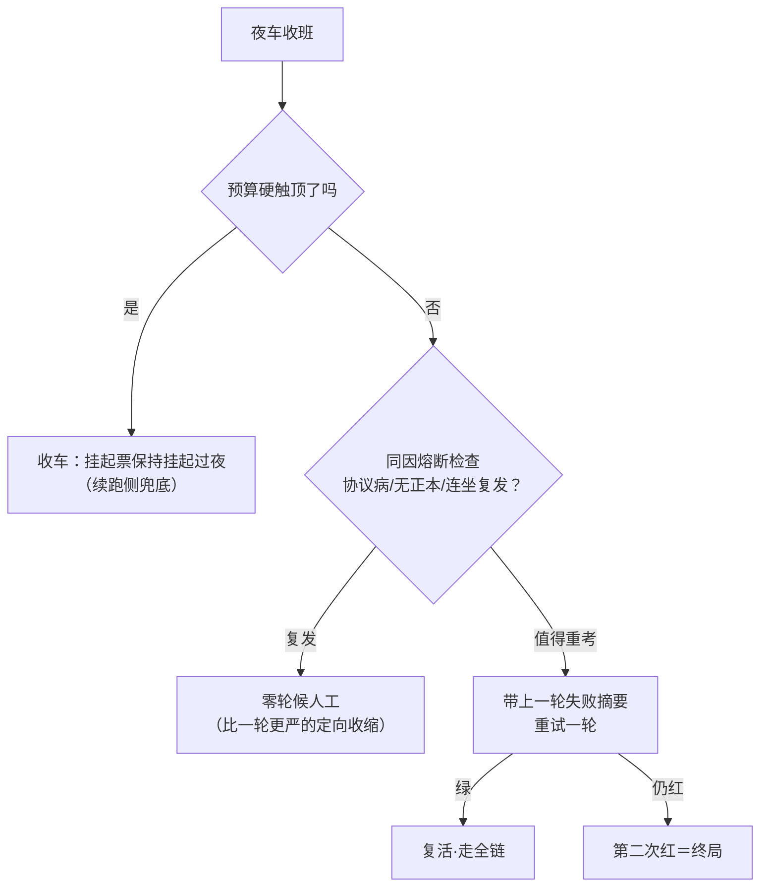
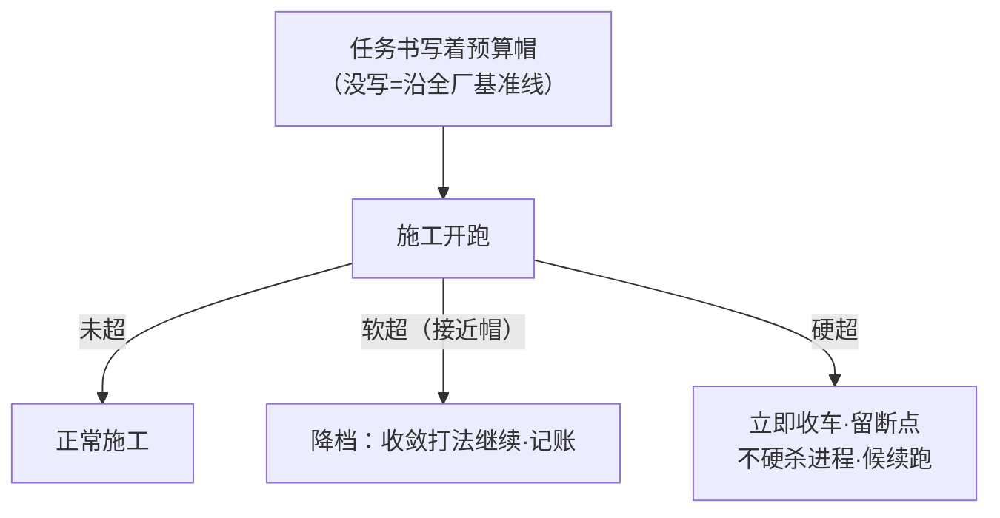
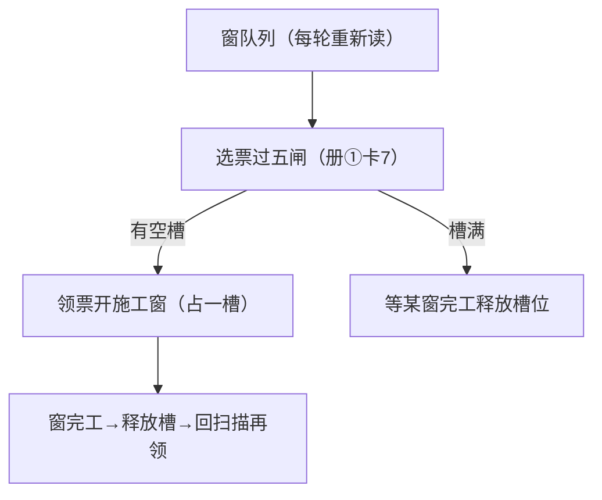
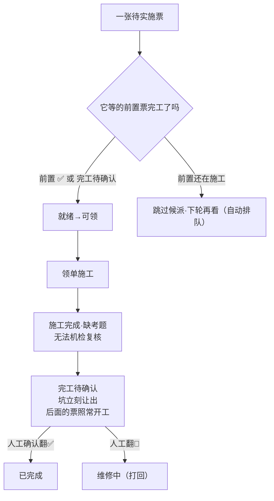
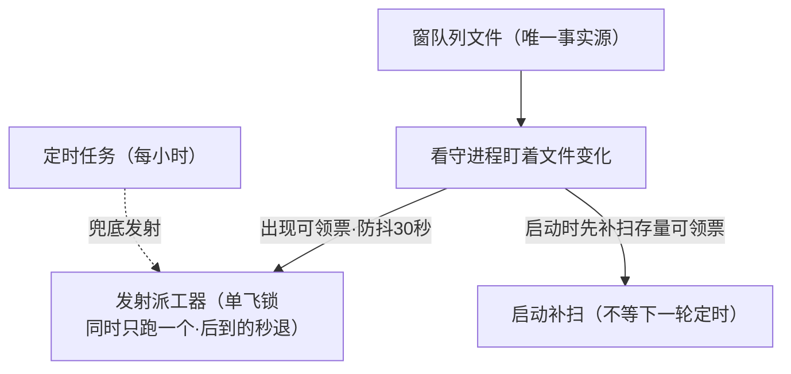
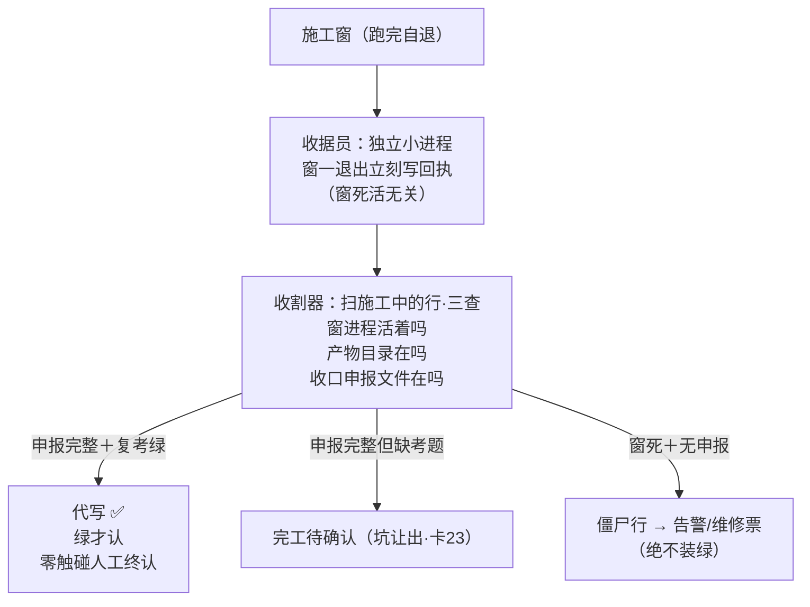
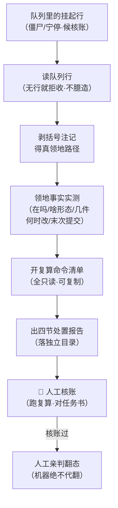
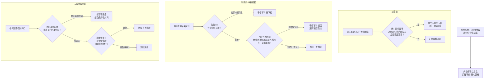

> **口径**：本卡话术/命名遵循《[00-话术统一口径正本](../00-话术统一口径正本.md)》（拍板#312）——双名制首现双写·撞车词带消歧（窗票/工序票·判色/判分）·两层口径 L1 车间（票级）/L2 派工台（窗级）。
> **消歧（本册·L1·口径正本 §3）**：「票」＝工序票（L1）；「挂起」＝gate_suspend/resume 事件对（无态·非 L2 ⏸格）；「补考」＝挂起补考；「熔断」＝同因熔断；「补偿」＝Saga 反向撤销（人工主导）。
> **事件名速查（口径正本 §4·拍板#316① W-234 双名化落册）**
> - 挂起补考＋同因熔断 → **挂起补考**（L1 夜末·自环）
> - 槽位化主循环 / 队列看守触发派工 → **翻格开窗**（markRunning＋spawn·L2 领单驱动）
> - 核账处置报告 → **僵尸核账报告**（L2 巡逻驻留）
> - 值守道/监工道推卡道/心跳租约三行在本册 §2 表（00-总索引卡）→ **值守巡检推进 / 候批推卡道 / 干活力续租**（本册 md 未出独立卡）
> - 其余（红票裁决/预算三步/前置闸让坑/收据员收割器/判死守卫四闸）→ 候正名
> - 双名制：首现双写「标准事件名（现行短名）」·短名机检永不改；§4 空缺→候正名不硬造名

# 机制卡册③ · 调度与停车场（7 卡·批1·2026-10-28）

> **本册管什么**：第二层派工链的「交通系统」——票怎么被挑中开工（槽位）、被谁挡住（前置闸）、干不完去哪（停车场/⏸）、夜末怎么收尾（补考/熔断）、钱烧超了怎么办（预算三步）、队列一变谁先知道（看守进程）、窗子死活谁来收尸（收据员/收割器）。图版=同目录 03-调度与停车场册.html。

---

## 卡19 · 红票裁决 R05＋停车场（业内名：统一失败裁决＋停车上限）

**harness 层**：harness第二层 · 派工链/收尾

**一句话**：七种进红灯的方式共用同一个裁决出口——第一次红挂起换票、第二次红终局出局；「接下来怎么办」只有一个人说了算，不许各修各的。

**术语白话对照**：`七源同出口`＝七种进红灯的方式（施工红/审查严重偏题/回喂重写红/硬化红/前置连坐红/车道异常红/翻案红）全部汇入同一个裁决函数——统一规则、统一记账，防「每个红各有各的私了办法」；`停车场（park≤2）`＝同一票最多挂起两次：第一次挂起换别的票先干，第二次还红=终局；`终局（DEF）`＝案子归档进晨报「待追认清单」，业主追认时过目——引擎不再返工。

**口述**：七个路口都能进红灯，但红灯之后只有一位交警。这是特意设计的：如果每种红各有各的处置办法，很快就会出现「这种红重试三次、那种红直接放弃」的规则漂移。统一出口意味着统一规则：第一次挂起（给别的票让路，也给自己冷静期），第二次终局。挂起次数写死上限——「再给一次机会」的仁慈必须有尽头，否则一张烂票能烧穿整夜预算。

**锚**：red-ruling.ts:35（同出口）·:48（挂起）·:57（终局）·:71（车道异常）｜业内对照：dead-letter queue（终局进死信待人工）+ bounded requeue｜变式：L2 打回分诊（册⑥卡49）=同构（重排/续拍/宁停）｜红线：挂起次数上限不可调大；七源清单加源=拍板。

---

## 卡20 · 挂起补考＋同因熔断（业内名：限时重试＋熔断器）

**harness 层**：harness第二层 · 派工链/收尾

**一句话**：夜车收班前，把停车场里挂起的票统一再试最后一轮——试之前先看「同样病因是否复发」：复发=零轮直接候人工（比多给一轮更严的定向收缩）。

**术语白话对照**：`夜末补考`＝夜车收班前的「最后一轮补考」：把挂起的票按入列顺序再试一轮；`带上次失败摘要`＝重试不是凭空重跑——上轮为什么红（失败摘录）随票走，把抽奖变成带证据重考；`M6 同因熔断`＝「同样的病第二次得」就不治了：协议病/缺正本/连坐复发这三类，复发=零轮直接候人工——熔断的本义就是「别再烧了」。

**口述**：夜快收班了，停车场里还挂着几张票。规矩三问：预算还够吗？不够——全挂过夜，续跑侧兜底。是老毛病复发吗（上次就这个病因红的）？是——不再试，直接候人工：同样的病因多试一轮只是多烧一遍钱。值得重考吗？值得——把上轮失败摘要别在票上，重试一轮；这轮再红，就是第二次红，终局。注意「更严」的方向：熔断不是放水，是收缩——省下的预算给别的票。

**锚**：lane-drain.ts:31（drain）·:50（M6 熔断）·build-lane.ts:69,215｜业内对照：Circuit Breaker（同因熔断）+ bounded retry with context｜变式：L2 班末补考（W-147 在飞·同构平移）｜红线：只重试一轮；熔断三类清单只加严。

---

## 卡21 · 预算三步刹车（业内名：背压/预算闸）

**harness 层**：harness第二层 · 派工链/收尾

**一句话**：每张票带着预算帽开工——接近上限就降档收敛（记账），硬触顶立刻收车留断点候续跑；绝不硬杀进程，也绝不超支硬干。

**术语白话对照**：`预算帽`＝这票最多烧多少（token/时长）；`软超降档`＝接近帽值不停车，但换收敛打法（例如不再重试、缩短产出）并记账；`hard 收车留断点`＝到顶立刻停止生成——但进度已落盘（断点在账本里），续跑时从断点接，不是从头再来；`AUTO_BUDGET_LINE`＝全厂默认基准线（任务书没写帽时沿用它）。

**口述**：三条路对应三种超支时刻：还早——正常干；快到了——收紧打法省着花（记账让人看得见它在省）；到顶——立即收车，但不是砸机器：断点都在账本里，续跑接得上。第二层的派工链目前只有「自律记账」（窗自己报数），机械硬闸（到顶必断）已列为本批 W-145 在飞施工——本卡描述的就是它的目标形态。

**锚**：night-budget.ts（三步语义原件）·pi_runner.ts:75（自律注记·机械计量候二期）｜业内对照：backpressure / token bucket｜变式：L2 W-145（本批在飞·机械刹车）（**实测补注 20261029·勘误一**：判级映射忠实——0.8 软带/恰帽 hard/帽 0 不设防四档真机对拍全同；但计量路 L1 三路〔次数/USD/时钟〕收敛为 L2 单路〔token vs 帽〕·拍板#231 拍定卡面声明）·拍板#238：hard=仅告警不停固化·词面已正（原「停车信号」为层1 术语残留误导）｜红线：收车≠硬杀进程；层 1 预算三路语义零触碰。

---

## 卡22 · 槽位化主循环（业内名：工作池·领至槽满）

**harness 层**：harness第二层 · 派工链/收尾

**一句话**：派工器每轮重读队列，把「过了五闸的票」领进空槽开窗施工——领到槽满为止；有窗完工释放槽位，下一轮立刻补领，全程不等人。

**术语白话对照**：`槽位`＝同时施工的窗口数量上限（业主可在派工台改，默认 5）；`领至槽满→轮询空槽→再领`＝不攒批、不等人——来一张领一张，领满为止，空一个补一个；`每轮重读队列`＝队列是唯一事实源，领单前永远重新读盘（不吃缓存里的旧状态）。

**口述**：派工器是个看板管理员：板上五个挂钩（槽位），队列里的票过完五闸就往挂钩上挂。挂满五个后它不停手——盯着看，哪个窗完工摘了票，空出的钩子下一轮立刻补新票。这个「补位」节奏意味着整晚机器利用率是满的：没有「等凑一批再开」的浪费，也没有「一张票卡住全场」的死等（卡住的进停车场，不占槽）。

**锚**：pi_runner.ts:3114 附近（槽位循环）·afk_dispatch_config.json（max_parallel 配置件）｜业内对照：worker pool / bounded concurrency｜变式：L1 波内受控并发（同族）｜红线：槽满不超开；每轮重读队列（不吃旧状态）。

---

## 卡23 · 前置闸＋完工待确认让坑（业内名：依赖闸＋槽位释放）

**harness 层**：harness第二层 · 派工链/收尾

**一句话**：票声明「我等谁」——前置票没完工就跳过候派（下轮自动再看，票不下架）；前置完工后自动解锁；特殊形态「完工待确认」既算就绪（不挡后票）又保留人工确认。

**术语白话对照**：`前置列`＝票面上「我等谁」的声明（空=无依赖·多前置逗号分隔——**必须留空不能写占位符**，本会话「—」笔误连坐三票的实证）；`前置闸`＝每轮领单前查前置状态的机械闸（fail-closed：前置行不存在=不领）；`完工待确认`＝第八态：施工完成但缺考题无法机检复核——**坑立刻让出**（后面的票照常开工），人工确认翻✅或打回🔁只是这张票自己的终审，不挡任何人。

**口述**：依赖排队有两层。第一层是「开工前置」：前置票没完工，后票就老实跳过候派——每轮自动再看，不需要人推。第二层是「完工之后」：活干完了但没法机检复核（缺考题），进「完工待确认」——关键设计是**坑立刻让出**：后面的票照常开工，人工确认只是这张票自己的终审步骤。这样「人工确认」永远不会变成「全场等人」的瓶颈。跳过候选还有一种特例要注意：前置列写错（比如写了破折号当占位符）会被当成「等一张不存在的票」而永远跳过——所以立票格式关（W-150 待办）很重要。

**锚**：queue-ledger.ts:166-171（终态/让坑）·pi_runner.ts:1317-1319（完工待确认）·window-card.ts:151-163（depsReady）｜业内对照：DAG scheduler dependency gate + slot release｜变式：L1 E3 就绪制=同构（批2 卡25）｜红线：领单仅从待实施(已批)；前置列空=无依赖（不收占位符）。

---

## 卡24 · 队列看守＋触发派工（业内名：变更触发的调度器·单飞互斥）

**harness 层**：harness第二层 · 派工链/收尾

**一句话**：一个看守进程盯着队列文件——一出现「可领的票」就立刻发射派工器（防抖 30 秒、单飞锁保证同时只有一个派工器在跑）；派工器没在跑时，定时任务兜底。

**术语白话对照**：`看守进程（queue_watcher）`＝常驻的小进程，用文件系统监听盯队列文件——文件一变就重新读，发现「可领的票」就发射派工器；`防抖 30 秒`＝30 秒内的连续变化只触发一次（防风暴）；`单飞互斥`＝派工器带一把锁，同时只允许一个实例在跑——后到的触发秒退（零风暴）；`启动补扫`＝看守进程自己启动时先扫一遍存量可领票，治「死亡窗口内入队的票没人领」。

**口述**：最早的设计是每小时定时跑一次派工器——票在两次定时之间入队，就要干等最多一小时。看守进程把这个等待杀掉了：它常驻盯着队列文件，一有可领的票立刻（防抖 30 秒后）发射派工器；定时任务降级为兜底。单飞锁保证看门狗和定时任务同时叫醒派工器也不会开出两个——后到的秒退。本会话实测：立票后看守 30 秒内就触发了派工。

**锚**：queue_watcher.mjs（fireDispatch·单飞锁·B1 启动补扫）·afk_cron.cmd（定时链）｜业内对照：file watcher + single-instance lock｜变式：L1 车道触发（波次就绪即开工）同族｜红线：看守零写队列（队列是唯一事实源·永不反向）。

---

## 卡25 · 收据员＋收割器（业内名：看门狗/清道夫·产物驱动收口）

**harness 层**：harness第二层 · 派工链/收尾

**一句话**：施工窗退出时由独立「收据员」立刻写下回执；收割器定期扫所有「施工中」的行做三查（窗活吗/产物在吗/申报在吗）——**看产物不看窗口**，绿才认✅。

**术语白话对照**：`收据员`＝独立小进程：施工窗一退出它就立刻写「退出回执」（退出码/会话档位置）——它是 detached 的，主派工器死活与它无关（治「窗死了没人写账」的老病）；`收割器`＝产物驱动的收口：不看窗口死活，看**产物**——收口申报文件完整+复考绿=代写✅；`三查`＝窗进程活性/产物目录/申报文件三项逐查；`僵尸行`＝窗进程已死但队列行还挂着「施工中」的行——收割器识别后转告警/维修票，绝不代写绿。

**口述**：谁来宣布「一个窗干完了」？最早的答案是「窗自己退出时说」——但窗可能被强杀、可能断线，死得悄无声息，账上永远是「施工中」。改造后的答案分两半：窗退出瞬间，一个独立小进程（收据员）立刻写回执——它不依赖主派工器活着；之后收割器定期扫全场，对每个「施工中」的行做三查，**凭产物说话**：申报文件完整且复考绿，才代写✅；有申报但缺考题，进「完工待确认」（坑让出）；窗死无申报=僵尸，转告警维修。核心哲学一句：**信产物，不信窗口的生死**。

**锚**：hook_receipt_clerk.mjs（收据员·:110 停更处置）·pi_runner.ts:1200（收割编排）·:1317-1319（完工待确认代收）｜业内对照：watchdog / reaper·产物驱动（artifact-driven）收口｜变式：停更签名分诊=W-148 在飞（本卡邻域升级）｜红线：绿才认✅零触碰；绝不代写绿；收据员只写回执不改判。

**折叠子行 · 卡29a 判死快照年龄守卫（业内名：Stale-snapshot Guard·宁停前置闸）**（W-172·拍板#234 20261029 在役·本子行 2026-11-01 补登·拍板#294②·全目录含拍板号零踪迹=漏盘补登·沿 15a/b/c 折叠先例·号面从总索引卡29）：收割判死方向的宁停前置闸——行上 spawn 快照时间戳「过新」（<10 分钟·env 可配）＝新窗可能还没来得及写快照，旧快照不可信 → skip 不判死候下轮巡检；快照老/缺失/不可解析＝照旧三查判（fail-open 不扩宁停面）。与母卡关系：同一判定单元（收割三查判死）的前置半边——母卡管「凭产物判生死」，本子行管「判死前先验快照新不新」；判死家族后续加严＝卡89 止血四闸闸2（判死四查）。锚（HEAD bd71adc 亲验）：pi_runner.ts:928-960（守卫区：阈值 :934/stamp 解析 :941/守卫纯函数 :952）·接线 :1264（harvestRows 判死处置前）·红先绿后案106-109 :2474。

---

## 卡64 · 核账处置报告（业内名：audit disposition report·只读核账取证报告）

**harness 层**：harness第二层（派工链·人工核账道·W-157 出卡·A类补卡批③ 拍板#233①）

**一句话**：对队列里的⏸僵尸/宁停行，机器只干「取证」——领地路径逐个实测、复算命令开成清单、汇成四节报告；「翻不翻态」永远人工亲判，机器绝不代写✅。

### 图（核账取证流水·F 型）

### 图说明（逐节点注解）

- **队列里的⏸行**：报告的对象——被判了僵尸/宁停挂起的窗行（已✅的行也能回放取证·W-157 四连案即回放验证）。
- **读队列行（无行就拒收）**：fail-closed——窗号不存在/格式非法直接拒收报错，绝不臆造一份「看起来像」的报告。
- **剥括号注记**：领地列里「路径（说明）」形态剥掉括号留裸路径——立票注记「(新)/(段名)」不得当字面路径去探测（W-155 会审门同款教训）。
- **领地事实实测**：逐路径只读实测——存在吗/文件还是目录/目录几件/最新改动时刻/git 末次提交号；全程不抛，探不到如实标缺。
- **开复算命令清单**：按事实开只读命令——逐路径 git log；.mjs 件开 node --selftest；ts 目录开测试+类型两基线；恒附队列行复核命令——人工核账道直接复制执行。
- **出四节处置报告**：§一判定信息（照录不判断）·§二实盘交付物验证（实测表）·§三复算命令建议·§四核账道操作建议＋零改写声明；落独立目录（90-过程/核账处置报告/·不进窗产物=探测面零扰），--print-only 可零写盘纯回显。
- **人工核账（跑复算·对任务书）**：读报告→跑 §三 命令→对任务书 accept 面→对台账拍板在案性——核账从「考古半小时」降为「读报告复算」。
- **人工亲判翻态（机器绝不代翻）**：核账过了由人工翻✅/续拍路由——报告器零状态改写（队列零写·状态零翻·✅零触碰·进程零杀）。

### 术语白话对照

`僵尸行`＝窗进程已死但队列行还挂着的行（收割器识别·卡25）——核账道要回答「它到底干没干活」；`领地`＝队列行登记的改动面路径清单（第 11 列·拍板#92 规约）——核账按领地逐项对账；`剥括号注记`＝「路径（注记）」→「路径」（注记是给人看的·不是文件名）；`复算`＝核账人亲自重跑关键命令验证申报真伪（selftest 绿不绿/交付物在不在/commit 对不对）；`核账道`＝人工核账全流程（读申报→实勘→复算→翻态）——本件是它的加速器不是替代者；`独立目录`＝报告只落 90-过程/核账处置报告/——不进窗产物目录，防污染窗产物探测面；`fail-closed`＝入参非法/队列无行=拒收退出（exit 2）·生成异常如实报错（exit 1）·绝不降级出假报告。

### 口述（一张⏸行怎么被核账）

一个窗被宁停⏸了，队列里挂着一行。搁在改造前，核账全靠主窗手做考古：逐路径 ls 交付物、跑 selftest、对任务书、翻台账——一个窗半小时起步（W-146/147/153/155 四连翻案就是这么熬过来的）。现在对这个窗号跑一条命令：报告器先读它的队列行（行都没有？拒收，不臆造），把领地列剥干净括号注记，逐路径实测——在吗、啥形态、几件、几点改的、末次 commit 是啥号；再按实测结果开一张只读复算命令清单，汇成四节报告落进独立目录。**实战回放（W-157）**：四连实票 W-146/147/153/155 逐窗回放——领地 2/3/3/5 项、复算命令 7/8/7/12 条逐条在；W-153 冒烟报告与主窗手做核账实录对齐（领地末 commit 与其施工本笔同号）。核账人读报告、跑命令、对任务书，然后**自己**决定翻不翻态——报告从头到尾没碰队列一个字节（selftest 有「真队列字节前后一致」断言押着）。

### 业内对照

postmortem / audit report generator（事后审计报告：取证与判断分离）＋ runbook（复算命令清单=可直接执行的核账手册）。差异：经典审计报告由审计员撰写结论，本厂报告器**只取证不下结论**——判定信息一节照录原文「不判断」，结论空间留给人工；经典 runbook 面向运维操作，本厂复算清单面向核账取证，全只读。

### 变式对照

- **上游产出方**：收据员＋收割器（卡25）=⏸行的判定与产出方（窗死无申报=僵尸·停更宁停行）——本卡=其人工核账道的半自动加速器（W-157③·拍板#217·主窗 2026-10-29 手做核账流程的产品化）；收据员退出代产申报骨架（W-157①·hook_receipt_clerk 骨架段）=核账道的供料上游（骨架≠完成申报·申报器仍不视同完成）。
- **人工亲判同旨**：业主追认＋一键撤回（册⑤卡40）=翻账永远人工亲判·翻账不抹账——本卡「机器绝不代翻」同一法理。
- **跨层同构对**：无——同构漂移实测报告 §1 十五对全集＋附带发现一条均无涉；核账道属对象面 L2 特有（L1 站点收口由三钥匙出关＋复考闸机检承接·无人工考古面）。**随卡申报：零未登记同构对**（沿卡60 随卡登记先例的实勘义务·本卡实勘结果=无对可登）。

### 锚点表（file:line·出卡亲验·本件=91-脚本/核账处置报告.mjs（批A 四件外·仍 .mjs·如实注）·开工锚=收口时实锚 HEAD·2026-10-29）

| 锚 | 亲验行内容 |
|---|---|
| 91-脚本/核账处置报告.mjs:28 | QUEUE_DEFAULT=90-过程/窗队列.md（唯一队列事实源·拍板#69） |
| 91-脚本/核账处置报告.mjs:29 | REPORT_ROOT=90-过程/核账处置报告/（独立目录·不进窗产物=探测面零扰） |
| 91-脚本/核账处置报告.mjs:32 | stripTerritoryNote 剥括号注记（W-155 会审门同款·注记不得当字面路径） |
| 91-脚本/核账处置报告.mjs:37 | parseQueueRowCells 11 列规约（拍板#92·cells[4]态/[5]注记/[6]锚/[10]领地） |
| 91-脚本/核账处置报告.mjs:44 | suggestRecalcCommands 复算命令建议集（git log 逐路径/.mjs→selftest/ts→两基线/队列复核恒附·全只读） |
| 91-脚本/核账处置报告.mjs:57 | buildAuditReport 四节报告构造（:66 零改写声明＋绝不代写✅必在·:68 §一判定信息照录不判断） |
| 91-脚本/核账处置报告.mjs:103 | collectTerritoryFacts 领地事实实测（存在/形态/件数/mtime/git 末提交·只读·statImpl/gitImpl 可注入） |
| 91-脚本/核账处置报告.mjs:136-139 | fail-closed 双闸：win 非法拒收/队列无行拒收（不臆造） |
| 91-脚本/核账处置报告.mjs:148-151 | 落盘=独立目录/<窗>/处置报告-<窗>-<日期>.md＋写后回读一致性断言 |
| 91-脚本/核账处置报告.mjs:204-223 | selftest 案4 四连真票回放（W-146/147/153/155）＋零状态改写断言（真队列字节＋窗产物列表前后一致·报告只落 tmp） |
| 91-脚本/hook_receipt_clerk.mjs:184 | 供料上游实锚：收据员退出骨架代产段（W-157①·骨架≠完成申报·绝不代写✅同旨） |

### 红线

- **只出报告不改状态**：队列零写·状态零翻·✅零触碰·骨架零代产（那是收据员的事）·进程零杀；
- **绝不代写✅**：翻态一律人工核账后亲判（机器链零代翻）；
- fail-closed：入参/队列行非法=拒收不臆造·生成异常如实报错不装绿；
- 报告只落独立目录（或 --out 指定处/--print-only 零写盘）——不进窗产物探测面；
- 复算命令全只读（git log/selftest/grep·零写命令不入清单）。

### 失效触发＋防重复指针

- 失效触发：队列列规约（拍板#92 11 列）变更→parseQueueRowCells＋本卡锚点表复验；收据员骨架代产/收割三查语义变更→卡25＋本卡联动复验；领地注记格式变更→剥括号注记行复验。
- 防重复：收割三查语义=卡25 正本零复制·票级状态机=sm-003 指针零复制·收口申报七键定义=模板件正本零复制（本卡只管核账取证一支）。

---

## 卡89 · 判死守卫四闸（业内名：止血四闸·拉窗-判死-翻格-维修态前置守卫）

**harness 层**：harness第二层 · 派工链（判死守卫族·在役）

**一句话**：派工链四个最容易被时序竞态打穿的时刻——拉窗、判死、改行、翻维修态——各设一道前置拦截闸：证据新鲜就宁停记因、词面不纯就拒写、翻维修必带维修段，只加严不加松，既有判定语义零删除。

**图说明（逐节点注解）**：

- **闸1·领单幂等**＝同一票 20 分钟内已发过拉窗令（kick）且旧窗还活着 → 跳过不重拉——治 W-182 双 kick 一票双窗真案；证据三源（PID 台账/发射台账/kick 文件）+四反例全 fail-open（无据不拦）。
- **先验29a**＝卡29a 判死快照年龄守卫（折叠子行·W-172）——快照过新先宁停，本卡闸2 的前置半边，同判定单元折叠不另立卡。
- **闸2·判死四查**＝判死前查翻▶证据（PID 台账/发射台账/kick 文件/快照 stamp 任一<15 分钟新鲜）＝窗可能正在拉，宁停 skip 候下轮；全陈旧/全无据＝fail-open 照旧判（不扩宁停面）——只加第四查，既有三查零改动。
- **闸3·写行词面**＝五个写行道（领单翻▶/会审门手术/钩子回执/复考手术/收口申报器）写行前校验状态词：白名单纯词放行，带表情前缀/复合注记＝拒写不落盘并指路规约改纯词（治 W-180/184 词面拒投影家族病·投影侧剥壳只兜底不代改）。
- **闸4·维修态归属**＝翻🔁维修中必带「【维修中 起=时 维修主=因】」段；后台巡检扫🔁行维修段超 60 分钟无进展＝断链嫌疑，升级 IM 告警——只催不代，不自动翻回（无活证自动重领＝重蹈双窗竞态）。
- **阈值三枚**＝闸1 20 分/闸2 15 分/闸4 60 分，全 env 可配（非法回落缺省·B 级取值留痕候追认）。

**术语白话对照**：`止血四闸`＝拉窗-判死-翻格-维修态四个动作前面各加的一道拦截闸（W-187·拍板#259①）；`kick`＝派工器拉窗时留在临时目录的开工令文件（文件名带发射时刻）；`宁停`＝证据不齐或太新鲜时宁可不动作、写下记因候下轮——宁停不装绿铁律的闸面化；`fail-open`＝守卫自己缺证据时不拦正常流程（守卫缺席≠流程瘫）；`维修段`＝🔁行注记里的「维修中 起=…维修主=…」段——维修态归属的凭据，巡检扫描就认这个词面；`判死`＝收割巡检把▶行判成僵尸打回/挂起（母卡=卡25 收据员+收割器）。

**口述**：派工链上最伤的病不是没人干活，是「两个人抢干同一件」和「把活人误当死人」。真案三连：某晚派工器 14:24 和 14:28 对同一票连发两次拉窗令，一票双窗同时写一个队列行——闸1 就是给这件事上的锁：同一票刚拉过、旧窗还活着，就跳过不重拉。又一案：巡检看到「窗进程死了」就判死刑，其实那是一个刚拉起来还没来得及写快照的新窗——29a 先验快照新不新，闸2 再查一遍「最近有没有人翻过它」，四路证据任一新鲜就宁停候下轮，全陈旧才照旧判。还有一族病：窗在行尾写了带表情的状态词，投影器直接拒收，账面和看板从此对不上——闸3 在写行那一刻就把不纯词面拦下，指路规约当场改纯词。最后翻维修态必带维修段，修了多久、谁在修写在行上，后台巡检看到维修超一小时没进展就喊人——只喊不代。四闸全是「前置拦截+记因」：不删任何既有判定，只把容易打穿的时刻提前守住。

**业内对照**：idempotency key（幂等键防重复提交·闸1 同构）＋ lease/fencing token（租约与栅栏令牌·判死前验新鲜度同构）＋ write-time validation / input validation at boundary（写入面校验·闸3 同构）＋ incident ownership tracking（维修段=事故归属凭据·闸4 同构）。差异：业内四件通常散在各自系统，本厂把它们收成同一族「前置守卫」同一批落地（拍板#259① 一批四闸），共享「只加严不加松·阈值 env 可配·记因留痕」三条家族纪律。

**变式对照**（引指针不复制）：连坐家族＝P12（同构漂移实测报告 §1·L1 依赖连坐半边缺位候补）↔ 卡10 依赖连坐（册⑧·L1 母版：前置挂起零 LLM 不施工）↔ 卡27 前置闸（本册·L2 领单面：前置未完不领）——本卡是同一「失败传导安全侧」家族的守卫半边：卡27 管领单资格，本卡管判死/写行/翻格时序。写面近邻＝卡88 投影唯一性（册⑨·投影侧词面剥壳兜底）与卡53 领地断言+写锁（本册·锁互斥）——闸3 与它们分层不合并（写行时拒·投影时剥·互斥时锁）。**随卡申报：零未登记同构对**（实测报告 §1 十五对无涉新增）。

**锚点表（file:line·出卡亲验·HEAD=bd71adc·2026-11-01·本窗 W-218 rg 逐行亲验）**

| 锚 | 亲验行内容 |
|---|---|
| 91-脚本/pi_runner.ts:962-966 | 区头注：止血四闸（拍板#259①·家族病三代实证+阈值三枚 env 声明） |
| 91-脚本/pi_runner.ts:968/983/1000 | 闸1：kickIdempotentMin 阈值/newestKickFileMs kick 文件证据/kickIdempotentCheck 四反例 |
| 91-脚本/pi_runner.ts:973/1026/1272-1276 | 闸2：flipFreshMs 阈值/flipTooFresh 四查纯函数/harvestRows 判死处置前接线 |
| 91-脚本/pi_runner.ts:1040/264,553,707,712,1107 | 闸3：assertStateFace 词面校验纯函数/五写面接线点（领单/会审门/钩子×2/收口申报器） |
| 91-脚本/pi_runner.ts:1047/1052/1064 | 闸4：repairSegment 维修段构造/repairSinceStamp 起时解析/repairStallSuspects 断链巡检 |
| 91-脚本/pi_runner.ts:2539-2660 | 红先绿后自检区（案110-119b 十案·四闸各案红屏存照） |
| 90-过程/窗产物/W-187-*/ | 施工窗产物（latitude 8 笔候追认·红先绿后三段留痕） |

**红线**：①只加严不加松——既有三查/领单链/五写面判定语义零删除（立项说明书 §七）；②阈值收紧＝业主令（env 放宽不属窗内自决）；③判卷语义/出题权/考题库零触碰；④闸2/29a 宁停面只减不增——fail-open 边界（全陈旧/全无据=照旧判）不得反向收紧成全拦（宁停族边界变更=业主令）；⑤巡检只告警不代翻格（🔁归属权在人）；⑥push 由人。

**失效触发＋防重复指针**：失效触发＝四闸任一阈值再拍板/第五闸立项（心跳租约第二批拍板#259② 落地）/家族病新代际实证→本卡逐锚复验；与卡29a（折叠子行）联动复验——判死前置链变更两家同检。防重复：规格与家族史＝pi_runner.ts:962-966 区头注（零复制）；母卡＝卡25 收据员+收割器（判死三查正本·只互指）；前置闸家族＝卡27/卡10/P12（指针不复制）；实战台账＝执行台账 W-187 收口笔+拍板#259①（只引不抄）。

**截图目检**：随卡过溢出闸+目检双闸（本窗 2026-11-01·shots 落窗产物/W-218-机制目录清偿/shots/）。

---

## 册③ 尾注 · 同构轴

7 卡（批1 正本·2026-10-28 成文时点）＋卡64（A类补卡批③ 追加·2026-10-29）是第二层的「交通与善后系统」：**看守触发（卡24）→ 选票过闸（册①卡7）→ 槽位开工（卡22）→ 前置排队（卡23）→ 干不完挂起（卡19）→ 夜末收尾（卡20）→ 钱超刹车（卡21）→ 死活收尸（卡25）→ 僵尸核账（卡64）**。与第一层的同构对：停车场↔park、补考↔夜末重试、预算↔R03、收口申报↔扣绿闸。全册一条纪律：**队列是唯一事实源；信产物不信窗口；绿灯/✅ 永远机器先验、人工只做终审**。
