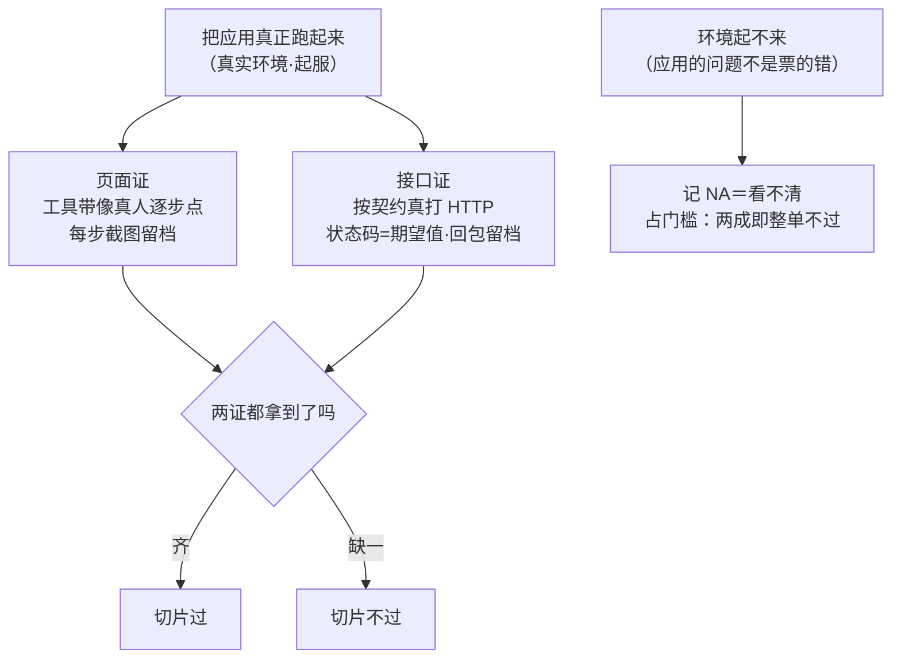
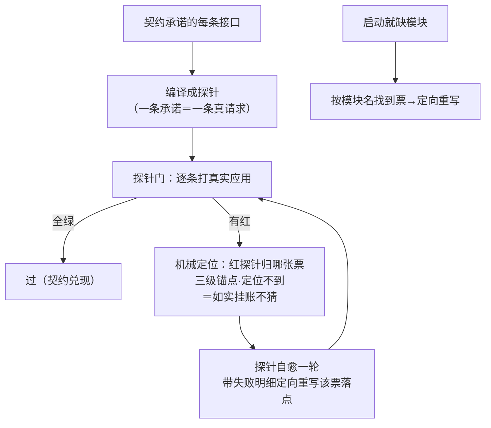
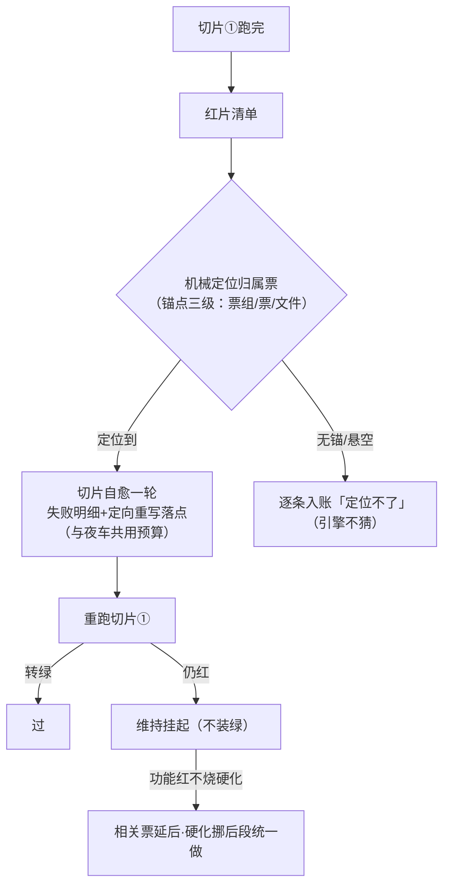
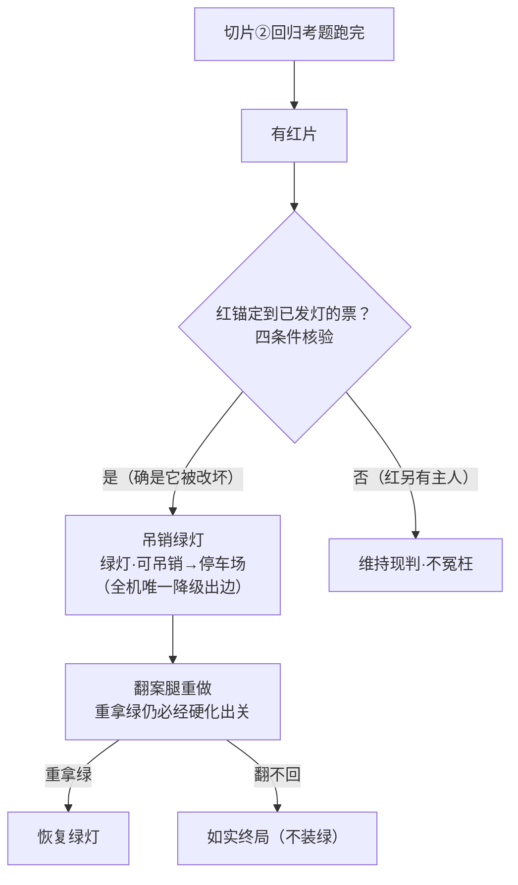
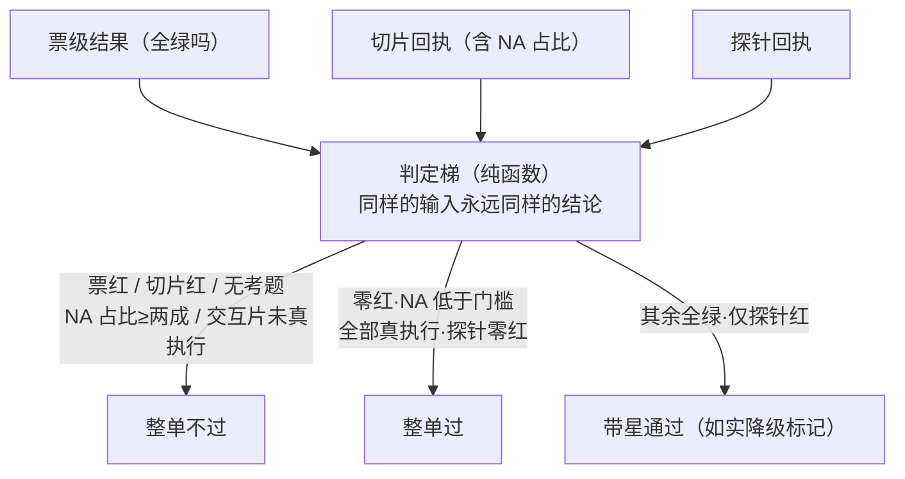
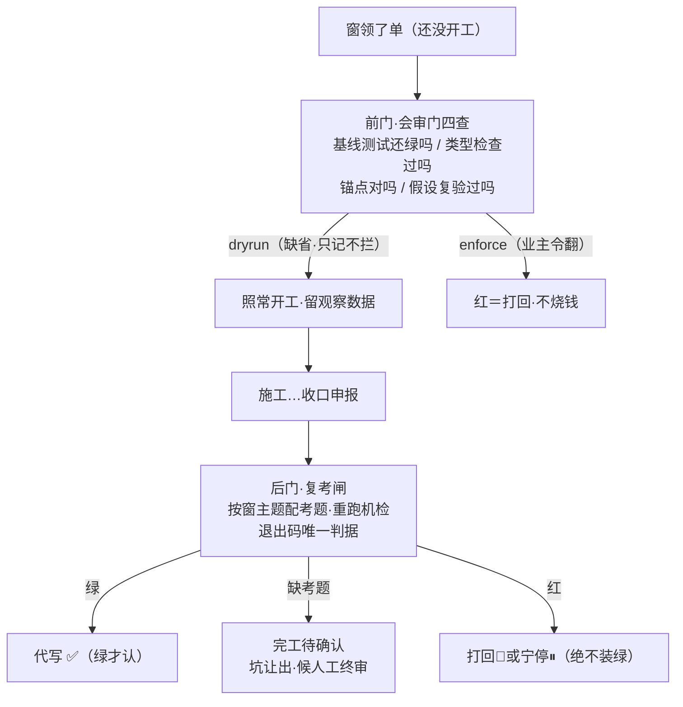
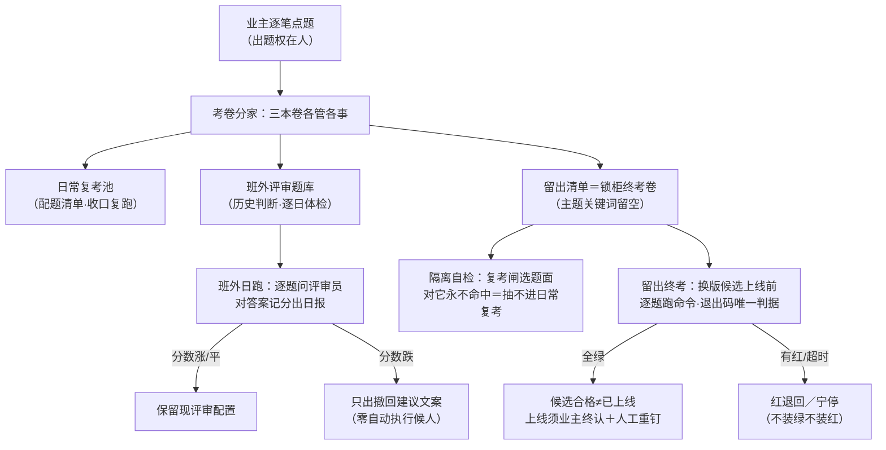

> **口径**：本卡话术/命名遵循《[00-话术统一口径正本](../00-话术统一口径正本.md)》（拍板#312）——双名制首现双写·撞车词带消歧（窗票/工序票·判色/判分）·两层口径 L1 车间（票级）/L2 派工台（窗级）。
> **消歧（本册·口径正本 §3）**：「判定梯」＝交卷判分梯（L1·R13）；「会审门」＝领单体检门（L2）；「复考闸」＝交活重考闸（L2）；「三关」含收包验货关/立票验单关；「票」＝工序票（L1）。
> **事件名速查（口径正本 §4·拍板#316① W-234 双名化落册）**
> - R13 判定梯 → **交卷判分梯**（L1 验收→汇报·闸）
> - 会审门 → **领单体检门**（L2 领单前门·Shadow Mode）
> - 复考闸＋考题库 → **交活重考闸**（L2 交活后门）
> - 其余（双证切片/探针门/段2.7 功能门/回归翻案/班外评测与留出核账）→ 候正名（起服守卫卡面在册⑨）
> - 双名制：首现双写「标准事件名（现行短名）」·短名机检永不改；§4 空缺→候正名不硬造名

# 机制卡册④ · 验收与判定（6 卡·批1 收尾·2026-10-28）

> **本册管什么**：「干完了」和「干好了」之间的全部判定机制——第一层怎么验收票和切片（双证/探针/功能门/翻案/判定梯），第二层怎么验收窗（会审门前门+复考闸后门）。全册一条铁律：**未知≠通过，NA≠PASS，绿才认**。图版=同目录 04-验收判定册.html。

---

## 卡31 · 双证切片（业内名：双见证验收·未知≠通过）

**harness 层**：harness第一层 · 站5（切片验收）

**一句话**：票级绿灯只算「工人自报」——站5 把应用真跑起来，像真人一样点页面、像调用方一样打接口，两条独立证据都拿到才算这个切片过；环境看不清记 NA，但 NA 绝不等于通过。

**术语白话对照**：`双证`＝两条互相独立的证据线（页面真实操作+接口真实调用）——一条证据可能骗人，两条独立证据都吻合才算数；`NA`＝「环境原因无法判定」——不是通过，是如实说看不清；`NA 占比门槛`＝看不清的切片超过两成，整单直接判不过（防「59 个看不清 + 1 个过=整单过」的放水口）；`交互片未真执行`＝要点页面的考题如果没真点，视同失败。

**口述**：工人说「我做完了，我自己的验收命令是绿的」——验收官说：我自己再考一遍。把你的应用真的跑起来：像用户一样一步步点页面（每步截图），像别的程序一样真打你的接口（状态码对不上就红）。两条证据互相独立——页面好看不代表接口对，接口对也不代表页面能用。应用起不来？记「看不清」，但看不清的切片多了，整单就是不合格：**看不清从来不等于通过**。

**锚**：slice-runner.ts:3（双证头注）·:43（页面证+接口证判据）·:63（双证不满）·:75（状态码比对）｜业内对照：evidence-based acceptance；NA≠PASS＝fail-safe 三值逻辑｜变式：L2 班次判定梯（W-149 出卡·NA 平移）·完工待确认＝窗级 NA｜红线：判卷语义一寸不动；NA 不许析取成 PASS。

---

## 卡32 · 探针门＋探针自愈（业内名：契约探针门·带自愈）

**harness 层**：harness第一层 · 站5（探针门）

**一句话**：把契约里的每条接口承诺变成真实请求逐条打一遍——红了先机械定位「归哪张票管」，定向重写一轮再打；启动就缺模块的，按模块名找到票重写。

**术语白话对照**：`探针`＝契约里每条接口承诺的「实测版」——契约说有这个接口，探针就真的发一次请求验证；`三级锚点`＝红探针找归属票的三级线索（多票组→单票→文件），三级都定位不到＝如实入账「定位不了」，**引擎不猜**；`探针自愈一轮`＝带失败明细重写归属票的落点文件，一轮为限；`启动缺模块`＝应用一起来就报缺某模块——按模块名反查是哪张票的落点。

**口述**：验收命令证明「工人自己的考题过了」，探针证明「契约的承诺兑现了」——这是两条独立的证据线。探针红了不慌：先定位归谁管（考题里写了锚点，三级往下找），定位到就带失败明细重写那票的文件，再打一遍；定位不到就如实挂账「定位不了」，绝不瞎猜乱修。应用连启动都报缺模块？按模块名反查是谁的落点，定向重写。全程与票级绿灯无关——探针是契约的证据线，不动票的位子。

**锚**：run-slice.ts:169（编译探针）·:238（探针门）·slice-selfheal.ts:101（启动缺模块自愈）｜业内对照：contract testing（契约测试的机械版）｜变式：站4 回喂自愈环＝长版（册②卡15）·段2.7＝切片版（卡33）｜红线：重生成只改归属票落点；无锚不猜入账；判卷零触碰。

---

## 卡33 · 段2.7 功能门（业内名：定位→修复→重跑回路）

**harness 层**：harness第一层 · 站5（段2.7 功能门）

**一句话**：切片①有红片，先机械定位「归哪张票」，再给那张票一次带失败明细的定向重写（一轮），重跑切片①——定位不到如实挂账，修不好维持挂起，绝不装绿。

**术语白话对照**：`功能门`＝切片①跑完后的「分诊+修复」关卡（段2.7 的名字=流程段落编号）；`锚点三级归属`＝红片找主人三级线索：多票共考的题（票组）→单票题→按文件匹配——找不到主人就逐条入账「定位不了」（slice_red_unlocatable 事件），**引擎不猜落点**；`切片自愈一轮`＝把失败明细（哪片红、为什么）喂给写码工人定向重写，一轮为限；`功能红不烧硬化`＝功能还没全绿的票先「延后硬化」，等功能门收口再统一硬化——省得硬化了又改。

**口述**：切片①红了，第一件事不是修，是**找主人**：这片红归哪张票？考题里写了锚点，三级线索往下找——找到就带着失败明细重写那票的文件（一轮为限，和夜车共用预算，烧飞照刹）；找不到主人就如实记账「定位不了」，绝不瞎猜乱修——猜错地方修，比不修更糟。修完重跑切片①；修不好维持挂起。功能红的票还有个贴心设计：硬化先延后——等功能门全部收口，再统一硬化，避免反复烧。

**锚**：run-slice.ts:251（功能门调用）·stage27.ts:20（组合根）·slice-triage.ts:23（定位）·slice-selfheal.ts:37（自愈）·:101（缺模块自愈）｜业内对照：triage + bounded repair loop｜变式：探针自愈=同构（卡32）·站4 ⟲≤3=长版（册②卡15）｜红线：⟲1 一轮；共用夜车预算；无锚不猜。

---

## 卡34 · 切片②回归翻案（业内名：回归测试＋绿灯吊销）

**harness 层**：harness第一层 · 站5→停车场（翻案腿）

**一句话**：切片②专抓「回归」——后来改的票把前面已发灯的票弄坏了。回归红锚定到绿灯票，绿灯当场吊销、回停车场重做；这是全机唯一让绿灯往下走的通道。

**术语白话对照**：`切片②`＝回归考题——专考「后来的改动有没有弄坏前面已完成的功能」；`翻案`＝吊销已发的绿灯、强制重做（业主拍板#54 件③）；`四条件核验`＝确认「红真的是这张绿灯票被改坏造成的」才吊销——不冤枉好票；`唯一降级出边`＝全机绿灯往下走的唯一通道就是这条——其他任何路都到不了；`重拿绿仍必经硬化出关`＝吊销重做后想再拿绿，还是得过全套三钥匙——便利通道不存在。

**口述**：为什么已发灯的票还要再考一次？因为「后来的人改坏了前面的人」是工程里最阴的病——每张票单看都绿，合起来前面绿的被弄红了。切片②就是回归考题。考出红且锚定到绿灯票：四条件核验确认是它被改坏——绿灯当场吊销，回停车场重做。注意两个「唯一」：这是全机绿灯**唯一**的降级出口；重拿绿**唯一**的路还是硬化出关。翻不回来就如实终局——不装绿。

**锚**：run-slice.ts:39（翻案腿装配）·night-shift/regression-leg.ts（翻案腿本体）·ticket-state.ts:47（唯一降级出边）｜业内对照：regression testing + green revocation｜变式：L2 完工待确认翻🔁＝窗级同构（卡38 邻域）｜红线：唯一降级出边；重拿绿唯一入边=硬化出关（三钥匙不破）。

---

## 卡35 · R13 判定梯（业内名：聚合健康判定·未知不等于健康）

**harness 层**：harness第一层 · 站6（判定梯）

**一句话**：一整晚所有票和切片的结果，由一个纯函数压成一句话——票红、切片红、考题缺失、NA 占比超两成、交互片没真执行，任何一个都直接判整单不过；探针红其余全绿给带星通过（如实降级）。

**术语白话对照**：`NA 占比门槛（两成）`＝看不清的切片达到两成，整单判不过——「大量看不清+少数过」不放行；`交互片未真执行`＝要点页面的考题没真点＝视同失败（防「跑了个空壳也算执行」）；`PASS*（带星通过）`＝只有探针红、其余全绿——如实标注降级，让业主知道星在哪儿；`纯函数`＝不读钟、不读随机、只吃输入——同样的输入永远同样的结论（可复算）。

**口述**：一晚上几百条结果，业主只想要一句话。判定梯把三路证据（票/切片/探针）压成一个三态结论，而且是个**死脑筋**：切片看不清？累计——看清的不到八成，整单不过；交互考题没真点？不过。它唯一的「温柔」是带星通过：探针红了但其他全绿，给个带星的过——星就是「这里有一处没验完」的如实标记。铁律一条：**看不清不是看清了**——NA 永远不会在梯子里变成绿。

**锚**：ladder.ts:13（NA 门槛 0.2）·:32（判定函数）·:38（FAIL 判据行）｜业内对照：aggregate health verdict·UNKNOWN≠HEALTHY（fail-safe 三值逻辑）｜变式：L2 班次判定梯（W-149 出卡·本梯平移）·完工待确认＝窗级 NA（**实测补注 20261029·勘误三**：NA 语义两层有意分歧——L1 占比容忍〔切片粒度·NA_RATIO_GATE=0.2·NA<20% 可绿〕/L2 单件零容忍〔窗粒度·任一完工待确认即班黄〕·真机对拍 1/6 NA→L1 PASS vs L2 班黄·拍板#231 拍定卡面声明）｜红线：纯函数零新数据源；NA 不装绿；判卷语义零触碰。

---

## 卡36 · 会审门＋复考闸（业内名：前门体检＋后门重考·渐进开闸）

**harness 层**：harness第二层 · 派工链（验收双门）

**一句话**：第二层给施工窗设两道验收门——前门（会审门）：领了单没开工先跑基线体检，地基绿才放行；后门（复考闸）：窗宣称完工，按考题库重跑考题，绿才认✅；新闸上线先「只记不拦」，业主令才翻实拦。

**查③词面补注（2026-11-01 W-234·拍板#316①·W-208 候卡清偿·只加不改）**：前门四查之查③「锚点对吗」＝**现行行号实勘**——锚列以现行码位复勘值为准（2026-11-01 W-231 同源复勘·与 00-机制总索引卡 卡37 行同值·史值注记在锚行内）；锚漂走失效触发流程复验，不凭记忆报行号。

**术语白话对照**：`会审门`＝领单后、开窗前的四查体检（基线测试/类型检查/锚点对不对/假设复验）——地基不绿不开工；`dryrun→enforce`＝新闸上线先「只记不拦」观察一班，业主看着数据下令才翻「真拦」（渐进开闸制·规则已成文）；`复考闸`＝窗宣称完工后，按考题库（两份清单按窗主题配题）重跑机检验收命令——退出码唯一判据；`缺考题=完工待确认`＝没有配题的窗不代写✅，进第八态坑让出，人工终审；`🔁/🔵 不复考`＝方向题流不受扰（终态尊重）；`W-088 挂载`＝复考开考前先跑一遍窗收口终态断言（window_assert：不变量＋产物锚存在性·拍板#135①·exit code 唯一判据）。

**口述**：两道门管住一个窗的一生。前门在开工前体检：地基测试还绿吗？类型检查过吗？领的基准对吗？任务书里的假设成立吗？——目前是「只记不拦」的影子模式，业主看了观察数据才下令翻真拦。后门在完工后重考：窗说干完了，复考闸从考题库按窗的主题配题重跑——绿了才认✅；没配题的窗不装绿，进完工待确认让坑，人工终审。两道门中间的活儿靠窗内自愈环自己管——门只管两头，不插手过程。

**复考范围限语（pi_runner.ts:34·拍板#294④ 补注 2026-10-31）**：首批只罩工具层/文档/通道窗——ts 码件窗不复考，候真班三班＋判定梯五布尔语义缺口另拍。**候拍面**：产物锚存在性→活体性强化（锚指向零字节/空产物=直接红·E10 零提交预闸同构·主窗 20261031 对账申报）。

**锚**：pi_runner.ts:390-412（会审门·AFK_REVIEW_GATE 三态·REVIEW_GATE_TIMEOUTS:403/reviewGateMode:407）·:600-623（runReviewGate 本体·四查执行）·:625-636（dryrun 观察留痕·reviewGateLogAppend）·:32（考题库重跑·exit code 唯一判据头注）·:2985/:2992-2995（runReexams 执行体＋W-088 window_assert 挂载点·#135①）·考题库/（两清单）——2026-11-01 W-231 同源复勘·与 00-机制总索引卡 卡37 行同值（史值 :395-413/:619-622/:28/:2842-2849 系 W-217/W-208 时点）｜业内对照：pre-merge check + post-completion exam；shadow mode→enforce（渐进开闸）｜变式：L1 站3 三关=前门同构（册①卡2）·L1 判定梯=后门同构（卡35）｜红线：绿才认✅永不装绿；🔁/🔵 终态不复考；实拦翻转=业主令。

---

## 卡66 · 班外评测与留出核账（业内名：保留集评测·锁柜终考·考题分家）

**harness 层**：harness第二层 · 自举环（版本三本账步③考题分家＋步⑤留出核账）

**一句话**：引擎自己的考卷分成两本且与日常复考池分家——班外评审题库日常体检（逐题问评审员记分·涨留跌撤），留出清单是业主点定的锁柜终考（换版候选上线前才跑）；两本卷都由业主逐笔点题，评测器零自产零拷贝，撤回/上线零自动执行。

**图说明（逐节点注解）**：

- **业主逐笔点题**＝两本新卷的题目都只能业主手点（班外题库逐条 append-only·留出清单「1245要」点定九题）——评测器不设加题口（出题权红线·零自产零拷贝）。
- **考卷分家**＝三本卷职责互斥：日常复考池管「窗收口复考」（配题清单按窗主题匹配）；班外题库管「评审员日常体检」；留出清单管「换版候选的终考」。
- **主题关键词留空**＝留出清单的选题关键词组留空——复考闸选题面对任意窗主题都抽不中它，这就是「锁柜」的实现（数据驱动天然隔离·复考闸源码零改动）。
- **隔离自检**＝每场终考报告自带一次机器自证：选题匹配函数对留出清单零命中才开考（命中＝隔离破防·报罥候查）。
- **班外日跑**＝读题库逐题调评审员（桥接接线员同款通道·裸快模型）独立判断，对正确答案记分出日报；日上限 10 次超帽截断（班外维护账）。
- **涨留跌撤**＝分数比上一版：涨/平＝保留现评审配置；跌＝只在日报里写撤回建议文案——回退动作必须人工拍板，评测器零自动执行（判定函数只产字符串零副作用）。
- **留出终考**＝逐题真跑验收命令，退出码唯一判据（与复考闸同一套聚合判定函数单源复用零重写）；四态：空卷＝待命（如实 skip）/全绿＝候选合格/有红＝红/超时＝宁停。
- **候选合格≠已上线**＝终考绿只是「候选合格」，上线切换必须业主终认＋人工重钉版（沿卡65 钉版器）——评测道全程零状态改写零自动上线。

**术语白话对照**：`留出（holdout）`＝从日常练习里隔离出来的一小柜题，平时不用、终考才开柜——防考题泄进日常反馈环致分数虚高；`班外（postshift）`＝下班后的额外体检场（班外维护账·日上限 10 次调用）；`涨留跌撤`＝评审员成绩的处置四则：涨/平保留现配置、跌出撤回建议（撤回本身候人工）；`退出码唯一判据`＝考题是一组验收命令，进程退出码 0＝绿非 0＝红，不看输出猜结果；`四态 skip/green/red/pause`＝空卷待命/候选合格/候选有红/超时宁停——与复考闸四态同源；`重钉`＝换版上线后重跑钉版器把新版本写进铭牌（卡65）。

**口述**：学生不能只考老师上课刚讲过的题——日常复考池就像课后练习，考多了分数会虚。所以引擎给自己另备两本卷：班外题库每天抽几题问评审员「当时这么判对不对」，答对记分答错记错，比昨天跌了就写撤回建议放桌上——动不动手撤，人来定。留出清单更严：题目业主亲点、锁进柜里，选题面根本抽不到它；只有要换新版引擎时才开柜终考，全绿也只是「候选合格」，上线要业主终认＋重钉铭牌。全程评测器只出卷出分出建议，动版本、撤配置、上上线，一件都不自动做。

**业内对照**：holdout set / locked test set（机器学习留出集：终考卷与训练集隔离防泄露）＋ model evaluation harness（模型评测架：定期对评审员回归评测）＋ canary analysis gate（金丝雀门：候选版本过终考才放行）。差异：业内留出集多为静态数据集，本厂留出卷是「业主逐笔点定的验收命令清单」且隔离由选题面数据结构天然实现（空关键词组＝永不相交）。

**变式对照**：15 对全集指针＝`90-过程/handoffs/同构漂移实测报告-20261029.md` §1（不复制表）；**随卡申报：零未登记同构对**——实勘全集 15 对＋附带发现一条（卡60 已首登对除外），班外评测/留出核账属版本三本账 L2 自举环特有面，L1 无镜像件；语义近邻＝卡38 复考闸（同源复用而非同构：留出终考直接 import 复考闸纯函数族·零重写零 diff·出题权同旨册⑥卡51 出题权冻结）/卡35 判定梯（NA≠PASS 同族·空卷＝skip 如实待命）/卡34 回归翻案（绿可吊销同宗：跌＝撤回建议，但执行权在人）。

**锚点表（file:line·出卡亲验·HEAD=a0e7312·2026-10-29·批A 切换注记：两主件=班外评测跑/留出核账跑均属 W-154/W-160 件·批A 四件外仍 .mjs·头注如实写明）**

| 锚 | 亲验行内容 |
|---|---|
| 91-脚本/班外评测跑.mjs:1-18 | 头注：班外评审题库日跑器（动作九·拍板#216 组一 B3/B4·W-154）·涨留跌撤·撤回零自动执行 |
| 91-脚本/班外评测跑.mjs:39 | DEFAULT_DAILY_CAP=10（B4 班外维护账·日上限 10 次调用） |
| 91-脚本/班外评测跑.mjs:56-71 | parseQuestionBank 四键门（输入/当时判断/正确答案/来源事件锚·缺键=坏行如实不装数） |
| 91-脚本/班外评测跑.mjs:105-113 | judgeTrend 涨留跌撤纯函数（首跑记基线/涨平留/跌产撤回建议字符串·零写零回调副作用） |
| 91-脚本/班外评测跑.mjs:116-123 | capDaily 日上限截断（超帽阁置候明日·WARN） |
| 91-脚本/班外评测跑.mjs:126-143 | runPostshiftEval 主编排（空库=skip 如实零调用/调用败=记错 fail-closed） |
| 91-脚本/班外评测跑.mjs:168-183 | summarizeScorebook 记分账末条投影（坏行容错·空账=null） |
| 91-脚本/班外评测跑.mjs:225 | --selftest 八案（沙盒零真盘零真 key·桩 LLM） |
| 91-脚本/留出核账跑.mjs:1-24 | 头注：留出核账（拍板#220·版本三本账步⑤·W-160）——留出清单=锁柜终考与日常复考池分家 |
| 91-脚本/留出核账跑.mjs:26-30 | 同源复用：import pi_runner 复考闸纯函数族四件（零 diff·非重写） |
| 91-脚本/留出核账跑.mjs:58-86 | renderReport（隔离自检零命中行/逐题 exit 判/三态文案/红线行「绿=候选合格≠已上线」） |
| 91-脚本/留出核账跑.mjs:88-118 | runCore（清单坏=红考卷也是卷/空卷=skip/逐题 spawnSync 超时宁停/reexamVerdict 四态单源） |
| 91-脚本/留出核账跑.mjs:121 | --selftest 沙盒四案（零真盘用完即焚·案4 零状态改写快照断言） |
| 91-脚本/考题库/清单-留出核账.json | 留出清单：match_主题含=[]（隔离实现）·九题业主点定（「1245要」四选＋5-1~5-5 已拍定）·出题权红线注 |
| 91-脚本/pi_runner.ts:233-256 | 复考闸纯函数族单源（matchExamLists/aggregateExamResults/summarizeReds/reexamVerdict） |
| 91-脚本/班次汇报聚合器.ts:32,246-256 | 消费方：班报第五节班外评测（summarizeScorebook 只投影不判断·null 不渲染） |
| 91-脚本/班次汇报聚合器.ts:272-273 | 头栏班外评测摘要（最近一跑分数与涨跌·指向第五节） |
| ts/src/run-slice.ts:137-140 | 邻闸互指：换版上线后钉版闸重验新铭牌（卡65·步②⑤闭环） |

**红线**：出题权归业主——两本卷零自产零拷贝·评测器不设加题口；留出清单只读·内容候业主点定；撤回零自动执行（跌只产文案）；零状态改写零自动上线（绿=候选合格≠已上线·上线须业主终认＋人工重钉）；复考闸/判卷语义/pi_runner 源码零触碰（单源 import 不改）；push 由人·凭据零涉。

**失效触发＋防重复指针**：失效触发＝清单 schema 再修订/评审通道换模型换提示词（指纹随变·记分账逐条带指纹可归因）/留出清单加题或移题→本卡逐锚复验；matchExamLists 命中数>0→隔离破防报罥候查。防重复：对比件＝`90-过程/handoffs/对比流程-动作九留出分割与班外评测集-现状vs改后-20261028.md`（拍板#216）；复考闸正本＝册④卡36 只互指；出题权冻结＝册⑥卡51；NA≠PASS 通则＝卡35/册⑦卡56；钉版器＝卡65（版本三本账步②·本卡步③⑤同账接力）。

---

## 册④ 尾注 · 同构轴

7 卡是「干完了→干好了→整单结论→引擎自己也受考」的判定链：**双证切片（卡31）真跑真验 → 探针门（卡32）验契约 → 段2.7（卡33）红了就修 → 翻案（卡34）绿了也吊销 → 判定梯（卡35）压成一句话 → L2 双门（卡36）管窗的一生 → 班外评测与留出核账（卡66）管引擎换版自己过终考**。全册一条铁律：**未知≠通过（NA≠PASS）·绿才认·翻案走唯一通道·便利通道不存在·候选合格≠已上线**。

**锚点验证**：1feb0f5 逐卡实锚（slice-triage:23 为本次抓新值；ladder:38 FAIL 判据行为增强锚）。
