> **口径**：本卡话术/命名遵循《[00-话术统一口径正本](../00-话术统一口径正本.md)》（拍板#312）——双名制首现双写·撞车词带消歧（窗票/工序票·判色/判分）·两层口径 L1 车间（票级）/L2 派工台（窗级）。
> **消歧（本册·口径正本 §3）**：「授权面」＝票单（L1）/窗单（L2）；「判定梯」＝收班判色梯（L2·判班）；「熔断」＝收班复盘器（审批熔断）；「票」＝窗票（L2）。
> **事件名速查（口径正本 §4·拍板#316① W-234 双名化落册）**
> - 方向题闸 → **拿不准停车请示闸**（L2 干活中·闸）
> - 审批卡异步道 → **候批回执道**（L2 立票驻留）
> - 班次汇报聚合器 → **收班报** · 班产效率账 → **收班工时账**
> - 班次判定梯 → **收班判色梯**（L2 收班判班）· 审批熔断与风险分级 → **收班复盘器（62a）／领单定档闸（62b）**
> - 其余（晨报投影/追认撤回/丙级规格修正/票面授权面/代拍追认制）→ 候正名
> - 双名制：首现双写「标准事件名（现行短名）」·短名机检永不改；§4 空缺→候正名不硬造名

# 机制卡册⑤ · 汇报与追认（8 卡·批2·2026-10-28）

> **本册管什么**：机器干完活之后，「人怎么知情、怎么认可、怎么撤回」——晨报怎么可信、代拍怎么追认、错了怎么撤、窗里的选择题怎么推给业主。图版=同目录 05-汇报与追认册.html。

---

## 卡39 · 晨报纯投影（业内名：事件溯源投影 / CQRS 读模型）

**harness 层**：harness第一层 · 站6（晨报投影）

**一句话**：晨报不生产事实，只转写事实——夜里每件事先进流水账，晨报只是把账本按栏目重新排一遍；想核对晨报，翻账本重放即可。

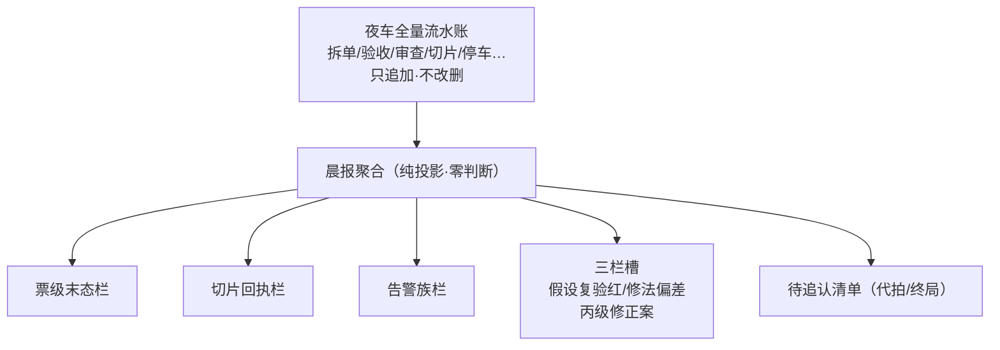

**术语白话对照**：`投影`＝只读转写——从唯一事实源（流水账）算出视图，自己不产生任何新事实；`无独立数据源`＝晨报没有自己的小账本，全部数字都能在流水账里找到出处；`三栏槽`＝施工期发现三类计数（假设复验红/修法偏差/丙级修正案），有数据才渲染；`代写✅禁区`＝晨报永远不代替任何闸做判断。

**口述**：晨报为什么可信？因为它想撒谎都做不到——它没有自己的记忆，每一个数字都是从全厂唯一的流水账里算出来的。想核对？翻账本重放一遍，分毫不差。这堵死了「汇报美化」的路：账本里没有的功劳，晨报编不出来；账本里有的事故，晨报也藏不住。

**锚**：morning-report.ts:56,70,284（三栏槽/聚合/投影）·:171（决策行双写正本名「中文名（码）」·#268/W-195）·event-types.ts｜业内对照：Event Sourcing 读模型（CQRS）｜变式：L2 班次聚合器（卡46 同构）｜红线：零判断·零新增数据源。

---

## 卡40 · 业主追认＋一键撤回（业内名：人工回路＋补偿事务）

**harness 层**：harness第一层→harness第二层（缝·追认）

**一句话**：机器夜里代拍了几十笔，早上业主一键批量追认——追认错的可以一键撤回；撤回本身也入账，翻账不抹账。

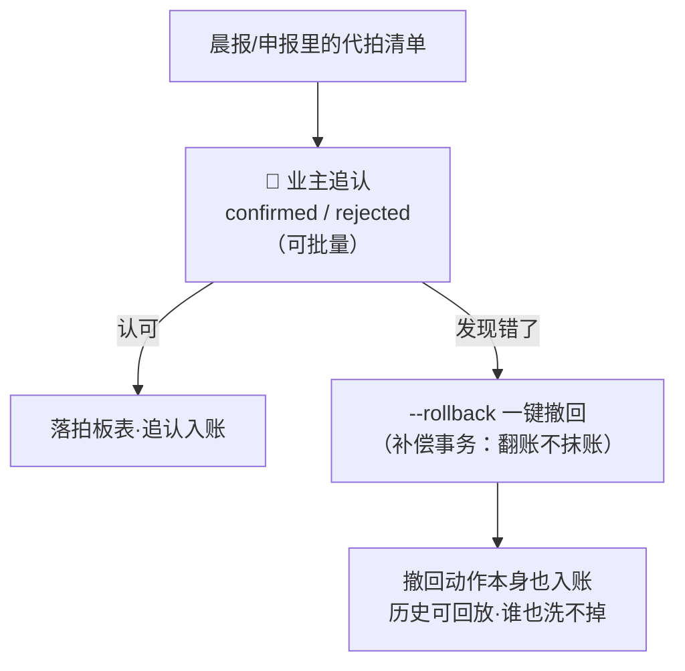

**术语白话对照**：`追认`＝业主对机器代拍动作的事后认可（confirmed=认可/rejected=驳回）；`批量追认`＝几十笔一起确认，不必逐笔；`--rollback`＝补偿事务：发现追认错了，一键把账翻回去——注意是「翻」不是「删」，撤回动作本身也是一条账，历史完整可回放。

**口述**：自主系统的信任闭环=「先干后认+错了能翻」。夜里机器自决几十件事，早上聚成一页清单；业主批量追认——常态下这是十秒钟的事。真追认错了？--rollback 一键翻回，而且翻回这个动作自己也进账本：任何时刻打开账本，能看到「当时代拍了什么、业主何时认可、何时又为何翻回」。整个系统错得起，因为每一步都留了痕。

**锚**：event-types.ts:82（owner_confirmed/rejected）·confirm CLI（拍板#12）｜业内对照：Human-in-the-loop + Saga 补偿事务｜变式：完工待确认翻🔁＝窗级同构（册③卡27）｜红线：翻账不抹账；追认不回写票级状态机（终局无出边）。

---

## 卡41 · 丙级规格修正（业内名：规格修正案的法定通道）

**harness 层**：harness第一层（丙级通道）

**一句话**：施工时发现「图纸好像不对」——施工窗绝不亲手改规格，只立一张「建议修正」的票附证据进候批；规格改不改，永远是业主的事。

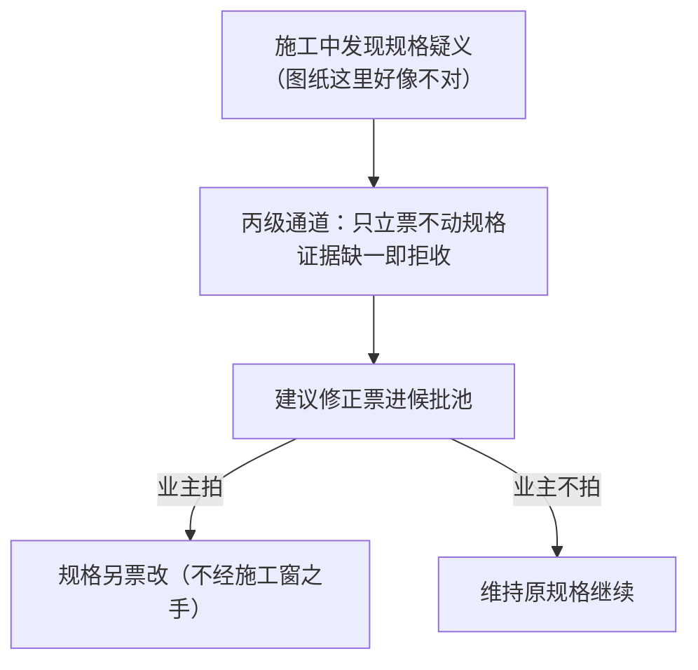

**术语白话对照**：`丙级`＝修正案三档里最轻的通道（对比：甲/乙级是更大的规格变更流程）；`只立票不动规格`＝施工窗发现疑义的唯一合法动作是「立票建议」，规格文件一个字都不许碰；`证据缺一即拒`＝立票必须附完整证据（哪里疑/为什么/建议什么），缺一样机检直接拒——防「顺手改规格」。

**口述**：工人施工时觉得图纸不对——直接改图纸是大忌：图纸是业主的出题权，改了就分不清「是图纸错了还是工人想偷懒」。丙级通道给了合法出口：立一张「建议修正」票，证据齐全（哪里疑、为什么、建议怎么改），进候批池等业主拍。业主拍了，规格另开一票正经地改；不拍，维持原规格继续干。施工窗从头到尾没碰规格一个字。

**锚**：spec-amendment.ts·拍板#35｜业内对照：change request channel（变更请求法定化）｜变式：方向题闸（卡43）=同一「不越出题权」红线的另一形态｜红线：施工窗零改规格；证据缺一即拒。

---

## 卡42 · 票面授权面 latitude/escalate（业内名：预授权自主范围）

**harness 层**：harness第一层 · 票契约

**一句话**：任务书里圈出「这些事你可以自己拿主意」——圈内自决但要留痕候追认，圈外一步就推卡候批；还有升级触发器：限次、预算、触红线即停。

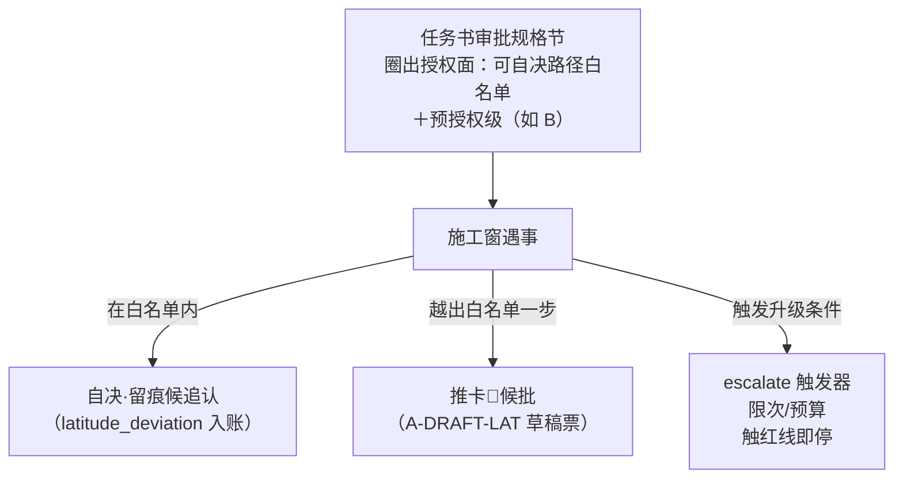

**术语白话对照**：`授权面`＝任务书圈出的自主范围（可自决哪些路径+预授权级别）——没写=没有授权面=逐案报；`留痕候追认`＝面内自决不是不报，是「先干+记账」，晨报里业主看得见；`推卡🔵（A-DRAFT-LAT）`＝越面一步就生成一张标准草稿卡推给业主，自己停；`escalate 触发器`＝票面上预设的「到什么条件必须升级」（重试限次/预算水位/触红线即停）。

**口述**：授权面解决窗里最高频的纠结：「这事我自己拿主意还是等业主？」任务书圈出白名单后答案清晰：圈内干+留痕（事后业主看得见、可推翻）；圈外一步都推卡。三档分级让「胆子」有了精确刻度。红线画死：出题权、判卷权、规格域——这三样永远不进授权面，写多大胆都没用。

**锚**：types.ts:185-207（三字段 schema）·latitude 消费道（W-119 落地）｜业内对照：pre-authorized autonomy scope｜变式：L2 代拍追认制（卡45）=两层同构｜红线：出题权/判卷权/规格域永不进授权面。

---

## 卡43 · 方向题闸（业内名：方向选择题联锁）

**harness 层**：harness第二层（方向题闸）

**一句话**：施工中撞见「方案级分歧」——不是 bug，是「另一种做法也能对，但和任务书规定的路不一样」——窗不许自作主张，推一张蓝卡给业主，自己停下。

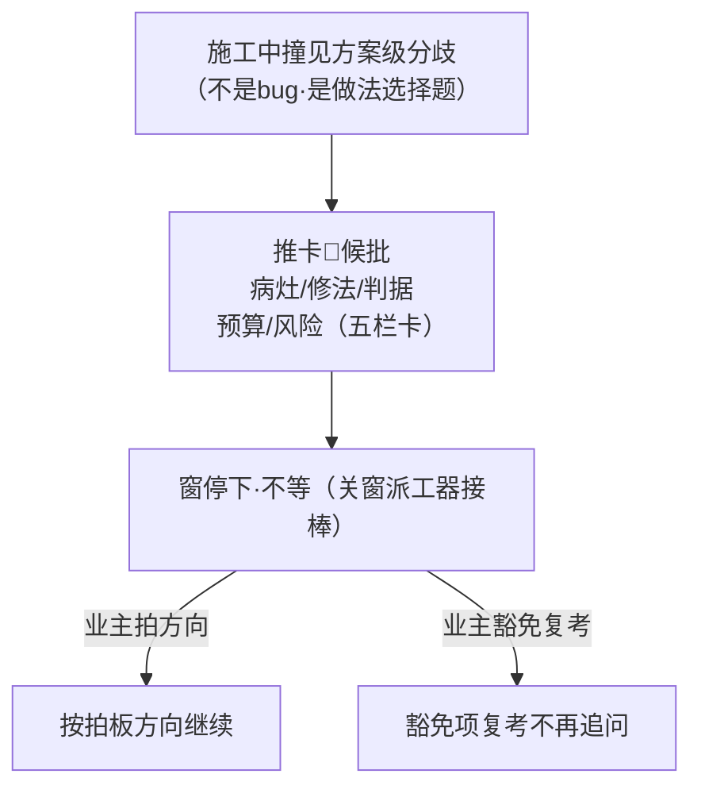

**术语白话对照**：`方向题`＝与 bug 的分界：bug 是「照规定的路走错了」，方向题是「另一条路也能到终点但不是规定的路」；`推卡🔵`＝标准五栏卡（病灶/修法/判据/预算/风险）推给业主；`复考豁免`＝业主在卡上明确豁免的项，复考闸不再追问；`停·不等`＝推卡后窗停止该方向的工作，派工器把槽位让给别的票。

**口述**：施工最危险的不是错——错有验收命令拦着；最危险的是「另一种也对的做法」：做对了分不清是谁的主意，做错了说不清谁的责任。方向题闸把这类选择题全部标准化：窗撞见就推五栏蓝卡，自己停；业主拍完方向拿回继续。与授权面的分界一句话：授权面管「面内的小自决」，方向题闸管「面外的路線选择」——后者永远业主拍板。

**锚**：pi_runner.ts:227,3078-3086,3207（方向题闸三处：复考豁免/出卡 CLI/收割方向题标记）｜业内对照：escalation interlock｜变式：审批卡异步道（卡44）=推卡后的接力机制｜红线：方向题禁止窗内自决（与 latitude 的分界=是否改变方案路线）。

---

## 卡44 · 审批卡异步道（业内名：异步审批工作流）

**harness 层**：harness第二层（审批异步）

**一句话**：推卡之后窗不用干等——问题做成标准审批卡发到业主手机，业主随时批；轮询器定期把批复拉回来交叉核对后落表，窗接着干。关窗不丢活。

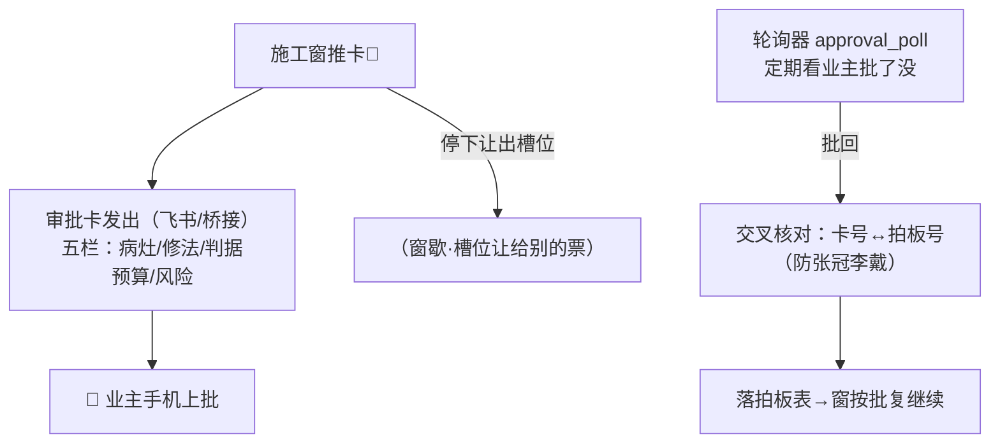

**术语白话对照**：`审批卡`＝标准五栏问题卡——病灶（什么问题）/修法（建议怎么改）/判据（怎么算改对）/预算（花多少）/风险（不批会怎样）；`轮询拉回`＝approval_poll 定期看业主的批复并拉回；`交叉核对`＝拉回的拍板号与卡上的对账——防「批的是 A 卡落到了 B 卡」的张冠李戴；`关窗不丢活`＝窗停了但卡还在流转，批复回来换窗接着干也行。

**口述**：推卡之后窗歇着，但活不丢——审批卡飞到业主手机，业主地铁上就能批；轮询器定期把批复拉回来，交叉核对卡号拍板号无误后落表，窗按批复继续。W-090 实战：业主在外面手机上批完，窗无缝续跑。这套机制把「等人」从阻塞变成了异步——人的时间碎片化了，机器的活却不断。

**锚**：approval_poll.mjs·pi_runner.ts:288（W-090 实战）｜业内对照：async approval workflow｜变式：方向题闸（卡43）=发卡的前半段｜红线：拍板号交叉核对防张冠李戴。

---

## 卡45 · 代拍与追认制（业内名：委托决策＋追认制）

**harness 层**：harness第二层（代拍制）

**一句话**：窗里的小决策画死六条禁区——禁区外允许机器代拍但必须留全「四件套」证据；晨报聚合清单给业主批量追认；错了解决方案是撤回不是隐瞒。

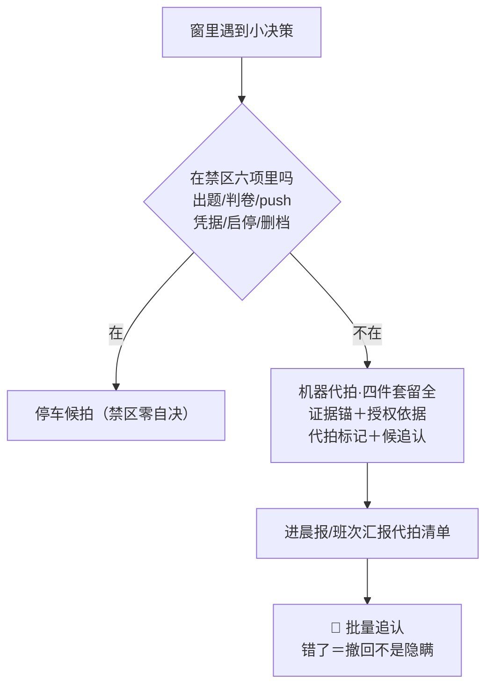

**术语白话对照**：`禁区六项`＝六类永远不许机器自决的事（出题/判卷/push/凭据/启停/删档——以规则文件正本为准）；`代拍四件套`＝机器代拍必留的四样：证据锚（凭什么这么拍）/授权依据（谁授的权）/代拍标记（明示这是代拍）/候追认（等业主过目）；`批量追认`＝晨报聚合清单一键确认；`撤回不隐瞒`＝追认错了走 --rollback，撤回本身入账。

**口述**：窗里每天几十个小决策，事事叫业主=瘫痪，全自决=失控。代拍制的解法分三步：画死禁区（六类碰都不许碰）；禁区外允许代拍但四件套证据留全（凭什么/谁授权/是代拍/等过目）；晨报聚合清单批量追认——追认是常态（十秒钟），撤回是保险（一键翻回）。错误的代拍在系统里「错得起」：因为每一步都留痕，没有不可翻的账。

**锚**：规则-代拍与追认制.md·拍板#151①②·#12｜业内对照：delegated authority with ratification｜变式：审批卡（卡44）=同步问·代拍=先干后认；授权面（卡42）=票面级同构｜红线：禁区六项零自决；代拍四件套缺一=违规。

---

## 卡46 · 班次汇报聚合器（业内名：班次报告聚合）

**harness 层**：harness第二层（班次汇报）

**一句话**：把一个班次里所有窗的申报、所有代拍、所有候拍、所有追认聚成一页三节——数字与拍板表机械对账；再配 W-149 判定梯给整班一个绿黄红总评。

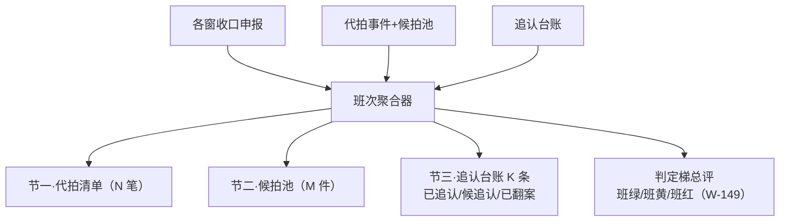

**术语白话对照**：`三节`＝班次汇报的三大块：代拍清单（机器自己拍了什么）/候拍池（等着业主拍的）/追认台账（已追认/候追认/已翻案三态）；`N/M/K 计数对账`＝三节的数字与拍板表机械核对（对不上=红）；`判定梯总评`＝W-149 出的整班绿黄红（窗完工待确认=班黄·绝不装绿）。

**口述**：业主的「不定时了解进度」怎么满足？班次聚合器把散在各窗的申报自动聚成一页三节，数字与拍板表机械对账（对不上当场红）。业主打开一页就知道：这个班机器自己拍了 N 笔（都可翻）、还有 M 件等拍、K 条已追认。配上整班绿黄红总评，十秒钟掌握一个班。

**锚**：班次汇报聚合器.ts:271（三态推导）·W-124（拍板#170）｜变式：L1 晨报投影（卡39 同构）（**实测补注 20261029·勘误三**：NA 语义与 L1 判定梯有意分歧——本梯单件零容忍〔任一完工待确认即班黄〕/L1 占比容忍〔NA<20% 可绿〕·拍板#231 拍定卡面声明）｜红线：聚合零判断·对账断言·判定梯 NA 不装绿。

---

## 卡60 · 班产效率账（业内名：usage accounting & telemetry aggregation·用量台账与遥测聚合）

**harness 层**：harness第二层（班次汇报的数据道·管理层成绩单的原料间·W-146 出卡·A类补卡批② 拍板#233①）

**一句话**：一个班干完，把本班每个窗烧了多少、跑了多久，从各窗的会话档里读出来聚成一页账——班怎么切、数从哪来、缺数怎么标，口径全写在账面上；它只报数不下判断，判断是判定梯（卡61）的事。

### 图（三源聚合流水·F 型）

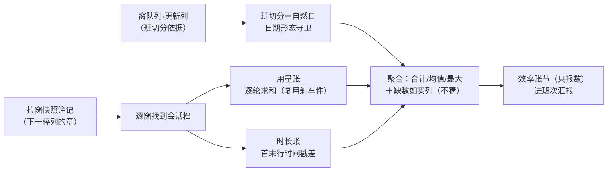

### 图说明（逐节点注解）

- **窗队列·更新列**：班切分的依据列——每行登记日期，本班＝日期≥班界的那批行。
- **拉窗快照注记**：拉窗器开工时在队列行注记里盖的时间戳章（「【快照 spawn 月-日 时:分】」形态），效率账靠它反查每窗的会话档文件。
- **班切分＝自然日**：以自然日为班界（拍板#216 组三 G2）·日期形态守卫＝长得不像「年年-月月-日日」的老格式行不归班如实剔除——防老行因字符串比较误归本班（W-087 式 12 列行的端到端对账红警教训）。
- **用量账**：会话档逐轮用量求和——直接复用窗预算刹车件（W-145）的同一套解析，一处实现零双写。
- **时长账**：会话档首行末行时间戳之差＝窗的最后活动跨度；时长与用量各算各的——有用量没时长（或反之）单侧缺失不互拖。
- **聚合**：只对有数的窗合计/求均值/找最大窗；读不出的窗进「缺数如实列」（无注记/档缺/解析未出数，每窗写明原因）——不猜不补不装数。
- **效率账节**：渲染进班次汇报第四节，纯投影；它自己不给班打绿黄红。

### 术语白话对照

`班产效率账`＝一个班（自然日）全部窗的用量＋时长汇总账；`班切分`＝把队列行按更新列日期划进某个班（自然日·拍板#216 G2）；`会话档`＝每个窗干活时留下的对话流水文件（一行一条·带时间戳）；`快照 spawn 注记`＝拉窗器在队列行盖的章（写明会话档是哪个＋几点拉的）；`sumSessionUsage`＝窗预算刹车件里的「逐轮用量求和」函数——效率账直接复用它算用量，不另写一套（W-145 零双写）；`snapshotDeltaMs`＝快照章时刻与会话档首行时刻的差（起点对照·只摆出来不判断）；`unknowns`＝没读出数的窗清单（每窗带原因）。

### 口述（一个班收工后的一页账）

夜跑收工，班长（班次汇报聚合器）要出班报，问效率账解析件：「这个班烧了多少？每窗跑了多久？」效率账件先把窗队列本班的行捞出来（更新列日期≥班界·长得不像日期的老行不收），再逐窗看注记里盖的快照章——章上写着会话档路径。有档的窗打开读：一行行流水，每行带时间戳和用量——用量逐轮加起来＝这窗烧了多少，首末行时间戳一减＝这窗跑了多久。读不出的（章也没有/档丢了/格式不对）如实记进缺数清单。最后聚成一页：合计、均值、最大窗，各带出数率（比如「出数 5/7 窗」——两窗缺数也写明）。班报拿这页账直接投影；判定梯（卡61）再拿这页账做预算审计——哪窗触了硬帽，是从这页账的数判出来的。

**未登记同构对·随卡登记（本卡＝首个登记点·拍板#233①）**：L1 `ts/src/efficiency-report.ts:64`（夜报效率账·读第一层事件账本聚合用量/时长/缓存命中率·按票/按批）↔ L2 `91-脚本/效率账解析.ts:81`（班产效率账·读第二层管理侧痕迹聚合·按窗/按班）——同构语义＝「读账聚合出效率成绩单·只投影不判断」；对象面差异＝L1 读自家事件账（结构化事件溯源），L2 读会话档＋窗队列（半结构化行级解析）。此对机制卡九册均未登记（同构漂移实测报告-20261029 :43「附带发现（未登记疑似对·候业主确认）…不入主证据链仅备案」）——本行即登记入卡·候业主追认。

### 业内对照

用量计费与遥测聚合（usage-based billing / telemetry aggregation：云厂商账单＝逐请求计量再聚合成单）＋读模型投影（CQRS 读侧·卡39 晨报同族——从账本读出视图绝不反写）。差异：云账单按计费项聚合，本厂按「窗×班」两个维度聚合；云账单缺数据重试补采，本厂缺数据如实列明不补（宁缺不猜）。

### 锚点表（file:line·出卡亲验·批A 切换注记＝效率账解析 .mjs→.ts 已于 W-163 收口（施工本笔 001aaec·2026-10-29）切换·本卡锚＝.ts 终态·HEAD=3877aa6·2026-10-29）

| 锚 | 亲验行内容 |
|---|---|
| 91-脚本/效率账解析.ts:35 | parseSessionSpan：会话档全档可解析时间戳行取首末→时长跨度；零可解析行/零时间戳行如实返原因 |
| 91-脚本/效率账解析.ts:61 | parseSnapshotStamp：【快照 spawn 月-日 时:分】形态解析·年份补正＋跨年窗回退（当前时刻+36小时外＝年-1） |
| 91-脚本/效率账解析.ts:81 | aggregateShiftEfficiency：班级聚合主口·纯读零写盘·会话档/用量/当前时刻可注入（selftest 沙盒） |
| 91-脚本/效率账解析.ts:85-87 | 班切分日期形态守卫：更新列命中「年年-月月-日日」且≥班界才归班（老格式行剔除·W-087 红警实锚） |
| 91-脚本/效率账解析.ts:104-108 | 时长独立于用量：各记各·单侧缺失不互拖；起点对照（快照章时刻减首行时刻）只投影不判断 |
| 91-脚本/效率账解析.ts:112-114 | 用量聚合：只就有数窗合计/均值/最大·零窗＝空（不装 0） |
| 91-脚本/班次汇报聚合器.ts:29 | 消费方 import 行（批A 切换实证）：聚合器读效率账解析.ts（恰一行·只读消费） |
| 91-脚本/班次汇报聚合器.ts:227 | renderEfficiencySection：效率账节渲染·空/无数据＝整节不渲染·只投影不判断（W-146） |
| ts/src/efficiency-report.ts:64 | L1 侧同构对 aggregateEfficiencyReport：读事件账本聚合·按票/按批（未登记对·本卡首登） |
| 90-过程/handoffs/同构漂移实测报告-20261029.md:43 | 未登记疑似对备案原文（「附带发现…候业主确认…不入主证据链仅备案」） |

### 红线

只读零写盘（聚合主口纯读·不碰队列不碰账本）；用量路单实现零双写（复用 W-145·不另写解析）；只投影不判断（判断＝卡61 判定梯）；缺数不猜不装数（缺数如实列·空窗＝空不装 0）。

### 失效触发＋防重复指针

失效触发：会话档形态变/窗队列列结构变/快照章格式变→本卡逐锚复验；班界口径改（G2）→班切分守卫复验。防重复：班次汇报聚合视角＝卡46（互指不重述）；判定梯＝卡61（本卡数据的消费方）；晨报投影＝卡39（同族读模型·互指）；sm-20261027-003 / df-20261027-002 状态机与数据流本体只指针。

---

## 卡61 · 班次判定梯（业内名：three-state verdict ladder·三态验收梯）

**harness 层**：harness第二层（班次汇报的判定道·L1 站5 验收判定梯的窗粒度平移件·W-149 出卡/W-156 补帽级·A类补卡批② 拍板#233①）

**一句话**：一个班收工，给整班打一个绿黄红——班绿＝全✅且复考道零红且预算全可判；有一窗「完工待确认」就绝不能绿（NA 不装绿）；病多病少取最重，红黄绿一字排开如实报。

### 图（三态判定·F 型梯式）

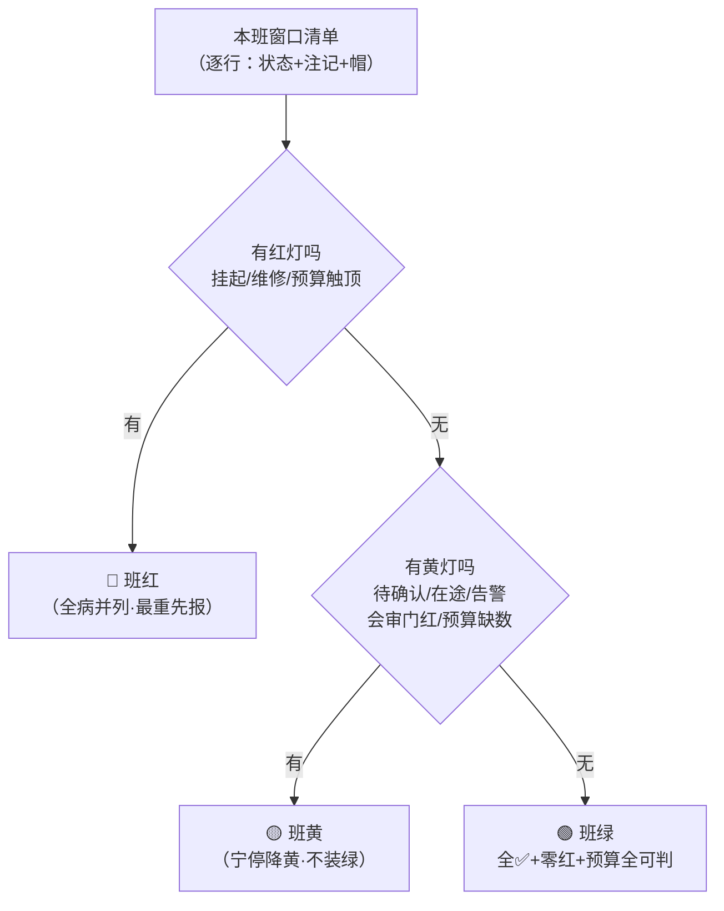

### 图说明（逐节点注解）

- **本班窗口清单**：判定梯只吃清单——班切分（更新列日期守卫）由上层聚合器按效率账同款守卫先滤好（W-146 同源·防老格式行误归班）；清单之外不碰（纯函数零副作用）。
- **红灯三源**：挂起/维修中（状态格词面）＋预算硬顶（某窗用量≥它的帽——帽两级：任务书写的帽优先·没写沿班缺省帽）。
- **黄灯五族**：完工待确认（NA）·在途未✅（施工中/待实施/探讨中/转人工/🔵候拍）·告警族（注记里有 WARN/告警/⚠ 字样）·会审门红（彩排红的词面）·预算缺数或效率账缺（班绿需预算全可判——缺数宁停降黄）。
- **未知词面**：状态格写了转移表八态和🔵之外的字样→不猜，按黄处理并告警（fail-closed：未知不等于通过·册⑦卡56 同源纪律）。
- **全病并列**：红族全列→黄族全列一条不藏——归因串就是班的病历；多病并存取最重（红＞黄＞绿）。
- **班绿三条件机械等价**＝全✅∧零维修∧零会审门红∧预算全可判（✅只认复考后·拍板#87）。

### 术语白话对照

`judgeShift`＝班次判定函数（纯函数：只吃清单·不碰盘不碰账本）；`词面锚`＝状态格/注记格里认字用的固定字样（八态＋🔵＋告警族字样）；`NA≠PASS`＝「完工待确认」绝不折算成绿（L1 原件纪律平移）；`帽两级`＝每窗预算帽先看任务书写的帽（聚合器从队列行产物列读任务书解析注入·W-156 拍板#216），没写才沿班缺省帽；`帽看不懂`＝任务书帽行写了但解析不了→降黄宁停不猜帽（fail-closed）；`沉降`＝注记里的历史告警只在窗还没✅时才算病——✅（复考/终认已过）后历史注记不再永久黄（防告警疲劳）；状态格词面照判不沉降（挂起/维修/待确认＝当前态事实）；`空班`＝清单零行→不渲染（数据驱动·不硬凑）。

### 口述（班长打分的那一分钟）

班报最后一节是「整班总评」。判定梯拿到本班窗口清单，从重往轻扫：有没有窗挂着「挂起」或「维修中」？有没有窗烧超了自己的帽？——有，班红，归因一句话。没有红的再看黄：有没有窗「完工待确认」？还在施工？注记里有告警字样？预算有缺数的？——有一件就是班黄，所有病并列写明。全清才班绿。W-156 实战：判定梯刚上线时把「任务书写了帽但格式怪」的窗误判红（按缺省帽算超顶），W-156 补了「帽两级＋解析不了降黄不猜」两级修正——宁可黄着说「帽看不懂」，不红着冤枉人，也不绿着放过。

**NA 两层语义分歧·卡面声明（勘误三·拍板#231）**：同喊「NA≠PASS」，两层现役行为有意分歧——L1 站5 判定梯＝占比容忍制（NA 门槛建在 20%·`ts/src/station5-verify/ladder.ts:13`：NA 占比<20% 可 PASS·切片粒度·环境不可判可容忍）；L2 班次判定梯＝单件零容忍制（`班次汇报聚合器.ts:163`：任一窗完工待确认即班黄·无占比机制·窗粒度·在途未终审不可容忍）。定性＝领域适配非漂移（L2 比 L1 严·加严侧零放水·拍板#231 拍卡面声明·码改对齐另拍候勘）。

### 业内对照

验收门梯（quality gate / release ladder：多级判定从重到轻短路求值）＋语义平移（同一契约·换粒度再实现：L1 判「整单三态」、L2 平移判「整班三态」——口号忠实·门槛机制按对象改款）。差异：经典 quality gate 用加权打分，本梯用穷举词面锚＋机械等价式（全✅∧零红∧预算可判）——每个判定都可逐字对账，没有隐藏权重。

### 锚点表（file:line·出卡亲验·批A 注记＝本卡主锚件班次汇报聚合器 .mjs 不在批A 四件（为消费方·其效率账数据面已 .ts 化）·HEAD=3877aa6·2026-10-29）

| 锚 | 亲验行内容 |
|---|---|
| 91-脚本/班次汇报聚合器.ts:135-140 | 词面锚五组：完成八态/完工待确认/红两态/在途五态（含🔵）/会审门红＋告警族字样（B面留痕候追认） |
| 91-脚本/班次汇报聚合器.ts:147 | judgeShift 纯函数签名：零文件读写零副作用·只吃清单＋效率账入参 |
| 91-脚本/班次汇报聚合器.ts:148 | 空班返回空·不渲染（数据驱动） |
| 91-脚本/班次汇报聚合器.ts:163 | NA≠PASS：完工待确认词面命中→黄（注释原文「绝不析取班绿·ladder.ts:13,32 原件语义」） |
| 91-脚本/班次汇报聚合器.ts:172-173 | 预算审计完整性：效率账有数据但缺数→黄（如实不装绿）；效率账缺→黄 |
| 91-脚本/班次汇报聚合器.ts:174 | 取最重：红＞黄＞绿 |
| 91-脚本/班次汇报聚合器.ts:175 | 全病并列 causes（红族全列→黄族全列·不藏） |
| 91-脚本/班次汇报聚合器.ts:199-200 | 班切分＝更新列日期守卫（与效率账 W-146 同源·防老格式行误归班） |
| 91-脚本/班次汇报聚合器.ts:203-209 | 每窗任务书帽读盘注入：产物列「任务书＝x.md」→解析帽（刹车件同源复用）→解析不了置「帽看不懂」 |
| 91-脚本/班次汇报聚合器.ts:211 | 聚合总装→判定梯调用点（清单＋帽＋效率账喂入） |
| ts/src/station5-verify/ladder.ts:13 | L1 原件 NA 门槛＝0.2（占比容忍制·与 L2 单件零容忍有意分歧·勘误三声明） |
| ts/src/station5-verify/ladder.ts:38 | L1 原件整单三态判定函数（PASS/PASS*/FAIL·整单粒度） |

### 红线

NA 不装绿（完工待确认绝不析取班绿）；班绿需预算全可判（缺数/效率账缺＝降黄宁停·宁停不装绿）；纯函数零副作用零新数据源（读盘面只在聚合总装＝拍板#216 授权位）；未知词面不猜（降黄＋告警）；判卷语义零触碰（梯判班色·不判卡的对错·红绿权在判卷面）。

### 失效触发＋防重复指针

失效触发：状态转移表八态扩容→词面锚组复验；拍板#231 若拍码改对齐（占比容忍引入）→本卡判定语义修订另拍；窗队列列结构变→班切分守卫复验。防重复：卡46 判定梯总评节＝同梯的聚合视角（互指不重述）；卡39 晨报投影＝只投影半边（本卡＝判定半边）；L1 判定梯正本＝ladder.ts（零复制只引锚）；sm-20261027-003 / df-20261027-002 状态机与数据流本体只指针。

---

## 卡62 · 审批熔断与风险分级（业内名：circuit breaker + risk-based approval tiering·熔断器＋风险定档审批）

**harness 层**：harness第二层（审批面双器·拍板#216 组二·W-155 出卡·A类补卡批② 拍板#233①）

**一句话**：两台机械守着审批面——熔断器每班算「代拍翻回来多少＋出了几起事故」，越阈就出收紧建议（缺省影子态只报数不执行）；分级器给每张票定「几个人批」（低＝零人/中＝一人/高＝停车候拍），只定批人档、永不定「过不过」。

### 图（双器守门·F 型）

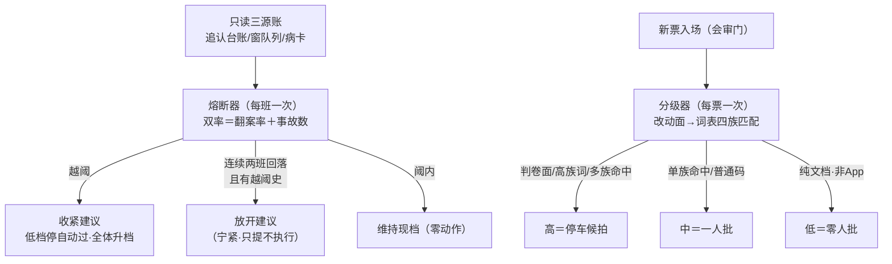

### 图说明（逐节点注解）

- **只读三源账**：熔断器的全部数据源——拍板表追认台账（翻案率分子分母·聚合器同源导出零复制）、窗队列「复考红」词面（写侧唯一落点）、病卡文件（两根目录·文件名日期落班）。
- **双率**：回退率＝当班代拍被翻案的比例（分母＝代拍总数·拍板#216 C1 拍定）；事故率＝复考红件数＋新病卡件数。
- **收紧建议**（越阈＝回退率严格大于 20% ∨ 事故≥2 件）：低档停自动过/全体升一档人工批/晨报置顶——缺省影子态只把建议写进班报，不真拦（渐进开闸制·册⑦卡52 同族）。
- **放开建议**（宁紧防噪声）：连续 2 班双率回落 ∧ 前两班内有越阈史——没闯过祸不谈放开；且只出建议，执行候业主追认。
- **分级器词表四族**：判卷面构件（红绿权域）＝高；派工链/凭据面/票契约＝中；另写死加严族（判卷语义/红绿权/预算三路/禁区六项/出题权/考题/复考/金标准字样＝高·App 交付包落点永不低档）。
- **三档＝定「几个人批」**：低＝纯文档零人批·中＝单族或普通码一人批·高＝停车候拍——「过不过」永远由既有机械闸/业主拍板说了算，分级器不说。
- **加严两则**：多族命中≥2＝升高档（只加严不加松）；改动面空＝中（fail-safe 不低）。

### 术语白话对照

`熔断器`＝审批熔断件（每班跑一次·双率越阈出收紧建议）；`双率`＝回退率＋事故率两个数；`影子态`＝dryrun——只报数不动手（缺省·环境开关三态：关/影子/实拦·非法值一律落影子 fail-safe）；`实拦态`＝enforce——翻转候业主令（拍板#216 C5/C6·渐进开闸·拍板#226 邻域）；`分级器`＝风险分级件（每票过会审门时跑·改动面词表匹配定批人档）；`词表四族`＝判卷面/派工链/凭据面/票契约四组字样（业主可经 config 扩展位增删）；`注记剥括号`＝领地列里括号里的注记字样先剥掉再匹配（防注记文字误触发分级·W-155 立票会审门红同根教训）；`留痕账`＝实拦态收紧/放开各写一行事件（候追认台账消费）·分级结果写窗产物 risk-tier.jsonl 留痕。

### 口述（两台机器的一天）

一天里两台机器各忙各的。白天票进来：会审门先叫分级器——这张票要动哪些文件？词表挨族扫：碰了判卷面构件？碰了两族以上？碰了「禁区/预算三路」这些写死加严字样？——高，停车候业主拍；只碰派工链一个族？中，一个人批就行；纯改文档？低，直接放行。晚上收工：熔断器开机——这个班机器代拍了 12 笔，业主翻案 1 笔（8.3%），出事 1 起——都没过线，维持现档，班报里记一行。哪天翻案率窜过 20%，它就写收紧建议：低档先停自动过、全体升一档；连着两班都乖了，它才提「要不放开一档？」——但只是提，动手前必等业主令。两台机器缺省都跑影子：先看几个班的数据攒账，才谈得上收紧阈值怎么定——这本身就是渐进开闸（册⑦卡52）在审批面的落地。

### 业内对照

熔断器（circuit breaker：微服务故障熔断——错误率越阈断路·半开试探恢复）＋基于风险的审批分级（risk-based approval tiering：变更管理里低风险免审/中风险单人审/高风险 CAB 全审）。差异：经典熔断自动断自动恢复，本厂熔断只出建议（收紧放开都要业主令——决策权不交给自动器）；经典 CAB 按变更类型定级，本厂按「改动面碰了哪个域」机械词表定级（零大模型·逐字可对账）。

### 锚点表（file:line·出卡亲验·批A 切换注记＝审批熔断 .mjs→.ts 已于 W-163 收口（施工本笔 001aaec）切换·熔断器锚＝.ts 终态；风险分级仍 .mjs（批A 四件外）·HEAD=3877aa6·2026-10-29）

| 锚 | 亲验行内容 |
|---|---|
| 91-脚本/审批熔断.ts:48 | 熔断默认阈值：回退率 0.20/事故 2 件/放开 N=2（拍定值·config 可覆盖） |
| 91-脚本/审批熔断.ts:60 | 当班回退统计：分母＝当班代拍总数（C1）·分子＝终态已翻案行·聚合器同源导出零复制 |
| 91-脚本/审批熔断.ts:73 | 复考红计数：窗队列「复考红」词面（写侧唯一落点同源·沉降语义沿判定梯） |
| 91-脚本/审批熔断.ts:78 | 新病卡计数：文件名日期落在班界当日（93 兜底库＋维修与自愈两根） |
| 91-脚本/审批熔断.ts:85 | 熔断判定：越阈＝严格大于∨事故≥阈；放开＝当班不越阈∧连续 N 班双率不升∧前 N 班有越阈史（宁紧） |
| 91-脚本/审批熔断.ts:101 | 三态开关解析：环境变量优先·非法＝影子（fail-safe） |
| 91-脚本/审批熔断.ts:110 | 判定核（零写盘）：报数/建议串/实拦态三动作/放开留痕文案的行集组装 |
| 91-脚本/审批熔断.ts:173 | IO 主道：班后恰一行接线消费·任何模式零写队列零改档·实拦态收紧/放开才产留痕账 |
| 91-脚本/风险分级.ts:33 | 默认词表：四族＋高族文本词＋App 落点写死族（正则字面即词表·config 可扩展） |
| 91-脚本/风险分级.ts:55 | 注记剥括号再匹配（领地列规约＝纯路径·拍板#92·防注记词误触发） |
| 91-脚本/风险分级.ts:79 | 三档分类：判卷面族/高族词/多族≥2＝高·单族＝中·纯文档非 App＝低·空面＝中（fail-safe 不低） |
| 91-脚本/风险分级.ts:116 | 分级三态开关：缺省影子（fail-safe 向记录侧） |
| 91-脚本/风险分级.ts:125 | 分级结果写窗产物 risk-tier.jsonl 留痕 |

### 红线

判卷语义零触碰（分级只定批人档不定红绿·熔断只定审批松紧不定卡对错）；零写队列零改档（任何模式·产物只落指定目录/窗产物）；零大模型（代码零引入判卷外的智能面·全机械）；出题权/考题库/预算三路本体/凭据值零涉（词表只认字样不碰值）；实拦态翻转＝业主令（渐进开闸·影子缺省）；分级只加严不加松（多族升高·App 落点永不低档）。

### 失效触发＋防重复指针

失效触发：实拦态翻转拍板（拍板#226 邻域）→收紧动作文案与绑级接线复验；词表增删（config 扩展位）→分级锚复验；病卡目录根变→计数锚复验。防重复：渐进开闸生命周期正本＝册⑦卡52（互指不重述）；代拍与追认正本＝卡45（翻案率数据源语义）；授权面自决边界＝卡42（互指）；班次聚合视角＝卡46（熔断器＝班报第五节接线消费方·互指）；sm-20261027-003 / df-20261027-002 只指针。

---

## 册⑤ 尾注 · 同构轴

8 卡（批2 正本·2026-10-28 成文时点）＋卡60/61/62（A类补卡批② 追加·2026-10-29）回答「人怎么知情、怎么认可、怎么撤回、干得怎么样、要不要收紧」：**晨报投影（卡39）让人知情 → 追认+撤回（卡40/45）让人掌舵 → 授权面（卡42）划自决边界 → 方向题闸+审批卡（卡43/44）管选择题 → 班次聚合（卡46）汇总**。全册一条铁律：**汇报是投影不是创作；追认可批量；撤回不抹账**。

---

## 册⑤ 候拍卡 · 卡70 驾驶舱 v2（候拍·未拍板·20261030 主窗代录入册·不计入尾注卡数）

**卡面名**：驾驶舱 v2（静态生成观测面）
**业内名**：Static Generated Dashboard / Read Model Projection
**harness 层**：跨层（L1 事件面 → L2 观测）·班末随晨报一并出
**一句话（白话）**：V1 五页驾驶舱原型（导航/运行总览/Agent员工/票级时序/数据流转·真账 143 条验证过取数路径）在 V4 数据面复活——events.jsonl→afk-data.js 预处理→静态 html 零运行时＋跨班趋势页；补「班中·票级·一眼看全」空位（晨报是班后的·飞书卡是窗粒度的·账本是机器面的）。
**数据链**：events.jsonl（唯一事实源）→ afk-data.js（window.AFK_DATA 静态注入·V1 先例 w13-docker-v1 143 条真账）→ 五页静态 html；V4 适配=119 事件码中文正本（票53/班52/切片8/列队6）＋十态/十一态中文键。
**先例与断档史**：V1 原型五件=`10-专题档案/04-夜车运行/夜车监控/`（导航页:43 自述「原型预览件·入列施工需对比件+拍板号」——本卡即该对比件前身）；晨报 html 渲染器现役=`pipeline-lab/scripts/render-morning-report.mjs`（V4 收车链未挂=断档点·接回可零成本先行）。
**锚**：sm-20261030-005 §2-4·morning-report.ts:2（事件面=唯一事实源）·卡39（CQRS 读模型·本卡=其可视化推广）·卡46（班次聚合）
**红线**：只读投影零写底表·判卷/账本零触碰·html 静态零新运行时。
