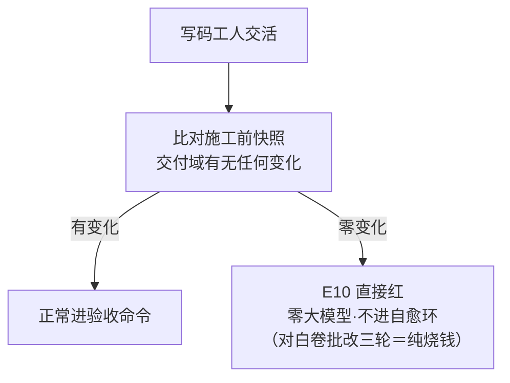
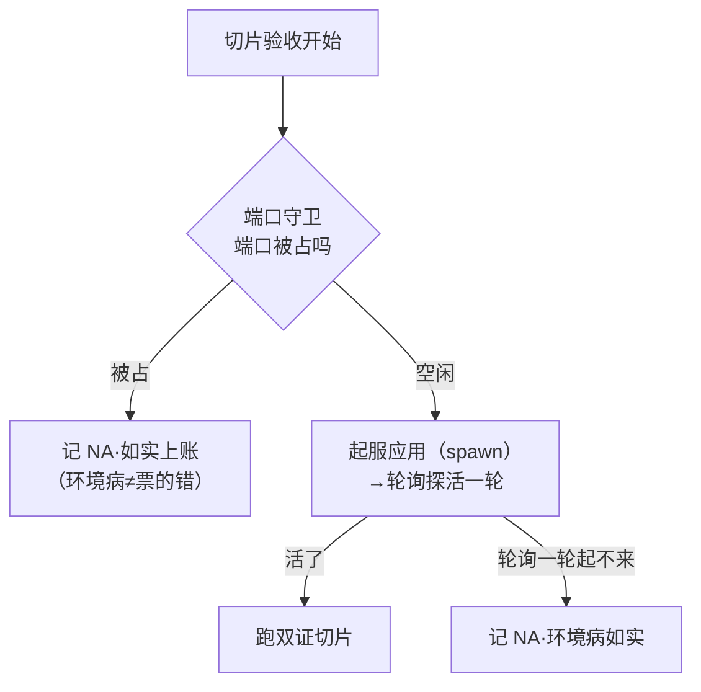
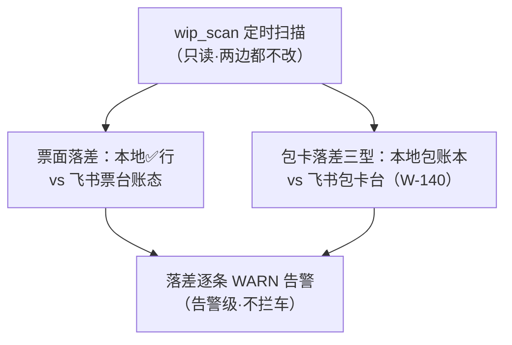
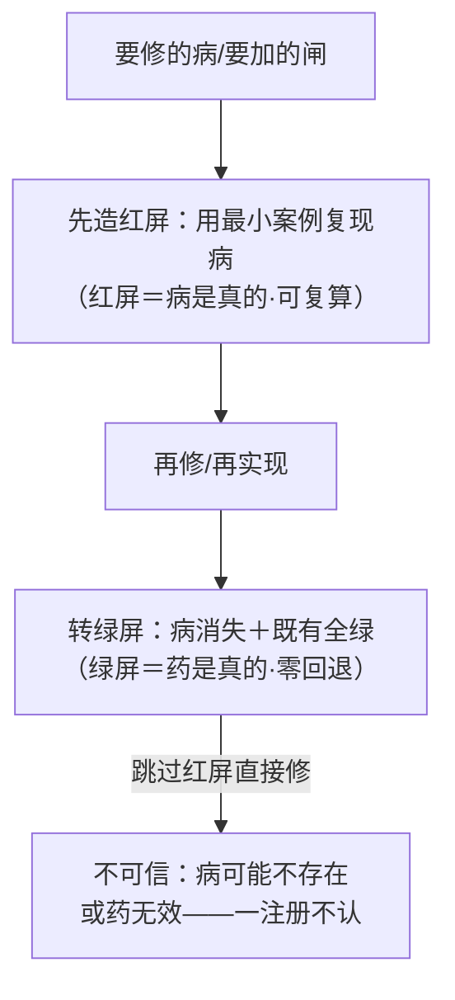
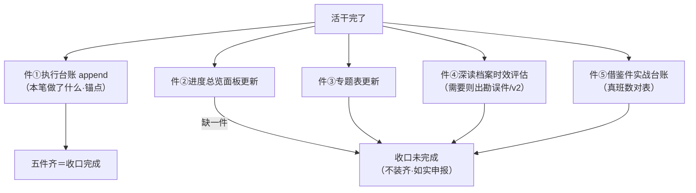
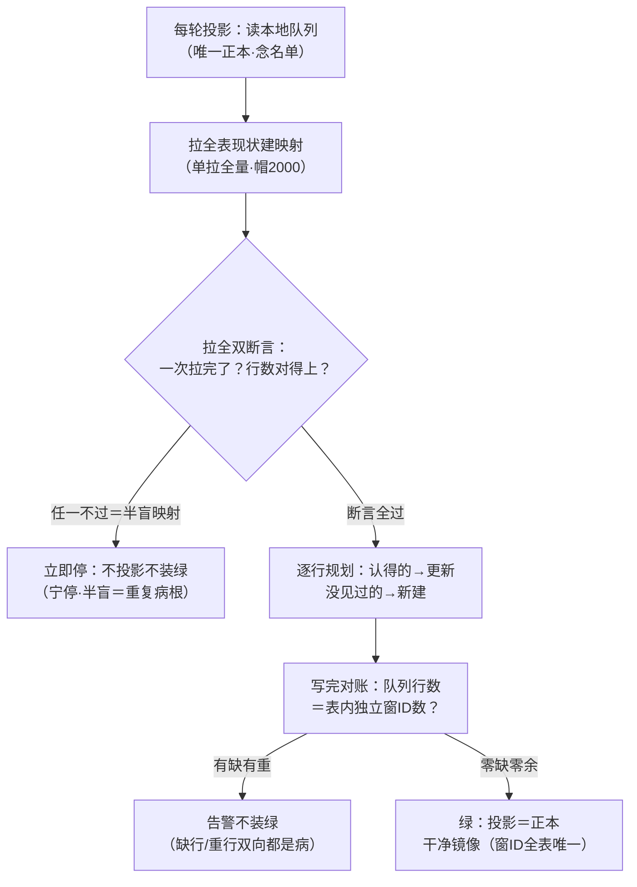

> **口径**：本卡话术/命名遵循《[00-话术统一口径正本](../00-话术统一口径正本.md)》（拍板#312）——双名制首现双写·撞车词带消歧（窗票/工序票·判色/判分）·两层口径 L1 车间（票级）/L2 派工台（窗级）。
> **消歧（本册·口径正本 §3）**：「票」含工序票/窗票；红先绿后/fail-closed＝两层纪律。
> **事件名速查（口径正本 §4·拍板#316① W-234 双名化落册）**
> - wip_scan 落差机检 → **半小时巡逻**（L2 巡逻驻留·告警级不拦车）
> - 收口五件套 → **交活五件套**（L2 交活驱动·纪律卡）
> - 窗卡台投影唯一性纪律 → **立票贴卡**（窗卡台投影·L2 立票闸＋驱）
> - 其余（E10 零提交预闸/起服守卫/红先绿后）→ 候正名
> - 双名制：首现双写「标准事件名（现行短名）」·短名机检永不改；§4 空缺→候正名不硬造名

# 机制卡册⑨ · 纪律与小卡（5 卡·批3·目录收官·2026-10-28）

> **本册管什么**：批3 收尾——三张小机制卡（E10 零提交/起服守卫/落差机检）＋两张纪律卡（红先绿后/收口五件套），外加**六项覆盖申报**（批3 旧清单里已在前面各册覆盖的条目，逐条注明出处在哪，防重复出卡）。图版=同目录 09-纪律与小卡册.html。

---

## 卡17 · E10 零提交预闸（业内名：快速失败·零产出检测）

**harness 层**：harness第一层 · 站4（E10）

**一句话**：写码工人交活后、进验收前，先机械查一遍「交付域有没有任何变化」——零变化＝零产出，直接红，不进自愈环（省掉对一张白卷的三轮批改）。

**术语白话对照**：`交付域`＝工作区里「工人负责产出的那部分文件」的集合（施工前先拍快照）；`零变化`＝工人交活了但磁盘上一个字节都没动——等于交了白卷；`E10`＝这条快闸的内部编号（fail-closed 家族成员）。

**口述**：曾有个真实浪费：工人交了活，验收红，自愈环认真地带证据回喂了三轮——三轮之后才发现，工作区从头到尾一个字节都没变：工人交的是白卷，三轮批改全是空转。E10 闸就是为这个病生的：交活后先比对快照，零变化直接红，连自愈环的门都不进。省的是「对白卷认真批改」的荒唐预算。

**锚**：build.ts:205（deliveryChanged 比对·E10 预闸）·:206 附近（llm_build_fail 入账）｜业内对照：fail-fast / no-op detection｜变式：续写修复道（册②卡15 折叠）＝「有产出但残缺」走的是另一道｜红线：零变化=红不可豁免；快照只读交付域。

---

## 卡30 · 起服与端口守卫（业内名：环境守卫·起服探活）

**harness 层**：harness第一层 · 站5（起服守卫）

**一句话**：切片验收前把应用真正起起来——端口被占先守卫、起服后轮询探活（一轮为限）；起不来记 NA 如实上账（环境病不是票的错，但看不清就是看不清）。

**术语白话对照**：`端口守卫`＝起服前先查应用要用的端口是不是被占了（占着=起不来，早发现早记 NA）；`轮询探活一轮`＝起服后定时探测应用是否响应，只轮询一轮——超时按环境病记 NA，不无限等；`环境病（NA）`＝「应用起不来是环境/素材的病，不是这张票代码的病」的如实归类——NA 占门槛（册④卡31/35）。

**口述**：切片验收第一步是把应用真跑起来。跑之前先看端口——被占了就是环境病，立刻记 NA 如实上账，不硬抢不糊弄；跑起来了还要轮询探活——应用「假启动」（进程在但不响应）也逃不过。探活一轮起不来的，记 NA 走门槛——NA 会累计拉低整单判定（册④卡35 判定梯），所以环境病必须当场修环境，而不是让切片「等等再说」。

**锚**：verify.ts:9（端口守卫 guardBackendPort/spawnLogged/pollHttp 装配）·run-slice.ts:251（起服调用）｜业内对照：environment guard + readiness probe｜变式：L2 收据员探活（册③卡29·窗级探活同族）｜红线：NA 不装绿；轮询一轮为限不无限等。

---

## 卡50 · wip_scan 落差机检（业内名：账实落差扫描器·告警级）

**harness 层**：harness第二层 · 机检（落差扫描）

**一句话**：定时扫「本地台账 vs 飞书票台账/包卡台」的落差——本地✅了飞书没跟上、飞书✅了本地缺档，逐条 WARN 告警；只读只告警，拦车权在别的闸。

**术语白话对照**：`落差`＝同一个事实在两个台账里的记录对不上（本地说✅、飞书还在施工中=落差）；`只读`＝扫描器两边都不改——它只负责「发现对不上」，修复权在各账本的主own进程；`告警级`＝WARN 不拦车（沿「告警级不拦车」全厂惯例·册⑦卡56 的姊妹款）；`三型`＝包卡落差的三种类型（W-140 定义·缺省关可开）。

**口述**：两层记账（本地队列+飞书台账）最怕「各记各的、渐渐对不上」。wip_scan 是会计对账员：定时把两边拉出来逐行比，对不上的逐条 WARN——只喊不拦。为什么只告警不拦？因为落差多数是「投影延迟」不是真病，拦车会误伤；真正的拦截有专门闸（复考/会审）。定位：发现病的哨兵，不是治病的大夫。

**锚**：91-脚本/wip_scan.py:9-15（用法：--check-feishu/--check-package）·:43/:47（票面落差/包卡落差）·拍板#120 题7 乙·W-140（包卡三型）｜业内对照：reconciliation scanner（只读对账）｜变式：收割器三查（册③卡29）=窗级账实核查｜红线：只读零写；告警级不拦车。

---

## 卡55 · 红先绿后纪律（业内名：红-绿重构的施工纪律）

**harness 层**：harness第一层＋harness第二层（全厂纪律）

**一句话**：全厂改任何机制/写任何代码，先造出「能复现病的红」再动手修，修完转绿——红屏证明病是真的，绿屏证明药是真的；没有红屏的修复不可信。

**术语白话对照**：`红屏`＝测试/自检跑出失败的屏幕输出——证明「病可复现」；`绿屏`＝修完全绿的屏幕输出——证明「药有效且无回退」；`红先绿后`＝顺序铁律：先红后绿，绝不「修完补一个必过的测试」；`金样`＝格式或行为的对照正本（新岗/新件照着金样对齐）。

**口述**：这是从测试驱动开发（TDD）搬进全厂的施工纪律。红屏的价值：它证明「病是真的、可复现的」——没有红屏的修复，可能修的是一个不存在的病，也可能药根本没效只是碰巧没触发。本会话实证：W-128 机检首跑红（样品节标题不匹配词面）→只修被检件标题→复跑绿（机检器零触碰）；W-131 两件落地红屏 7 FAIL 恰病分支→绿屏 14 PASS。红屏存档是「病曾经存在」的证据，绿屏是「药有效」的证据——两屏合订=修复可信度的完整证明。

**锚**：pi_runner.ts:1902,1939,2026（三处红先绿后实锚）·W-128 检3 首跑红实录·W-131 红屏7FAIL实录｜业内对照：TDD red-green-refactor｜变式：变异标定（册②卡17·「能红」的考题版）｜红线：红屏必须归档（病存在证据）；绿屏必须全量回归（零回退）。

---

## 卡57 · 收口五件套（业内名：收口清单协议）

**harness 层**：harness第一层＋harness第二层（收口纪律）

**一句话**：任何窗/任何活收口时必须交齐五件——执行台账、进度总览、专题表、深读档案时效评估、借鉴件实战台账；五件不全=收口未完成（缺一件就是缺一件，不装齐）。

**术语白话对照**：`五件套`＝收口时的五份标准产物：①执行台账 append（本笔记录）②进度总览面板更新 ③专题表更新 ④深读档案时效评估（既有档案还准不准，需则勘误）⑤借鉴件实战台账（借了什么·真班效果对表）；`缺一件=未完成`＝五件是「与」关系——任何一件缺=整个收口不完成（不装齐）；`时效评估`＝自己的活可能让既有深读档案过期——评估并申报，防「文档静默腐烂」。

**口述**：为什么收口要五件套？因为一个窗的产出不止「代码」：账本要记（台账）、全局视图要更新（总览）、专题知识要归档（专题表）、既有文档可能被本次改动作废（时效评估）、借鉴了谁要还礼记账（借鉴台账）。五件套防的是「干完活拍屁股走人」——活干了但组织记忆没更新，下个窗还要重新踩一遍坑。本会话就是活例：机制目录八册出完，索引卡进度立即更新（五件套精神在知识件上的应用）。

**锚**：拍板#20/#68（五件套构成）·执行台账.md（五件套实录·本会话多条）·AGENTS.md 路由行（收口路由）｜业内对照：definition of done checklist｜变式：收口申报器（册③卡29·机器代查五件齐不齐）｜红线：五件是「与」关系；缺件如实申报不装齐。

---

## 卡88 · 窗卡台投影唯一性纪律（业内名：Projection Uniqueness / Idempotent Upsert + Reconciliation）

**卡面名**：窗卡台投影唯一性纪律（**在役**·拍板#286/#287/#288 三拍病案与决策·W-210 落码治本·20261031 窗代录入册·拍板#293 出卡）
**业内名**：Projection Uniqueness Discipline（Idempotent Upsert + Reconciliation）
**harness 层**：harness第二层 · 窗卡台投影道（sync 每轮·纪律小卡）
**一句话（白话）**：本地窗队列是唯一正本，飞书窗卡台三表只是它的投影——投影时窗ID 必须唯一：拉映射必拉全（拉不全宁停不投影）、写只更新不重复建、清重以队列为准每ID留一、对账差值≠0 不装绿。

**机制图（白话）**：

**图说明**（节点/边逐个注解）：
- **A 读本地队列**：每轮 sync 从本地窗队列读行——它是唯一正本，投影无权凭空造行；
- **B 拉全表建映射**：listExisting 单调用拉全表（缺省帽 2000）建「窗ID→record_id」映射——sync 认得哪些行的前提；
- **C 拉全双断言**：fail-closed 双闸——①manifest `has_more≠false`=单次没拉完→抛；②拉回行数≠`records_count`=传输拉不满→抛；
- **X 立即停**：映射不完整＝半盲——sync 认不得老窗ID 就会对同票反复新建（本案增殖根因本体），宁停不投影不装绿；
- **D 逐行规划**：认得的窗ID 走更新，没见过的才新建——修后「更新优先」语义（唯一性保障后半）；
- **E 写完对账**：队列行数=T1a∪T1B 独立窗ID 数，零缺零余才绿；
- **Y 告警不装绿**：缺行/重行双向告警（对账机检候小票）；
- **F 干净镜像**：投影与正本逐行等值——窗ID 全表唯一。

**术语白话对照**：`窗卡台`＝飞书侧镜像窗队列的三张表（T1a App 类/T1b 引擎类/旧表·旧表回组见拍板#287）——业主在飞书看到的窗池就是它；`拉页`＝lark-cli record-list 一次调用拉回的行批次（修前单拉帽 200 行）；`映射`＝「窗ID→record_id」对照表（sync 靠它认人）；`fail-closed`＝断言不过即全链停（卡56 同族）；`batch-create`＝飞书表批量新建 API（盲跑每轮都走它）；`对账`＝正本行集与投影行集比对；`正本`＝本地窗队列.md（卡53 单写者守护的文件）。

**口述**：投影重复是怎么把人坑惨的？10-31 业主打开主表：311 行里 7 个窗ID 各占十几行、多余 104 行（重复清单在案）。病因不是量大，是一行代码：建映射只拉前 200 行——表一超 200 行，行序靠后的窗ID sync 就「不认识」，每轮都当新票 batch-create，越滚越多。W-210 三步治本：①去 200 帽改单拉全量（lark-cli 缺省帽 2000），外加「拉没拉完、行数对不对」两道断言，任一不过当场抛；②清重以正本为准每窗ID 留一（状态与队列一致的行优先），主表删 48 行，删前快照+删行清单留痕；③连跑两轮「新建 0·更新 209」对账零差值——治本实证。旧表同病同治：拍板#287 推翻停写退役恢复回组（行集=队列行集），拍板#288 主窗数据面清 28 行复验 211 行零重复。唯一性自此钉成纪律：映射必拉全·更新优先·清重以正本为准·对账把关绿灯——对账机检缺行/重行双向告警候小票（册尾挂账）。

**业内模式对照**：这是「Single Source of Truth（唯一事实源）」的投影面纪律：正本一份，镜像跟随。业界同族写法叫 Idempotent Upsert（同键重复写不产生第二条）；定期比对叫 Data Reconciliation（ETL 全量对账/账实核对）；「宁停不投影」是 fail-safe 在投影侧的落法。与 Event Sourcing 的「投影可从事件流重建」同理而不同物：窗队列是管理事实文件不是事件流，重建=从正本重投影而非回放事件。

**变式对照**：**随卡申报：零未登记同构对**——同构漂移实测报告 §1 十五对 grep 复核，唯一命中 P7「晨报纯投影↔班次汇报聚合器」（册⑤卡39↔卡46·已登记对）与窗卡台投影面无涉。语义近邻三处（只互指不重述）：**卡53 领地断言+队列写锁**（正本单写者——本卡管其读侧投影的唯一性·写锁姊妹纪律）；**卡56 fail-closed**（断言不过宁停不装绿·同族）；**卡80 改前快照断言法**（共享面防漂移——本卡=投影面防重复·共享面双翼纪律）。

**锚点表**（出卡时行号亲验·工作树 8fdb3c4）：

| 锚 | 说什么 |
|---|---|
| 91-脚本/window_card_sync.mjs:151 | routeTableOf 分流（App三类→T1a·引擎两类→T1b·缺省记因）——旧锚 :140-143 已漂移·与册⑦卡67 锚点表同批勘误（本窗） |
| 91-脚本/window_card_sync.mjs:161·168 | planBatchesRouted 旧表回组（拍板#287·每轮照写·行集=队列行集） |
| 91-脚本/window_card_sync.mjs:670-672 | listExisting 头注 W-210 治本注记（病灶锚 :664 史锚） |
| 91-脚本/window_card_sync.mjs:684-687 | 拉全双断言本体（:686 has_more≠false→抛·:687 行数≠records_count→抛） |
| 90-过程/拍板记录表.md:323 | 拍板#286 原行（病案：311 行·7 窗ID·多余 104 行） |
| 90-过程/拍板记录表.md:324 | 拍板#287 原行（旧表不退役·回组+清重扩载） |
| 90-过程/拍板记录表.md:325 | 拍板#288 原行（旧表清 28 行·复验零重复·唯一性后续保障=更新优先+对账机检候小票） |
| 90-过程/窗产物/W-210-sync拉页/收口申报-W210-20261031.md | 治本+清重+双轮新建0 全套书证（含 v2 扩载停车段） |
| 90-过程/窗产物/_主窗临时/重复清单-20261031.txt | 病案实证：7 窗ID 多余 104 行全清单 |

**红线**：
1. 映射不完整＝宁停不投影不装绿——半盲映射是重复增殖根因本体，「先写上再说」即违例；
2. 本地窗队列=唯一正本——投影只产镜像永不回写正本（正本零字节写=卡53 同族红线）；
3. 清重只碰重复判定面：每窗ID 留一（状态同正本优先）·删前快照+删行清单+回执全留痕·零无账删行；
4. 拉页帽/断言参数/对账判据=拍板级变更——本卡只述纪律，无拍板零码改；
5. 对账差值≠0 不装绿——缺行与重行双向都算病；
6. 零涉判卷语义——投影面是管理事实镜像，与验收命令/判卷官零接触。

**失效触发＋防重复指针**：失效触发＝listExisting 拉页参数/断言判据变·窗卡台表结构变（加表/删表/键列变）·sync 写入路径变（update/create 优先级变）→本卡逐锚复验；对账机检候小票落地并改判据→本卡判据面联动复验。防重复：拍板#286/#287/#288=病案与决策正本（本卡只提炼零复制）；W-210 收口申报=施工书证（只引不抄）；重复清单=病案实证附片；近邻=卡53/卡56/卡80（互指不重述）。

---

## 册⑨ 尾注 · 覆盖申报（批3 旧清单勘误·防重复出卡）

批3 旧清单 11 项中，**6 项已在前面各册覆盖**（本册不出重复卡）：

| 项 | 覆盖位置 |
|---|---|
| #13 素材预投 | 折叠入册①卡4（判卷素材冻结+施工前锁定·build.ts:129） |
| #34 切片出题员/考题病修复 | 已出＝册⑧卡34（08-辅链补遗册） |
| #41 丙级规格修正 | 已出＝册⑤卡41 |
| #43 方向题闸 | 已出＝册⑤卡43 |
| #44 审批卡异步道 | 已出＝册⑤卡44 |
| #46 班次汇报聚合器 | 已出＝册⑤卡46 |

**批3 实际新卡＝本册 5 张**（卡17/30/50/55/57）。至此 57 项盘点全部落卡：53 张独立卡（册①~⑨）＋4 项折叠（#13 入册①卡4·#15a/b/c 入册②卡15）。

## 册⑨ 尾注 · 全目录收官

八册 53 卡覆盖 57 项盘点，全目录统一体例（白话图+术语对照+口述+业内对照+变式+锚+红线+失效触发+截图目检），统一铁律（判卷权只在验收命令·NA≠PASS·fail-closed·翻账不抹账）。目录维护规则：新机制→补卡+索引补行；源码变更→失效触发条款启动逐卡复验。

---

## 册⑨ 候拍卡 · 卡71 透明表观测三查（候拍·未拍板·20261030 主窗代录入册·不计入尾注卡数）

**卡面名**：透明表观测三查（底表主数据落盘直读）
**业内名**：Transparent Table Health Check
**harness 层**：跨层·纪律小卡
**一句话（白话）**：观测不经过任何中间层直接吃底表落盘态——底表=文件形态透明表（六台正本/事件白名单/正本字典/events.jsonl/窗队列.md/分诊事件.jsonl/判卷快照/latitude-log·全清单=sm-20261030-005 台账）；三查覆盖「在不在·动没动·对不对」。
**三查**：①**齐备查**=六台正本/字典在不在·齐不齐·同构不对——`state_dict_check.ts --local`（现役·运行时提取·引用正本零复抄）②**流转查**=账本 seq 递增/状态列合法边/更新列新鲜度（停滞=底表落盘停了）——监工道（卡69）停滞检测内建·对齐 L1 ready-scheduler 停滞内建哲学 ③**落差查**=本地底表 vs 飞书投影——`wip_scan.py`（现役·四类落差 WARN）。
**总纪律（卡39 CQRS 读模型推广·一切观测的宪法）**：一切观测件（晨报/驾驶舱/推卡/三查）=底表的只读投影——**观测永不写底表**；任何新观测需求=「对底表写一个新的只读投影」，不造新事实源。
**锚**：state_dict_check.ts:54-61（六台目录）·wip_scan.py:49·sm-20261030-005·卡39·卡54
