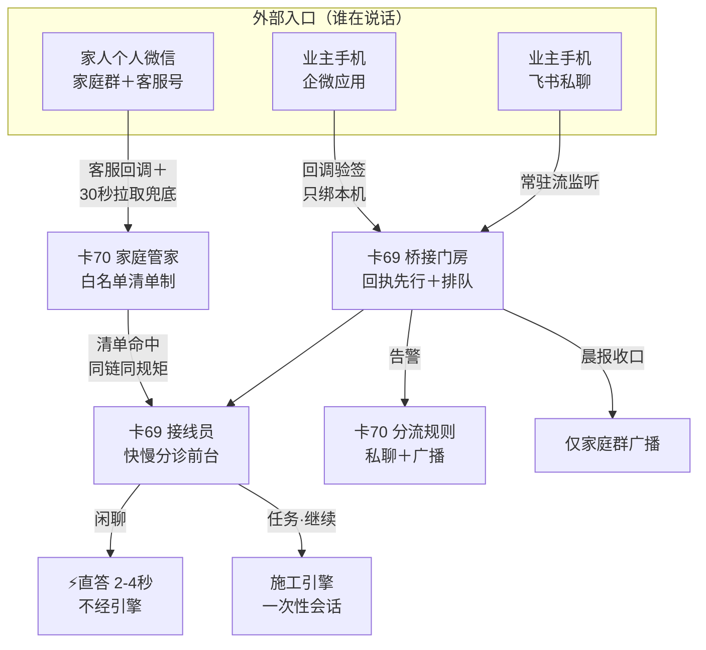
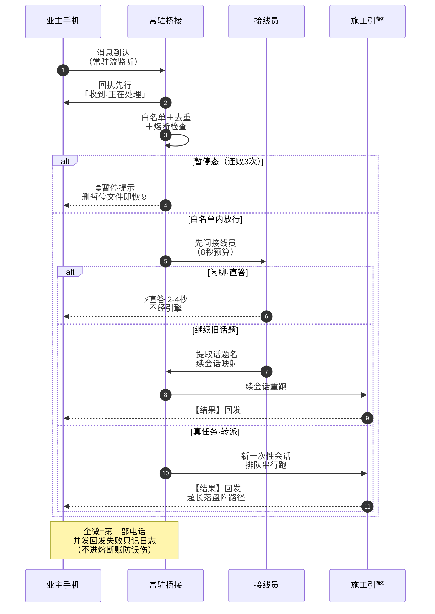
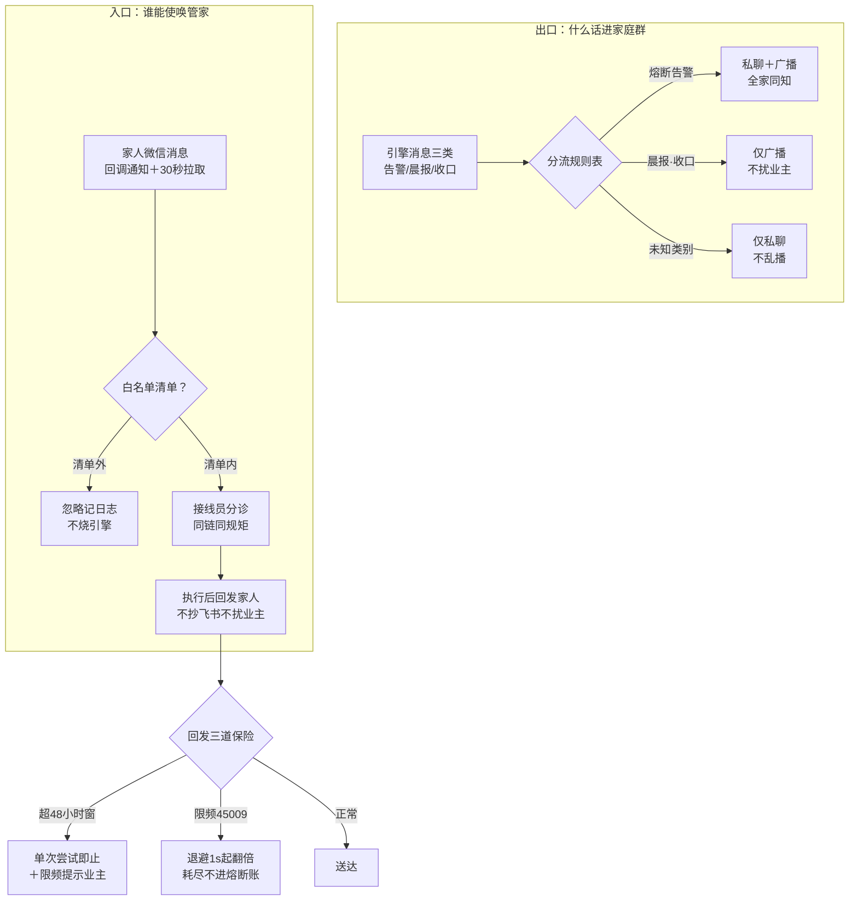

> **口径**：本卡话术/命名遵循《[00-话术统一口径正本](../00-话术统一口径正本.md)》（拍板#312）——双名制首现双写·撞车词带消歧（窗票/工序票·判色/判分）·两层口径 L1 车间（票级）/L2 派工台（窗级）。
> **消歧（本册·口径正本 §3）**：「票」按层消歧（工序票 L1/窗票 L2）；通道熔断＝对外调用保护。
> **事件名速查（口径正本 §4·拍板#316① W-234 双名化落册）**
> - 本册两卡（通道与接线员/家庭面广播与客服）§4 暂无对应行 → **全册候正名**（对外通道＝框架外辅助系统·不入运行时机制分母）
> - 邻册关联：接线员分诊正本＝册⑤卡42/43（速查见册⑤）· 熔断近邻＝册③卡20
> - 双名制：首现双写「标准事件名（现行短名）」·短名机检永不改；§4 空缺→候正名不硬造名

# 机制卡册⑪ · 对外通道（2 卡·D类通道族·2026-10-29）

> **本册管什么**：引擎的「前门与家庭喇叭」——业主手机（飞书/企微）与家人（家庭微信群/微信客服）怎么把话递进引擎、引擎怎么把话递出去。四个通道机制聚成两卡：**卡69 通道与接线员**（桥接常驻=进料门房＋回执先行＋防烧钱熔断＋接线员分诊=快慢前台＋企微通道=第二部电话）与 **卡70 家庭面**（广播分流=家庭喇叭＋微信客服管家=家人指令口）。索引=00-机制总索引卡（尾增补节）。
> **业内定位**：Channel Gateway（通道网关/消息门面）＋ message-driven facade——外部世界与引擎核心之间的一层「翻译与守门」；文档学位置=02-全景视图动态横切视图的对外通道分册（桥接静态结构另有模块卡 mk-012·本册管机制怎么转）。
> **纪律**：fail-closed 全链（白名单外/配置缺/验签败=关与拒·绝不装绿）；密钥永不入 git（业主亲填 ts/.env·代理不经手明文）；「重活不降级」——分诊只分路不换活；主件仍 .mjs（E类 TS 化横切候批0·拍板#235③·锚以 4e6d7df 实锚为准）。
> **图版**：本册 md 正本·html 由 render_views 全量覆盖生成（生成品永不手改）。

## 册头总图 · 对外通道全景（谁在说话·话走哪条路）

**读法**：三条入口（飞书/企微/家人客服）汇进同一根处理脊柱（门房→前台→引擎），出口按「说给谁听」分流（业主私聊/家庭群广播）。两卡分工：卡69 管脊柱与业主双通道，卡70 管家庭侧的入口清单与出口喇叭。

---

## 卡69 · 通道与接线员（业内名：Channel Gateway + Receipt-first FIFO with LLM Triage）

**harness 层**：harness第二层（对外通道层·91-脚本常驻件·经一次性会话伸入第一层执行）

**一句话**：业主手机发话，本机常驻门房秒回「收到」再排队干活，先问快模型接线员——闲聊两三秒直答、真任务才起引擎会话；连败三次自动熔断停烧钱，删一个文件就恢复。

### 图（一条消息的一生·L 型）

### 图说明（逐节点注解）

- **业主手机**＝飞书私聊机器人（主道）或企微应用（附加道）——消息从哪来不改变后面的处理链。
- **常驻桥接（门房）**＝本机一个常驻进程：单个长跑事件流逐行读消息（进程活=流活·异常退后指数退避自动重启·2 秒起 60 秒封顶·稳定一分钟重置）；收到消息**先回执再干活**，然后进先进先出队列。
- **白名单＋去重＋熔断检查**＝三道门：白名单只认业主（企微认本人账号·配置缺=全忽略关死）；消息编号去重防重投；暂停态不烧引擎只回提示。
- **接线员（前台）**＝裸快模型分诊：只会说话不会动手（零文件写·零命令执行·零仓读取），八秒预算内三选一——超时或失败就降级走老路（不起快道不重试）。
- **施工引擎**＝一次性会话（或按话题续旧会话）：排队串行跑·不并行抢道；超长回复截断回发、全文落盘附路径。
- **熔断暂停**＝连败三次（引擎非零退/超时/回发失败）写暂停文件+发红色告警+全家广播——删暂停文件即恢复，或用桌面启停台停止再启动。
- **企微第二部电话**＝回发时双通道并发：飞书结果为主，企微尽力同发——企微失败只记日志**不进熔断账**（防附加道故障误伤暂停全家通道）。

### 术语白话对照

`常驻流式监听`＝监听进程长跑不重启，消息任何时候来都能接（旧版每条消息重启一次·已被替换）；`回执先行`＝收到先回「收到·正在处理（约 30-60 秒）」，回执与结果用前缀区分（结果带【结果】头）——业主不用对着黑屏等；`先进先出单工人`＝队列里一条条干，同一时刻只跑一条（不并行抢引擎名额），排队不丢；`接线员`＝afk_receptionist.mjs 的快模型分诊台：输入消息文本，输出三分类之一（闲聊直答/继续话题/真任务）；`裸调用`＝直接发一次 HTTPS 对话请求，不起引擎进程、不给工具不给仓权限；`三分类`＝direct_answer（闲聊直答）/continue（继续旧话题·提取话题名落会话映射）/task（转派引擎）；`防烧钱熔断`＝连续失败达阈值就自锁暂停——宁可停服不可空烧；`会话映射`＝「话题名→会话编号」对照表，「继续〈话题〉」按表续旧会话防上下文膨胀；`单飞`＝企微令牌缓存并发共享一次刷新（五路并发只发一次 HTTP）；`验签回显`＝企微回调端点的接头暗号校验（对上才回明文·后台验证用）。

### 口述（一条手机消息的一生）

业主在地铁上用手机发「帮我看下 W-170 跑完没有」。本机常驻门房的监听流立刻收到这一行，**不到一秒**业主手机就弹出「收到·正在处理（约 30-60 秒）」——这是回执先行，改造前同样位置要等 11-27 秒才有动静。消息进队列排队（前面有人也在说就等着·实测两条连发只串行不并行）。轮到它，先问接线员：这句话是要动手还是闲聊？接线员是只快模型，八秒内答「这是任务」（action=task）——于是门房拉起一个一次性引擎会话（工作目录=本仓根·自动继承全仓纪律），跑完把结果加上【结果】前缀发回手机；太长就截断、全文存档附路径。要是发的只是「你好呀」——接线员直接答，一两秒回电，引擎根本不醒。连着三次没干成（比如引擎接口抽风）？门房自锁暂停：不再起会话烧钱，红字告警发到业主手机、同时广播到家庭群让全家知道；业主排除故障后删掉暂停文件（或用桌面启停台重启），一切照旧。企微通道是第二部电话：业主在企微应用里说的话走回调端点进来（验签+只绑本机+伪造全拒），回发时飞书企微一起发——企微发挂了只记一笔，不牵连全家通道熔断。

**实战案例（W-019~W-022 实测·进度总览 :52-55 行在案）**：①提速实证——单链注入实测收到到回执 **约 1 秒**（改造前 11-27 秒）；两条连发排队不丢不并行（件2 等件1 完工才开工）。②接线员真调实测——闲聊直答 1.2-1.8 秒（2-4 秒目标超额达标）、读文件任务转派引擎 12.5 秒不降级；「接着W020施工的话题说」端到端提取话题建映射续会话成功。③重构不换行为——通道抽象改造时原 13 案自测**原样全绿**（基线逐字节对账）+飞书原链注入回归全通。④安全用例先行——企微回调端点先跑桩版让伪造/错签/重放/超窗四案**跑红留证**，实装后 11/11 全绿、伪造请求全 403。

### 业内对照

API Gateway / Channel Adapter（企业集成模式：外部通道各自适配、核心链路统一）＋ ack-first receipt（消息系统的先确认后处理·HTTP 202 Accepted 同族）＋ serialized queue / worker pool concurrency=1（单工人串行队列·防并发抢配额）＋ LLM intent router（客服系统的意图路由器：小模型分类、大模型执行·成本分级调度）＋ circuit breaker（熔断器·连败trip防雪崩）＋ singleflight（并发去重共享一次远程调用）。差异：本厂的「回执」同时是**人读的**（业主手机可见）而非纯协议 ACK；接线员的「降级」永远落向重通道（引擎）而非轻通道——重活不降级是铁律。

### 变式对照

15 对全集指针＝`90-过程/handoffs/同构漂移实测报告-20261029.md` §1（不复制表）；**随卡申报：零未登记同构对**——对外通道层=第二层特有的对外边界面，第一层夜车无镜像件（实测报告 §1 十五对＋附带发现均无涉·报告 :42 明注 bridge 演练闸=同层同族非跨层对）。语义近邻三处（只互指不重述）：**接线员三分类↔方向题闸**（册⑤卡43——「该不该动手、找谁动手」的分诊同构，对象面=手机消息而非方案分歧）；**回执先行↔拉窗快照回执**（spawn 三键快照+就绪探针=「窗已拉起」的回执·拍板#89 AX己件）；**防烧钱熔断↔同因熔断**（册③卡20——第一层夜车侧的连败熔断同骨架）＋接线员连败自动关↔审批熔断（册⑤卡62）。

### 锚点表（file:line·出卡亲验·HEAD=4e6d7df·2026-10-29·批A 切换注记：本卡主件均批A 四件外仍 .mjs 如实注·E类 TS 化候批0·无 .ts 切换面）

| 锚 | 亲验行内容 |
|---|---|
| 91-脚本/afk_bridge.mjs:3-40 | 头注链路全图：监听→回执先行→接线员→企微→家庭面→路 B→熔断六段白纸黑字 |
| 91-脚本/afk_bridge.mjs:143-146 | 流退避常量：首退 2s·封顶 60s·稳定阈 60s（指数退避三参数） |
| 91-脚本/afk_bridge.mjs:186 | RECEIPT_TEXT=「收到·正在处理（约 30-60 秒）」（回执先行文案·拍板#79②原文） |
| 91-脚本/afk_bridge.mjs:191-200 | DEFAULT_CONFIG：owner_open_id 白名单·max_consecutive_failures=3·pi 超时 900s·截断 3800 字 |
| 91-脚本/afk_bridge.mjs:326-355 | classifyEvent 通道感知白名单：飞书认 open_id/企微认 touser（缺=全 ignored）/kf 认清单+激活态 |
| 91-脚本/afk_bridge.mjs:351-368 | createLineSplitter 流式 NDJSON 分帧（跨 chunk·剥 CR·残行 flush fail-closed） |
| 91-脚本/afk_bridge.mjs:375-380 | nextRestartBackoffMs 流重启退避纯函数（base×2^(n-1)·封顶） |
| 91-脚本/afk_bridge.mjs:389-408 | CircuitBreaker 连败熔断器（连败+1·达阈 trip·成功清零） |
| 91-脚本/afk_bridge.mjs:585-600 | runPi 起 pi：cmd /c 拉起·消息走 stdin 零注入面·超时/非零退=计失败 |
| 91-脚本/afk_bridge.mjs:629-659 | sendViaFeishu 飞书发送（W-088 演练闸：设闸零外发只落日志·@file 传值避转义） |
| 91-脚本/afk_bridge.mjs:1130-1158 | handleIncomingEvent：分类→回执先行（失败不弃单 WARN）→FIFO 入队→拉 worker |
| 91-脚本/afk_bridge.mjs:1172-1231 | processQueuedItem 分诊前置：机械「继续」优先零 LLM·direct 直答⚡/continue 落映射/task 走引擎 |
| 91-脚本/afk_bridge.mjs:1233-1252 | workerLoop 单工人串行（异常兜底计败·双时间戳日志：收到/回发） |
| 91-脚本/afk_bridge.mjs:1536-1557 | recordVerdict 终判入账：rate_limited 零记账·连败 3→写暂停文件+红字告警+家庭广播 |
| 91-脚本/afk_receptionist.mjs:40-48 | DEFAULT_RECEPTIONIST_CONFIG：glm-5.3-flash 快档·8s 超时·Anthropic 协议口（OpenAI 口 429 实证迁移） |
| 91-脚本/afk_receptionist.mjs:172-226 | extractJsonObject 平衡扫描＋parseReceptionistReply 三分类（空直答 fail-closed 不发空消息） |
| 91-脚本/afk_receptionist.mjs:230-315 | triageChat 裸 HTTPS 一次调用：AbortSignal.timeout 到点降级·Result 不抛·key 永不入日志 |
| 91-脚本/afk_receptionist.mjs:317-347 | ReceptionistGate 连败自动关闭（达阈只报一次·恢复=重启桥接重装载） |
| 91-脚本/afk_wecom_sender.mjs:151-169 | resolveWecomRuntime fail-closed 四件套缺一=该侧关（发送/回调分立判定） |
| 91-脚本/afk_wecom_sender.mjs:173-217 | WeComTokenCache：缓存至过期+5min 裕量·inflight 单飞（并发 N 调用一次 HTTP）·失败不缓存 |
| 91-脚本/afk_wecom_sender.mjs:252-293 | truncateWecomText 2048 字节码点切＋sendWecomReply（40014/42001 强刷重发一次） |
| 91-脚本/afk_wecom_callback.mjs:38-55 | computeSignature sha1 排序四元组＋verifyWeComSignature 常量时间比较（防时序侧信道） |
| 91-脚本/afk_wecom_callback.mjs:151-208 | createWecomCallbackServer：重放缓存 1024·新鲜窗 300s·无签/错签/重放/超窗全 403 |
| 91-脚本/afk_wecom_callback.mjs:292-306 | listen 只绑 127.0.0.1（安全三件套②·穿透由业主侧转发） |

### 红线

密钥永不入 git、永不入日志（企微三密钥/接线员 key 全走 ts/.env·业主亲填代理不经手）；白名单外零执行（陌生人消息只记日志·配置缺=关死不猜）；熔断暂停态不烧引擎（恢复权在业主）；附加通道（企微）失败**不进熔断账**（防附加道故障误伤暂停全家）；接线员零文件写零命令执行零仓读取（提示词红线句·只会说话）；分诊只分路不换活——**重活不降级**（task/超时/失败一律走完整引擎链）。

### 失效触发＋防重复指针

失效触发：回执文案/熔断阈值/截断阈值改动→本卡锚点表复验；企微验签协议或错误码语义变→企微锚点复验；接线员换模型/换端点→分诊锚点复验；六主件 TS 化（E类候批0）→整表复验。防重复：分诊判路正本＝册⑤卡42/43（互指）；熔断骨架正本＝册③卡20（互指）；fail-closed 通则＝册⑦卡56（互指）；各主件头注即机制正本（本卡零复制只提炼）。

---

## 卡70 · 家庭面广播与客服（业内名：Audience-Segregated Broadcast + Rate-limit-aware Customer Service Channel）

**harness 层**：harness第二层（对外通道层·家庭侧面部）

**一句话**：家人不用装企微——告警全家同知、晨报收口只进家庭群；家人发指令走白名单清单+接线员同链分诊；48 小时超窗不硬发、平台限频退避且不烧熔断账、首次拉取只建水位防历史轰炸。

### 图（出口分流＋入口清单·F 型）

### 图说明（逐节点注解）

- **分流规则表**＝一张写死的三行表：熔断告警=私聊+广播（全家同知防烧钱事件）；晨报/收口=仅广播；**其余/未知类别=仅私聊**——表上没有的类别绝不广播（fail-closed 不骚扰全家）。
- **家庭群广播**＝家庭微信群里的群机器人：引擎把晨报/收口/告警 POST 进群，家人个人微信直接可见（零企微安装）；通知类单次发送失败只记日志不重试轰炸。
- **白名单清单**＝业主亲自维护的家人客服 ID 清单（每条=ID+备注名）——清单外忽略记日志；**清单为空=管家关死**（零人可用·fail-closed·装载时告警提示配清单）。
- **同链同规矩**＝家人消息与业主消息走同一根脊柱：一样回执先行、一样先过接线员、一样排队串行——只是回发走客服道回家人、不抄送飞书不扰业主。
- **48 小时窗**＝官方规矩：家人 48 小时内发过消息才回发得进去；超窗=单次尝试即止+对业主限频提示（24 小时最多提醒一次）——**不硬发不刷屏**，家人下次随便发一条消息自然激活。
- **限频退避**＝平台回「频率超限」（错误码 45009）时按 1s→2s→4s…60s 封顶退避重试，八次耗尽就如实放弃并记 rate_limited——**不进熔断账**（平台瞬态限频≠执行缺陷·烧了熔断会误停全家通道）。
- **首拉只建水位**＝客服通道首次接通时，第一轮拉取只记「看到哪了」（水位）不派发任何历史消息——防新账号接入瞬间历史消息轰炸全家。

### 术语白话对照

`分流规则（routeBroadcast）`＝消息类别→出口的组合表：alert（告警）=私聊+广播、digest（晨报）/closing（收口）=仅广播、未知=仅私聊；`清单制白名单`＝家人身份用清单管理（业主增删）而非单人白名单——清单哲学同事件账本白名单但对象是家人客服 ID；`48h 窗`＝微信客服官方会话窗：48 小时内家人来过消息才可主动回发，超窗回发会失败；`水位（cursor）`＝「同步到哪条了」的书签——回调道与 30 秒拉取道共用同一个水位文件（无第二套游标·防重复消费靠消息编号幂等兜底）；`seed 模式`＝水位为空的首轮拉取：只存水位不派发（防历史重放）；`45009`＝企微官方「接口频率超限」错误码——退避序列 1s→2s→4s…60s 封顶·八次帽；`rate_limited`＝限频耗尽的终判值：熔断记账闸对该值零记账（对齐「平台瞬态≠执行缺陷」）；`origin=3`＝官方消息来源标记：3=家人在微信发来——只取这类（接待侧发出的不回声·系统事件不空转）。

### 口述（家人的一天）

早上八点，家庭群「叮」一声：晨报到了——昨晚夜车跑了七张票六绿一红、花了多少钱，全家都看得见（这是**仅广播**：全家知情但不私聊扰业主）。中午引擎连败三次自锁了，群里同时蹦出红字告警——**私聊+广播**，业主手机和家庭群一起知道出事了。下午女儿想查进度，她用个人微信给「家庭管家」客服号发了句「家里最近跑了啥」：管家先查清单——她的客服 ID 在妈妈定的名单上（名单外的人说破天也只被记一笔日志），于是回执先行、过接线员分诊、起会话跑完，结果回到她的微信——业主手机全程不响。三天后儿子也想要这服务？业主把他的客服 ID 填进清单就行。若有人 48 小时没说话，管家想发提醒也发不进去——那就只试一次，对业主说一声「XX 的会话超窗了」，不刷屏不硬发；等儿子哪天随手发个「在吗」，会话自动激活，一切照旧。

**实战案例（W-023/W-026 实测·进度总览 :56/:60 行在案）**：①清单外演练——真实配置空清单时家人消息全 ignored 不烧引擎（fail-closed 关死实证）；②自测逮真雷——sendKfReply 实装漏 dryRun 参数，演练时真调了令牌接口（40001）当场逮住补齐；本地回环豁免坑——广播 POST 强制 https 曾拒掉演练用的本地假 webhook，补 127.0.0.1/localhost 回环豁免（真 webhook 仍强制 https）；③路 B 兜底——回调没配也能 30 秒级自动闭环（治「回调与拉取两头落空」痛点）；水位互斥=拉取道与回调道共用同一 sync_cursor 书签、消息编号幂等去重兜底；④桩跑红留证——广播适配器桩版 0/6 跑红留证→实装 6/6 绿（先红后绿）。

### 业内对照

Audience segmentation / unicast-broadcast routing table（受众分道：一张静态路由表决定单发还是群发·未知落保守侧）＋ allowlist（白名单准入·deny-by-default）＋ 48h customer service window（Meta/微信系客服消息的官方会话窗·超窗不可主动触达——本厂把它读成「不硬发不刷屏」的礼貌纪律）＋ cursor-based sync with watermark（游标水位同步·Kafka 消费者 offset 同族）＋ initial-offset seeding（新消费组首挂只推进位不回放——auto.offset-reset=latest 的手工版）＋ exponential backoff with rate-limit exemption（429/Retry-After 语义：限频退避但**不计入**故障熔断——限频是流量信号不是健康信号）。

### 变式对照

15 对全集指针＝`90-过程/handoffs/同构漂移实测报告-20261029.md` §1（不复制表）；**随卡申报：零未登记同构对**——家庭面=第二层特有面·第一层无镜像件（实测报告 §1 十五对＋附带发现均无涉）。语义近邻三处（只互指不重述）：**清单制白名单↔事件账本白名单**（册⑦卡54——「清单外拒收」同哲学，对象=家人身份≠事件类型）；**48h 超窗不硬发↔宁停不装绿**（册⑦卡56 同族——发不进=如实停·绝不刷屏硬凑）；**45009 不进熔断账↔审批熔断风险分级**（册⑤卡62——「平台瞬态≠执行缺陷」的记账豁免同构）。

### 锚点表（file:line·出卡亲验·HEAD=4e6d7df·2026-10-29·批A 切换注记：本卡主件均批A 四件外仍 .mjs 如实注·E类 TS 化候批0·无 .ts 切换面）

| 锚 | 亲验行内容 |
|---|---|
| 91-脚本/afk_family_broadcast.mjs:53-59 | BROADCAST_ROUTE 分流规则表＋routeBroadcast（alert=双发/digest·closing=仅广播/未知=仅私聊 fail-closed） |
| 91-脚本/afk_family_broadcast.mjs:141-166 | truncateWebhookText 码点截断（text 1900/markdown 3800）＋buildWebhookBody（非法 msgtype=null fail-closed） |
| 91-脚本/afk_family_broadcast.mjs:168-213 | postWebhook：https 强制（本地回环仅演练豁免）·单次无重试（通知类不轰炸） |
| 91-脚本/afk_family_broadcast.mjs:216-247 | createFamilyBroadcastChannel：骨架态静默零 HTTP·失败只回调日志 |
| 91-脚本/afk_family_kf.mjs:55 | KF_WINDOW_HINT=「请先发任意消息激活会话」（48h 超窗引导语原文） |
| 91-脚本/afk_family_kf.mjs:118-156 | parseFamilyAccounts 清单解析（每条=客服 ID+备注名·非法条目剔除留痕） |
| 91-脚本/afk_family_kf.mjs:159-165 | isAllowedFamily 清单制白名单（空清单=false 降级关死·ID 精确匹配） |
| 91-脚本/afk_family_kf.mjs:190-215 | resolveFamilyKfRuntime fail-closed（secret/open_kfid/清单缺一=关·发送与回调分立） |
| 91-脚本/afk_family_kf.mjs:247-267 | parseKfMsgList origin=3 过滤（只取家人来文·不回声不空转） |
| 91-脚本/afk_family_kf.mjs:269-285 | kfMsgToEvent 标准事件同构（channel=kf·kf_ 前缀幂等键·进桥接链零特判） |
| 91-脚本/afk_family_kf.mjs:287-300 | 48h 超窗判定（errcode 集合候真班回填·errmsg 模式匹配·误判后果=少重试语义安全·如实声明） |
| 91-脚本/afk_family_kf.mjs:337-344 | shouldNotifyWindowExpired 超窗提示 24h 限频一次（不报错刷屏） |
| 91-脚本/afk_family_kf.mjs:413-450 | pullAndDispatch 拉取链（cursor 水位·首拉 seed 只建水位不派发·分页≤3 轮） |
| 91-脚本/afk_bridge.mjs:149-157 | 45009 退避常量+nextKfRateLimitDelayMs 纯函数（1s→2s→4s·60s 封顶·八次帽） |
| 91-脚本/afk_bridge.mjs:833-874 | sendKfReplyWithBackoff：限频退避重试·耗尽=rate_limited·超窗零重试（对齐 48h 语义） |
| 91-脚本/afk_bridge.mjs:877-951 | kfPullOnce 路 B 单轮拉取（复用 kf 件零改·KF_PULL 结构化单行 JSON 日志·W-061） |
| 91-脚本/afk_bridge.mjs:953-969 | kfPullLoop 路 B 长跑循环（每 N 秒·配置 0=关·仅激活态拉·异常兜底进程不退） |
| 91-脚本/afk_bridge.mjs:168-181 | parseKfPullIntervalSeconds 路 B 开关（0 或 10~86400·非法=0 fail-safe） |

### 红线

分流规则表不可倒——未知类别永远不广播（家庭群不被骚扰是硬边界）；家人清单增删权在业主（代理不代填家人身份·空清单=关死不猜）；密钥不入 git（客服 Secret/回调 Token/AES 键全走 ts/.env）；48h 超窗零重试（重试=轰炸）；45009 限频不得计入熔断账（误伤会暂停全家通道·平台瞬态≠执行缺陷）；首拉 seed 不可省（省了=历史消息轰炸全家）；家人回发不抄送业主道（两世界隔离·业主开放名单在飞书道零变化）。

### 失效触发＋防重复指针

失效触发：企微协议/错误码语义变（KF_WINDOW_ERRCODES 候真班实测回填·当前空集如实声明）→本卡复验；分流规则表改行→卡面与锚点同步复验；pull_interval 语义变→路 B 锚点复验；主件 TS 化（E类候批0）→整表复验。防重复：分流与清单正本＝各主件头注（零复制只提炼）；白名单哲学＝册⑦卡54（互指）；fail-closed 通则＝册⑦卡56（互指）；记账豁免近邻＝册⑤卡62（互指）；家庭面业主操作指引＝91-脚本/家庭面业主操作指引.md（只指针不搬运）。

---

## 册⑪ 尾注 · 同构轴

2 卡是一条「对外通道轴」：**卡69 管「业主的话怎么进、引擎的话怎么出」（门房＋前台＋第二部电话）·卡70 管「家人的话怎么看、怎么说」（家庭喇叭＋管家客服）**。两卡共用一根脊柱（回执先行→接线员→排队串行→回发）与同一条铁律：**通道只搬运不判卷——分诊只分路不干活，广播只分流不私改，白名单外零执行，失败 fail-closed 关道不装绿，附加道故障不烧主道熔断**。

**锚点验证**：4e6d7df 逐卡实锚（本窗 2026-10-29 亲验·六主件 selftest 56 案复跑全绿：bridge 21+receptionist 4+sender 5+callback 11+broadcast 6+kf 9）；主件均 .mjs（E类 TS 化横切候批0 立票·拍板#235③·届时本册锚点表整表复验）。

> 编号注记：任务书原拟号「卡67」撞册⑦既有卡67（两层 harness 分治·W-165 出卡）→顺延 **卡69/卡70＝当前首个真空号**（卡67/68 已有主·既有卡号零动·沿 W-165 两跳先例·窗产物 latitude-log 在案候追认）；册⑪为 D 类通道族入射程新建册（D 类无既有对应册·沿册⑩增册先例·latitude 留痕候追认）；总索引射程声明与分母口径见其尾增补节。
