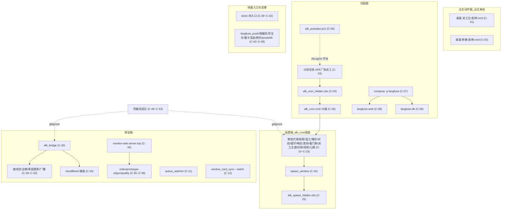

> **口径**：本卡话术/命名遵循《[00-话术统一口径正本](../00-话术统一口径正本.md)》（拍板#312）——双名制首现双写·撞车词带消歧（窗票/工序票·判色/判分）·两层口径 L1 车间（票级）/L2 派工台（窗级）。
> **消歧（本卡）**：构成物=现役引擎的运行面构件（拉起面/挂链件/常驻族/码面入口/支撑件/凭据位）；「垫片」=mjs 入口壳（实现单源在同名 .ts·拍板#254 TS 化迁移先例）；「挂链」=被 afk_cron.cmd 巡逻轮顺序拉起。

# 09-配置目录 · 01-构成物清单卡（现役引擎构成物三态总账·O6 第一步）

> **这是什么**：全厂「在役面花名册」——现役引擎由哪些件构成·逐件标 **在役/退役/试验（观察期）** 三态·各带依据锚（拍板#362 O6 第一步·版本化自举五步路径的地基件·后续版本 pin/留出分割/基类化/自举环四步候拍不动）。
> **为什么需要**：「引擎由哪些件构成」此前靠人记翻五处文档拼——本卡机扫一屏可查；O6 第二步（版本 pin）直接以本卡为地基。
> **机扫性质**：纯只读（rg/ls/read/Get-ScheduledTask/Get-CimInstance/docker ps/curl health）·零配置变更零码面零字节（git numstat 断言见窗产物）。
> **来源**：任务书 W-277（`90-过程/handoffs/任务书-W277-O6构成物清单-20261104.md`）·拍板#362·对比件=`90-过程/handoffs/对比流程-版本化自举五步路径O6-口径澄清与启动方案-20261104.html`。

## §1 机扫方法与三态判据

| 项 | 口径 |
|---|---|
| 五路机扫锚 | ①`02-全景视图/06-运行拓扑/topo-20261021-001-五类拉起链部署图.md`（五链清单源）②`91-脚本/langfuse/docker-compose.yml`（-p langfuse·3370）③计划任务「AFK厂务派工」④`91-脚本/afk_autostart.ps1`（AtLogOn 开关）⑤后台常驻族（afk_bridge/pi_runner --loop/monitor-web·`91-脚本/monitor-web/server.mjs:4-6` 定位注记） |
| 活证三道（2026-11-04 实勘） | 进程道=Get-CimInstance（脚本文件道·GBK 控制台 -Command 传参会坏中文任务名——**首查 NOT-FOUND 系查询坑非引擎侧**·教训入 §11）；容器道=docker ps；服务道=curl /api/health |
| 三态判据 | **在役**=活证锚（在跑 / 被拉起链引用 / 被账本消费）；**试验/观察期**=试点或观察期拍板在案；**退役**=退役拍板号或收口申报路径在案；**判不动→如实列 §10 待勘附节，不冒充定论** |
| 边界（不入卡） | 94-班外经验库RAG 与 pipeline-lab 其余件=判卷/eval 面（判卷面零触碰纪律·不入拉起面机扫）；91-脚本 一次性修复工具件（`_fix*.py`/`_conv_*.py` 等）非拉起非消费=非构成物（§10 注记）；凭据**值**零进卡（拍板#90·compose 段只记项目名/端口） |

构成物全景（五链分层）：

## §2 拉起面（部署面·9 件）

| 件号 | 构件名 | 拉起方式/形态 | 三态 | 依据锚 |
|---|---|---|---|---|
| C-01 | 桌面「AFK派工台-启停.cmd」（母本=`91-脚本/AFK派工台-启停桌面版.cmd`） | 业主双击·菜单 [1]启动(启用+触发计划任务+投影) [2]停止 [4]自启 [5]并行数 [6]形态 | 在役 | 桌面份 ls 实勘（2026-11-04）·部署图五链1·启停业主亲自=拍板#76⑥ |
| C-02 | 桌面「AFK桥接-启停.cmd」（母本=`91-脚本/AFK桥接-启停桌面版.cmd`） | 业主双击·[1]启动=afk_bridge_hidden.vbs 隐藏常驻 [2]停止 [3]状态 [6]隧道开关 | 在役 | 桌面份 ls 实勘＋菜单 GBK 解码实勘·拍板#78①⑥/W-019·部署图五链1 |
| C-03 | 计划任务「AFK厂务派工」 | Windows 任务计划·TimeTrigger 30min 循环 | 在役 | 活证=Get-ScheduledTask State=**Ready**（2026-11-04 脚本文件道实勘）·部署图五链2·心跳体检件（C-23）即为其哑火监视而立（拍板#350④） |
| C-04 | `91-脚本/afk_cron_hidden.vbs` | wscript 隐藏壳·计划任务动作调它再拉 afk_cron.cmd | 在役 | 部署图五链2（W-041 Get-ScheduledTask 动作实勘）·`afk_cron_hidden.vbs:1` |
| C-05 | `91-脚本/afk_autostart.ps1` | 业主面开关（on/off/toggle/status）·增删 AtLogOn 触发器 | 在役 | `afk_autostart.ps1:5`（taskName 定义）·拍板#76⑥·部署图五链2 |
| C-06 | `91-脚本/afk_cron.cmd` | 巡逻链载体·现勘 25 行 **16 道**挂链（§3 逐件） | 在役 | 现勘全文 25 行（2026-11-04 GBK 解码）·部署图五链3（基准 23 行 15 道——**时效偏差候勘误·见 §11**） |
| C-07 | `91-脚本/langfuse/docker-compose.yml` | `docker compose -p langfuse up -d`·编排 langfuse-web+langfuse-db 两容器·端口 3370 | 在役 | compose 头注（收编自 v1.1 smoke-004·2026-10-23 业主令迁移）·拍板#362 机扫锚 |
| C-08 | 容器 langfuse-web（image langfuse/langfuse:2） | compose 拉起·0.0.0.0:3370→3000 | 在役 | 活证=docker ps「Up 21 hours·3370->3000」（2026-11-04） |
| C-09 | 容器 langfuse-db（postgres:16-alpine） | compose 拉起·healthcheck pg_isready·卷 langfuse_pgdata | 在役 | 活证=docker ps「Up 21 hours (healthy)」（2026-11-04） |

## §3 巡逻链挂链成员（afk_cron.cmd 16 道·逐件）

| 件号 | 构件名 | 拉起方式/形态 | 三态 | 依据锚 |
|---|---|---|---|---|
| C-10 | `91-脚本/approval_poll.mjs`（垫片→`approval_poll.ts` 单源） | cron :4 审批代录道 `--go` | 在役 | `afk_cron.cmd:4` 现勘·部署图五链3 |
| C-11 | `91-脚本/queue_watcher.mjs`（垫片→`queue_watcher.ts`） | cron :6 `start /b` detached 常驻快车道 | 在役 | `afk_cron.cmd:6` 现勘·活证=进程 PID 25060 在跑（2026-11-04）·拍板#168/W-116 detached 化 |
| C-12 | `91-脚本/window_card_sync.mjs`（垫片→`window_card_sync.ts`） | cron :7/:21 投影道（前后双挂）＋ `--watch` 常驻形态 | 在役 | `afk_cron.cmd:7/:21` 现勘·活证=进程 `--watch` PID 62400 在跑（2026-11-04） |
| C-13 | `91-脚本/supervisor.mjs`（垫片→`supervisor.ts`） | cron :8 监工道 `--go` | 在役 | `afk_cron.cmd:8` 现勘·部署图五链3 |
| C-14 | `91-脚本/wip_scan.py` | cron :9 超时催办道 `python -X utf8 --check-feishu` | 在役 | `afk_cron.cmd:9` 现勘·部署图五链3 |
| C-15 | `91-脚本/对拍机检.mjs`（→`对拍机检.ts`） | cron :11 班前对拍道 `--selftest`（告警级不拦车） | 在役 | `afk_cron.cmd:11` 现勘·拍板#247/W-176 |
| C-16 | `91-脚本/duty_monitor.mjs`（垫片→`duty_monitor.ts`） | cron :12 值守道 `--go` | 在役 | `afk_cron.cmd:12` 现勘·拍板#304 |
| C-17 | `91-脚本/队列哨兵.mjs` | cron :13 队列哨兵道 `--go` | 在役 | `afk_cron.cmd:13` 现勘·件存在性 ls 实勘 |
| C-18 | `91-脚本/清场巡检.mjs` | cron :14 清场巡检道 `--go` | 在役 | `afk_cron.cmd:14` 现勘·W-242/W-238 批2/3 落码 |
| C-19 | `91-脚本/watchdog_llm.cmd` | cron :15 LLM 看门狗（60min 节流→duty window） | 在役 | `afk_cron.cmd:15` 现勘·`watchdog_llm.cmd:2-5` 头注（W-224 v2·拍板#305 R2） |
| C-20 | `91-脚本/pi_runner.mjs`（垫片→`pi_runner.ts` 实现单源） | cron :20 **派工主道** `--auto --loop --max-hours 4 --spawn-mode`（形态读 `.spawn-mode.txt`·缺省 print·#158/W-108） | 在役 | `afk_cron.cmd:17-20` 现勘·活证=进程 PID 52804 `--auto --loop --max-hours 4 --spawn-mode print` 在跑（2026-11-04·**即本窗宿主**）·垫片关系=`pi_runner.mjs:1`（拍板#254/W-179） |
| C-21 | `91-脚本/窗卡台对账.mjs`（→`窗卡台对账.ts`） | cron :22 窗卡台对账道 | 在役 | `afk_cron.cmd:22` 现勘·件存在性 ls 实勘 |
| C-22 | `91-脚本/经验落盘.mjs`（→`经验落盘.ts`） | cron :23 经验落盘道 `--cron-scan --since 2026-10-31` | 在役 | `afk_cron.cmd:23` 现勘·拍板#261/W-188 |
| C-23 | `91-脚本/派工心跳体检.mjs` | cron :25 心跳体检道（每轮尾·告警级不拦车）·三查三态 | 在役 | `afk_cron.cmd:25` 现勘·`派工心跳体检.mjs:2`（拍板#350④·W-265 11-03 落码）——**部署图 23 行勘验后挂链·部署图漏录·候勘误（§11）** |
| C-24 | `91-脚本/spawn_window.mjs`（垫片→`spawn_window.ts` 单源·红线件 import 面） | 被 pi_runner SPAWNER 词面 spawn·领单拉窗 | 在役 | `pi_runner.ts:88/:102`（SPAWNER+快照底座 import）·垫片关系=`spawn_window.mjs:1`（拍板#293/W-216）·部署图五链3 |
| C-25 | `91-脚本/afk_spawn_hidden.vbs` | print 静默壳（wscript 0=隐藏窗·异步发射）·运行时落 %TEMP% 副本 | 在役 | `spawn_window.ts:98-101` print 命令串纯函数·拍板#318/W-236·部署图 §增量段1 |

## §4 常驻族（13 件）

| 件号 | 构件名 | 拉起方式/形态 | 三态 | 依据锚 |
|---|---|---|---|---|
| C-26 | `91-脚本/afk_bridge.mjs`（垫片→`afk_bridge.ts` 单源） | 桌面桥接台 [1]→afk_bridge_hidden.vbs 隐藏常驻·飞书流式监听+接线员分诊+回发 | 在役 | 活证=进程 PID 21756 在跑＋`.bridge.log`（19MB）尾行 2026-11-04T01:40 当下活跃（2026-11-04）·`afk_bridge.mjs:1-3` 垫片注记（拍板#284②/W-203）·部署图五链5 |
| C-27 | `91-脚本/afk_bridge_hidden.vbs` | 桥接静默壳·`WScript.Shell.Run node afk_bridge.mjs, 0, False` | 在役 | 件实勘（GBK 解码·拍板#78②·W-019）·桌面桥接台 [1] 词面 |
| C-28 | `91-脚本/afk_receptionist.mjs`（垫片→`afk_receptionist.ts`） | 桥接接线员分诊（闲聊直答/任务转派）·模型/超时消费 `afk_dispatch_config.json` receptionist 段 | 在役 | 部署图五链5·配置总索引卡 §2 参数 2·`afk_receptionist.mjs` 消费 wecom_sender 实勘 |
| C-29 | `91-脚本/afk_wecom_callback.mjs`（垫片→`afk_wecom_callback.ts`） | 企微客服回调端点·绑 127.0.0.1:8423 | 在役 | 部署图五链5（WECOM 节点）·桌面桥接台 KFPORT=8423 实勘 |
| C-30 | `91-脚本/afk_wecom_sender.mjs`（垫片→`afk_wecom_sender.ts`） | 企微发送件（库形态·被消费） | 在役 | 消费方 rg 实勘四处：afk_bridge.ts/afk_family_kf.ts/afk_receptionist.mjs/supervisor.ts |
| C-31 | `91-脚本/afk_family_kf.mjs`（垫片→`afk_family_kf.ts`） | 家庭管家客服拉取循环（水位 seed 防重放） | 在役 | 活证=`.bridge.log` 尾 2026-11-04T01:40 KF_PULL 当下＋`.bridge-family-kf.json` mtime=11-04 09:40（2026-11-04） |
| C-32 | `91-脚本/afk_family_broadcast.mjs`（垫片→`afk_family_broadcast.ts`） | 家庭管家广播件（库形态·bridge 过渡消费面） | 在役 | 被拉起链引用=afk_bridge 过渡 import（`afk_family_broadcast.mjs:1` 词面）·**运行词面 .bridge.log 零命中·运行证据弱·如实注记候观察** |
| C-33 | `91-脚本/cloudflared.exe`（隧道B） | 桌面桥接台 [6] 按需开关·公网回调入口（8423 映射·状态 `.bridge-tunnel.json`） | 在役 | 部署图五链5·桌面桥接台 TUNFILE/TUNCLOUDFLARED 词面实勘·`.bridge-tunnel.json` 在案（10-27）——**机扫时刻未在跑（按需件·在役≠常跑·如实注记）** |
| C-34 | `91-脚本/monitor-web/server.mjs` | 后台常驻看板服务件 `--port 8424`·五路数据源聚合只读 | 在役 | 活证=进程 PID 34128 `server.mjs --port 8424` 在跑＋curl `/api/health` `{"ok":true}`（2026-11-04）·`server.mjs:4-6` 定位注记（W-256·拍板#341③④·任务书机扫锚5） |
| C-35 | `91-脚本/monitor-web/index.html` | server 路由 `/`·`/index.html` serve | 在役 | `server.mjs:523-524` 路由实勘·W-275 真数据版恢复上屏（拍板#361·收口申报 d1d44270） |
| C-36 | `91-脚本/monitor-web/prototype-ui.html` | server 路由 `/prototype-ui`＋`/lines`·`/docs`·`/tickets`（同源 fetch board·JS ?page= 切换） | 在役 | `server.mjs:528-532/:582-593` 路由实勘·W-272 交付件（d1d44270·git af36b80 已入库） |
| C-37 | `91-脚本/monitor-web/gov.html` | server 路由 `/gov` 治理配置台（并行数禁用态+六灯·候拍 O4） | 在役 | `server.mjs:598` 路由实勘·W-273 收口（拍板#358 P1） |
| C-38 | `91-脚本/monitor-web/quality.html` | server 路由 `/quality` 质量面（测试红绿+考题清单+R-F 梯） | 在役 | `server.mjs:603` 路由实勘·W-273 收口（拍板#358 P1） |

## §5 码面入口（ts/src·4 件·`ts/package.json` scripts 实锚）

| 件号 | 构件名 | 拉起方式/形态 | 三态 | 依据锚 |
|---|---|---|---|---|
| C-39 | `ts/src/queue/queue-runner.ts` | `npm run queue`（tsx 直跑）·队列账本运行道 | 在役 | `ts/package.json` scripts.queue 实勘·执行台账消费 28 笔（rg 计 2026-11-04） |
| C-40 | `ts/src/run-slice.ts` | `npm run slice`（tsx 直跑）·切片运行道 | 在役 | `ts/package.json` scripts.slice 实勘·执行台账消费 42 笔 |
| C-41 | `ts/src/confirm.ts` | `npm run confirm`（tsx 直跑）·追认/翻案道（代拍追认制回滚机制） | 在役 | `ts/package.json` scripts.confirm 实勘·`90-过程/规则-代拍与追认制.md:40`「回滚=confirm --rollback」·台账 4 笔 |
| C-42 | `ts/src/drift/cli.ts` | `npm run drift`（tsx 直跑）·漂移检测道（npm run check 四关之一） | 在役 | `ts/package.json` scripts.drift 实勘·台账 66 笔·W-265 四关自跑在案 |

> 注：typecheck/lint/test 三道=开发安全网命令面（非运行入口不单列）——W-265 收口 vitest 132 文件/1226 用例全绿即其活证；91-脚本 五垫片对应的 .ts 实现单源（pi_runner/spawn_window/queue_mutex/hook_receipt_clerk/window-card）已在 §3/§4/§6 逐件登记。

## §6 支撑件（6 件）

| 件号 | 构件名 | 拉起方式/形态 | 三态 | 依据锚 |
|---|---|---|---|---|
| C-43 | `91-脚本/langfuse_push.py` | 被 pi_runner detached spawn `--batch -`（stdin 喂 ops·零临时文件）·Langfuse 打点件 | 在役 | `pi_runner.ts` lfStepOps/lfStep 六插入点（W-274 收口·拍板#358 P0-c·commit beff6be）·真链 trace 落账实证 |
| C-44 | `91-脚本/hook_receipt_clerk.mjs`（垫片→`hook_receipt_clerk.ts`） | pi_runner CLERK 词面 detached 发射（armExitHook/armSessionClerk）·print 窗完工感知收据员 | 在役 | `pi_runner.ts:104` CLERK 词面·活证=进程两 detached 实例在跑（`--win W-276 --pid 63280`/`--win W-277 --pid 69216`·2026-11-04）·拍板#155/W-105 |
| C-45 | `91-脚本/queue_mutex.mjs`（垫片→`queue_mutex.ts`） | 库形态·窗队列写互斥（领单/钩子/复考/快照注记四写点包锁） | 在役 | `pi_runner.ts:89` import 实勘·拍板#140/W-092 |
| C-46 | `91-脚本/window-card.mjs`（垫片→`window-card.ts`） | 库形态·窗卡渲染单源 | 在役 | 消费方 rg 实勘五处：pi_runner.ts/meta-lint.ts/server.mjs/queue_watcher.ts/hook_receipt_clerk.ts |
| C-47 | `91-脚本/afk_probe.mjs` | 派工链只读探针（启停台 [3] 状态段接入·关没关干净机读自检） | 在役 | `afk_probe.mjs:1-5` 头注（件④ C1·W-116·拍板#168） |
| C-48 | `pipeline-lab/scripts/postshift.mjs`（＋事件源 `queue-events.jsonl`） | 事件驱动链：`--watch` 监听 queue_gate_failed/passed→班后复盘件（零代码写入零重跑零判卷触碰·手动复盘令直跑双道） | 在役 | 部署图五链4（as-built）·`postshift.mjs:8-12` 头注（拍板#25·触发声明）·`state_dict_check.ts:231` gate 事件词面 |

## §7 凭据会话位（5 件·全 gitignore·值零进卡=拍板#90）

| 件号 | 构件名 | 拉起方式/形态 | 三态 | 依据锚 |
|---|---|---|---|---|
| C-49 | `91-脚本/afk_bridge_sessions.json` | 桥接私有会话映射（不入投影不入文档正文） | 在役 | 部署图凭据位 C1·ls 实勘在案 |
| C-50 | `cookies/`（企微登录态） | 扫码落盘·桥接/企微族消费 | 在役 | 部署图凭据位 C2·`.gitignore:33` |
| C-51 | `91-脚本/afk_dispatch_config.json` | 派工本地配置（max_parallel+receptionist/通道段）·派工器与接线员消费 | 在役 | 部署图凭据位 C3·配置总索引卡 §2 参数 1/2·派工台 [5] 写面实勘 |
| C-52 | `ts/.env`（*.env 全族） | 密钥三键（Token/Secret/AESKey）·打点/桥接/投影消费 | 在役 | 部署图凭据位 C4·`.gitignore` 首段·compose 头注「钥匙在仓根 .env」（值零进卡） |
| C-53 | `96-运行态/` | 常驻运行态残件（连红计数/审计 jsonl 等） | 在役 | 部署图凭据位段·`.gitignore:35`·W-265 案B 三关连红计数落位 |

## §8 退役面（4 件·退役依据锚全带）

| 件号 | 构件名 | 拉起方式/形态 | 三态 | 依据锚 |
|---|---|---|---|---|
| C-54 | 飞书旧表 `tblfvvXffnFX1kVg` | 曾为投影目标表 | 退役 | 决策反转链终局：拍板#255 停写→#287 恢复投写→**#302 退役删除**→#320 W-222 码面摘道完成（两段式·实体删除随业主 UI·数据零损失事实源在本地窗队列） |
| C-55 | 存量 72 手抄 html 族（软归档四件=sm-20261101-006/旧票生命周期.html/册⑩v1/df-005 v1） | 曾为全景视图正本形态 | 退役 | 拍板#355（乙=生成件替代·丙=软归档物理零搬·README 门牌归档位列路径·W-270 完成重生成） |
| C-56 | 人肉翻账道（print 窗完工感知） | 曾为完工感知唯一道 | 退役 | 拍板#193（print 会话档收据员窗完工感知秒级·人肉翻账道退役·W-134 两笔在库） |
| C-57 | 监控前台「演示版」前端（prototype-detail-v1·b9719aea·82290B） | 曾上屏 8424 首页（11-04 早会话收口外漂移） | 退役 | W-275 收口申报（拍板#361·真数据版恢复上屏·演示版覆盖前两件 .bak-演示版-20261104091820＋归档件三重一致 b9719aea 零丢失） |

## §9 试验/观察期面（2 件）

| 件号 | 构件名 | 拉起方式/形态 | 三态 | 依据锚 |
|---|---|---|---|---|
| C-58 | pi_runner 收口感知双道（轮询保底＋退出钩子两道并行） | 收口感知观察期双保险 | 试验/观察期 | 拍板#89③（部署图边界注记原词「两道并行·观察期·拍板#89③」·终认翻单道候拍） |
| C-59 | RPC 常驻会话（pi `--mode rpc`） | 桥接 RPC 常驻（W-212 交割·灰度缺省关→启用令） | 试验/观察期 | 拍板#320（翻缺省启用·候业主重启桥接生效）·活证=进程 `cli.js --mode rpc` 在跑（2026-11-04·启用已生效）——首周观测态如实标注 |

## §10 待勘附节（判不动·如实申报·不冒充定论）

| # | 待勘件 | 卡在哪 | 申报 |
|---|---|---|---|
| D-1 | `91-脚本/monitor-web/prototype-detail.html` | server.mjs 全部路由词面（:523-:620 逐条勘验）**无此路由**；无收口申报点名其归属（W-275 演示版保全只点 .bak 两件+归档件） | 在役/退役/试验三态判不动→候勘：若系 W-271 期原型明细页遗留，退役处置候业主令；本票不改不删 |
| D-2 | `91-脚本/monitor-web/` 四个 .bak 备份件（index.html.bak-20261104075016 / prototype-ui.bak-20261104075701 / 两件 .bak-演示版-20261104091820） | 备份残件的保留策略与清理时点无拍板（W-275 只拍保全不拍清理） | 三态判不动→候勘：保留策略候业主令（本票零删） |
| D-3 | 91-脚本 一次性修复工具件族（`_baldiff.py`/`_conv_*.py`/`_fix*.py` 等下划线前缀件） | 非拉起非消费=不属「现役构成物」；但无退役拍板·不判退役 | 不入主表·注记候专项盘点票 |
| D-4 | `91-脚本/.spawn-mode.txt`（形态开关状态文件） | 状态文件非构件·当前值未读（读面属运行态） | 注记：缺省 print（#158/W-108）·值候运行态票 |

## §11 机扫时效偏差与勘误候选（如实申报·本票零改他件）

1. **afk_cron.cmd 行数/道数**：部署图 topo-001 §增量段（2026-11-03 勘验）记「全文 23 行·15 道挂链」；本卡现勘（2026-11-04）=**25 行·16 道**——差=派工心跳体检.mjs 挂链（拍板#350④·W-265 11-03 收口落码，晚于部署图勘验时点）＋尾部空行。**部署图候勘误注记（归 W-251 对账批主·本票只读不代改）**。
2. **计划任务查询坑（工具侧·非引擎侧）**：powershell `-Command 'Get-ScheduledTask -TaskName "AFK厂务派工"'` 经 GBK 控制台传参**中文任务名坏码→误报 NOT-FOUND**；改脚本文件道（UTF-8 ps1）实勘 State=Ready 在役。教训=中文实勘一律脚本文件道（meta-lint.ts 头注 GBK 坑同族先例）。
3. **00-图谱索引卡未登记本卡**：`00-图谱索引卡.html` 现处 W-270 重生成件在飞 M 态（未 commit）——本票动 md 会致 html 落后、动 html 会覆盖他窗在飞面。**B 级自决：本票不登记·候其在飞面入库后补行（限一行）·候追认**。

## §12 从哪复扫

- 断言件：`node "90-过程/窗产物/W-277-构成物清单/check_w277.mjs"`（EXIT 0=全绿·件数/五列/三态/退役锚/html 三键/零密钥六断言）
- 进程活证：`powershell -File <ps1 脚本文件道> Get-CimInstance Win32_Process`（勿用 -Command 传中文·§11.2）
- 计划任务：`Get-ScheduledTask -TaskName 'AFK厂务派工'`（脚本文件道）·容器：`docker ps`·看板：`curl http://127.0.0.1:8424/api/health`
- 机扫底稿：`90-过程/窗产物/W-277-构成物清单/`（开工界快照/红相留痕/断言件/机扫活证摘录）

---
*footer：本卡=md 正本·html 为生成件（`node 91-脚本/md2html_全景视图.mjs 02-全景视图/09-配置目录/01-构成物清单卡.md 02-全景视图/09-配置目录/01-构成物清单卡.html`）·源视图分离（拍板#352）·W-277·2026-11-04*
