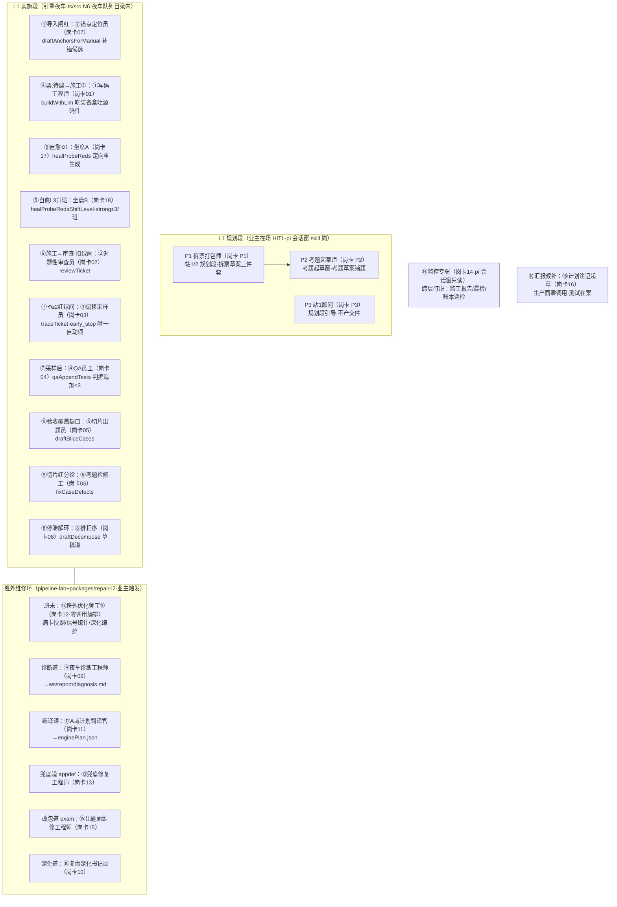

# 岗位编排卡 · gw-001 两层岗位编排总图（拍板#343）

> **本卡是什么**：一张图回答「两层事件链第 N 步，哪个 Agent员工（白话：流水线上的判断工位·LLM 调用面岗位）在干活、吃什么、吐什么」——岗与链的交叉视图（此前四类动态文档均无 agent 视角·翻五处拼不全·拍板#343 动因）。
> **怎么读**：5 分钟=§2 总图一格一行扫过去；对账某一岗=§3~§9 明细表按岗卡锚跳；查机械设备（确定性脚本/机检）角色=§10。提示词**不在本卡**——唯一事实源=岗卡（`90-过程/岗卡/`），本卡只挂锚（双源必漂移训·规划层 README 明训）。
> **口径**：话术/命名遵循《[00-话术统一口径正本](../00-话术统一口径正本.md)》（拍板#312）——白话三词首现：机械设备＝确定性脚本/机检、Agent员工＝施工窗会话（本卡收窄为 LLM 调用面岗·含引擎脚本消费面）、自然人审核＝业主；两层口径 L1＝车间流水线（票级·ts/src）/L2＝派工台（窗级·91-脚本）。
> **编制口径**：全编制一张表=20 实体/21 卡（`90-过程/岗卡/规划层岗位卡/00-README.md:18`）——引擎 15 员工岗+2 工位+规划层 3 skill 岗。输入输出节点编号引用[登记表](../07-数据流/00-节点与边总登记表.md) §〇（N=本地文件/F=飞书/A=Agent 调用面·本票新增段）。

---

## §1 岗位在事件链上的三种身份

| 身份 | 判定 | 在册岗位 |
|---|---|---|
| 判断岗（employee） | 自身有 LLM 调用面·SYSTEM 提示词进模型 | 引擎 15 员工岗+坐席A/B（一岗两卡）+规划层 P1/P2/P3（skill 装载进 pi 会话窗） |
| 编排工位（station） | 自身零模型调用·只编排判断岗 | ⑫班外优化师（`pipeline-lab/scripts/postshift.mjs`）·⑭监控专职（pi 会话窗只读不写） |
| 机械设备角色 | 无岗卡不立卡（拍板#28 口径·Agent员工=判断函数岗） | L2 全部 actor（owner/主窗/dispatcher/window/inspector/supervisor/写口/考务等·§10） |

机检底册=`pipeline-lab/scripts/check-consumers.mjs:28` CONSUMER_RE（`callLLM|budgetedChat|chat(|call({system` 三分支）——卡↔调用面对账·幽灵岗红；已卡化对账清单见其头注（①=llm-file-writer·②③=reviewer·④-⑧五件·坐席A/B 经 llm-file-writer 间接·白名单 6 件=传输/预算/编排管道非岗）。引擎 18 卡在册清单见 `90-过程/岗卡/00-README.md:31`（拍板#151② 收官表）。

## §2 两层×事件链总图（横轴=步序·每格=岗+岗卡锚+触发状态/事件）

> 状态词（施工中/审查·扣绿闸/验收/汇报）=L1 票级十一态正名（`sm-20261101-007` §14 L1 矩阵·状态定义正本在其表 B）；步序号=sm-007 §14 双矩阵行序+df 卡事件链节。L2 派工台行=§10（机械设备/自然人·零判断岗行）。

## §3 导入与拆单段明细

| 步骤 | 岗（岗卡锚） | 触发状态/事件 | 输入自节点 | 提示词锚 | 输出落节点 | 合格判据锚 |
|---|---|---|---|---|---|---|
| 导入闸红补锚 | ⑦锚点定位员（[岗卡07](../../90-过程/岗卡/07-锚点定位员.md)） | 导入红·无锚候选（W6 件③·`ts/src/night-shift/probe-gate.ts:31`） | N6 manifest∪票面白名单 | `ts/src/station3-import/anchor-draft.ts:19` ANCHOR_DRAFT_SYSTEM | N7 事件 `anchor_draft_proposed`→白名单机检过闸并入补票 | path 只准白名单原样路径或 null（`ts/src/station3-import/anchor-draft.ts:29` 输出协议） |
| 停滞解环草稿 | ⑧排程序（[岗卡08](../../90-过程/岗卡/08-排程序.md)） | 就绪制停滞 stalled（W6 件⑤·`ts/src/night-shift/ready-scheduler.ts:14`） | N6 停滞票/已完结票/依赖边盒 | `ts/src/night-shift/decompose-draft.ts:15` DECOMPOSE_SYSTEM | N6 `ws/report/attachments/decompose-draft-<runId>.md`（`ts/src/night-shift/decompose-draft.ts:38`） | 纯报告层零执行面·只起草（`ts/src/night-shift/decompose-draft.ts:2` 头注） |

> **拍定注记（2026-11-04·拍板#366·应然候施工）**：§3 候拍新工位「修包 agent」——站3 三关硬红→spawn_window 拉起·机械格式病白名单定向修⟲≤3（岗位岔激活·岗卡候立；母件=`90-过程/handoffs/方案件-L1预防六闸落地路径-20261104.md`）

## §4 施工与审查段明细（票:待建→施工中→审查·扣绿闸）

| 步骤 | 岗（岗卡锚） | 触发状态/事件 | 输入自节点 | 提示词锚 | 输出落节点 | 合格判据锚 |
|---|---|---|---|---|---|---|
| 正常开工 | ①写码工程师（[岗卡01](../../90-过程/岗卡/01-写码工程师.md)） | 票:待建→施工中（`ts/src/station4-build/build.ts:20` buildWithLlm） | N6 装备信封五槽（变量盒 protocol=factory.variable-box/v1） | `ts/src/station4-build/llm-prompts.ts:22` SYSTEM_BOX | N6 ws 源码件+N7 事件（经 `ts/src/station4-build/llm-builder.ts:63` writeOneFileAssembled） | 零漂移金样 `pipeline-lab/tests/cards-zero-drift.test.mjs`；盒内皆数据纪律 |
| 对题审查 | ②对题性审查员（[岗卡02](../../90-过程/岗卡/02-对题性审查员.md)） | 票:施工中→审查·扣绿闸（`ts/src/night-shift/build-lane.ts:24` reviewTicket） | N6 票+交付件+判卷冻结素材 | `ts/src/station4-build/reviewer.ts:42` REVIEWER_SYSTEM | N7 事件+ReviewOutcome{passed,findings,severe}（`ts/src/station4-build/reviewer.ts:20`） | 判卷守卫防篡改（judge-guard `ts/src/shared/judge-guard.ts`·上轮意见殿后 G2-7） |
| 偏移采样 | ③偏移采样员（[岗卡03](../../90-过程/岗卡/03-偏移采样员.md)） | ⟲≥2 红绿间采样·early_stop 唯一自动项（`ts/src/station4-build/build.ts:264` 钩子） | N6 ws+会话轮史（failHead 摘要） | `ts/src/station4-build/reviewer.ts:147` TRACE_SYSTEM | N7 事件+早停明细→调用方转红（`ts/src/station4-build/l3-sample.ts:29`） | 宁停不装绿（`ts/src/station4-build/l3-sample.ts:3` 头注） |
| 判据追加 | ④QA员工（[岗卡04](../../90-过程/岗卡/04-QA员工.md)） | 采样后起草道（`ts/src/station4-build/l3-sample.ts:35` qaAppendTests） | N6 票+漂移 findings+轮史 | `ts/src/station4-build/qa-agent.ts:17` QA_SYSTEM | N6 qa-N 判据草案→appendJudgeTest 自动晋升（上限 3） | qa-N 无判卷权物种·只新增不覆盖（`ts/src/station4-build/qa-agent.ts:2` 头注） |

## §5 自愈段明细

| 步骤 | 岗（岗卡锚） | 触发状态/事件 | 输入自节点 | 提示词锚 | 输出落节点 | 合格判据锚 |
|---|---|---|---|---|---|---|
| 票级自愈⟲1 | 17维修工程师坐席A（[岗卡17](../../90-过程/岗卡/17-维修工程师坐席A.md)） | probe 红未定位·⟲1 票级（`ts/src/station4-build/probe-selfheal.ts:97` healProbeReds） | N6 失败明细+siblings 附加盒 | `ts/src/station4-build/llm-prompts.ts:22` SYSTEM_BOX（经 `ts/src/station4-build/llm-builder.ts:84` regenFile） | N6 定向重生成落点文件 | 修复预算与轮闸只收缩不放宽（岗卡必守规则区） |
| 票级自愈L3升班 | 18维修工程师坐席B（[岗卡18](../../90-过程/岗卡/18-维修工程师坐席B.md)） | ⟲1 后仍红·L3 升班（`ts/src/station4-build/probe-selfheal.ts:145` healProbeRedsShiftLevel·:186 seatB:true） | 同坐席A+跨票接口面 | 同坐席A（repairTier:'strong' 压票面档·`ts/src/station4-build/llm-builder.ts:94`） | 同坐席A | SEAT_B_CAP≤3/班（岗卡18 必守规则区） |
| 切片自愈 | 17/18（同上两卡） | 切片红归属票定向重写（`ts/src/station5-verify/slice-selfheal.ts:37` healSliceReds·:55 regenFile） | N6 切片失败明细 | 同坐席链 | N6 定向重生成落点文件 | 功能门⟲1 由装配保证（`ts/src/station5-verify/stage27.ts:6` 头注） |

## §6 验收段明细（station5）

| 步骤 | 岗（岗卡锚） | 触发状态/事件 | 输入自节点 | 提示词锚 | 输出落节点 | 合格判据锚 |
|---|---|---|---|---|---|---|
| 切片考题起草 | ⑤切片出题员（[岗卡05](../../90-过程/岗卡/05-切片出题员.md)） | 验收覆盖缺口嫌疑→起草（W6 件⑥·`ts/src/station5-verify/stage27.ts:16`） | N6 切片红+契约行 | `ts/src/station5-verify/slice-draft.ts:14` SLICE_DRAFT_SYSTEM | N6 qa-slice- 前缀考题（副本只增·五道机检晋升 `ts/src/station5-verify/slice-draft.ts:10`） | 站2 正本字节冻结+ws 副本只增+上限 |
| 考题病修复 | ⑥考题检修工（[岗卡06](../../90-过程/岗卡/06-考题检修工.md)） | 切片崩溃签名 NA 分诊→修复道（W6 件⑦·`ts/src/station5-verify/stage27.ts:17` fixCaseDefects·`ts/src/run-slice.ts:24` applyCaseFixes） | N6 病单（崩溃签名·`ts/src/station5-verify/functional-gate.ts:18` isCaseDefect） | `ts/src/station5-verify/case-defect.ts:58` CASE_FIX_SYSTEM | N6 `ws/_slices/case-fixes.json`（`ts/src/station5-verify/case-defect.ts:21`·undo 随件） | 崩溃签名 NA≠app 红；断言集不可减（修复原语白名单） |
| 计划注记候补 | ⑯计划注记起草（[岗卡16](../../90-过程/岗卡/16-计划注记起草工程师.md)） | **生产面零调用**（测试调用在案 `ts/src/phase3.test.ts:13`·事件消费 `ts/src/night-shift/report-agg.ts:190`） | 话题盒 | `ts/src/station4-build/plan-annotation.ts:13` ANNOTATION_SYSTEM（:35 budgetedChat） | N6 `_plan_notes/`（乙级语义增补·只加严不加松） | 在役零生产调用·如实申报（§11） |

## §7 规划层明细（pi 会话窗 skill 岗·业主在场 HITL）

| 步骤 | 岗（岗卡锚） | 触发 | 输入自 | 提示词锚 | 输出落 | 合格判据锚 |
|---|---|---|---|---|---|---|
| 拆票打包 | P1 拆票打包师（[岗卡P1](../../90-过程/岗卡/规划层岗位卡/P1-拆票打包师.md)） | 站1/2 规划段（编制链 #101③→#170B→#209） | 业主素材包 | `站点1站点2方案规划流程/工具包/skills/拆票打包师/SKILL.md`（规格卡不复制·规划层 README 纪律2） | 拆票草案三件套→站3 导入 | 规程正本=`站点1站点2方案规划流程/引擎站点12/拆票打包师流程件-20261023.md` |
| 考题起草 | P2 考题起草师（[岗卡P2](../../90-过程/岗卡/规划层岗位卡/P2-考题起草师.md)） | 考题起草窗 | 包+考题面 | `站点1站点2方案规划流程/工具包/skills/考题起草师/SKILL.md` | 考题草案铺题→站2 | 规程正本=`站点1站点2方案规划流程/引擎站点12/考题起草窗流程件.md` |
| 规划引导 | P3 站1顾问（[岗卡P3](../../90-过程/岗卡/规划层岗位卡/P3-站1顾问.md)） | 规划段全程引导 | 规划段对话 | `站点1站点2方案规划流程/工具包/skills/站1顾问/SKILL.md` | 引导问题（不产交件） | skill 自含规程（#211 如实存照） |

## §8 班外环编排段明细（业主触发·pipeline-lab 系·全 user 身份）

| 步骤 | 岗（岗卡锚） | 触发状态/事件 | 输入自节点 | 提示词锚 | 输出落节点 | 合格判据锚 |
|---|---|---|---|---|---|---|
| 班末编排 | ⑫班外优化师工位（[岗卡12](../../90-过程/岗卡/12-班外优化师工位.md)） | 班末收车（nightrun-wrap 链后） | N6 班产物 | —（工位零模型调用·station 降配版） | 编排病卡快照/信号统计/深化（`pipeline-lab/scripts/postshift.mjs:76,103,131`） | 缺参不推卡·显式 --base-token 才推 F2/F3（`pipeline-lab/scripts/postshift.mjs:76`） |
| 诊断 | ⑨夜车诊断工程师（[岗卡09](../../90-过程/岗卡/09-夜车诊断工程师.md)） | fail-loop 诊断道 --force（`pipeline-lab/scripts/fail-loop.mjs:752`） | N6 findings/班产物证据包 | 岗卡进prompt区·读卡 fail-closed（`pipeline-lab/scripts/diagnose.mjs:52`） | N6 `ws/report/diagnosis.md` 四段+免责行（`pipeline-lab/scripts/diagnose.mjs:110`）+TOP1 回写 F3 病卡 | 非法 JSON 喂错重试·预算内（`pipeline-lab/scripts/diagnose.mjs:115` 头注） |
| 深化复盘 | ⑩复盘深化书记员（[岗卡10](../../90-过程/岗卡/10-复盘深化书记员.md)） | postshift 深化道 --kind both（`pipeline-lab/scripts/postshift.mjs:131`） | N6 班产物 | 岗卡进prompt区三段·读卡 fail-closed（`pipeline-lab/scripts/report-deepen.mjs:97`） | N9 report 深化报告 | 卡区应恰三段·不符 throw（`:100`） |
| 计划翻译 | ⑪A域计划翻译官（[岗卡11](../../90-过程/岗卡/11-A域计划翻译官.md)） | fail-loop 编译道（runCompileFn·diagnosis.md→施工图） | 诊断件+根因+范围锁摘记 | 岗卡进prompt区·读卡 fail-closed（`pipeline-lab/scripts/compile-plan.mjs:56`） | `out/enginePlan-<runId>.json`（`pipeline-lab/scripts/compile-plan.mjs:225`） | file 只准来自允许清单·不发明新改动（`:56` 头注） |

## §9 修复执行与盯班段明细

| 步骤 | 岗（岗卡锚） | 触发状态/事件 | 输入自节点 | 提示词锚 | 输出落节点 | 合格判据锚 |
|---|---|---|---|---|---|---|
| 兜底修复 | ⑬兜底修复工程师（[岗卡13](../../90-过程/岗卡/13-兜底修复工程师.md)） | domain=appdef 终局兜底道（`pipeline-lab/scripts/fail-loop.mjs:65`→:566-579 经 repair-cli spawn tsx） | enginePlan（A域白名单） | `packages/repair-l2/src/fallback-repair.ts:44` FALLBACK_SYSTEM | N6 ws 文件全文 JSON 白名单落盘 | 四道闸只收缩不放宽（A域双根/根因≤3/每根因≤3/账闸独立）；**station 搬址欠账**见 §11 |
| 出题面维修 | ⑮出题面维修与计划增补工程师（[岗卡15](../../90-过程/岗卡/15-出题面维修与计划增补工程师.md)） | domain=exam 包病改包道（`pipeline-lab/scripts/fail-loop.mjs:79`·:105-107） | 考题文件盒（examFile 相对路径） | `packages/repair-l2/src/exam-repair.ts:41` EXAM_SYSTEM | 修复后考题全文+`_repair-before` 改前副本 | 禁反向迁就机检（断言/用例只增不减·放松=拒收·`:46` 纪律行）；**station 搬址欠账**见 §11 |
| 跨层盯班 | ⑭监控专职（[岗卡14](../../90-过程/岗卡/14-监控专职工位.md)） | 值巡班表（监工报告/晨检/账本巡检/对照试跑盯班） | N1/N6/N9 只读 | —（pi 会话窗宿主·station 只读不写） | 监工推卡→F6 IM（supervisor 道同源） | 只读不写（岗卡14 station 行） |

## §10 L2 派工台角色行（机械设备/自然人·零 Agent员工判断岗申报）

| 角色 | 机械设备/自然人 | 事件链职责 | 岗卡 |
|---|---|---|---|
| owner | 自然人审核（业主） | 拍板落账/终认/挂账随裁/代拍追认 | 无（自然人） |
| 主窗 | 机械设备编排+Agent 施工窗 | 立票三关/审批规格节 | 无（编排道·任务书代录） |
| dispatcher | 机械设备（pi_runner） | 领单五闸/体检门/定档/翻格开窗/心跳/收割 | 无 |
| window | Agent 施工窗（pi 会话） | 施工/收口五件套/方向题推卡 | 无专卡（施工窗内消费岗卡岗的产物） |
| inspector | 机械设备（wip_scan/哨兵） | 巡逻/落差机检/宁停判死 | 无 |
| supervisor/duty | 机械设备+pi 会话窗（值守道） | 监工推卡/值守六查 | 无专卡（值守窗≠岗卡编制 21 卡内岗·如实申报 §11） |
| 写口 | 机械设备（队列写口.mjs） | 唯一写口四道（词面/宪法/乐观锁/审计） | 无 |
| 考务 | 机械设备+业主 | 复考闸判卷/考题分家/留出终考 | 无 |

> L2 全部翻格 actor=owner/主窗/dispatcher/window/inspector/supervisor/duty+LLM/值守/人工/制度/写口/考务（`sm-20261101-007` §14 L2 矩阵 35 行 actor 列逐格实勘·零 Agent员工岗卡岗）——L2 是编排与治理层，判断岗全在 L1 车间与班外环。**唯二 pi 会话窗面**：施工窗（消费①②③…卡岗产出）与值守窗（六查推进·非编制内岗）。

## §11 如实申报三件（不装齐）

1. **⑯计划注记起草=在役零生产调用**：`runPlanAnnotation`（`ts/src/station4-build/plan-annotation.ts:23`）导出后 ts/src 生产代码零调用点，唯一调用=`ts/src/phase3.test.ts:13`（测试）+`ts/src/night-shift/report-agg.ts:190` 消费其 runId 事件——卡在岗、链上暂无触发点，候接线票。
2. **⑬⑮ station 搬址欠账（存量红）**：两卡 station 字段仍指旧址（`ts/src/night-shift/fallback-repair.ts`/`ts/src/station4-build/exam-repair.ts`），真实调用面已随 W-152（拍板#213）git mv 迁 `packages/repair-l2/src/`——check-consumers 反向因此红 2 处（2026-11-03 开工实勘在案）；岗卡=零字节禁区，本卡按**新址**记锚，修 station 字段候岗卡领地窗小票。
3. **值守窗/施工窗非编制内岗**：两窗=pi 会话形态（LLM 会话），不在 20 实体/21 卡编制表内（`90-过程/岗卡/规划层岗位卡/00-README.md:18`）——本卡只记其机械设备/窗口角色位，不替业主立卡。

## §12 防重复指针

- 提示词正本=岗卡 21 卡（`90-过程/岗卡/`），本卡零复制只挂锚；agent 输入输出契约正本=[登记表 §〇-A 段](../07-数据流/00-节点与边总登记表.md)，本卡明细表只写节点号不展开字段。
- 状态定义/迁移边正本=状态机卡（sm-20261101-007 §13/§14），本卡状态词只作触发列标注；数据边正本=登记表 §一~§六；机制正名=话术正本+机制目录。
- 两层定义与 L2 派工台详述=`07-设计理念专题/` 两件 v1.1+sm-20261101-007 第一章——本卡不重复。

## §13 evidence（实勘底册·2026-11-03·repo_head 8ef60c9）

- 码面调用面：llm-prompts/reviewer/qa-agent/slice-draft/case-defect/anchor-draft/decompose-draft/plan-annotation SYSTEM 常量行·build/llm-builder/build-lane/probe-selfheal/slice-selfheal/l3-sample/stage27/run-slice/functional-gate/probe-gate/ready-scheduler 调用行（§3~§6 表逐行列锚）·pipeline-lab diagnose/report-deepen/compile-plan/postshift/fail-loop 调用行（§8~§9 表逐行列锚）·packages/repair-l2 两执行件 SYSTEM 行。
- 编制正本：`90-过程/岗卡/00-README.md`（18 卡+机检三件套纪律）+`90-过程/岗卡/规划层岗位卡/00-README.md`（全编制 20 实体/21 卡表）。
- 在册对账：`pipeline-lab/scripts/check-consumers.mjs` 头注在册清单+CONSUMER_RE 三分支（:28）。
- 矩阵对照：sm-20261101-007 §14 L2 35 行/L1 31 行 actor 列逐格实勘（L2 零岗卡岗·L1 唯「两岗编制」行=P1/P2）。
- 事件链素材：df-001/003/004/005 §典型事件链节+登记表 §一/§三/§四/§五 边明细（编号引用零漂移）。
