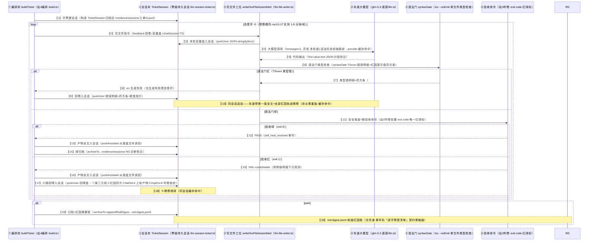
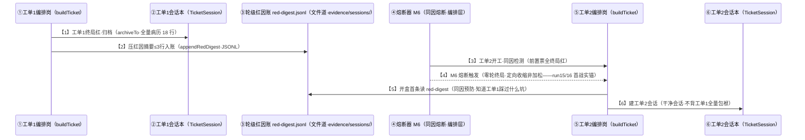
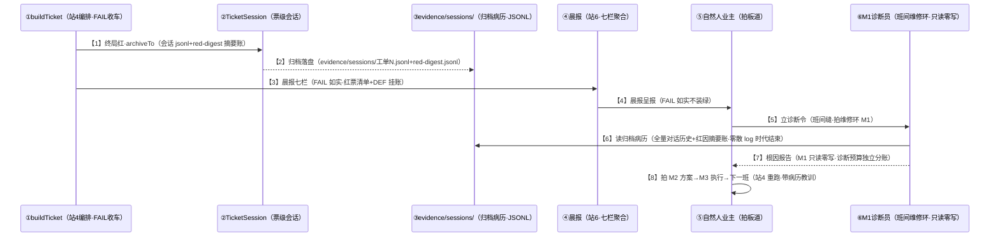
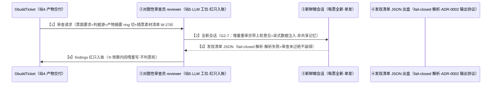

# 岗位编排 · 持续化会话时序图（#502 规范重写版 · run13-17 五轮实证驱动 · 拍板#501 实现形态）

<!-- meta: tags=岗位编排,会话持久化,时序图,红因路由,流程图规范 -->

> **形态声明（拍板#502）**：本件权威形态=md（mermaid 流程图节点带「**编号+白话口述+专业名称**」三要素）·html 版转存档展示（`90-过程/handoffs/对比件-会话持久化岗位持续化-现状vs改后-20261108.html`）。
> 关联：模块卡 mk-20261108-001（十六岗位三法则评估定稿）· 拍板#501（会话持久化 MVP·commit 7ad539d）· 实证存证=`面试助手/MeetingCopilot/rag-poc/acceptance-opt/` 判卷存证族+`evidence/sessions/`（run17 归档实锚：工单1.jsonl 18 行病历+red-digest.jsonl 摘要账双笔）
> 判定法则：①迭代闭环→持续化 ②裁决/审查/诊断独立性→不持续化 ③单发起草→不持续化 ④判卷闸族→严禁（红线）

---

## 图 1 · 站 4 车道票级会话主时序（持续化主受益岗 · #501 实现真实形态 · run17 实锚验证）

**口述总纲**：编排岗建一个「票级会话本」（TicketSession），车道大模型每写一版代码就过「语法门」体检；体检不过，把化验单和药方写回会话本让大模型**带着自己上一版代码精修**（不是从零重抽）；体检过了跑验收，绿了归档收工，红了继续精修，两次都不行就终局归档并写三行红因摘要给下一班。

**run17 实锚**：【10】精修形态实证（park#1 自愈期 564s≈9.4 分钟=四轮最长·车道在会话内深度迭代）·【14】【19】归档实锚（工单1.jsonl 18 行病历+red-digest.jsonl 双笔摘要账）·【9】回喂实锚（red-digest 摘要 30 秒定位第 15 病：模型路径布局解析 bug）。

---

## 图 2 · 轮级红因摘要账 · 跨票传递时序（工单1→工单2·同因预防与 M6 熔断互补）

**口述总纲**：工单 1 终局时把「三行红因摘要」写进轮级红因账（一个 jsonl 文件）；工单 2 开工开盒时先读这份账——知道工单 1 踩过什么坑，避免同因各踩一遍。它和 M6 同因熔断是互补关系：熔断负责「止损」（前置全红就别跑了），摘要账负责「预防」（跑了也别踩同一个坑）。

**run17 实锚**：【2】red-digest.jsonl 双笔落盘（15:28/15:31 两轮终局摘要·含 ANSI 转义原文如实）——摘要账「值」的即时实证：判卷方 30 秒定位第 15 病（对比前四轮读码半小时）。

---

## 图 3 · 会话归档咬合班间维修环（M1 诊断员的免费病历）

**口述总纲**：夜车 FAIL 收车时，票级会话自动归档成「全量病历」（evidence/sessions/）——班间维修环的 M1 诊断员（只读零写岗位）直接读病历出根因报告，不再靠零散的 build-fail 日志拼线索。这解决了 M1 的老毛病：以前诊断要翻一堆零散文件，现在一份归档就是完整病史。

**run17 实锚**：evidence/sessions/ 双件落盘（工单1.jsonl 18 行+red-digest.jsonl 双笔）——【6】的病历质量首次达标（此前 M1 只能读零散 build-fail log）。

---

## 图 4 · 对照 · 不持续化岗位（法则②·reviewer 对题性审查员示例）

**口述总纲**：审查员岗位**故意不用持续会话**——每票全新会话保持「新鲜眼」（防止上轮说有病、这轮没病就放行的锚定偏差）；上轮意见需要延续时用「显式注入」（G2-7：把上轮意见当数据放进本轮输入），而不是共享记忆。这与车道岗位（法则①持续化）形成刻意的设计对比：**干活的要记性好，验收的要没偏见**。

**红线对照**：判卷闸族（judge-guard/symbol-gate/probe-gate/mutation-gate/crap-gate/ladder 六闸）**任何 LLM 形态都严禁**——LLM 进判卷=考生自判（判卷语义零触碰红线）。

---

## 附 · 五轮形态链与成本（持续化前后对照）

| 轮 | 会话形态 | 红因（带编号口述+专业名） | LLM 计量 |
|---|---|---|---|
| run13 | 无状态 | 【挂死】进程 300s 无输出（Atomics.wait 10min 无 watchdog·第 13 形态） | 6 调用/91,288 |
| run14 | 无状态+#498 挂死盒 | 【TS2339】类字段未声明（constructor 动态挂字段） | 11/139,670 |
| run15 | 无状态+#499 TS2339 盒 | 【TS2322】SAB 进 transferList（共享≠可转移）——TS2339 未复发=盒起效 | 18/231,993 |
| run16 | 无状态+#500 类型族盒 | 【TS2304】引用未定义名称（族盒触发·仍未收敛·第 6 亚型） | 24/318,050 |
| **run17** | **票级会话（#501）** | 【语法门族】模型路径布局解析 bug（第 15 病·red-digest 30 秒定位） | 30/412,528 |

五轮累计 89 调用/1,193,529 tokens。run17 自愈期 564s=四轮最长（会话内深度迭代实证·精修形态已发生）——收敛仍未达但缓存命中未达预期（provider context caching 启用验证=#501 MVP 如实申报项·cache_control 支持待冒烟）。

## 落盘 tags

`<!-- meta: tags=岗位编排,会话持久化,时序图,流程图规范,红因路由 -->`

## 变更行

- 2026-11-08 v1 立稿（四图草稿）→ 同日 v2 按 #502 规范重写（mermaid 节点三要素：编号+白话口述+专业名称·覆盖草稿·主窗代录）
