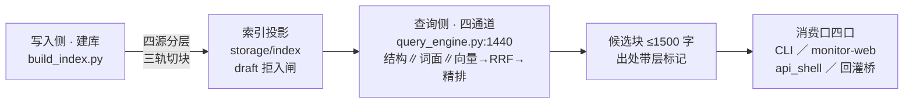

# RAG 现状总览卡 · 94 区检索体系一页总览（11-RAG专题 首件）

> **本卡管什么**：94-班外经验库RAG（本仓知识检索子系统·Agent员工查资料用的机械设备）的现状一页总览——写入侧怎么建库、查询侧怎么出候选、谁在消费、GPU 与同步面现状。**只锚不搬**：正本散在 `07-设计理念专题/`（理念）、`07-数据流/df-20261103-001`（全链数据流）、94 区源码（实现）——本卡每条结论只放锚点，正文零复制（02-全景视图 README 防重复四规）。
> **行号口径**：全部锚=本窗 W-420 对 repo_head `991159f` 实勘（grep+sed 直读）；深读实勘件与 df-001 的旧行号已漂移（见 §八），本卡不沿用旧行号。

## 一、一句话定位

94 区 RAG=**md 权威事实源＋storage 可重建投影**（理念锚=`07-设计理念专题/检索体系设计理念总纲-分层召唤场景路由与VCP借鉴结算-20261023.md` §四）：知识文件是唯一事实源（git 审计·人可读），索引与缓存全是可删可重建的投影（删库重建=标准恢复动作）；建库多源四层分池（`94-班外经验库RAG/settings.py:191` kb_sources），查询四通道编排出候选块（`94-班外经验库RAG/query_engine.py:1440` retrieve_hybrid），**检索只产候选不产结论**（提醒级·拍板#69）。

## 二、管线四通道（查询侧）

四通道编排=确定性键短路在前、三路并行居中、融合精排殿后（理念锚=检索总纲 §一「门在融合前」；实现锚=query_engine.py 本 HEAD 实勘）：

1. **T0 确定性键短路**：`--kind/--tag/--scope/--hybrid` 先滤后取，不进融合（检索总纲 §一；`--scope` 层硬过滤用法见 `query_engine.py:13-14` 头注）。
2. **结构路**：命中块做种子→引用图 PPR 扩散→血缘块（`query_engine.py:1767` structure_candidates／`:1499` ppr_rank·damping=0.85；缺省开=拍板#141）。
3. **词面路 BM25**：jieba 分词（W-060 修复中文生效）＋保词正则；process 语料不入词面路（W-091 语料门）。
4. **向量路双段**：engine+common 两段先滤后取（Qwen3-Emb-0.6B），硬身份去重后并集。

三路汇入 **RRF 融合 k=60**（`query_engine.py:1024` rrf_merge·按名次折算不怕分数不可比）→ **bge-reranker-v2-m3 fp16 精排**（`query_engine.py:246` apply_rerank·CLI 常开·`--no-rerank` 逃生口 `query_engine.py:8`）→ **结构配额护栏**（`query_engine.py:1671` apply_structure_quota·每文档 1 块降尾）→ 出口三件（弱命中标注 z<2.3／hit_log 使用日志／perf_log 计时缺省关）。

**三条铁律**（锚=检索总纲 §一）：①门设在融合之前，融合之后不设线；②RRF 只按名次折算，不怕各路分数不可比；③每个开关缺省关＋对表达标后另拍缺省（两段式）。**缺省开关全表**（hybrid=True 拍板#118／structure=True 拍板#141／dedup_sim=False 拍板#131 等）锚=`07-设计理念专题/RAG全链触发机制-写入与查询双阶段代码实勘-20261025.md` §三——逐值出处以该件为准，本卡不复制表文。

## 三、切块三档与建库三轨（写入侧）

**切块三档**（`94-班外经验库RAG/rrm_chunker.py:41-47` 常量段·本 HEAD 实勘）：

| 档 | 窗/重叠 | 状态 | 锚 |
|---|---|---|---|
| small_window | 350/35 | **缺省档**（W-374·拍板#449⑥·小块检索→大窗供给两段式） | `rrm_chunker.py:107/:233` |
| sentence_window | 800/80 | 可选档（VCP TextChunker 本仓化） | `rrm_chunker.py:44-45` |
| section | 节切 | 旧节切逃生口（显式设置可达·其他值 fail-closed RuntimeError） | `rrm_chunker.py:41` |

**建库三轨分派**（`94-班外经验库RAG/rrm_chunker.py:306` dispatch_documents·本 HEAD 实勘）：RRM verified 档走档位切块；legacy 档走旧切分器＋**0.85 降权标**（`query_engine.py:95` LEGACY_PENALTY·拍板#59 双轨保留·不回改不排除）；process 轨=五类件白名单（拍板表/台账/窗队列/任务书/收口报告）宽松分块**帽 4000**（`query_engine.py:1277`·W-091 拍板#140·仅显式 `--scope=process` 可达）。

**拒入闸**：frontmatter status=draft 的档在建库即拒（`build_index.py:63-65` INDEX-BLOCKED·fail-closed 计数如实）——绿驱动写入：只有 verified 许入 RAG 索引（rrm_lint B1·拍板#59②）。

## 四、数据落位

- **kb_sources 缺省四源**（`94-班外经验库RAG/settings.py:191-241`·本 HEAD 实勘）：`10-专题档案`＋`02-全景视图`=engine 层（W-040 拍板#93③ 现状态入池）＋`07-设计理念专题`=engine 层（W-403·拍板#508 乙案）＋`95-公共经验库-invariant`=common 层；93 病卡=app 层经回灌桥、**缺省关**（见 §五口4）。四层分池不混（W-028 拍板#88②·检索稀释实证 W-006）。
- **落位产物**：嵌入缓存双轨（RRM=sha1 文本哈希＋配置指纹·换模型天然 miss；legacy=IngestionCache 按层分键——锚=实勘件 §二）＋索引落盘 `storage/index`（块数时点口径锚=`02-全景视图/07-数据流/df-20261103-001-知识库RAG数据流v2.md`）。
- **storage 全目录=gitignore 投影**：删库重建=标准恢复动作，非事故（检索总纲 §四）。
- **同步机制**：拍板#513 乙案=事件驱动翻档即重建＋漂移灯兜底（挂账来源=`91-脚本/经验落盘.mjs:162`）；看门 `91-脚本/rag_sync_watch.py` 由 W-408 产出（窗队列在飞·完工待确认态）。

## 五、消费口四口

| 口 | 形态 | 锚（本 HEAD 实勘） |
|---|---|---|
| ① 维修员 CLI | `query_engine --retrieve` 只检索不烧 LLM·≤1500 字候选块带层标记 | `query_engine.py:5` 头注 |
| ② monitor-web | `GET /api/kb/search?q=` 子进程调 .venv312 检索·零 LLM 零预算只读 | `91-脚本/monitor-web/server.mjs:646`（W-368）·`:32` 只读注记 |
| ③ api_shell | 9414 端口 SSE 检索阶段事件壳·**随用随起零常驻** | `94-班外经验库RAG/api_shell/main.py:44-50` lifespan（W-370·拍板#448①） |
| ④ 93 回灌桥 | 93 病卡入池开关·**缺省关** | `94-班外经验库RAG/wardcard_bridge.py:43` wardcard_enabled（W-125·拍板#170 C1） |

## 六、GPU 资源面与同步现状

- **模型配置**：嵌入 qwen3-embedding-0.6B（cuda）＋精排 bge-reranker-v2-m3 fp16——量级与驻留证据链=业主勘验 2026-11-09（对比件 §1：进程不退模型不卸·驻留 29h 占显存 ~2.4GB）。
- **应然 vs 实然**：设计=随用随起非常驻（`api_shell/main.py:44-50` lifespan docstring「进程起时加载一次·进程退即散」）；实然=进程不退模型不卸（业主勘验在案·对比件 §1）。
- **修复已批在排**：拍板#527（shutdown 钩子卸载模型＋idle 超时自动卸载缺省关·两段式）——施工归 GPU 面另票，本票零码零触碰。
- **同步乙案在飞**：拍板#513（事件驱动增量建库＋漂移灯兜底）·W-408 完工待确认——终认后 02-全景视图 新档自动接引入索引（本卡 status=draft 期内不入池·终认翻 verified 后即被看门收进）。

## 七、边界红线（本视角纪律·全部只锚）

1. **只产候选不产结论**：RAG 检索=提醒级候选，结论权在核账与业主（拍板#69·锚=本仓 AGENTS.md 讨论引擎类路由）。
2. **判卷零触碰**：判卷语义一寸不动·预算三路原样·出题权冻结在开工前（立项说明书 §七）——本视角区纯文档零码。
3. **运行时只读不写**：检索口只读（`server.mjs:32`）；写入只有 md 落盘→draft→业主过目翻 verified 一条道（绿驱动写入·对比件 §3②）。
4. **调参走申请单制**：rag_tuning 四参改动须申请单（拍板#143·对比件 §6）。
5. **只锚不搬**：理念正本=`07-设计理念专题/`、全链图正本=`07-数据流/df-20261103-001`、实现=94 区源码——本区引用不复制（02-全景视图 README 防重复四规·对比件 §6）；html 一律生成件（md2html 流程·手改会被渲染器覆盖）。

## 八、时效与对账（现状体三闸自我声明）

- 本卡锚=repo_head `991159f`（2026-11-09 实勘）；**深读实勘件（sug-20261109-rag-full-chain·repo_head 716576f）与 df-001（e170067）的 query_engine/rrm_chunker 行号已漂移**（例：retrieve_hybrid :899→现 :1440·dispatch_documents :153→现 :306·retrieve_for_query :1375→现 :2042·本窗 grep 复核）——两件文档的结论仍有效（符号未变），行号以本卡为准；两件追笔归各件失效触发条款与核账道，本票零触碰。
- 任一失效触发命中（见 frontmatter）→本卡过期改 draft→对账重制再翻 verified（02-全景视图 README 现状体三闸）。
---
id: rg-20261109-001
kind: 模块卡
domain: engine
window: W-420
type: 模块卡
status: draft
created_at: 2026-11-09
repo_head: 991159f
run_id: W-420
owner: 业主
tags: [知识库RAG, 全景视图, query_engine, 向量索引]
anchors: ["94-班外经验库RAG/settings.py:191", "94-班外经验库RAG/query_engine.py:95", "94-班外经验库RAG/query_engine.py:1024", "94-班外经验库RAG/query_engine.py:1440", "94-班外经验库RAG/query_engine.py:2042", "94-班外经验库RAG/rrm_chunker.py:41", "94-班外经验库RAG/rrm_chunker.py:306", "94-班外经验库RAG/build_index.py:63", "94-班外经验库RAG/api_shell/main.py:44", "94-班外经验库RAG/wardcard_bridge.py:43", "91-脚本/monitor-web/server.mjs:646"]
related: ["df-20261103-001", "sug-20261109-rag-full-chain", "sug-20261109-retrieval-design"]
as_of: 2026-11-09
基准: repo_head 991159f（本窗 W-420 逐锚实勘）
生成式: 否
核对: 2026-11-09（消费口四口/降权/切块三档/拒入闸均本窗 grep+sed 直读）
失效触发: query_engine/rrm_chunker/build_index/settings/api_shell/wardcard_bridge 任一改码、拍板#527 GPU 修复批落地、拍板#513 乙案 W-408 终认翻档——任一命中即过期改 draft 对账重制（B1 保鲜闸）
---

# RAG 现状总览卡 · 94 区检索体系一页总览（11-RAG专题 首件）

> **本卡管什么**：94-班外经验库RAG（本仓知识检索子系统·Agent员工查资料用的机械设备）的现状一页总览——写入侧怎么建库、查询侧怎么出候选、谁在消费、GPU 与同步面现状。**只锚不搬**：正本散在 `07-设计理念专题/`（理念）、`07-数据流/df-20261103-001`（全链数据流）、94 区源码（实现）——本卡每条结论只放锚点，正文零复制（02-全景视图 README 防重复四规）。
> **行号口径**：全部锚=本窗 W-420 对 repo_head `991159f` 实勘（grep+sed 直读）；深读实勘件与 df-001 的旧行号已漂移（见 §八），本卡不沿用旧行号。

## 一、一句话定位

94 区 RAG=**md 权威事实源＋storage 可重建投影**（理念锚=`07-设计理念专题/检索体系设计理念总纲-分层召唤场景路由与VCP借鉴结算-20261023.md` §四）：知识文件是唯一事实源（git 审计·人可读），索引与缓存全是可删可重建的投影（删库重建=标准恢复动作）；建库多源四层分池（`94-班外经验库RAG/settings.py:191` kb_sources），查询四通道编排出候选块（`94-班外经验库RAG/query_engine.py:1440` retrieve_hybrid），**检索只产候选不产结论**（提醒级·拍板#69）。

## 二、管线四通道（查询侧）

四通道编排=确定性键短路在前、三路并行居中、融合精排殿后（理念锚=检索总纲 §一「门在融合前」；实现锚=query_engine.py 本 HEAD 实勘）：

1. **T0 确定性键短路**：`--kind/--tag/--scope/--hybrid` 先滤后取，不进融合（检索总纲 §一；`--scope` 层硬过滤用法见 `query_engine.py:13-14` 头注）。
2. **结构路**：命中块做种子→引用图 PPR 扩散→血缘块（`query_engine.py:1767` structure_candidates／`:1499` ppr_rank·damping=0.85；缺省开=拍板#141）。
3. **词面路 BM25**：jieba 分词（W-060 修复中文生效）＋保词正则；process 语料不入词面路（W-091 语料门）。
4. **向量路双段**：engine+common 两段先滤后取（Qwen3-Emb-0.6B），硬身份去重后并集。

三路汇入 **RRF 融合 k=60**（`query_engine.py:1024` rrf_merge·按名次折算不怕分数不可比）→ **bge-reranker-v2-m3 fp16 精排**（`query_engine.py:246` apply_rerank·CLI 常开·`--no-rerank` 逃生口 `query_engine.py:8`）→ **结构配额护栏**（`query_engine.py:1671` apply_structure_quota·每文档 1 块降尾）→ 出口三件（弱命中标注 z<2.3／hit_log 使用日志／perf_log 计时缺省关）。

**三条铁律**（锚=检索总纲 §一）：①门设在融合之前，融合之后不设线；②RRF 只按名次折算，不怕各路分数不可比；③每个开关缺省关＋对表达标后另拍缺省（两段式）。**缺省开关全表**（hybrid=True 拍板#118／structure=True 拍板#141／dedup_sim=False 拍板#131 等）锚=`07-设计理念专题/RAG全链触发机制-写入与查询双阶段代码实勘-20261025.md` §三——逐值出处以该件为准，本卡不复制表文。

## 三、切块三档与建库三轨（写入侧）

**切块三档**（`94-班外经验库RAG/rrm_chunker.py:41-47` 常量段·本 HEAD 实勘）：

| 档 | 窗/重叠 | 状态 | 锚 |
|---|---|---|---|
| small_window | 350/35 | **缺省档**（W-374·拍板#449⑥·小块检索→大窗供给两段式） | `rrm_chunker.py:107/:233` |
| sentence_window | 800/80 | 可选档（VCP TextChunker 本仓化） | `rrm_chunker.py:44-45` |
| section | 节切 | 旧节切逃生口（显式设置可达·其他值 fail-closed RuntimeError） | `rrm_chunker.py:41` |

**建库三轨分派**（`94-班外经验库RAG/rrm_chunker.py:306` dispatch_documents·本 HEAD 实勘）：RRM verified 档走档位切块；legacy 档走旧切分器＋**0.85 降权标**（`query_engine.py:95` LEGACY_PENALTY·拍板#59 双轨保留·不回改不排除）；process 轨=五类件白名单（拍板表/台账/窗队列/任务书/收口报告）宽松分块**帽 4000**（`query_engine.py:1277`·W-091 拍板#140·仅显式 `--scope=process` 可达）。

**拒入闸**：frontmatter status=draft 的档在建库即拒（`build_index.py:63-65` INDEX-BLOCKED·fail-closed 计数如实）——绿驱动写入：只有 verified 许入 RAG 索引（rrm_lint B1·拍板#59②）。

## 四、数据落位

- **kb_sources 缺省四源**（`94-班外经验库RAG/settings.py:191-241`·本 HEAD 实勘）：`10-专题档案`＋`02-全景视图`=engine 层（W-040 拍板#93③ 现状态入池）＋`07-设计理念专题`=engine 层（W-403·拍板#508 乙案）＋`95-公共经验库-invariant`=common 层；93 病卡=app 层经回灌桥、**缺省关**（见 §五口4）。四层分池不混（W-028 拍板#88②·检索稀释实证 W-006）。
- **落位产物**：嵌入缓存双轨（RRM=sha1 文本哈希＋配置指纹·换模型天然 miss；legacy=IngestionCache 按层分键——锚=实勘件 §二）＋索引落盘 `storage/index`（块数时点口径锚=`02-全景视图/07-数据流/df-20261103-001-知识库RAG数据流v2.md`）。
- **storage 全目录=gitignore 投影**：删库重建=标准恢复动作，非事故（检索总纲 §四）。
- **同步机制**：拍板#513 乙案=事件驱动翻档即重建＋漂移灯兜底（挂账来源=`91-脚本/经验落盘.mjs:162`）；看门 `91-脚本/rag_sync_watch.py` 由 W-408 产出（窗队列在飞·完工待确认态）。

## 五、消费口四口

| 口 | 形态 | 锚（本 HEAD 实勘） |
|---|---|---|
| ① 维修员 CLI | `query_engine --retrieve` 只检索不烧 LLM·≤1500 字候选块带层标记 | `query_engine.py:5` 头注 |
| ② monitor-web | `GET /api/kb/search?q=` 子进程调 .venv312 检索·零 LLM 零预算只读 | `91-脚本/monitor-web/server.mjs:646`（W-368）·`:32` 只读注记 |
| ③ api_shell | 9414 端口 SSE 检索阶段事件壳·**随用随起零常驻** | `94-班外经验库RAG/api_shell/main.py:44-50` lifespan（W-370·拍板#448①） |
| ④ 93 回灌桥 | 93 病卡入池开关·**缺省关** | `94-班外经验库RAG/wardcard_bridge.py:43` wardcard_enabled（W-125·拍板#170 C1） |

## 六、GPU 资源面与同步现状

- **模型配置**：嵌入 qwen3-embedding-0.6B（cuda）＋精排 bge-reranker-v2-m3 fp16——量级与驻留证据链=业主勘验 2026-11-09（对比件 §1：进程不退模型不卸·驻留 29h 占显存 ~2.4GB）。
- **应然 vs 实然**：设计=随用随起非常驻（`api_shell/main.py:44-50` lifespan docstring「进程起时加载一次·进程退即散」）；实然=进程不退模型不卸（业主勘验在案·对比件 §1）。
- **修复已批在排**：拍板#527（shutdown 钩子卸载模型＋idle 超时自动卸载缺省关·两段式）——施工归 GPU 面另票，本票零码零触碰。
- **同步乙案在飞**：拍板#513（事件驱动增量建库＋漂移灯兜底）·W-408 完工待确认——终认后 02-全景视图 新档自动接引入索引（本卡 status=draft 期内不入池·终认翻 verified 后即被看门收进）。

## 七、边界红线（本视角纪律·全部只锚）

1. **只产候选不产结论**：RAG 检索=提醒级候选，结论权在核账与业主（拍板#69·锚=本仓 AGENTS.md 讨论引擎类路由）。
2. **判卷零触碰**：判卷语义一寸不动·预算三路原样·出题权冻结在开工前（立项说明书 §七）——本视角区纯文档零码。
3. **运行时只读不写**：检索口只读（`server.mjs:32`）；写入只有 md 落盘→draft→业主过目翻 verified 一条道（绿驱动写入·对比件 §3②）。
4. **调参走申请单制**：rag_tuning 四参改动须申请单（拍板#143·对比件 §6）。
5. **只锚不搬**：理念正本=`07-设计理念专题/`、全链图正本=`07-数据流/df-20261103-001`、实现=94 区源码——本区引用不复制（02-全景视图 README 防重复四规·对比件 §6）；html 一律生成件（md2html 流程·手改会被渲染器覆盖）。

## 八、时效与对账（现状体三闸自我声明）

- 本卡锚=repo_head `991159f`（2026-11-09 实勘）；**深读实勘件（sug-20261109-rag-full-chain·repo_head 716576f）与 df-001（e170067）的 query_engine/rrm_chunker 行号已漂移**（例：retrieve_hybrid :899→现 :1440·dispatch_documents :153→现 :306·retrieve_for_query :1375→现 :2042·本窗 grep 复核）——两件文档的结论仍有效（符号未变），行号以本卡为准；两件追笔归各件失效触发条款与核账道，本票零触碰。
- 任一失效触发命中（见 frontmatter）→本卡过期改 draft→对账重制再翻 verified（02-全景视图 README 现状体三闸）。

## run13-17 五轮实测注记（拍板#498-#501·2026-11-09）

红因路由提示盒三眼已装（#498/#499/#500·commit 75bfe5f/7aba79e/786934a）·会话持久化 MVP 已落地（#501·commit 7ad539d）·缓存冒烟实测 cachedTokens=0（provider 未回缓存字段·cache_control 支持候验证）——五轮 89 调用/1,193,529 tokens·四形态逐轮跳变（挂死→TS2339→TS2322→TS2304）·第 15 病（路径布局解析）30 秒定位（red-digest 摘要账兑现）。
