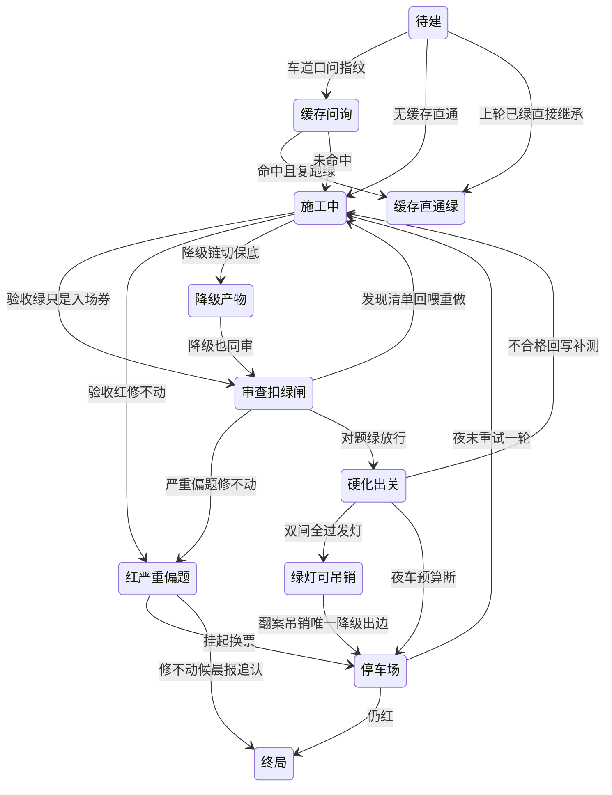
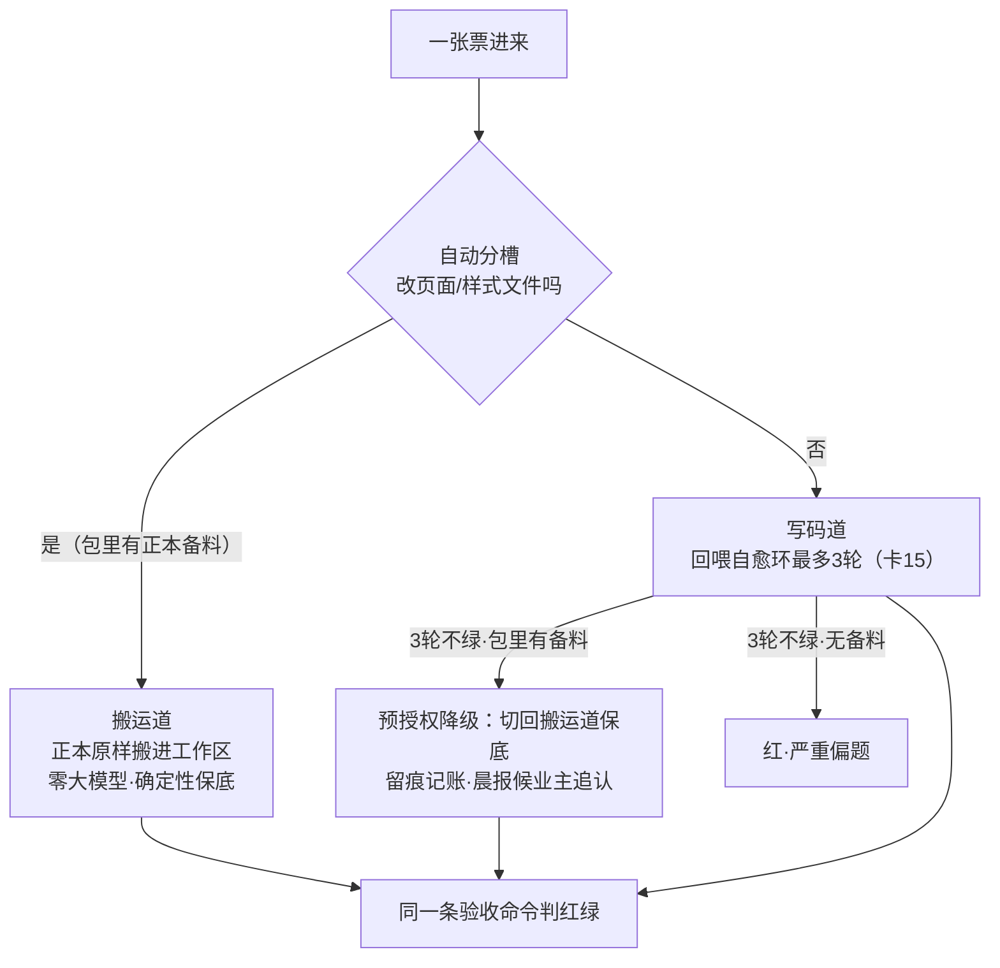
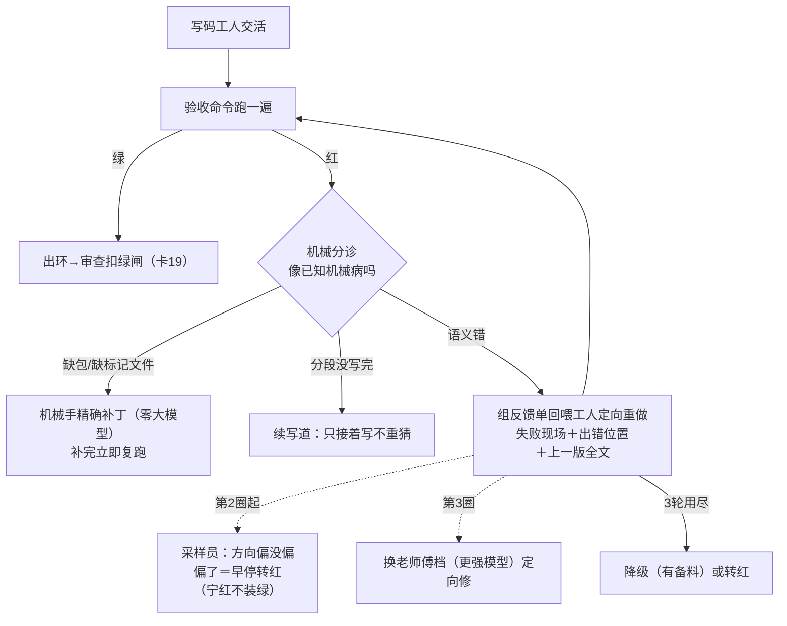
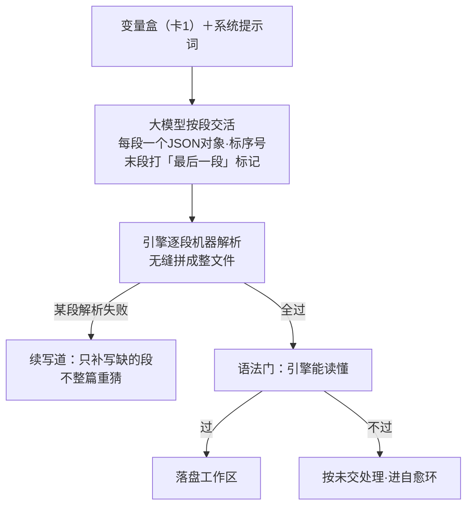
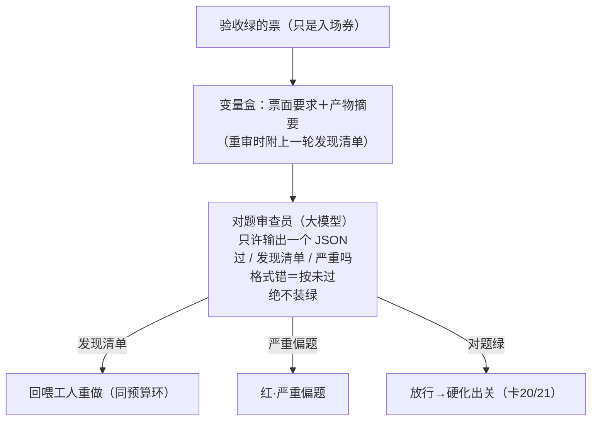
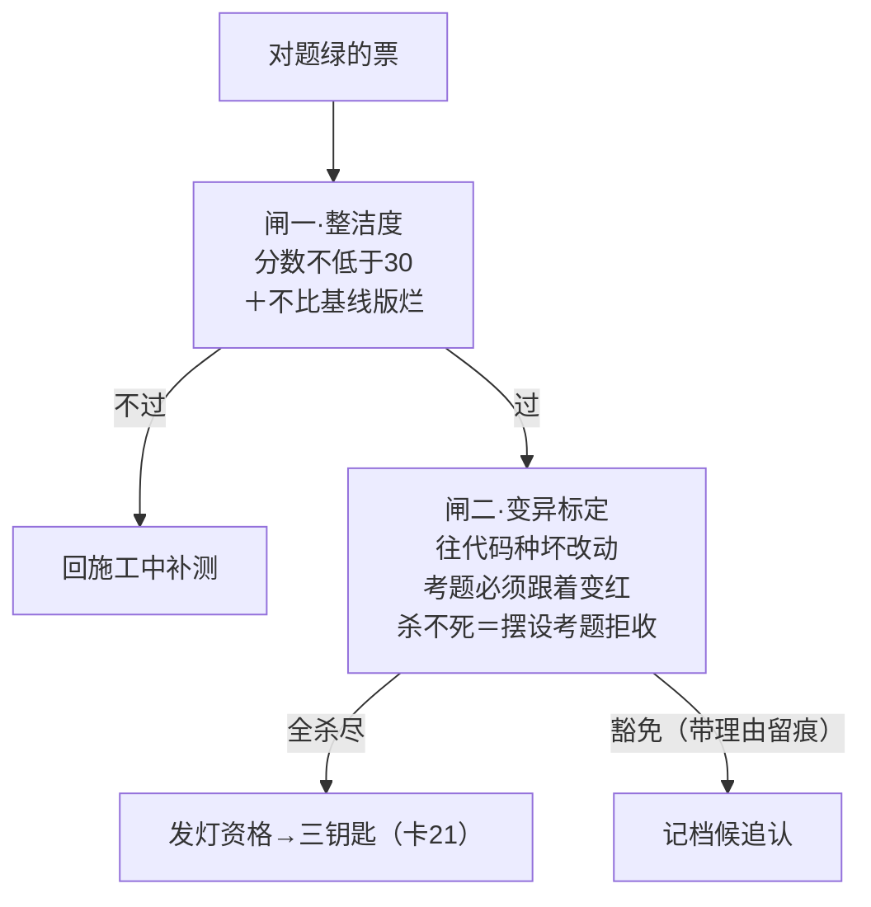
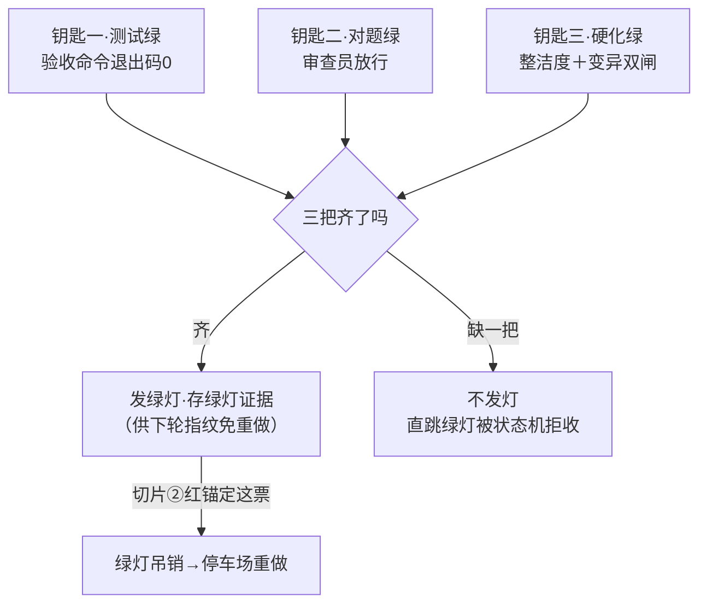

> **口径**：本卡话术/命名遵循《[00-话术统一口径正本](../00-话术统一口径正本.md)》（拍板#312）——双名制首现双写·撞车词带消歧（窗票/工序票·判色/判分）·两层口径 L1 车间（票级）/L2 派工台（窗级）。
> **消歧（本册·L1·口径正本 §3）**：「票」＝工序票（L1）；「自愈环」＝干活自愈环（⟲≤3）；判定/闸名详见口径正本 §4。
> **事件名速查（口径正本 §4·拍板#316① W-234 双名化落册）**
> - 回喂自愈环 ⟲≤3 → **干活自愈环**（L1 施工中自愈·驻留）
> - 其余六卡（票级状态机/自动分槽/分段JSON协议/扣绿闸/硬化双闸/三钥匙出关）→ 候正名（§4 无对应行·候拍补册）
> - 考据注记：三钥匙出关/对题审查扣绿闸的中文正名＝口径正本 §10.4 已有·候 §4 事件名补行后首现双写
> - 折叠子行（15a/b/c 系）随母卡同口径
> - 双名制：首现双写「标准事件名（现行短名）」·短名机检永不改；§4 空缺→候正名不硬造名

# 机制卡册② · 施工质量（7 卡·批1·2026-10-28）

> **本册管什么**：一张票进入施工车道之后的全部质量机制——状态机怎么管房间、走哪条施工道、修不好怎么办、谁来扣住绿灯、凭什么发灯。图版=同目录 02-施工质量册.html。体例=十要素白话版（索引卡 §4）。

---

## 卡8 · 票级状态机 11 态（业内名：带守卫的有限状态机·生命周期）

**harness 层**：harness第一层 · 站4（施工质量道）

**一句话**：一张票从出生到退休要走过 11 个房间，墙上贴着「哪个房间能去哪个房间」的清单；走错房间的请求会被记账但拒绝执行——流水账就是每张票的唯一事实源。

**术语白话对照**：`转移表`＝墙上那张「房间连通清单」（代码里就是一个字典：每个房间列出能去哪些房间）；`非法转移入账不抛`＝走错房间的请求不被执行，但会记一笔「曾被拒绝」的流水——留痕候追认，不吵不闹；`账本恢复`＝停电后来电，翻流水账就知道每张票停电前在哪间房；`LEGACY_EN_MAP`＝旧英文房间名翻译表（历史账本一字不动，读的时候翻译）。

**口述**：把票想成旅馆客人。它不能在房间之间乱窜——每一步搬家都要经过一个统一的前台（状态机），前台照着连通清单办事：合法就搬+记账，不合法就只记账不搬。为什么这么严？因为「当前在哪个房间」决定所有机制对它的态度：在「施工中」的票才会被回喂重做，在「绿灯」的票才可能被翻案吊销。全厂只有前台有权搬人——镜像、报告、晨报全是隔着玻璃看的，谁也不能直接把人拖进房间。

**锚**：ticket-state.ts:21（房间清单）·:47（连通表）·:113（前台）·:137（翻账恢复）｜**薄卡声明**：11 态本体与逐边语义=sm-20261027-003，本卡只讲机制视角｜业内对照：FSM with guarded transitions；非法入账不抛=audit-then-reject｜变式：队列八态/病卡七态/run 十态/波次=同族六台（#54 事件账本互指）｜红线：状态只经前台变·守卫（⟲次数/停车次数/预算）不进连通表——由调用方持计数器决定走哪条边。

---

## 卡12 · 自动分槽+预授权降级链（业内名：优雅降级/后备通道）

**harness 层**：harness第一层 · 站4（施工质量道）

**一句话**：每票自动挑施工道——改页面的票走「搬运道」保底（零大模型），其余走「写码道」；写码道修不出来且有备料的，自动降回搬运道，降级要记账候业主追认。

**术语白话对照**：`copy 槽（搬运道）`＝机械臂式搬运：包里备好的正本原样搬进工作区，零大模型零意外；`auto 分槽`＝业主拍板的默认档——机器按「改的是不是页面/样式文件」帮票挑道；`预授权降级链`＝「写不出来就用备料保底」是业主预先批准的动作，但每次降级都要留痕（DEC 记账）候追认——机器不发明新手段，只在预授权清单里降档。

**口述**：两条施工道。搬运道是个机械臂：包里备好什么就搬什么，快且100%可复现——改页面的票天然适合它。写码道才是真工人。机器帮每票挑道时还留一手：写码道三圈修不出来、而包里恰好备了正本的票，自动切回搬运道交保底版本——这不是认输，是「有 60 分交付好过没有交付」，而且降级这件事本身要记账，业主在晨报里看得见、可推翻。

**锚**：build.ts:137（分槽入口）·:274（降级链）｜业内对照：Graceful Degradation / Fallback｜变式：L2 机械票免窗道（挂账#17·同一思想的窗级版）｜红线：降级不降权（降级产物同样过审+篡改红旗照终局）；只在预授权清单内降，机器不发明新手段。

---

## 卡14 · 回喂自愈环 ⟲≤3（业内名：带反馈的有界重试）

**harness 层**：harness第一层 · 站4（施工质量道）

**一句话**：验收红了不蛮干——先机械分诊（像机械病的打确定补丁，零大模型），语义病才回喂工人定向重做；最多三圈，圈圈带证据，第二圈起还派采样员看方向。

**术语白话对照**：`机械分诊`＝先看报错像不像已知机械病（缺包/缺包标记文件/分段断/形态错）——像就打**确定性补丁**，不像才动用大模型（省钱的分水岭）；`回喂`＝把失败现场打包给工人：报错头尾+出错代码位置+上一版全文，命令是「定向修，别凭空重写」；`续写道`＝分段输出没写完时的确定性修法——只接着写，不整篇重猜；`坐席A`＝第三圈换的更强模型档（独立记账≤2次）；`L3 采样弹`＝第二圈起派出的方向检查员，唯一能自动执行的建议是「早停」（其余只建议）。

**口述**：工人交活，验收官说红。红分两种：没装依赖这种机械病，分诊员一眼认出，机械手补完秒级复跑——不花大模型一分钱；真语义错才把失败现场打包回喂：「你上一版全文在这、报错在这、出错的代码位置在这，定向修」。最多三圈：第二圈起有个采样员盯方向——「你在朝题目的方向走吗？」偏了就早停认红，宁红不装绿；第三圈换老师傅。三圈用尽，有备料降级保底，没备料认红进停车场。全程每圈都留痕（重试事件+失败摘要），夜末重试的票还自带上次失败摘要——把「抽奖式重试」变成「带证据重考」。

**锚**：build.ts:184（回喂环）·:190（续写）·:233（分诊调用）·selfheal-triage.ts:57,94·reviewer.ts:147,205｜业内对照：Bounded Retry with Feedback·Mechanical-first Triage｜变式：L2 打回分诊三分类（册⑥卡49）·续写=断窗续拍道同族｜红线：⟲≤3 守卫在调用方；分诊不改验收命令；工位不可用=fail-closed 按未过。

---

## 卡15 · 写码工程师分段 JSON 协议（业内名：结构化输出协议）

**harness 层**：harness第一层 · 站4（施工质量道）

**一句话**：大模型交活不许自由发挥——必须按「一段一个 JSON 对象、带序号、末段打完成标」的格式分段输出，引擎逐段机器解析拼成整文件；格式不对＝按未交处理。

**术语白话对照**：`分段输出`＝长文件切成小段（每段≤2500字），防大模型写到一半「失忆」或偷懒省略；`语法门`＝拼好后先过一道「代码引擎能否读懂」的检查，读不懂=白交；`分程预算`＝更长的文件让模型一次只写前几段就停笔，引擎自动叫它续写——防「赶进度烂尾」；`diff 形态`＝改造老文件时只许交「改动块」（旧代码→新代码），不许整篇重写。

**口述**：为什么逼大模型用这么啰嗦的格式？因为自由文本有三个老毛病：写到一半忘记前文、偷懒用「此处省略」、JSON 被截断后整篇作废。分段协议把三个病一起治：每段独立机器校验（一段坏只补一段）、序号保证顺序（无缝拼接）、「最后一段」标记防烂尾。超长文件还有分程预算：写满预算就停笔等续写指令——像流水线工人不蛮干。所有格式违例都是同一句判词：按未交处理，绝不假装收到。

**锚**：llm-prompts.ts:22（系统提示词全文）·llm-builder.ts:35（调用编排）｜业内对照：structured output / JSON mode 的强化版（分段+续写+语法门）｜变式：审查员/采样员的单 JSON 输出=同族短协议｜红线：fail-closed——任何格式违例按未交，绝不装绿。

---

## 卡16 · 对题审查员扣绿闸（业内名：质量门·测试绿≠完成）

**harness 层**：harness第一层 · 站4（施工质量道）

**一句话**：验收绿只是一张入场券——独立的对题审查员拿票面要求逐条核对产物，「对题」才放行进硬化段；它只有扣住绿灯的权力，永远没有把红改绿的权力。

**术语白话对照**：`扣绿闸`＝验收绿后「暂存不发灯」的关卡——防「把验收命令糊绿但根本没做票面要求的事」；`对题三查`＝①票面要求的行为全实现了吗 ②有没有缺失走样 ③该逐字的是否逐字；`品味四查`＝四种代码坏味道（空壳假装实现/嵌套套娃/强转糊弄/注入漏洞），发现必列账但不判死；`severe`＝「整体做偏了题」——回喂也修不动的那种，直接转红；`无红入边`＝它的输出清单只能让票「回炉」或「放行」，转移表里根本没有「红改绿」的通道。

**口述**：为什么测试绿还不能发灯？因为验收命令只证明「测的都过了」，不证明「该做的都做了」——工人可能把验收命令糊绿但票面要求的真正行为只做了一半。审查员拿着票面要求逐条对产物：行为齐吗？有缺吗？该逐字的地方逐字了吗？顺手再做四项品味检查（只记账不判死）。它的判决只有三种：放行、打回重做（附发现清单=修的直接依据）、严重偏题转红。最要紧的红线：它**永远不能把红的票变绿**——验收命令的红，谁也洗不白。

**锚**：reviewer.ts:42（系统提示词全文）·:69（变量盒构造）·:109（fail-closed 解析）·:127（调用）｜业内对照：Quality Gate / Two-person rule 的机器版｜变式：L2 复考闸+收口申报器=同一「绿才认」哲学的窗级投影（册④卡38）｜红线：转移表无「红→审查」边；协议违例=审查未过；判据源=票面（它不产验收命令）。

---

## 卡17 · 硬化双闸（业内名：变异标定的质量底线）

**harness 层**：harness第一层 · 站4（施工质量道）

**一句话**：对题绿之后、发灯之前的最后一道：代码整洁度不得低于 30 分且不许比基线烂；变异标定证明考题是真的——对好代码能过、对坏代码必须报。

**术语白话对照**：`整洁度（CRAP 分数）`＝代码复杂度与测试覆盖的合成评分——30 是绝对线，同时新代码不许比历史基线烂（「新烂必拦、存量不追」）；`变异标定`＝考题的「验钞」：故意往实现里种一个坏改动（变异体），考题必须跟着变红——种了坏改动考题还绿，说明这是道摆设题，拒收；`豁免留痕`＝确有理由放行的要写明理由并记账，无理由豁免=配置校验直接红。

**口述**：前两把钥匙证明「能跑、对题」，第三把证明「质量不欠账、考题不是摆设」。整洁度闸像体检硬指标：低于 30 分回去补测。变异闸更妙——它反过来考考题：往你的代码里故意种一个 bug，考题必须立刻变红；种了 bug 考题还绿，说明这道考题根本测不出问题，是摆设——摆设考题当場拒收入库。这一闸既保代码质量，也保「考题本身是真考题」。

**锚**：hardening-lane.ts:209（三钥匙编排）·mutation-gate.ts:227（标定）·crap-gate.ts（整洁度）｜业内对照：mutation testing / code quality gate｜变式：L2 机检器例行标定（挂账#4·同一思想）｜红线：双闸只拦发灯不造绿；阈值变更=拍板。

---

## 卡18 · 三钥匙出关（业内名：多信号签出·唯一入边）

**harness 层**：harness第一层 · 站4（施工质量道）

**一句话**：测试绿、对题绿、硬化绿——三把钥匙集齐才发灯；发灯的唯一入口是硬化出关，绿灯的唯一降级出口是翻案吊销；想直跳绿灯？状态机当场拒收。

**术语白话对照**：`三钥匙`＝测试绿（验收命令过了）∧对题绿（审查员放行）∧硬化绿（整洁+变异双闸）——三条独立证据线，缺一不可；`唯一入边`＝想拿绿灯只有一条路：从硬化出关走过来——任何「直跳绿灯」的请求都会被转移表拒收记账；`绿灯证据`＝发灯时存档的证据包（供下轮指纹问询「免重做但必复验」）；`绿灯可吊销`＝绿灯不是免死金牌——切片②考题红了且锚定这张票，绿灯当场吊销回停车场重做。

**口述**：三把钥匙来自三个互相独立的证据线：验收命令说「能跑」、审查员说「对题」、双闸说「质量不欠账」。为什么强调唯一入边？因为历史上出过「从别处直跳绿灯」的漏洞设想——测试绿了想直接发灯？状态机拒收，连讨论的余地都没有。发灯也不是终点：后面切片②的考题如果红了且锚定到这张票，绿灯当场吊销、回炉重做——「重拿绿仍必经原路」，便利通道从头到尾不存在。

**锚**：build-lane.ts:126,150·hardening-lane.ts:209·ticket-state.ts:47（绿灯唯一入边/唯一降级出边）｜业内对照：multi-signal sign-off；「重拿绿必经原路」=no shortcut invariant｜变式：L2 复考闸绿才认✅=同一哲学（册④卡38）｜红线：三钥匙缺一不可；绿灯证据进缓存只免「重新生成」不免「重新验收」。

---

## 册② 尾注 · 同构轴

7 卡是一条质量流水：**状态机管房间（卡8）→ 分槽定做法（卡12）→ 环里修到绿或降级（卡15）→ 协议保交付格式（卡14）→ 扣绿闸对题（卡16）→ 双闸保质量保考题（卡17）→ 三钥匙发灯（卡18）**。全册一条红线贯穿：**判卷权只在验收命令 exit code；任何角色只能扣住绿灯，不能制造绿灯**。
