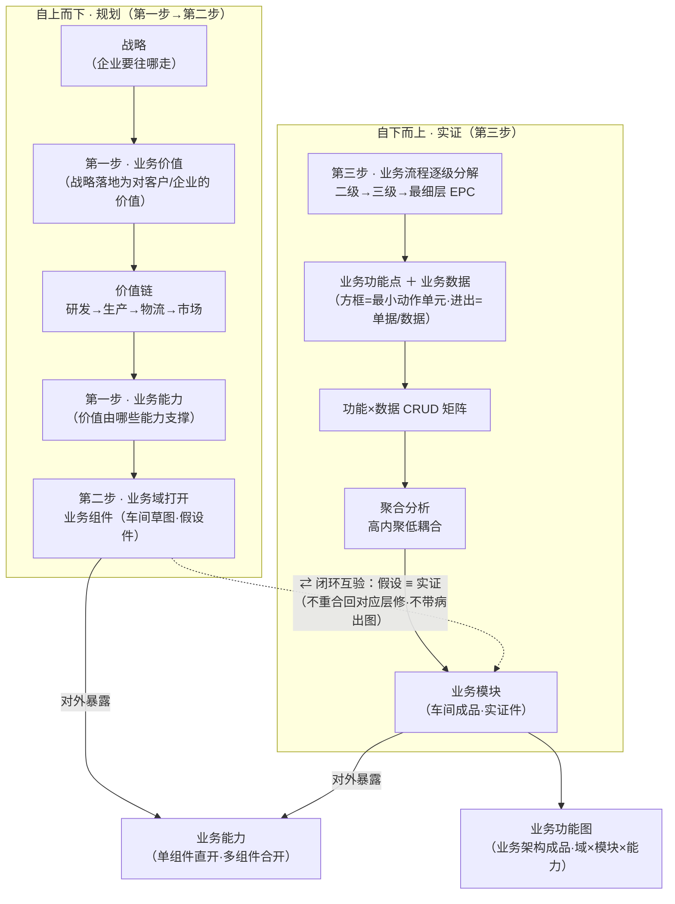
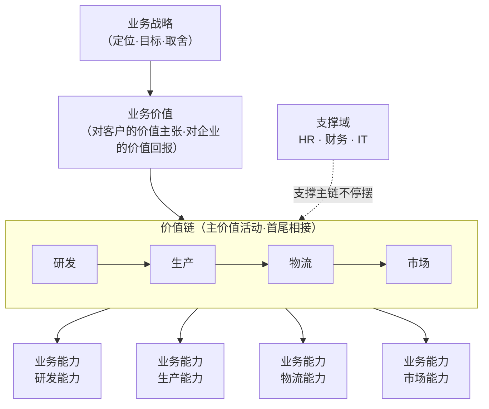
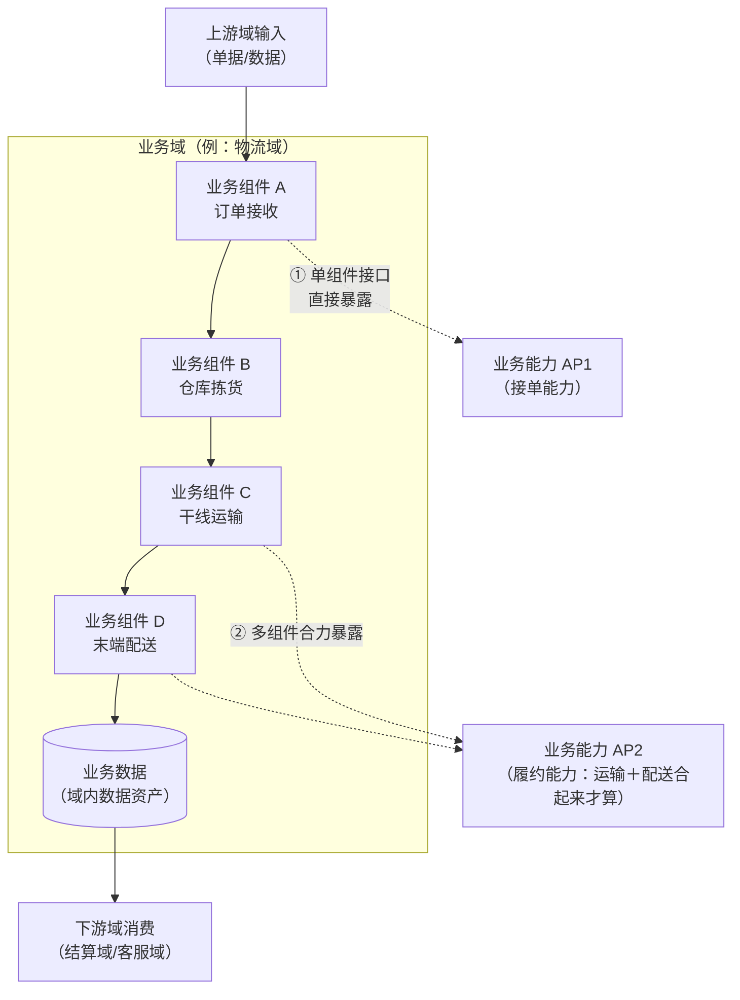
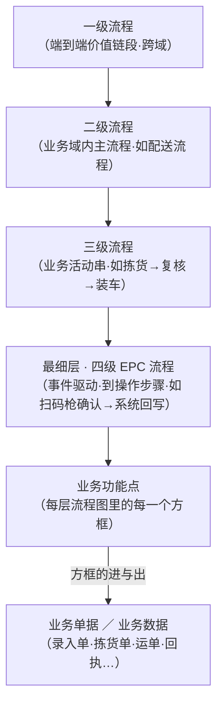
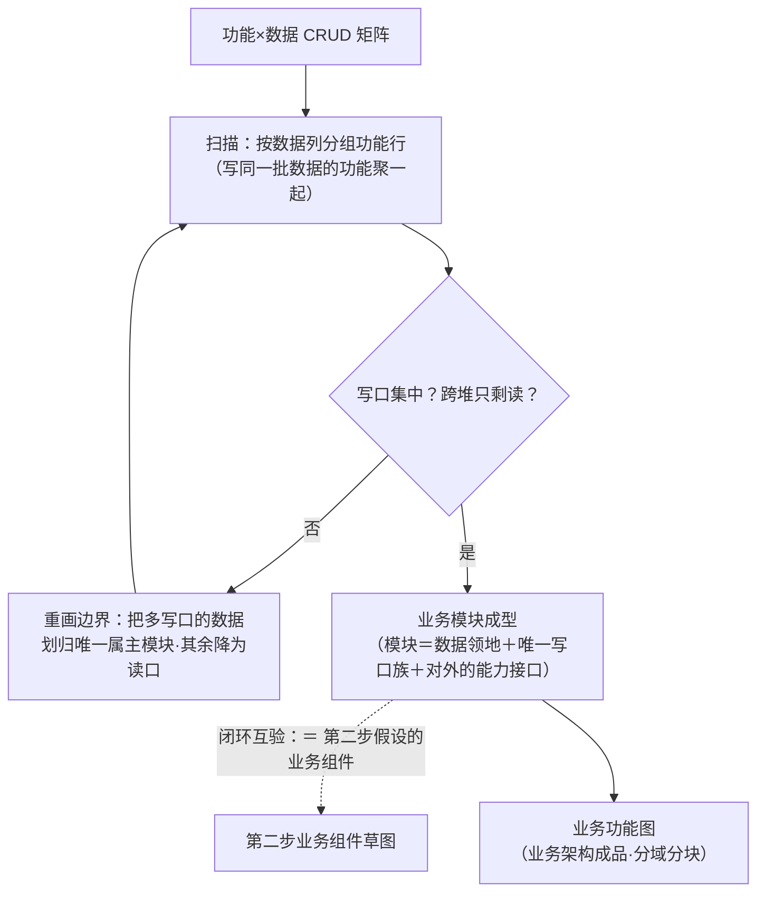
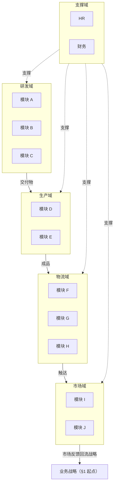

# 从业务战略到业务架构形成逻辑 · 三步法方法论（v1.0·2026-11-05）

> **TL;DR**：本件沉淀一条**从战略推导到业务架构成品**的分析流水——**两向一行**：①→②为**自上而下的规划**（业务价值 → 价值链 → 业务能力 → 业务域 → 业务组件假设）；③为**自下而上的实证**（流程分解 → 业务功能点＋业务数据 → CRUD 矩阵 → 高内聚低耦合聚合 → 业务模块）；最后**闭环互验**——实证的业务模块 ≡ 假设的业务组件（同一物·来路不同），两向对上才画业务功能图（业务架构成品）。四词定名见 §0.1（业务能力=接口词·业务组件=假设件·业务功能点=最小动作单元·业务模块=实证件；别名「业务功能模块」弃用防同物三叫）。
>
> **术语白话（首现）**：**价值链**＝企业创造价值的主活动链条（研发→生产→物流→市场，首尾相接）；**业务能力**＝企业能做成某件事的本领（如「物流能力」）；**业务域**＝按业务性质划的地盘（如物流域、财务域）；**业务组件**＝域内一个可独立运转的业务功能模块（如「仓库拣货」）；**EPC 流程**＝事件驱动流程链（Event-driven Process Chain·白话：每步先写「发生了什么事」、再写「谁来做」）；**CRUD**＝增（Create）查（Read）改（Update）删（Delete）四类数据动作；**高内聚低耦合**＝一家的事关在一扇门里（内聚）、对外只开必要的窗（低耦合）。

---

## §0 方法论总览（一图看全·两向一闭环）

> **方向性（v1.1 业主令标注）**：第一步→第二步＝**自上而下的规划**（战略拍到车间草图为止）；第三步＝**自下而上的实证**（从车间真实动作往回收拢）；两向在「组件 ≡ 模块」处**闭环互验**。

### §0.1 四词定名（v1.1·本文件逻辑中的唯一用词口径）

| 词 | 身份 | 方向 | 一句话 |
|---|---|---|---|
| **业务能力** | 接口词（对外承诺） | 双向契约物 | 企业能做成某件事的本领——价值由它支撑，它由组件/模块对门口暴露 |
| **业务组件** | 结构词（**假设件**） | 自上而下（第二步·规划终点） | 规划阶段拍的「车间草图」：为兑现能力，域里该有哪几个部件 |
| **业务功能点** | 动作词（**最小单元**） | 自下而上（第三步·实证起点） | 流程图里的方框：一次真实的业务操作 |
| **业务模块** | 成果词（**实证件**） | 自下而上（第三步·聚合终点） | 功能点＋经手数据做完 CRUD 后归堆出来的「车间成品」 |
| ~~业务功能模块~~ | ❌ 弃用别名 | — | 它＝业务组件＝业务模块（同物三叫·歧义源）——按阶段只叫组件（假设时）/模块（实证后） |

> 「业务功能」只在两处干净出场：微观=「业务功能**点**」（方框）、宏观=「业务功能**图**」（成品）；中间层一律用组件/模块。
>
> **关系口述（白话一段话）**：先老板拍方向（战略），战略换算成值钱的事（价值），值钱的事需要本领支撑（能力）——自上而下第一段；为有这些本领，按域画车间草图（组件）——规划终点。掉头从基层验：看真实干活顺序（流程分解），记下每个动作方框（功能点）和经手的单据数据，做 CRUD 盘点，把写同一批数据的功能归一堆——归出来的堆就是模块——自下而上实证。最后对账：草图车间（组件）与实证车间（模块）对得上，确认每个车间对门口开的服务窗口（能力暴露——单车间直开或几车间合开），画成业务功能图交卷；对不上，回对应层修，不带病出图。

三步一句话各自说清：

| 步 | 干什么 | 产出 | 白话 |
|---|---|---|---|
| 第一步 | 战略→业务价值→价值链→业务能力 | 业务能力清单 | 先想清楚「企业靠什么本事赚钱」 |
| 第二步 | 业务域打开→业务组件（假设·**自上而下规划终点**） | 业务域×组件草图 | 再想「这些本事该分几个车间、每个车间干什么」 |
| 第三步 | 流程分解→功能点/数据→CRUD→聚合（**自下而上实证**） | 业务模块（实证）＋业务功能图 | 最后「下到车间看真实干活顺序，按数据归属把活归堆，归出来的堆＝车间」（两向对上了，架构才算数） |

---

## §1 第一步 · 战略解码：业务价值 → 价值链 → 业务能力

**分析逻辑**：从战略的业务价值开始分析，先画价值链（主价值活动链条），再看企业的业务价值最终可以分解成什么**业务能力**来支撑。

- 业务价值：战略对客户兑现什么、对企业换来什么（收入/口碑/壁垒）；
- 价值链：价值是沿主活动链条**接力**创造的——研发→生产→物流→市场，每段接力都是价值的一段；
- 业务能力：把每段价值接力翻译成「企业必须具备的本领」。**自问句式**：「要兑现这条价值，公司必须能做成哪几件事？」——每件事就是一个业务能力。

**要领**：
1. 价值链的段怎么切，跟着商业模式走（制造业经典四段；平台型企业可能是「获客→成交→履约→复购」），不套模板；
2. 支撑域（HR/财务/IT）不是价值链主段，但缺了主链就停——单列支撑能力，不混进主链；
3. 第一步产出的是**能力清单**（名词），还不是模块（动词的组织）——能力到模块要等第三步聚合闭环。

---

## §2 第二步 · 业务组件假设：业务域打开 → 组件协作 → 能力暴露

**分析逻辑**（本步＝**自上而下规划的终点**·产物是假设件）：为了实现业务能力，把**业务域**打开，分析里面的**业务组件**——每个业务组件本身是一个业务功能模块（v1.1 消歧：即后续实证聚合出的「业务模块」·见 §0.1），会实现相应的业务能力（例：「用户往数据库录入数据」录入这条就是一个业务功能，它实现了「数据资产沉淀」这类能力）。业务组件和业务组件之间**水平上下游打交道**；业务域的业务能力对外暴露有两条路：**单个组件接口直接暴露**，或**多个业务组件合起来暴露**——给外部暴露出去的，就是业务能力。

**要领**：
1. 此时组件是**假设件**（自上而下拍的草图）——假设对不对，等第三步流程实证和 CRUD 聚合来验收，两向对上了才算数；
2. 能力暴露口径要先想清：对外承诺的能力，落在哪个组件接口上？是「一个组件顶到前沿」还是「几个组件合扮一个角色」？——这决定后面集成与接口设计的粒度；
3. 组件间只走**上下游单据/数据**（水平协作），不走捷径互相掏内脏——为第三步的低耦合打预防针。

---

## §3 第三步 · 流程实证：流程分解 → 功能点/数据 → CRUD → 聚合 → 业务模块

**分析逻辑**：基于业务能力的实现，分析业务域里具体有哪些业务流程，做**二级、三级、最细层级**的 EPC 流程分析，分析到每一个业务流程的**业务活动、业务功能、业务操作步骤**。每层级流程里的方框都是一个**业务功能点**，方框的输入和输出就是业务操作形成的**单据或数据**。有了业务功能和业务数据之后，做**功能和数据的 CRUD 分析**。CRUD 分析完成后（本步起＝**自下而上的实证**），看哪些功能可以聚合到一起，满足软件工程里**高内聚低耦合**的目的——聚合完成后才形成真正的**业务模块**；业务模块＝第二步假设的业务组件（v1.1 消歧：原文「业务功能模块」即此物·见 §0.1）；最终做成业务架构里的**业务功能图**。

### 3.1 流程逐级分解（一级→四级 EPC）

### 3.2 功能×数据 CRUD 矩阵（示例·行=功能 F·列=数据 D）

流程分解到最细层后，把所有方框（功能点）收拢成行、所有单据/数据收拢成列，逐格登记该功能对该数据做 C/R/U/D 中的什么（一格可多动作，如 CR）：

| 功能＼数据 | D1 客户订单 | D2 库存 | D3 拣货单 | D4 运单 | D5 结算账 | D6 客户档案 |
|---|---|---|---|---|---|---|
| F1 订单接收 | C | R | C | — | — | R |
| F2 仓库拣货 | R | R/U | R/U | — | — | — |
| F3 干线运输 | R | — | R | C/U | — | — |
| F4 末端配送 | — | — | — | R/U | — | R |
| F5 结算开票 | R | — | — | R | C/U | R |
| F6 客户回访 | R | — | — | R | R | U |

> 示例为演示口径；真实矩阵格子里应带「动作｜触发者｜依据锚点」，**无据格子禁硬填**（无交互的格显式空或标 NA＋理由）。

### 3.3 从 CRUD 到聚合（高内聚低耦合的判据）

CRUD 矩阵是聚合的**证据底座**——不是拍感觉归堆，而是看**谁对哪些数据有写权（C/U）、谁只读（R）**：

| 判据 | 白话 | 怎么从矩阵里看出来 |
|---|---|---|
| 内聚 | 一家的事关一扇门里 | 几个功能**写同一批数据**（列上 C/U 高度重叠）→ 归一个模块 |
| 低耦合 | 对外只开必要的窗 | 跨堆的引用尽量只剩 **R（读）**→ 模块间只开读接口 |
| 单写口 | 谁家的数据谁家管 | 一列数据的 C/U 最好集中在同一堆功能里；多堆都写=职责边界画错了 |
| 读口自由 | 读不伤架构 | R 天然松耦合，跨模块读随便——写权才是边界敏感动作 |

**闭环两向互验（方法论的灵魂）**：
- 第二步自上而下拍的**组件假设**，与第三步自下而上聚出来的**模块实证**，两者应当**重合**；
- 重合 → 架构成立，出业务功能图；
- 不重合 → 要么假设错了（域切分/组件粒度不对），要么流程实证漏了（流程没分解到位）——回对应层修，**不带病出图**。

---

## §4 成品：业务功能图（业务架构的最终呈现）

三步走完的成品＝一张**分域分块的业务功能图**：外层按业务域分块（研发域/生产域/物流域/市场域/支撑域…），块内是聚合后的业务模块（方框），模块对外暴露的接口即业务能力。白板手绘原样转译：

---

## §5 本仓落位注记（方法论 ↔ AFK 引擎已有的对应物）

> 注记性质：方便后续按此方法论继续补分析——不展开，只给锚点。

| 方法论层 | 本仓已有对应物 | 状态 |
|---|---|---|
| 第三步·CRUD 矩阵 | `02-全景视图/07-数据流/df-20261030-001-业务链触发CRUD矩阵.md`（36 数据行×15 环节列·格子级实勘·拍板#272/#283②） | ✅ 在档 verified |
| 第三步·数据分级 | `02-全景视图/05-状态机/sm-20261030-005-两层对象与数据分级台账.md`（两层 harness 分级：L1=车间票级层/L2=派工台窗级的主数据·静态·动态全景） | ✅ 在档 verified |
| 第三步·聚合 | harness 第一层（项目APP研发团队·票级车间）九模块聚合提案（数据领地制·intake/building/judging/cases/verifying/ticketing/accounting/orchestrating/infra·拍板#384 方向已认可·候对比件立票） | 🅿 方向已认可·候施工票 |
| 业务域划分 | 两层 harness 分治（拍板#101）：第一层=项目APP研发团队（站1/2 规划＋站3-6 实施）·第二层=研发部管理层（派工/维修/优化/机检） | ✅ 在档定名 |
| 第一步·战略→价值→能力 | 本仓尚未做正式的「引擎业务价值→能力清单」推导（现行为拍板驱动，未按能力地图组织） | ⬜ 待补（方法论落位后的候选功课） |
| 第二步·组件暴露口径 | 部分自发实践（账本唯一写口/队列写口四道闸=单写口纪律先例），未按「能力暴露」口径正式梳理 | ⬜ 待补 |

---

## 变更记录（append-only）

| 版本 | 日期 | 变更 |
|---|---|---|
| v1.0 | 2026-11-05 | 首版：业主白板手绘+口述三步法转译落盘。§0 总览闭环图·§1 战略解码·§2 业务组件假设·§3 流程实证（分解→CRUD→聚合四判据→闭环互验）·§4 业务功能图·§5 本仓落位注记。图 6 幅全 mermaid。 |
| v1.1 | 2026-11-05 | 业主令补方向性标注：第一步→第二步=自上而下规划·第三步→CRUD→聚合=自下而上实证（§0 总览图重画为两向两泳道+闭环互验·三步表补方向列）；增 §0.1 四词定名表（业务能力=接口词/业务组件=假设件/业务功能点=最小单元/业务模块=实证件）·弃用别名「业务功能模块」（同物三叫歧义源）；§2/§3 开头补方向括注与消歧注；TL;DR 改写为「两向一行」口径。 |
| v1.2 | 2026-11-05 | 拍板#384 分层代号话术规落地：§5 本仓落位注记 L 代号光秃使用处 2 处补白话全称（L1=车间票级层/L2=派工台窗级·全称=项目APP研发团队/研发部管理层）；同步聚合行状态（拍板#384 方向已认可·候对比件立票）。 |
