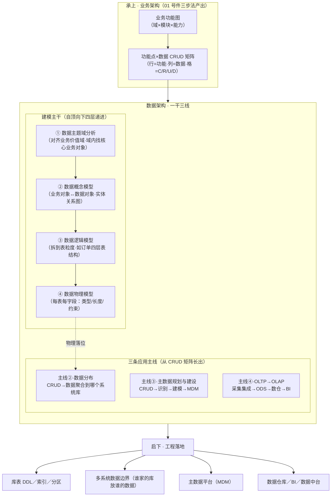
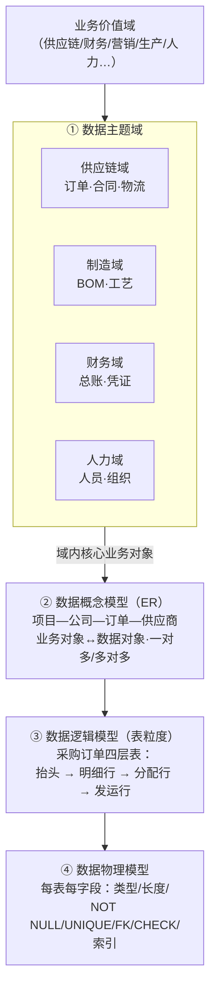
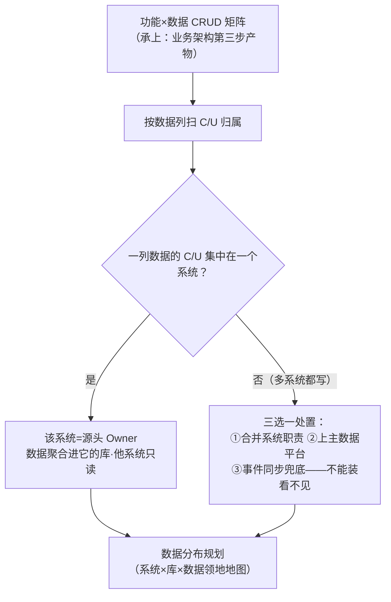
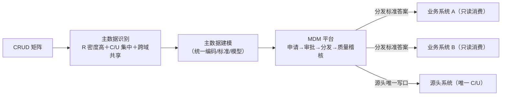
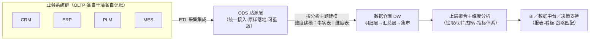
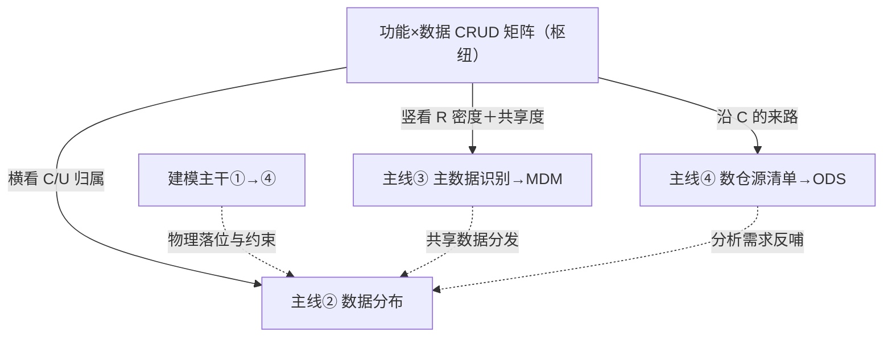

# 数据架构的承上启下逻辑 · 四线方法论（v1.0·2026-11-06）

> **TL;DR**：数据架构**承上**——吃业务架构（01 号件三步法）产出的「业务功能图＋功能×数据 CRUD 矩阵」当输入；**启下**——产出指导物理库表设计与多系统数据分布。方法论＝**一条建模主干＋三条应用主线**：主干自顶向下四层递进（数据主题域→概念模型→逻辑模型→物理模型）；三条主线全从 CRUD 矩阵长出——①**数据分布**（数据聚合到哪个系统的库）、②**主数据规划与建设**（识别→建模→MDM 治理）、③**OLTP→OLAP**（采集集成→ODS→数据仓库→BI/数据中台/决策支持）。**CRUD 矩阵是枢纽**：它同时回答「数据放哪」「谁是主数据」「数仓从哪抽」。
>
> **术语白话（首现）**：**数据主题域**＝按业务价值域划的数据大底盘（如采购域、销售域——域内装着核心业务对象）；**概念模型**＝业务对象和数据对象的关系图（实体-关系·只画"有什么、什么关系"，不画字段）；**逻辑模型**＝拆到具体数据表的粒度（如采购订单四层表：抬头→明细行→分配行→发运行）；**物理模型**＝每张表每个字段的类型与约束（到能写建表语句的程度）；**CRUD**＝增（Create）查（Read）改（Update）删（Delete）四类数据动作；**主数据**＝跨业务反复引用的核心共享数据（物料、客户、供应商、组织）；**MDM**＝主数据管理平台（Master Data Management·统一出处、统一编码、分发到位）；**OLTP**＝联机事务处理（业务系统日常干活的那套增删改查）；**OLAP**＝联机分析处理（把干活的账攒起来做多维分析）；**ODS**＝贴源层（操作数据存储·从各业务系统原样抽来的第一站）；**数据仓库（DW）**＝按分析主题重新建模的历史账房；**BI**＝商业智能（报表、看板、多维分析的总称）。

---

## §0 方法论总览（一图看全·承上启下）

> **承上**：业务架构第三步（01 号件）做完「功能点×数据 CRUD 矩阵」——这张矩阵正是数据架构的**入口凭证**：它把「哪些功能碰哪些数据」盘清楚了，数据架构才有的放矢。
> **启下**：数据架构四线走完，产出物直接落到工程——库表 DDL、系统数据边界、主数据平台、数仓分层。

### §0.1 定名表（本件用词口径）

| 词 | 身份 | 一句话 |
|---|---|---|
| 建模主干 | 纵深四层 | 主题域→概念→逻辑→物理，层层递进不可跳 |
| 数据分布（主线②） | 横向切系统 | CRUD 矩阵裁决"数据聚合到哪个库" |
| 主数据（主线③） | 运营侧下游 | 共享核心数据的识别、建模与治理 |
| OLTP→OLAP（主线④） | 分析侧下游 | 干活的账 → 分析的账房 → 决策支持 |
| CRUD 矩阵 | **枢纽** | 三条主线的共同证据底座 |

---

## §1 主线一 · 建模主干：数据四层递进（自顶向下）

**分析逻辑**：对齐业务价值域做**数据主题域分析**，每个域里找核心业务对象；业务对象和数据对象做关系分析成**概念模型**（可能一对多/多对多）；再拆到具体数据表的粒度成**逻辑模型**（例：采购订单拆四层表——抬头、明细行、分配行、发运行，一层比一层细，对应"一张订单→多行明细→明细分多次分配→分配分多次发运"的业务节奏）；最后对每张表每个字段做**物理模型**（类型、长度、约束——非空/唯一/外键/检查）。

**四层要领**：

| 层 | 回答什么 | 产物 | 易犯的错 |
|---|---|---|---|
| ① 主题域 | 数据的大底盘怎么切 | 主题域清单＋域内业务对象 | 按部门切（应按业务价值过程切·防烟囱） |
| ② 概念模型 | 有哪些对象、什么关系 | ER 图（实体＋关系＋基数） | 忍不住画字段——概念层画字段=后面全返工 |
| ③ 逻辑模型 | 拆成几张表、表内什么结构 | 表结构（主键/外键/规范化·不含物理细节） | 跳过概念直接拆表；子表粒度不跟业务节奏（分几次收货就拆几层） |
| ④ 物理模型 | 怎么落到具体数据库 | DDL（字段类型/约束/索引/分区） | 把逻辑模型当物理模型直接建库 |

---

## §2 主线二 · CRUD 矩阵与数据分布（数据聚合到哪个系统的库）

**分析逻辑**：多系统多数据库场景下，用 **CRUD 矩阵**分析每个数据对象和每个业务功能（往往已聚成应用/系统）之间的耦合关系——看**谁创建（C）、谁更新（U）**：C/U 集中在哪个系统，哪个系统就是这份数据的**源头系统（Owner·数据属主）**，数据就聚合到那个系统的数据库里；其余系统一律降为只读（R）引用。这一步的产物叫**数据分布规划**。

**判据三条（与 01 号件 §3.3 聚合四判据同源）**：

| 判据 | 白话 |
|---|---|
| 单写口 | 一份数据只有一个系统能动笔（C/U），其余只读——写权才是边界 |
| 读口自由 | 跨系统读（R）不伤架构，随便开窗 |
| 多写口=病灶 | 两个系统都改同一份数据=一致性事故的苗床，必须裁决 |

---

## §3 主线三 · 主数据的规划与建设（识别→建模→MDM）

**分析逻辑**：同样从 CRUD 矩阵出发做**主数据识别**——被大量功能**只读引用（R 密度高）**、而创建更新**集中在少数源头**、且**跨多个业务域共享**的数据对象，就是主数据候选（物料、客户、供应商、组织、人员、科目）。识别完成后做**主数据建模**（统一编码、统一标准、统一模型——往往一套独立于业务库的主数据库），再建 **MDM 平台**做治理：申请→审批→分发→质量稽核，让各业务系统用的都是同一份"标准答案"。

**与主线二的关系**：主数据是数据分布的**特例与升华**——当一份数据谁都要用、但不能谁都写时，把它从各业务库中"提拔"出来独立管理，就是把"多写口病灶"治成"单写口＋全局分发"。

---

## §4 主线四 · 从 OLTP 到 OLAP：数仓与决策支持（采集集成→ODS→数仓→BI）

**分析逻辑**：主数据和业务库建好后（OLTP 侧·管干活），还要从 **OLTP 过渡到 OLAP**（管分析）：先把各业务系统的数据**采集和集成**（ETL/ELT·抽取-转换-装载）形成统一的 **ODS 贴源层**；再结合分析主题做**数据建模**（维度建模·事实表＋维度表）形成上层**数据仓库**；数仓之上做**数据聚合与维度分析**（钻取/切片/切块/旋转），建成 **BI 系统／数据中台／决策支持分析系统**，让数据更好地和业务战略匹配。

**分层要领**：

| 层 | 干什么 | 纪律 |
|---|---|---|
| ODS | 各源系统的账**原样**搬过来、统一编址 | 贴源不改；删了可从源重抽重放 |
| DW 明细/汇总 | 按分析主题重新建模（不是业务表的复印） | ODS 别直接当数仓用——否则退化成报表堆 |
| BI/应用 | 看板、报表、指标、多维分析 | 指标口径单源，防"同一个数各说各话" |

---

## §5 四线咬合（为什么 CRUD 矩阵是枢纽）

1. **主干纵向、主线横向**：四层建模是纵向深化（一层比一层接近机器），三条主线是横向铺开（铺到多个系统、多个库、多个分析主题）；
2. **主线二是枢纽**：同一张 CRUD 矩阵，横看回答"数据放哪个库"（分布），竖看抽出"谁是主数据"（识别），再沿 C 的来路回答"数仓该从哪些源抽"（集成范围）——三条主线不是并列的三件事，是同一份证据的三个下游；
3. **时序**：主题域→概念→逻辑属业务侧稳定层，先做；物理设计与数据分布可并行细化；OLTP 侧建成后才启动 OLAP 侧规划——**先有干活的账，才有分析的账房**；
4. **闭环**：主线③（主数据）和主线④（数仓）反过来约束主线②的分布裁决（共享度高的升主数据、分析需求大的进数仓源清单）——四线互验，不带病出图。

---

## §6 承上启下：与业务架构（01 号件）的接口

| 接口 | 上游产物（01 号件） | 本件怎么吃 |
|---|---|---|
| 功能点清单 | 流程分解到 EPC 后的方框 | CRUD 矩阵的**行** |
| 业务数据清单 | 方框进出的单据/数据 | CRUD 矩阵的**列**（也是主题域内业务对象的雏形） |
| 功能×数据 CRUD 矩阵 | 01 号件第三步产物 | **主线②③④的直接证据底座**（§5 枢纽） |
| 业务模块（聚合成果） | 01 号件第三步聚合 | 数据分布的"系统"候选——一个业务模块往往对应一个应用、一个库 |
| 业务功能图 | 01 号件成品 | 数据主题域的对齐锚（价值域↔主题域） |

> **一句话**：业务架构回答"企业靠什么本事赚钱、分几个车间"；数据架构回答"车间之间流转的那些单据账本，存在哪、谁管、怎么攒起来看"。**01 号件的 CRUD 矩阵是两份架构的交界断面**——业务架构从功能侧写它，数据架构从数据侧读它。

---

## §7 本仓落位注记（方法论 ↔ AFK 引擎已有对应物·只给锚点不展开）

| 方法论层 | 本仓已有对应物 | 状态 |
|---|---|---|
| 承上·CRUD 矩阵 | `01-蓝图/AFK…业务架构推导书…md` §附录A（33 功能点×25 数据族正本·v1.9 起）＋`02-全景视图/07-数据流/df-20261030-001`（36 对象×15 环节·触发视角） | ✅ 在档 verified |
| 主线①·主题域 | 推导书 §2 业务域/§2.4 站点×模块矩阵；数据域映射=数据架构推导书（姊妹件·`01-蓝图/AFK…数据架构推导书…md` §1.1） | ✅/新产 |
| 主线①·逻辑/物理 | `01-蓝图/设计书-L1主数据库-SQLite-DDL-20261104.md`（五表两视图 DDL）＋`91-脚本/master-db/ddl.mjs`（DDL 正本·零偏差纪律） | ✅ 在档＋已实装 |
| 主线②·数据分布 | 推导书 §3.3 九模块聚合（数据领地制）＋§附录A 列属主表（26 族写口属主） | ✅ 已施工（W-301/302/303·拍板#390） |
| 主线③·主数据 | `02-全景视图/05-状态机/sm-20261030-005`（主数据/静态/动态三档台账）＋六台状态机字典＋事件白名单闸（`ts/src/记账/event-types.ts`·加型须拍板） | ✅ 在档 verified |
| 主线④·OLTP→OLAP | `ts/src/记账/ledger.ts`（append-only 事件账本＋SQLite 投影可重建）→晨报/效率报告（班级投影）→`storage/afk-master.db`（跨班成绩/版本档案）→`94-班外经验库RAG/`（跨班知识检索）＋飞书窗卡台（看板投影） | ✅ 全链在役 |

> 姊妹件：`01-蓝图/AFK无人值守引擎V1.0-数据架构推导书-从业务功能图到数据架构-20261106.md`＝本方法论对本仓的全量实演（四线逐线落锚）。

---

## 变更记录（append-only）

| 版本 | 日期 | 变更 |
|---|---|---|
| v1.0 | 2026-11-06 | 首版：业主白板手绘+口述四线转译落盘。§0 总览（承上启下两段图）＋定名表·§1 建模主干四层（主题域/概念/逻辑/物理·采购订单四层表示例）·§2 主线二 CRUD→数据分布（单写口三判据）·§3 主线三主数据识别→MDM·§4 主线四 OLTP→ODS→DW→BI·§5 四线咬合（CRUD 枢纽论）·§6 与业务架构接口断面·§7 本仓落位注记。图 5 幅全 mermaid。 |
